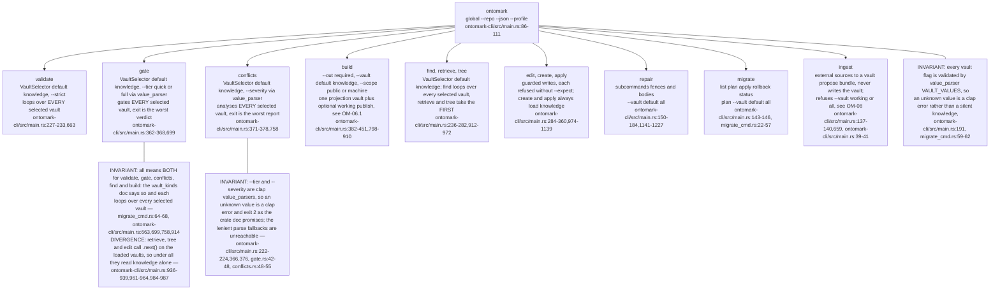
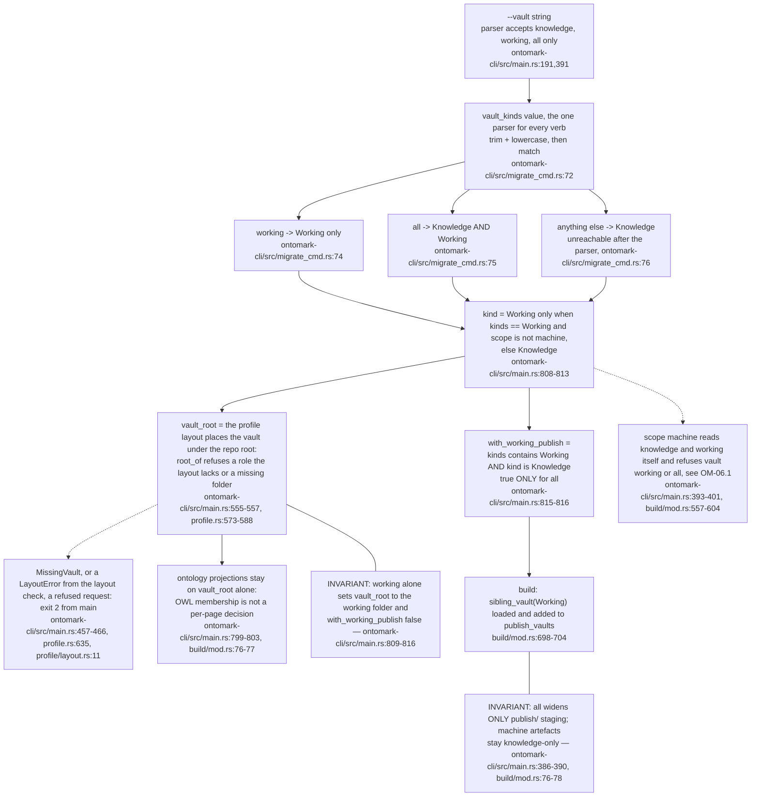
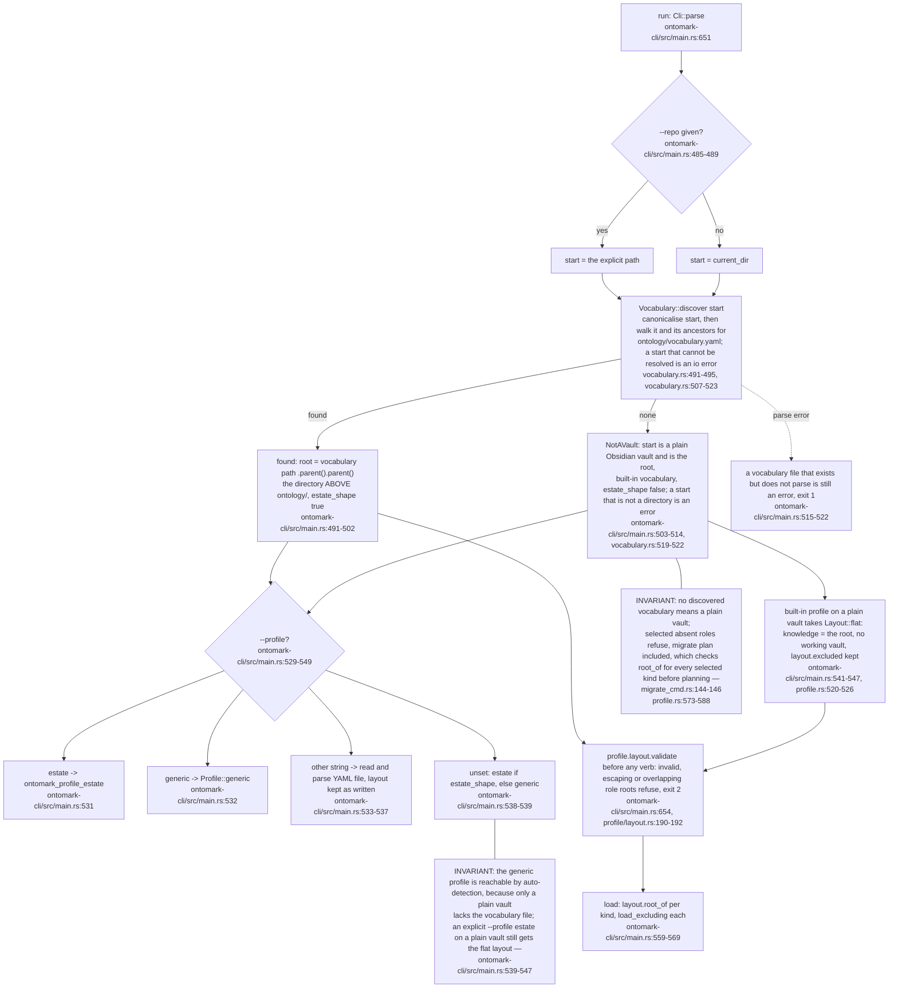
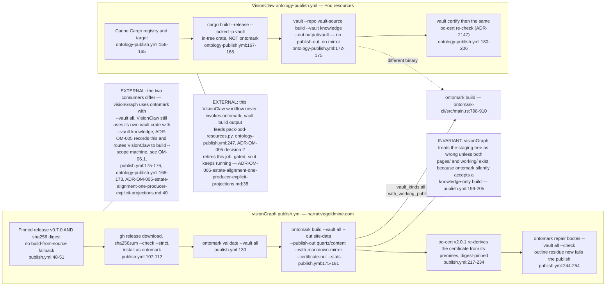
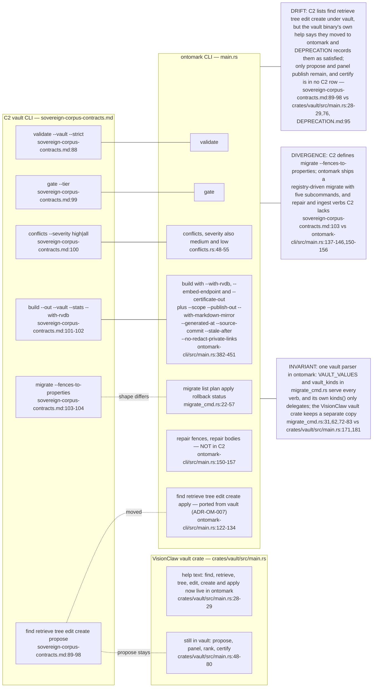

Restamped at ontomark 4b9d15d on 2026-11-02. The `ingest` verb is now in the command tree (`ontomark-cli/src/main.rs:137-140`) and is shown in OM-05.1; its pipeline is mapped in [OM-08](08-external-source-ingest.md).

## OM-05.1 Command tree — ten verbs, ingest, repair and migrate, three global flags, and which vault each one reads

- `repair` defaults to `all` while `validate`, `gate`, `conflicts`, `build` and the query verbs default to `knowledge`, so the same word means a different scope per verb (`ontomark-cli/src/main.rs:161,178,191,391`).
- DIVERGENCE: `--stats` is documented as "print the counts" but only forces the JSON report, a build-only alias for `--json` (`ontomark-cli/src/main.rs:403,888`).
- INVARIANT: `--profile` reaches every verb through the loaded vaults' layout (`ontomark-cli/src/main.rs:559-569,572-586`), but the conflict analysis itself takes no profile (`ontomark-cli/src/main.rs:762`).

## OM-05.2 `--vault knowledge|working|all` — resolution into vault_root and with_working_publish

- Every verb, `migrate` included, reads `--vault` through the one `vault_kinds` (`migrate_cmd.rs:72-83`): `validate`, `gate`, `conflicts` and `find` loop over every kind via `load` (`ontomark-cli/src/main.rs:559-569,663,699,758,914`), `repair` maps them to layout-placed roots for `scopes_for` (`main.rs:561-575,1129,1170`, `repair.rs:445`).
- DOC-DRIFT: comments say the projections are `knowledge/`'s by definition (`ontomark-cli/src/main.rs:799-800`, `build/mod.rs:76-77`), yet `--vault working` roots the build at the working vault (`ontomark-cli/src/main.rs:809-813`).

## OM-05.3 Exit codes — which error type maps to 0, 1 or 2

```mermaid
flowchart LR
    MAIN["main: run Ok(code) returns code;<br/>Err prints ontomark: and exits 1, except MissingVault and LayoutError which exit 2<br/>ontomark-cli/src/main.rs:453-467"]
    ZERO["0 — success<br/>ontomark-cli/src/main.rs:909,931,1077,1138"]
    ONE["1 — failed check or execution error"]
    TWO["2 — refused operation or invalid argument<br/>ontomark-cli/src/main.rs:31-42"]
    V1["validate: any error, or warning with --strict<br/>ontomark-cli/src/main.rs:666-667,688"]
    G1["gate: worst verdict.exit_code 0 or 1 over the selected vaults<br/>gate.rs:110-112, ontomark-cli/src/main.rs:714-718,751"]
    C1["conflicts: worst report.exit_code 0 or 1 over the selected vaults<br/>conflicts.rs:119-121, ontomark-cli/src/main.rs:765-769,795"]
    B1["build: written == 0 is an anyhow<br/>error<br/>ontomark-cli/src/main.rs:904-908"]
    R1["repair bodies --check with residue<br/>ExitCode::FAILURE,<br/>ontomark-cli/src/main.rs:1176-1178"]
    ANY["any other Err from<br/>build::run_with, load,<br/>resolve_repo<br/>ontomark-cli/src/main.rs:884,<br/>641-642"]
    S2["SecretsFound — credential on a<br/>published page<br/>build/publish.rs:66,<br/>ontomark-cli/src/main.rs:850-853"]
    O2["OutputCollision — two artefacts<br/>claim one path build/mod.rs:206,<br/>ontomark-cli/src/main.rs:856-859"]
    R2["ReasoningError — definition<br/>reasoner would not finish<br/>reason.rs:481,<br/>ontomark-cli/src/main.rs:862-865"]
    SC2["ScopeConflict or Unsatisfiable —<br/>machine scope misuse, or an<br/>unsatisfiable class<br/>build/mod.rs:282,235<br/>ontomark-cli/src/main.rs:868-877"]
    CP2["CertificateParity — the derivation<br/>certificate does not cover the<br/>classifier's closure (ADR-OM-009)<br/>build/mod.rs:101,<br/>ontomark-cli/src/main.rs:880-883"]
    MV2["MissingVault or LayoutError — a vault role<br/>the layout does not place, or role roots that<br/>escape the repository or overlap<br/>profile.rs:635, profile/layout.rs:11,<br/>ontomark-cli/src/main.rs:457-466"]
    GW2["create or apply refused by its<br/>guards, nothing written<br/>ontomark-cli/src/main.rs:1023-1034,1083-1094"]
    CL["clap parse failure: bad flag, or a<br/>vault, tier, severity or scope<br/>value outside its list clap<br/>default exit 2,<br/>ontomark-cli/src/main.rs:191,366,376,222"]
    M2["migrate plan not Ready -> 2<br/>migrate_cmd.rs:155-160"]
    M1["migrate apply incomplete, rollback<br/>with conflicts -> 1<br/>migrate_cmd.rs:189,216"]
    MAIN --> ZERO
    MAIN --> ONE
    MAIN --> TWO
    V1 --> ONE
    G1 --> ONE
    C1 --> ONE
    B1 --> ONE
    R1 --> ONE
    ANY --> ONE
    M1 --> ONE
    S2 --> TWO
    O2 --> TWO
    R2 --> TWO
    SC2 --> TWO
    CP2 --> TWO
    MV2 --> TWO
    GW2 --> TWO
    CL --> TWO
    M2 --> TWO
    n1["INVARIANT: build maps six typed errors to 2 by downcast_ref<br/>on the anyhow error, and create, apply, migrate plan and<br/>MissingVault and LayoutError refuse with 2 too,<br/>ontomark-cli/src/main.rs:850-883,1023-1034,1083-1094,457-466"]
    n2["DIVERGENCE: validate, gate and conflicts never return 2 from their<br/>own code (only clap and MissingVault do), so a refusal is<br/>distinguishable only on the writing verbs —<br/>ontomark-cli/src/main.rs:688,751,795"]
    TWO --- n1
    ONE --- n2
```

- `SecretsFound` is checked before validation on purpose so a credential is a code-2 refusal and never swallowed by the generic code-1 validation message (`build/mod.rs:673-683`).
- The `0/1/2` contract is declared in the crate doc, with `1` also covering execution errors, and the doc lists the unsatisfiable class, the machine-scope refusals, a `--vault working|all` on a layout without that vault, the `create`/`apply` guards and the `ingest` refusals under 2 (`ontomark-cli/src/main.rs:31-42`). **Drift:** the doc does not name the `LayoutError` refusals (escaping or overlapping role roots) that `main` also maps to 2 (`ontomark-cli/src/main.rs:460-463`).
- An unsatisfiable corpus exits 2 through the typed `build::Unsatisfiable`; before the OM-00 reconcile it was an untyped error at exit 1 (`build/mod.rs:858-864`, `ontomark-cli/src/main.rs:874-877`).

## OM-05.4 Repo-root discovery and profile resolution — before any verb runs

- The `--repo` argument starts an upward search (`ontomark-cli/src/main.rs:485-514`). **Changed by 4b9d15d:** the search starts from the canonical path, so implicit cwd and explicit `--repo .` agree (`vocabulary.rs:507-510`), and `migrate plan` refuses an absent selected role (`migrate_cmd.rs:144-146`); both faults were reproduced by the [layout audit](../../estate-review/2026-11-01-ontomark-layout-and-shared-checks.md), and [OM-12](12-shared-layout-checks.md) owns the shared check.

## OM-05.5 Two consumers — visionGraph publishes both vaults from a pinned release, VisionClaw builds knowledge in-tree

- Redaction is not a flag in either workflow: visionGraph gets it from the estate profile (`estate/profile.yaml:226`, `build/mod.rs:709-711`) and never passes `--no-redact-private-links`; the legacy `vault` build kept private links (`ontomark-cli/src/main.rs:443-450`).
- The consumer does not pass `--generated-at`, `--source-commit` or `--stale-after`, so `.generation.json` takes the clock and git (`build/mod.rs:63-67`, `publish.yml:175-181`).

## OM-05.6 C2 contract versus the shipped CLI — what C2 lists that ontomark and vault now split between them

- The verbs ontomark leaves out are the forum transport only: `propose` and `panel publish` stay in VisionClaw (`ontomark-cli/src/main.rs:52-53`, `DEPRECATION.md:95`).
- No `BuildArgs` option is parsed and left unused: all fourteen reach `build::Options`, the embedder or the report (`ontomark-cli/src/main.rs:382-451,814-837,888`).
- DIVERGENCE: `--no-redact-private-links` overlays the profile setting `publication.redact_private_links` as a `Some(false)` override rather than a separate behaviour (`ontomark-cli/src/main.rs:828`, `build/mod.rs:84`, `profile.rs:427`).

**Tension (ontomark 6c3f693 vs this topic's visionGraph stamp):** since 6c3f693, released in v0.7.3, `build` refuses a `--certificate-out` that is not a directory inside `--out`, because certificate files are now staged into the bundle and share its commit point (`../ontomark/crates/ontomark-compile/src/build/mod.rs:436-472`). The visionGraph workflow drawn in the consumer diagram is stamped at `556a015`, where it pins release v0.7.0 and passes `--certificate-out "$RUNNER_TEMP/certificate"`, outside `--out site-data` (`publish.yml:49`, `publish.yml:180`). That pairing runs only because the pinned release predates the guard. visionGraph is changing this workflow in a lane today, so the visionGraph key is left for phase 2.

**Open (ADR-OM-005 reconciliation, 2026-11-02):** the record now says its "sole producer" wording is about publication ownership, not a claim that every consumer is current, and that Agentbox's grouped-proposal adapter and VisionClaw's retained `vault propose` are distinct consumers: a signed multi-page proposal is not evidence that the single-page `apply` path can execute it (`../ontomark/docs/adr/ADR-OM-005-estate-alignment-one-producer-explicit-projections.md:25`). Its 2026-11-03 repair adds a resource-identity guard to single-page apply and leaves grouped signing, admission and digest checks to the consumers (`{ADR}:21`); see OM-00.
