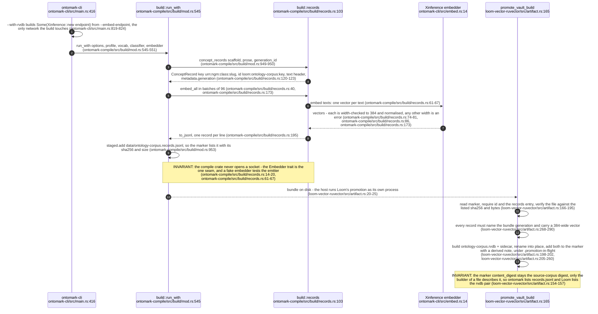
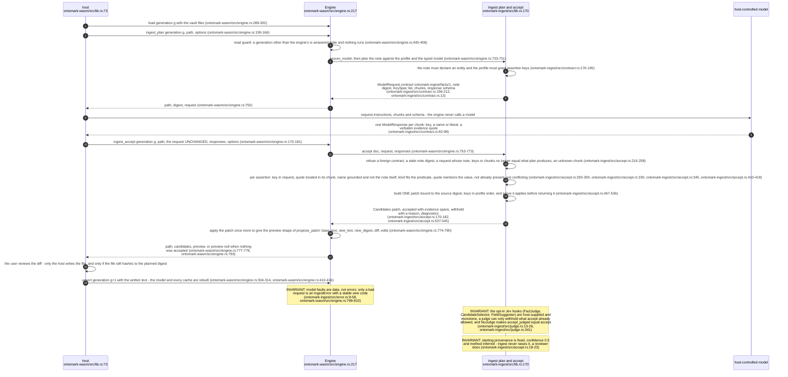
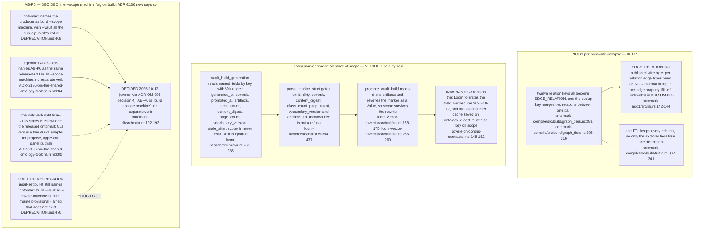

## OM-06.1 build --scope public|machine — the surface, the refusals and where run_with forks

```mermaid
flowchart TD
    ARG["CLI --scope public or machine, default public; ScopeArg is the clap twin of build::Scope<br/>ontomark-cli/src/main.rs:195-210, ontomark-cli/src/main.rs:390-391"]
    OPT["build::Options.scope reaches run_with; Scope is the enum Public (default) and Machine<br/>ontomark-compile/src/build/mod.rs:88, ontomark-compile/src/build/generation.rs:58"]
    GUARD["ensure_machine_scope names EVERY conflict, then ScopeConflict exits 2: --publish-out, --vault working or all, redaction off, a non-knowledge root, a layout with no working vault or no working folder<br/>ontomark-compile/src/build/mod.rs:476-518, ontomark-compile/src/build/mod.rs:282-297"]
    CENSUS["knowledge AND working run the census; working is loaded once and a public flag that is not a bool refuses the build<br/>ontomark-compile/src/build/mod.rs:596-603"]
    CRED["credential gate scans working's public pages with the knowledge ones; the staged Markdown is then discarded, publish/ is never written<br/>ontomark-compile/src/build/mod.rs:633, ontomark-compile/src/build/mod.rs:766-768"]
    VALW["working validated on its own under its own role; an error refuses the build<br/>ontomark-compile/src/build/mod.rs:645-656"]
    FORK["projection forks: project_machine returns knowledge + plain records, else the public projection<br/>ontomark-compile/src/build/mod.rs:658-676"]
    KNOW["corpus = the knowledge projection exactly as a public build makes it: Turtle, reasoner, scaffold, prose index, WebVOWL, NGG1, OKF read only this<br/>ontomark-compile/src/build/mod.rs:678-689"]
    LIST["listed = knowledge records followed by plain working records; only the page API and the search index read it, and page_count counts it<br/>ontomark-compile/src/build/mod.rs:756-761, ontomark-compile/src/build/mod.rs:791"]
    BACK["scaffold backlinks stay knowledge-only (D4), page-document backlinks may include working sources<br/>ontomark-compile/src/build/mod.rs:679, ontomark-compile/src/build/mod.rs:795-800"]
    MARK["gen.scope = options.scope; the field is omitted from a public marker so public marker bytes do not change<br/>ontomark-compile/src/build/mod.rs:1002, ontomark-compile/src/build/generation.rs:118-121"]
    REP["Report.machine carries working_records and yielded; published is empty in machine scope<br/>ontomark-compile/src/build/mod.rs:190-196, ontomark-compile/src/build/mod.rs:1036-1040, ontomark-compile/src/build/mod.rs:1062"]
    ARG --> OPT --> GUARD --> CENSUS --> CRED --> VALW --> FORK
    FORK --> KNOW --> LIST --> BACK --> MARK --> REP
    SAME["INVARIANT: data/ (bar the markers) and okf/ are byte-identical across scopes, in both directions, and ontology_digest and content_digest are equal, because every ontology artefact reads KNOW and the scaffold backlinks stay knowledge-only<br/>test machine_and_public_builds_share_every_ontology_artefact ontomark-compile/tests/machine_scope.rs:143"]
    KNOW -.- SAME
    BACK -.- SAME
    DIFF["INVARIANT: what differs is the markers (scope), api/pages/working/, the search index, page_count, and the absence of publish/<br/>test machine_scope_writes_no_publish_tree_and_stamps_its_scope ontomark-compile/tests/machine_scope.rs:244"]
    MARK -.- DIFF
    CLI["CLI contract: machine stamps scope, public writes no scope field, refusals exit 2<br/>ontomark-cli/tests/machine_scope_cli.rs:52, ontomark-cli/tests/machine_scope_cli.rs:70, ontomark-cli/tests/machine_scope_cli.rs:85"]
    ARG -.- CLI
```

- DIVERGENCE: ADR-OM-005 decision 4 named the private mode `--vault all`, which is the public publish's value; the mode shipped as its own flag, so `--vault` keeps its meaning (`ontomark-cli/src/main.rs:192-193`, `DEPRECATION.md:468`).
- EXTERNAL: the design record is `docs/design/machine-bundle-brief.md:9-13`; the decisions D1-D4 are in the ADR amendment (`ADR-OM-005-estate-alignment-one-producer-explicit-projections.md:79-88`).

## OM-06.2 project_machine — the union split, the directional twin rule and the plain records

```mermaid
flowchart TD
    PM["project_machine knowledge, working, vocab, held identities, PrivateLinks<br/>ir/projection.rs:740-747"]
    KP["knowledge side first: project_vault_with_links, untouched by working, so every ontology artefact keeps its bytes<br/>ir/projection.rs:750-751"]
    UNION["union_extra = held identities of both vaults<br/>ir/projection.rs:754-755"]
    PUBK["public_knowledge = every identity a PUBLIC knowledge record holds, as authored<br/>ir/projection.rs:763-768"]
    STRIP["strip_shared_public_identity blanks, on a PRIVATE record, each identity a public knowledge page already holds; public records pass through<br/>ir/projection.rs:253-268, ir/projection.rs:769-774"]
    CHECK1["Split::checked over knowledge + hold_back(working): a public identity also private in either vault is PublicationBlocked::Collision<br/>ir/projection.rs:534-553, ir/projection.rs:776"]
    TWIN["DIRECTIONAL TWIN RULE: public working beside PRIVATE page, either vault: refused; public working beside PUBLIC knowledge: yields to knowledge, counted; private working beside PUBLIC knowledge: harmless, yields silently<br/>ir/projection.rs:725-731"]
    CLEAN["link-clean each vault (clean_vault), rebuild the corpora; working's held pages forced private by hold_back<br/>ir/projection.rs:613-649, ir/projection.rs:654-662, ir/projection.rs:778-780"]
    YIELD["yields = public working records whose identity a cleaned public knowledge record holds<br/>ir/projection.rs:785-806"]
    LINKS["each plain record's links are pointed at the target's published slug through PrivateLinks::resolve_public: knowledge slug after disambiguation, working slug, else slug-verbatim<br/>ir/projection.rs:813-835, ontomark-compile/src/build/redact.rs:239-248"]
    UREDACT["private markers over the UNION: a private working twin keeps its own title and label as markers, so public working prose naming it is masked<br/>ir/projection.rs:837-850, ir/projection.rs:558-583"]
    SLUGC["two public working pages may not claim one working slug: Collision before staging<br/>ir/projection.rs:855-867"]
    PLAIN["plain override: page_id working/id, slug = working_slug, page_iri = page namespace + slug, has_ontology false, iri cleared, entity_type Class<br/>ir/projection.rs:869-883"]
    OUT["MachineProjection knowledge, redactor, plain, yielded; merged = knowledge then plain<br/>ir/projection.rs:691-717, ir/projection.rs:887-892"]
    PM --> KP --> UNION --> PUBK --> STRIP --> CHECK1 --> CLEAN --> YIELD --> LINKS --> UREDACT --> SLUGC --> PLAIN --> OUT
    TWIN -.- CHECK1
    TWIN -.- YIELD
    WS["working_slug = working/ + each path segment slugified, subdirectories kept; a segment slugify empties (CJK, emoji, punctuation) keeps x- + the first 4 bytes of its SHA-256, so two folders never share a file<br/>ir/projection.rs:668-671, ir/projection.rs:678-686"]
    PLAIN -.- WS
    T1["tests: a_public_working_twin_of_a_private_knowledge_page_is_refused :386, a_public_working_twin_of_a_public_knowledge_page_yields :428, a_private_working_twin_of_a_public_knowledge_page_yields_silently :666, a_non_ascii_working_folder_keeps_its_own_slug_segment :711<br/>ontomark-compile/tests/machine_scope.rs:386, ontomark-compile/tests/machine_scope.rs:428, ontomark-compile/tests/machine_scope.rs:666, ontomark-compile/tests/machine_scope.rs:711"]
    TWIN -.- T1
    WS -.- T1
    NOTE["INVARIANT: no urn page IRI under working/ reaches a public bundle; machine page IRIs carry no spaces and equal the slug path<br/>ontomark-compile/tests/machine_scope.rs:293, ontomark-compile/tests/machine_scope.rs:696"]
    PLAIN -.- NOTE
```

- INVARIANT: edges from a working record to knowledge are resolved; edges from knowledge to working are not, because knowledge records are never re-resolved (D3), so working links are one-directional in v1.
- DIVERGENCE: the twin rule was amended after the first real-corpus build found a private working twin of a public knowledge page (`Web3`); the amended text is `docs/design/machine-bundle-brief.md:44-49`.

## OM-06.3 The records emitter and Loom's promote_vault_build

- INVARIANT: the embedder lock is `bge-small-en-v1.5` at 384 dimensions (`ontomark-compile/src/build/records.rs:34-36`); the HNSW rebuild after a bulk load is a separate non-concurrent step and is never folded into the build.
- EXTERNAL: C3 lists the file, its `--with-rvdb` condition and the `derived` note in the marker (`sovereign-corpus-contracts.md:115-122`).

## OM-06.4 Assisted ingest — the host-driven plan/accept sequence over the wasm engine

- INVARIANT: the engine is pure; `ingest_plan` and `ingest_accept` never write and never call a model, and a mutation carries a generation strictly greater than the engine's (`ontomark-wasm/src/engine.rs:1-15`, `ontomark-wasm/src/engine.rs:429-443`).
- EXTERNAL: the instructions are versioned prompt data, `facts-v1.md`, carried inside the request (`ontomark-ingest/src/contract.rs:16`).

## OM-06.5 Open items carried by the machine scope and the ingest contract

- DIVERGENCE: the phrase "AB-P6 verb split" appears in no document at these revisions; the entry records what the sources do say: the scope flag (`DEPRECATION.md:468`), ADR-2136's matching `build --scope machine` wording (`ADR-2136-pin-the-shared-ontology-toolchain.md:84`) and the CLI-versus-adapter verb division (`ADR-2136-pin-the-shared-ontology-toolchain.md:80`).
- INVARIANT: of the three rows, AB-P6 is decided (the scope flag) and the Loom tolerance is verified (C3 corrected at VisionFlow HEAD); only the NGG1 collapse stays open, pending a format bump.
