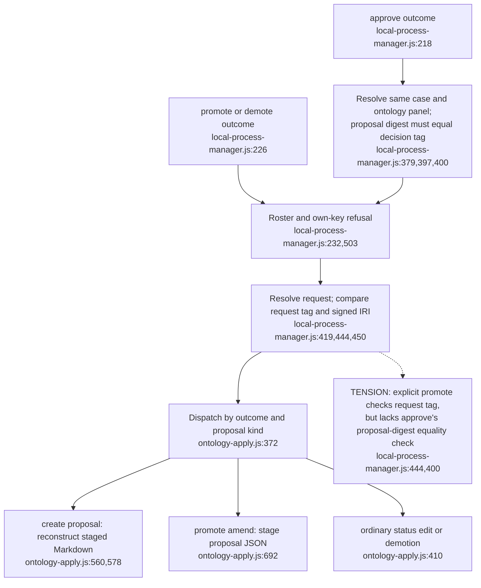
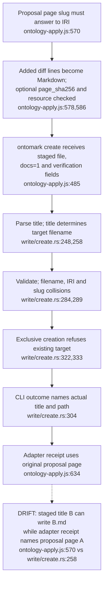
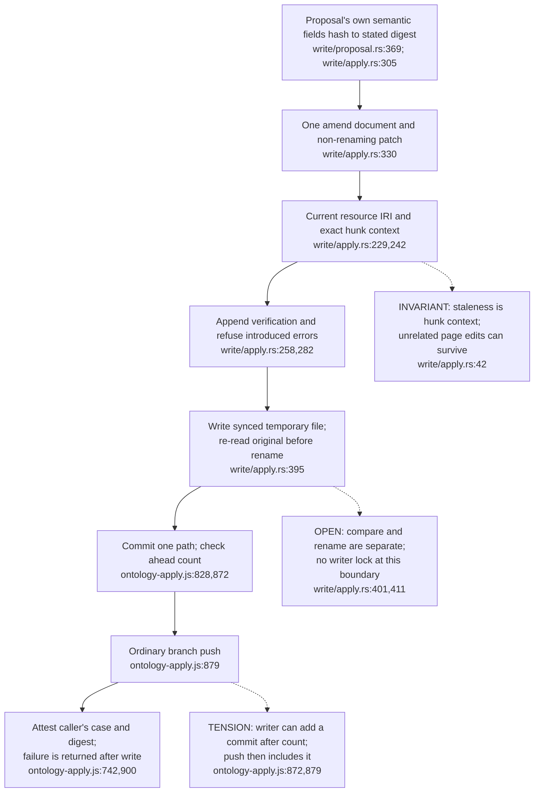

**Repair note — 2026-11-03:** selected counterexamples below have a [scoped successor verification](13-certificate-transaction-and-identity-repairs.md). This historical topic retains its declared source revision; the successor states the repaired contracts and acceptance boundaries.

## For developers

This topic follows the mutation consumer after a governance decision reaches Agentbox. It distinguishes a proposal's own digest from the decision's case tag, and a proposal's page from the filename selected by creation. The [31 October audit](../../estate-review/2026-10-31-proposal-application.md) includes real-CLI probes and explains which upstream checks were not exercised. Source pins identify the inspected implementation; they do not certify a deployed forum journey.

## For the business

A reviewer needs to know which approved change reached which page. The application can make a valid local change while its receipt names a different page or case. The diagrams show where that disagreement arises and why a successful write alone does not prove that the published and recorded outcomes agree.

## OM-07.1 Outcome selection and case identity

**What it shows.** Approve and explicit promote have different checks before reaching the same amendment writer. A valid proposal digest inside the CLI does not prove that it is the case digest used by the caller.

**Why it is this way.** ADR-2109 added approve-to-amend handling after explicit promotion. The source retains the equality check in that specialised branch. The probe reproduces the discrepancy below signature admission; it does not establish a relay bypass.

## OM-07.2 Creation chooses its filename from the staged title

**What it shows.** The title and the proposal page travel through different checks. The adapter's optional page hash does not replace a semantic proposal digest check, and the creation CLI receives no proposal object to verify.

**Why it is this way.** The CLI owns validated exclusive creation; the host owns the approved proposal. ADR-2109 describes both as one source of truth, but the isolated A/B fixture shows that the identity fields can disagree at their boundary.

## OM-07.3 Amendment guards and persistence receipts

**What it shows.** Proposal integrity, current-text compatibility, file persistence, Git publication and attestation are separate checks and outcomes. The audit reproduces hunk scope and the Git interleaving; the file re-read/rename interval remains a source-level concern.

**Why it is this way.** Ontomark owns local application and Agentbox owns publication and ledger calls. ADR-2109 keeps ledger failure from undoing a completed write. That boundary requires distinct receipts; it does not make the complete sequence atomic.

**Open:** Full signed-decision admission, replay policy and recovery are not certified by these local probes. See the [assessment and evidence](../../estate-review/2026-10-31-proposal-application.md).
