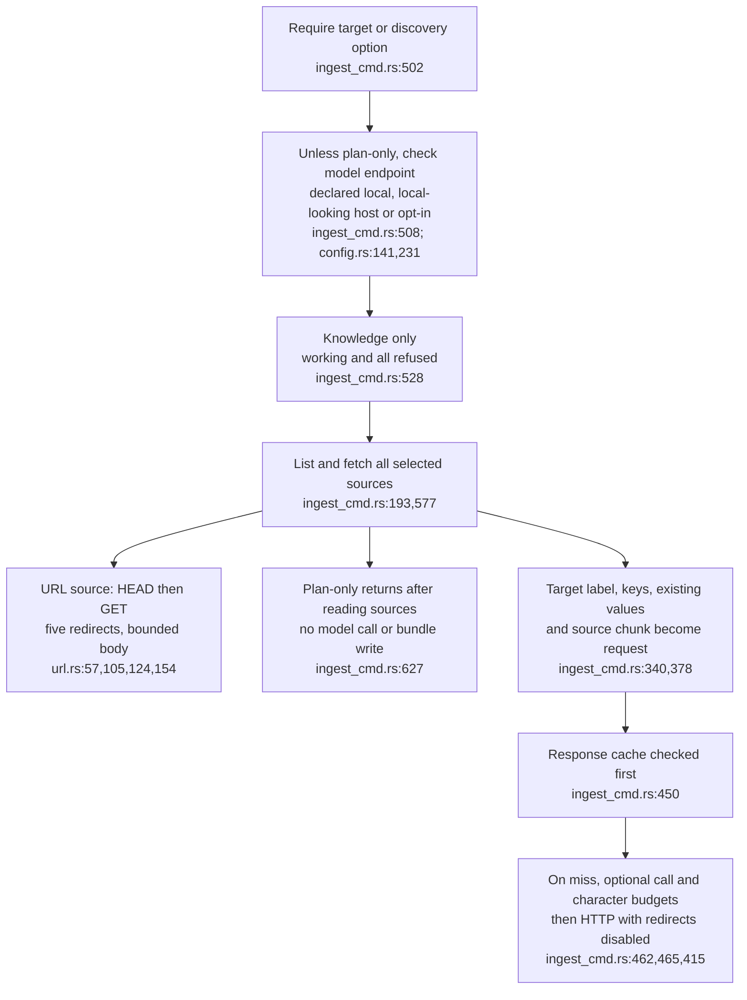
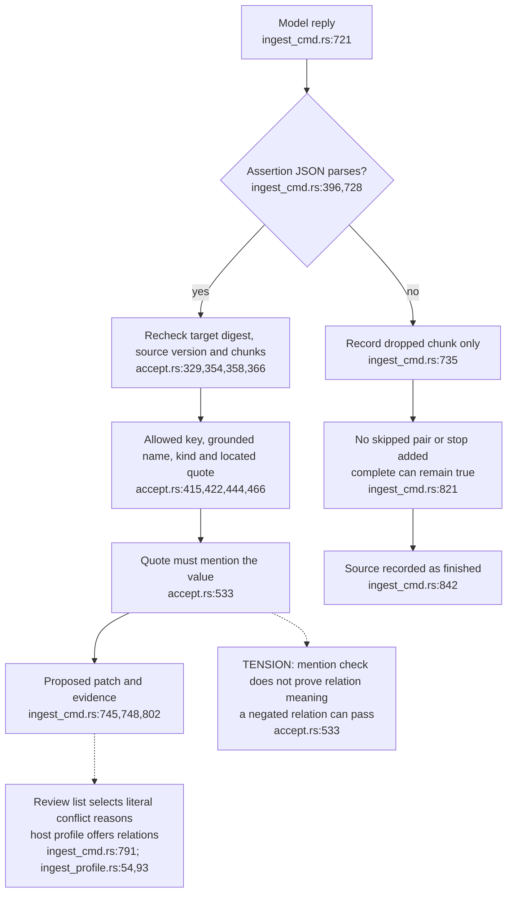
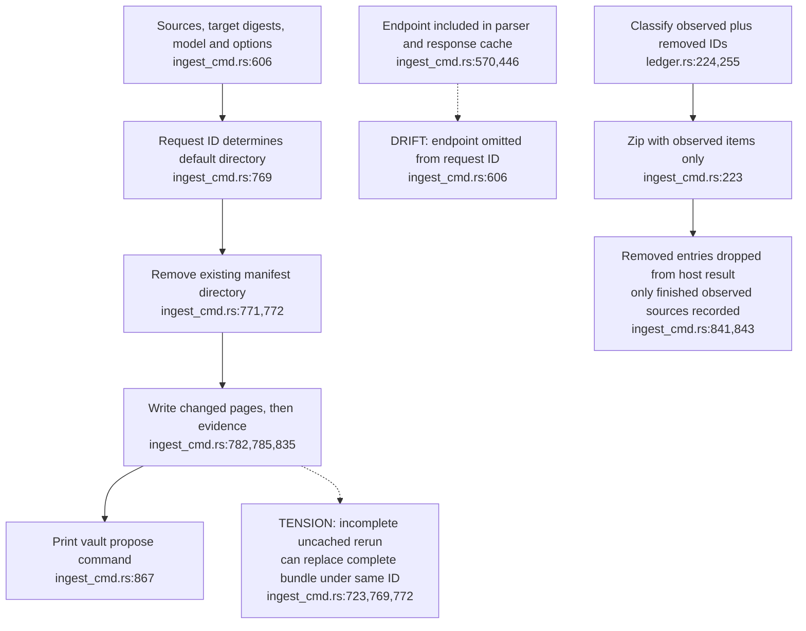

## For developers

The current `ingest` verb reads external evidence, asks an explicitly selected model and prepares full proposed pages for a separate governance submission. This topic supplements the historical OM-05 command inventory. The [audit and executable probes](../../estate-review/2026-10-31-external-source-ingest.md) distinguish input identity, extraction completeness, proposal bytes and publication. The ADR remains inactive: a passing local dry-run does not prove a signed forum-to-corpus journey.

## For the business

A researcher can turn a document or web page into suggested relationships on existing notes, with quotes available for review. The source text and some note context reach the selected model. A located quote may still contradict the suggestion, and a repeat run can replace an existing review bundle. Reviewers need the actual proposal and its evidence, rather than treating “complete” or a request identifier as a quality guarantee.

## OM-08.1 Acquisition precedes model budgets

**What it shows.** Source acquisition and model transport have separate policies. The endpoint check is bypassed for plan-only, but source fetching still occurs. Discovery's cap is per source; explicit targets are separate.

**Why it is this way.** ADR-OM-010 keeps source acquisition in the host and plan/accept in the pure library. Its budgets constrain model requests, not the total cost of acquiring and rendering sources.

## OM-08.2 Acceptance and completion measure different things

**What it shows.** Digest and span checks protect structural integrity. The reproduced negative sentence still grounds an accepted positive relation. A malformed response is exposed as a dropped chunk but does not make the host's summary incomplete.

**Why it is this way.** The pure engine grounds model-supplied values; the host defines run accounting. ADR-OM-010's conflict-review promise is narrower in the current relation-only implementation than a general contradiction check.

## OM-08.3 Request IDs do not identify immutable bundles

**What it shows.** Endpoint-specific cache and parser identity do not extend to the bundle ID. The audit reproduces endpoint and budget/cache changes replacing a previously complete manifest. Removal classification is implemented in the library but lost by the host.

**Why it is this way.** The request ID deliberately excludes budgets and output paths; the host reconstructs bundles in place. ADR-OM-010 does not yet define an immutable output identity, atomic bundle publication or the listing scope needed to interpret removed sources.

**Open:** Complete source snapshots, prior target bytes and model requests are not retained in the bundle (`ingest_cmd.rs:802-838`). Replay requires matching inputs from outside it. No live proposal activation or recovery journey is certified by these diagrams.
