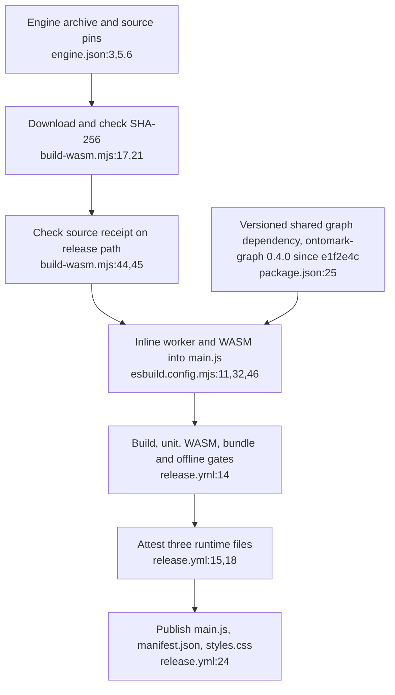
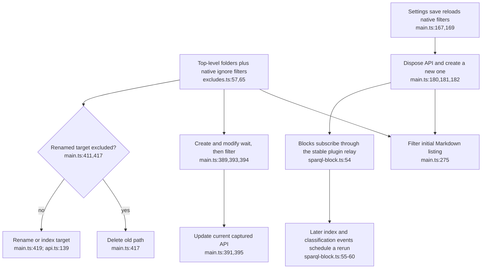
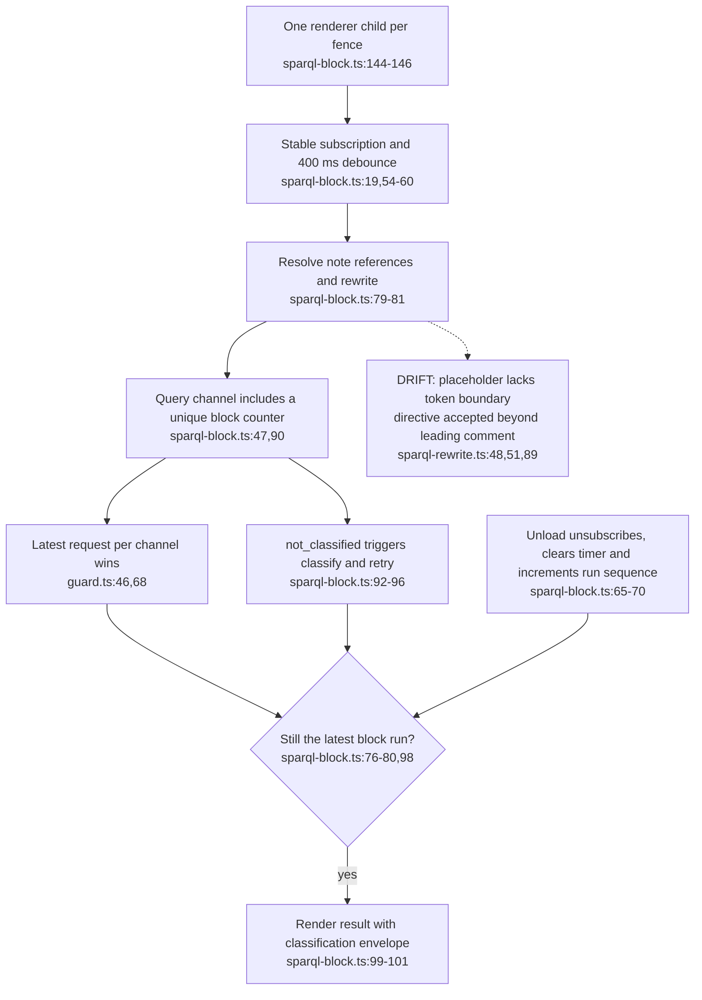
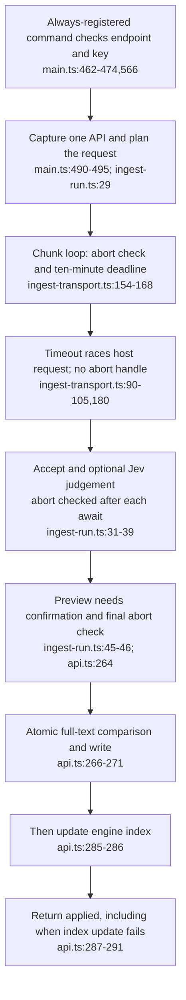

## For developers

The Obsidian plugin is a separate engine consumer with its own repository revision. These panels describe plugin 0.6.0 (e1f2e4c; it adds Graph layout settings over vowl-wasm 0.4.0, see OO-03.3 and OO-04.5) and engine v0.9.0, adopted at 64bdc5b from ontomark source f9ba200 (`engine.json:3,6`); its new `review_binding` export is not called by the plugin. The 14 November source refresh reconciles per-block query channels, stable subscriptions, ingest cancellation and persisted-write reporting. Historical probe receipts remain bound to their original revisions. The [refresh audit](../../estate-review/2026-11-01-obsidian-refresh.md) binds five whole-ADR assessments, current engine execution and bounded lifecycle probes. The ADR ledger's metadata migration is not a revalidation of implementation or activation.

## For the business

A user can query typed notes locally and review a proposed note edit before applying it. Saved queries now retain independent channels and stop rendering after unload. A successful note write is reported as applied even when the following engine update fails. Optional model features send requests outside the vault; a local graph does not make those actions offline. The build and shim tests establish bounded behaviour, not installed-desktop acceptance.

## OM-09.1 Verified inputs and three release files

**What it shows.** The release workflow publishes loose runtime files, not the removed ZIP. The linked 1 November audit verified the then-configured engine archive and source receipt. This source refresh checks the new pins, not a new release build. Workflow presence alone does not prove a published asset's attestation was verified.

**Why it is this way.** ADR-OBS-001 keeps reusable semantics and graph rendering upstream, while the plugin owns installation and host adapters. Licences and notices now live in the repository; this diagram makes no distribution-compliance determination.

## OM-09.2 Host filters and replacement of the API

**What it shows.** Filtering belongs to the host's listing and event adapters. A settings-triggered reindex replaces the API. Existing blocks now subscribe through the stable plugin relay, so a replacement API does not strand their listeners.

**Why it is this way.** ADR-OBS-005 separates vault policy from engine semantics. Malformed native configuration can remove the extra filters by design; these convenience rules are not an authorisation boundary inside every public API method.

## OM-09.3 Saved queries have a lifetime as well as a generation

**What it shows.** Each block has its own request channel, and each run checks its sequence before changing the display. Unloading invalidates an in-flight render. Concurrent entity lookups share one index read per generation (`api.ts:164-179`). These are source-level closures of the earlier lifecycle findings; the linked historical probes are not new installed-desktop acceptance.

**Why it is this way.** ADR-OBS-004 promises a reactive in-note result. That needs both per-block request identity and component lifetime checks. Inferred queries can still classify automatically, qualifying ADR-OBS-001's phrase “classification remains explicit”. The scanner mismatches remain separate from these lifecycle repairs.

## OM-09.4 Model waiting, review, persistence and indexing

**What it shows.** Proposal, confirmation, persistence and indexing remain separate events. The ingest lifecycle checks cancellation after planning, model calls, acceptance and optional Jev, and again after confirmation. A persisted write stays an applied outcome when the engine update fails. The ten-minute deadline covers the model chunk loop; it is not a timer around planning, Jev or the user's review. A timeout stops waiting but does not recall the host request.

**Why it is this way.** ADR-OBS-003 places credentials and network calls in the host and keeps the engine pure. Plain HTTP outside loopback now requires explicit configuration (`endpoint.ts:18-21,45-49`). The original one-destination wording still exceeds enforcement: the host transport does not expose redirect control (`endpoint.ts:27-31`).

**Invariant (verification policy):** with the Jev withholding threshold above zero, unverified facts are withheld; at zero, the result is retained with an explicit `not_verified` state (`jev-ingest.ts:127-144`). This source review does not claim a live model or installed-desktop test.
