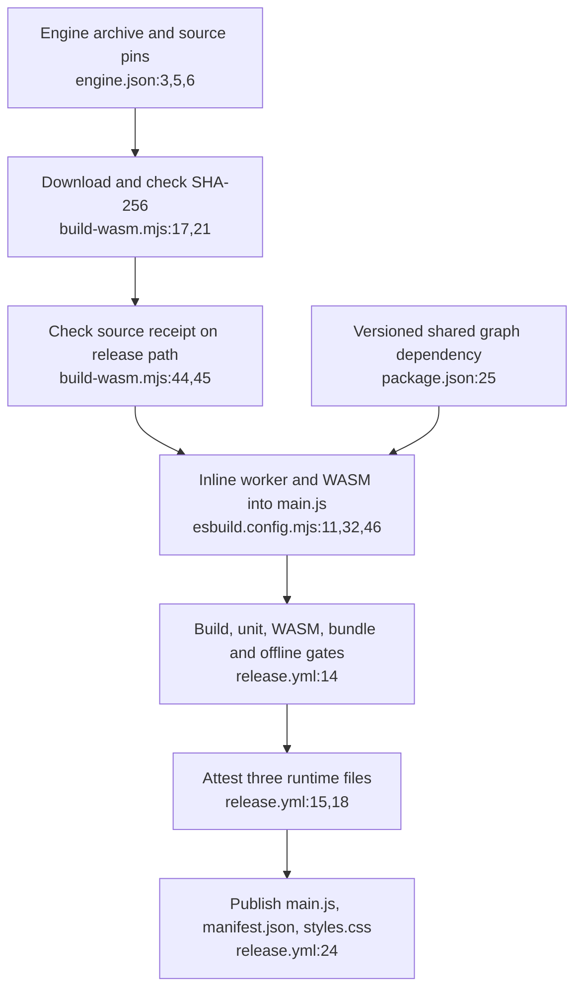
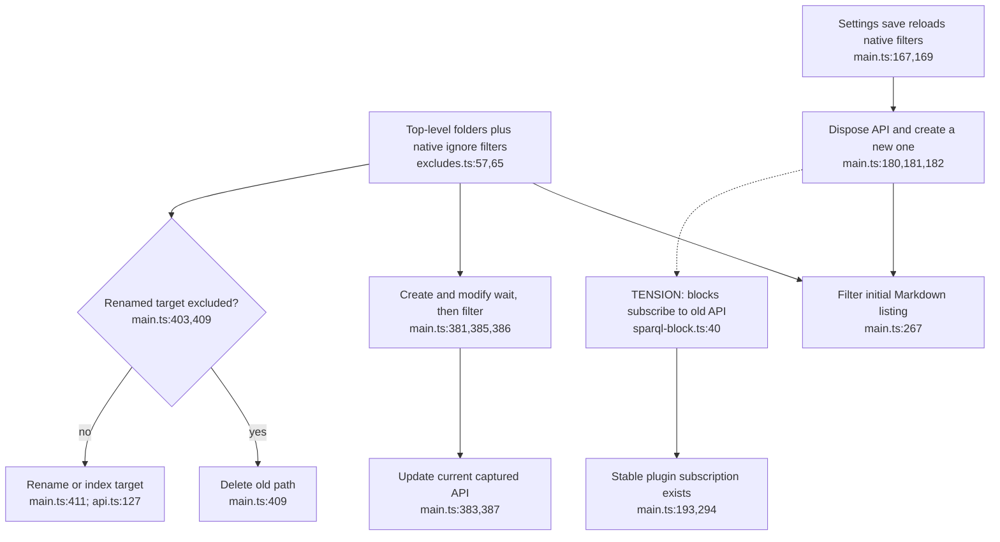
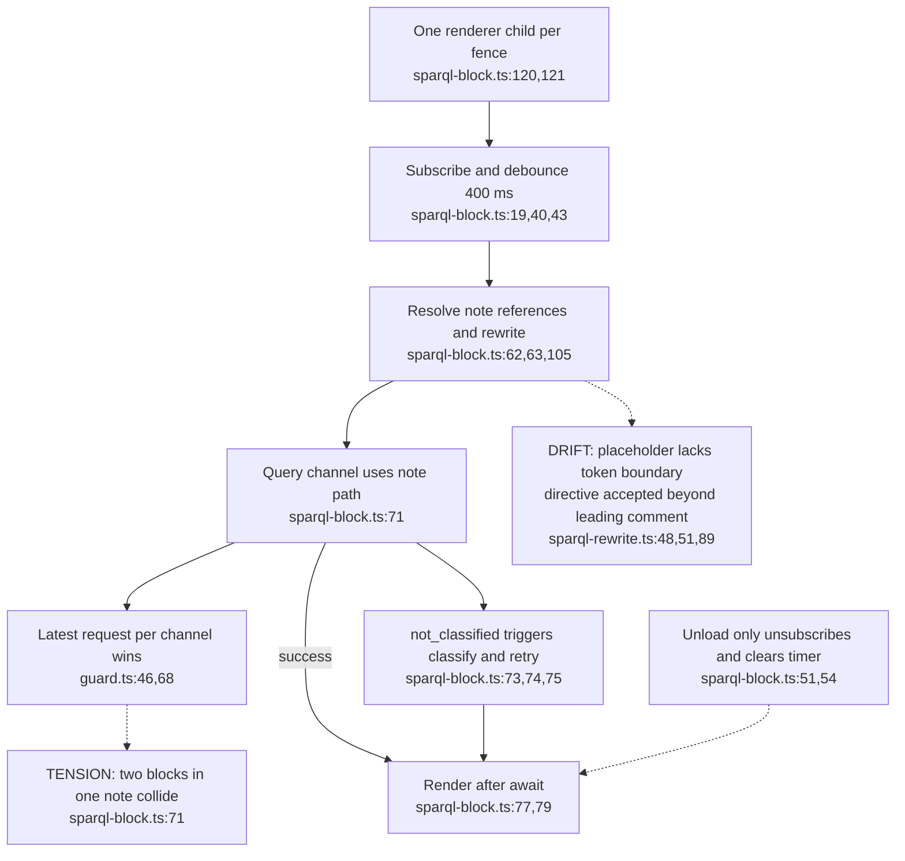
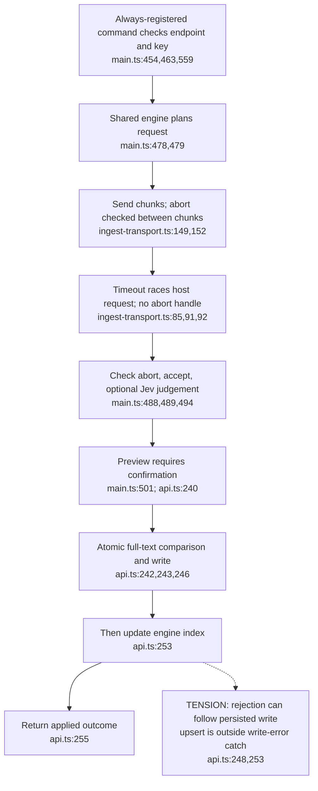

## For developers

The Obsidian plugin is a separate engine consumer with its own repository revision. These panels describe host behaviour at plugin 0.4.2, including reproduced failures. The [refresh audit](../../estate-review/2026-11-01-obsidian-refresh.md) binds five whole-ADR assessments, current engine execution and bounded lifecycle probes. The ADR ledger's metadata migration is not a revalidation of implementation or activation.

## For the business

A user can query typed notes locally and review a proposed note edit before applying it. Reliable saved queries and clear recovery after an index failure are still product gaps. Optional model features send requests outside the vault; a local graph does not make those actions offline. The build and shim tests establish bounded behaviour, not installed-desktop acceptance.

## OM-09.1 Verified inputs and three release files

**What it shows.** The release workflow publishes loose runtime files, not the removed ZIP. A fresh audit build verified the configured engine archive and source receipt. Workflow presence alone does not prove a published asset's attestation was verified.

**Why it is this way.** ADR-OBS-001 keeps reusable semantics and graph rendering upstream, while the plugin owns installation and host adapters. Licences and notices now live in the repository; this diagram makes no distribution-compliance determination.

## OM-09.2 Host filters and replacement of the API

**What it shows.** Filtering belongs to the host's listing and event adapters. A settings-triggered reindex replaces the API. Existing blocks subscribe directly to the old instance, unlike consumers using the stable plugin subscription.

**Why it is this way.** ADR-OBS-005 separates vault policy from engine semantics. Malformed native configuration can remove the extra filters by design; these convenience rules are not an authorisation boundary inside every public API method.

## OM-09.3 Saved queries have a lifetime as well as a generation

**What it shows.** The guard prevents obsolete reads on one channel. Reusing a channel across independent blocks defeats that independence, and unsubscribing does not invalidate an already running render. All three lifecycle cases and both scanner mismatches were reproduced with current host modules.

**Why it is this way.** ADR-OBS-004 promises a reactive in-note result. That needs both per-block request identity and component lifetime checks. Inferred queries can also classify automatically, qualifying ADR-OBS-001's phrase “classification remains explicit”.

## OM-09.4 Model waiting, review, persistence and indexing

**What it shows.** Proposal, confirmation, persistence and indexing are separate events. The timeout stops waiting; it does not recall a request. The current host has no second abort check after optional Jev judging and before confirmation. The write/index failure was reproduced; the Jev unload race remains a source-derived test target.

**Why it is this way.** ADR-OBS-003 places credentials and network calls in the host and keeps the engine pure. Its original absent-command and one-destination wording exceeds current enforcement: the command is always registered, optional Jev broadens the surface, and the host transport does not expose redirect control.
