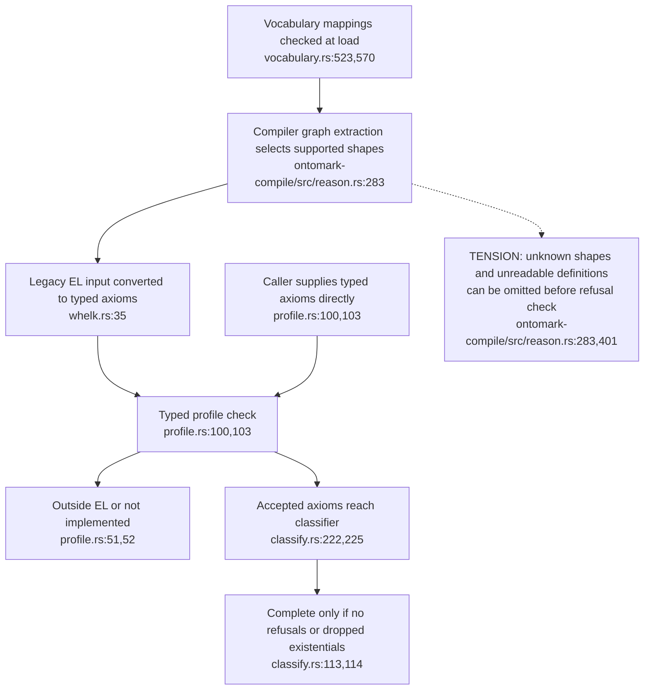
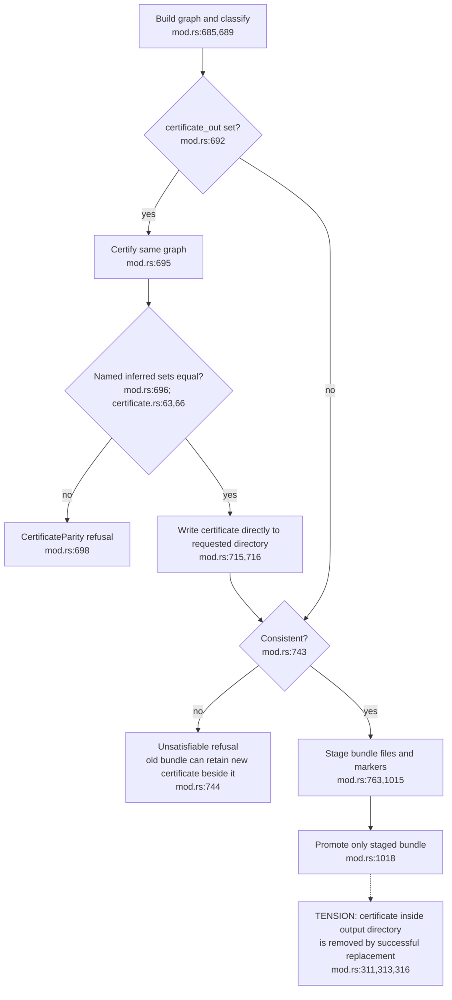
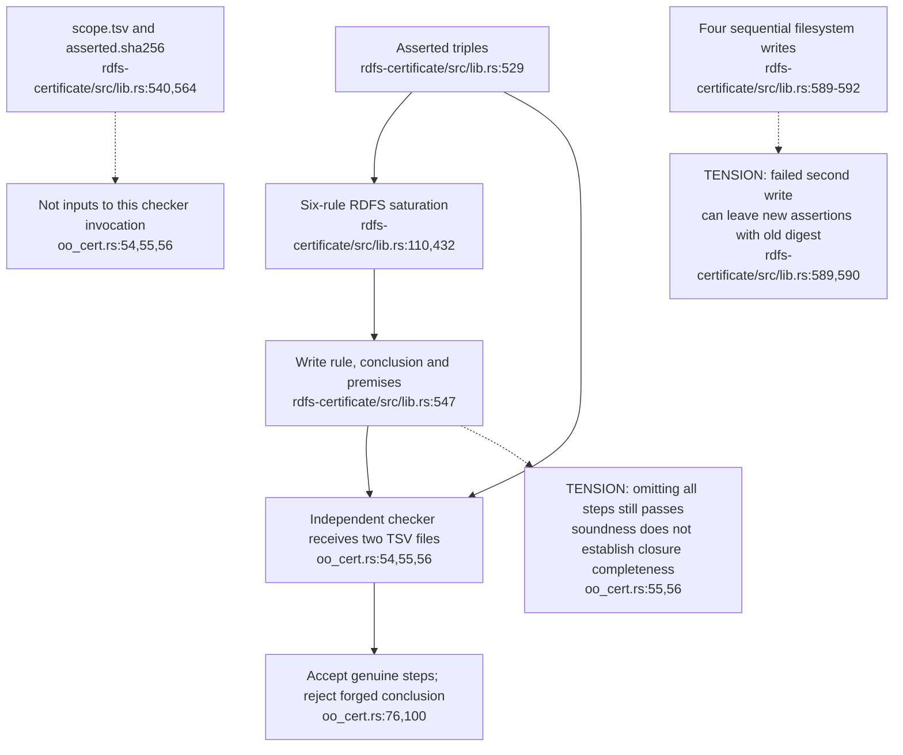
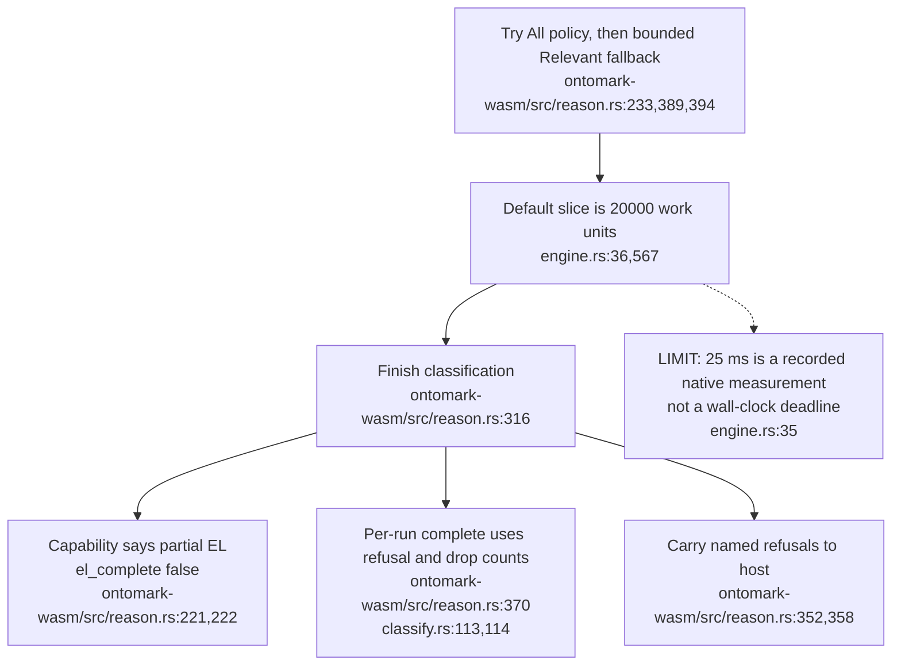

**Repair note — 2026-11-03:** selected counterexamples below have a [scoped successor verification](13-certificate-transaction-and-identity-repairs.md). This historical topic retains its declared source revision; the successor states the repaired contracts and acceptance boundaries.

## For developers

The shared typed facade distinguishes unsupported constructs. The compiler's graph extractor selects a narrower input first. The certificate then checks one named-subsumption set, and its files have a separate publication path from the bundle. The [source review and nine executable probes](../../estate-review/2026-11-01-ontomark-reasoning-and-certificates.md) establish these boundaries, including actual execution of the checksum-pinned independent checker.

## For the business

A certificate can let another person recheck a derivation without trusting the classifier. It does not prove that every conclusion is present or that the files belong to the bundle a user is reading. Current failure and path-overlap cases can separate that evidence from the published result. A useful acceptance test follows one inference from authored notes through publication to a reader checking the exact files.

## OM-10.1 A refusal table only sees the input it receives

**What it shows.** A raw universal restriction produced zero compiler refusals, while the equivalent typed axiom was refused. A malformed graph definition was also omitted. These are Graph API probes, not a demonstrated bypass of normal vocabulary loading.

**Why it is this way.** The compiler adapter was written for its own emitted fragment. ADR-OM-004's refusal promise needs that boundary stated. The vocabulary's `NON_EL_VOCABULARY` code also covers some EL constructs the backend does not implement; its wording is broader than the typed facade's distinction.

## OM-10.2 Optional parity precedes certificate writes, consistency and publication

**What it shows.** Parity is enforced when requested. A build without the flag has no certificate. Certificate writes occur before the consistency refusal and before bundle promotion. Successful output replacement discards an unstaged certificate placed below that output.

**Why it is this way.** ADR-OM-009 makes certification an option and writes to a caller-supplied directory. There is no shared transaction or output-path exclusion check for the certificate. The probes distinguish a valid parity refusal from these publication defects.

## OM-10.3 Checker soundness is separate from completeness and file identity

**What it shows.** The checksum-pinned checker accepted a genuine certificate and rejected a forged conclusion. It also accepted an empty derivation file after a one-step certificate was truncated. That is consistent with checking the soundness of supplied steps. Generation metadata and assertion hashes need their own consumer checks.

**Why it is this way.** The checker deliberately stands outside the engine. The host must retain and verify the expected conclusion set and artifact identity if it wants a claim about an entire published closure. The current certificate writer does not atomically replace its four files.

## OM-10.4 Work budgets and completeness are different guarantees

**What it shows.** The engine exposes both backend capability and per-run completeness. The scheduling budget counts saturation work; it is not a timer that interrupts an arbitrarily expensive unit of work after 25 ms.

**Why it is this way.** ADR-OM-004 chooses a tractable profile, but complexity theory and historical timings do not establish UI responsiveness on every ontology or device. The host needs measured latency and a clear incomplete-result state alongside the semantic checks.
