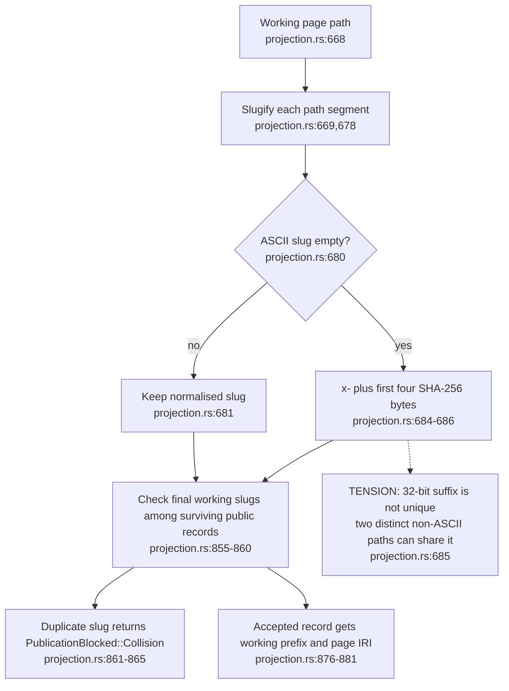
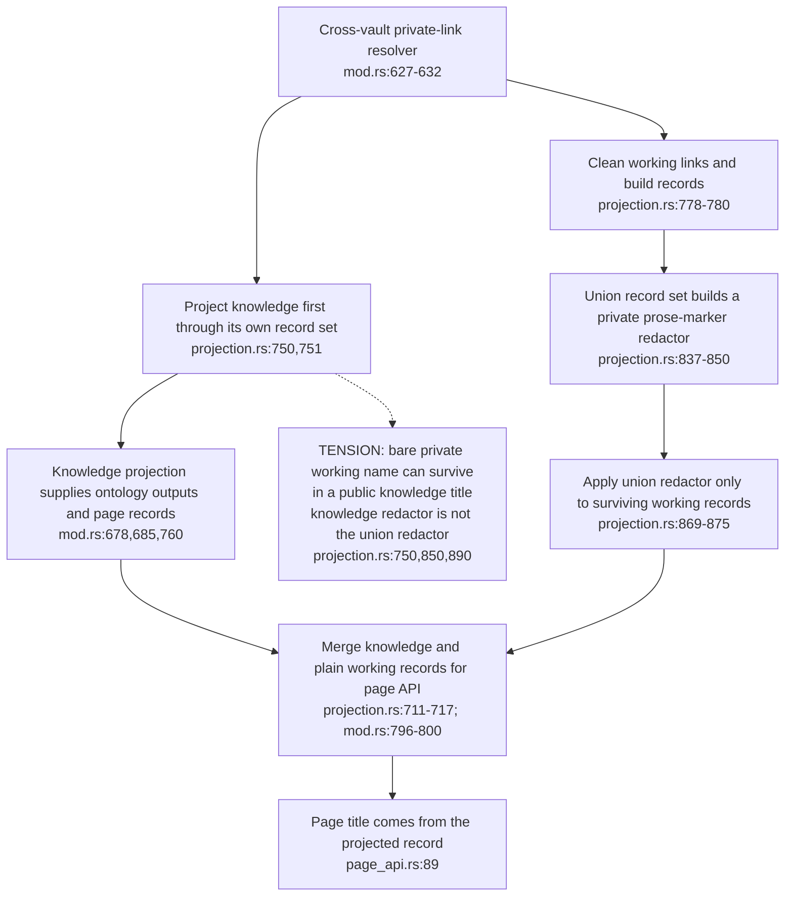
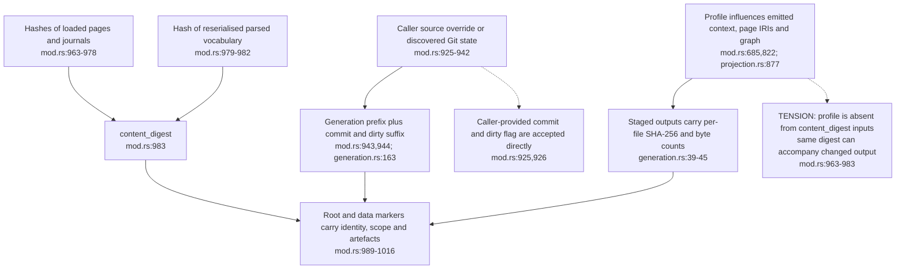

## For developers

Machine scope adds public working notes as plain records while preserving the knowledge projection. The [ADR and probe review](../../estate-review/2026-11-01-ontomark-machine-bundle-contract.md) checks its collision gate, redaction boundary and generation fields. Existing byte hashes identify outputs, but the source label and content digest do not describe every effective build input.

## For the business

A working note can be visible to the internal graph without becoming an ontology class. That separation needs an explicit disclosure policy and a receipt identifying the files the reader received. A successful build does not establish that every private name has disappeared from public prose.

## OM-11.1 A short folder hash can collide; the publication gate refuses it

**What it shows.** Two synthetic non-ASCII folder names mapped to `working/x-24f80a23/foo`. The real build refused the duplicate before creating output. The gate, rather than collision-free naming, protects against overwrite.

**Why it is this way.** ADR-OM-005 requires path-based working identities. Normalisation and finite hash suffixes need a separate collision check; the implementation has one.

## OM-11.2 Knowledge and working records use different private-name marker sets

**What it shows.** The same private working-note title was masked in a public working title and retained in a public knowledge title. Both public and machine builds retained the latter; the private body's canary stayed absent.

**Why it is this way.** D4 preserves the knowledge projection across scopes. Cross-vault link cleaning and plain-text marker masking are different operations; the union marker set is applied after the knowledge projection has already been produced.

## OM-11.3 Source labels, content digests and output hashes have distinct jobs

**What it shows.** A changed page namespace preserved generation ID and content digest while changing page IRIs and artefact hashes. A vocabulary comment changed input bytes without changing the digest, because the vocabulary is reserialised. An arbitrary caller-supplied commit label was retained.

**Why it is this way.** The build exposes reproducibility controls to its host. ADR-OM-005's generation loop needs the host to verify source assertions and retain the effective configuration and output receipt; these fields are not interchangeable evidence.
