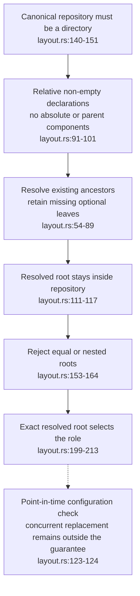
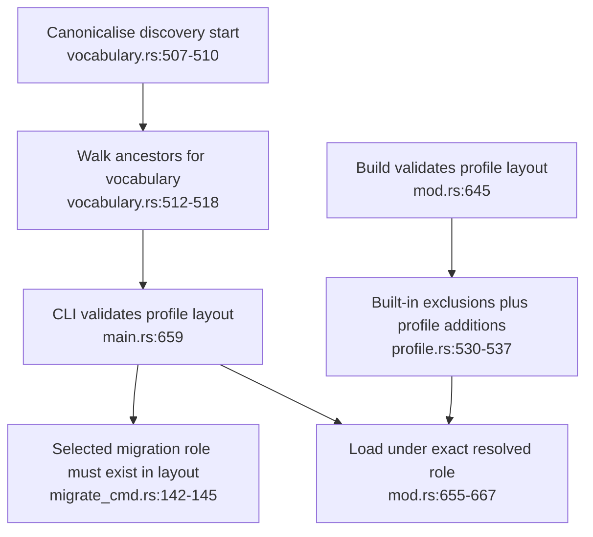
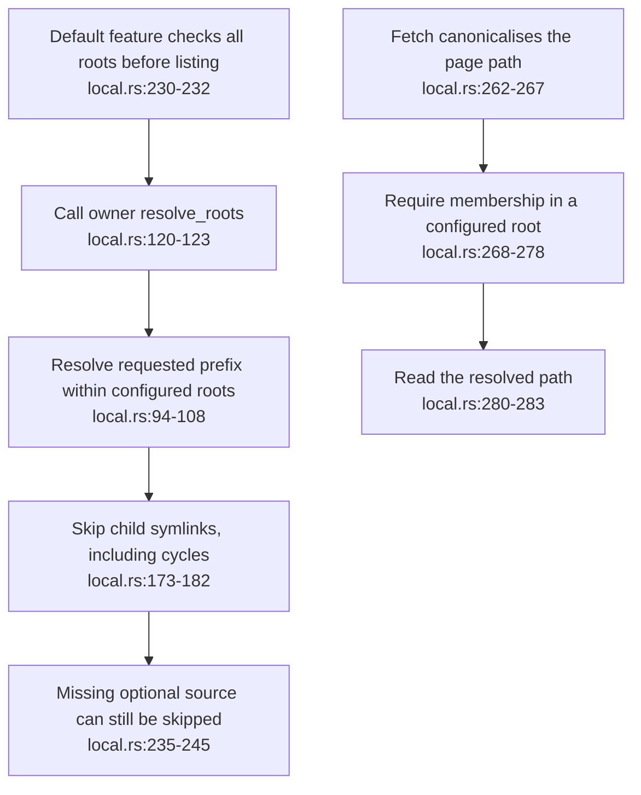
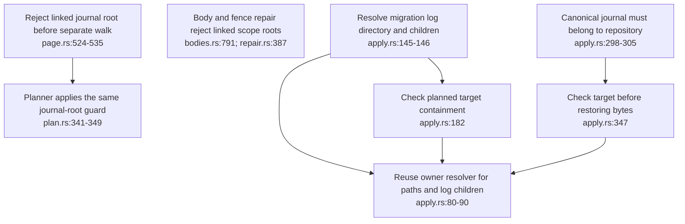

## For developers

Ontomark owns the path checks; VisionClaw consumes `ontomark-compile` through default crate features. The [section assessment and regression evidence](../../estate-review/2026-11-01-ontomark-layout-and-shared-checks.md) distinguish configuration rejection, publication policy and runtime activation. The consumer source pin precedes the dependency-only update from compiler 0.6.2 to 0.6.3; the final lock and release receipt are recorded in that review.

## For the business

A misplaced or linked source should produce an error before publication or partial ingestion. These checks make that feedback consistent across the compiler and its consumer. They do not establish publication privacy, replace producer parity checks or prove a deployed service is running the new code.

## OM-12.1 One owner resolves roots before assigning roles

**What it shows.** A single flat `.` is valid. Adding a nested working role, an alias or an escaping root fails. An absent optional leaf is checked through its existing ancestors.

**Why it is this way.** Suffix inference confused `nested/drafts` with `drafts`. The shared resolver compares complete paths and preserves the declared ordering.

## OM-12.2 Discovery, validation and build agree on the layout

**What it shows.** Relative and implicit discovery reach the same ancestor vocabulary. Build role assignment uses the same layout contract, and profile furniture exclusions are additive.

**Why it is this way.** A validator's refusal is useful only if the publication path applies the same role rules. Arbitrary required-key enforcement and custom public-gate policy remain separate open findings.

## OM-12.3 VisionClaw consumes checks at each local-source boundary

**What it shows.** The server's default `shared-corpus-layout` feature uses the registry compiler without its default reasoner feature. The vault CLI separately enables `shared-layout`. The actual local module and real vault binary have regression tests; the full server has a compile check.

**Why it is this way.** The owner maintains path semantics once. Feature-off builds retain legacy behaviour for compatibility comparison, including weaker link handling. This is not a server deployment receipt.

## OM-12.4 Journal walks and migration writes also check their roots

**What it shows.** Separate walk roots need explicit guards: child-link traversal settings did not protect a linked `journals/`. A matching content hash likewise did not prevent a parent directory from being redirected outside the repository between planning and application.

**Why it is this way.** The follow-up checks stable path redirection before reading or writing. It does not claim race-safe filesystem capabilities. Repair deliberately refuses linked scope roots even where a configured read-role root could resolve to a permitted in-repository target.
