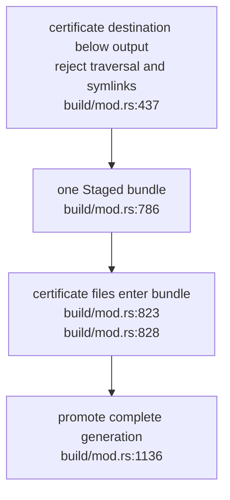
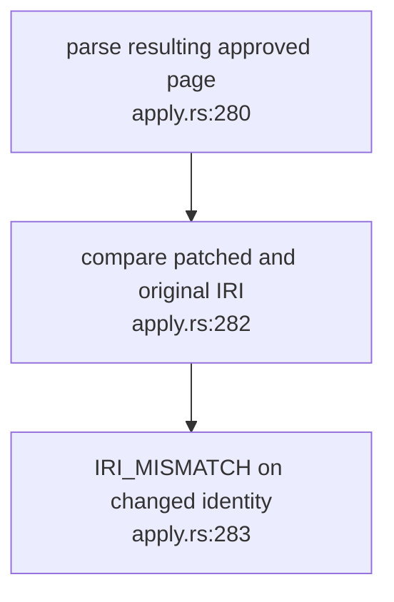
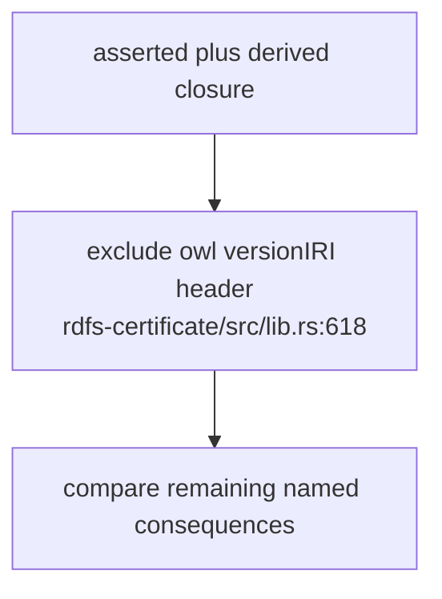

## For developers

This scoped successor covers OM-10.2's external-certificate write and OM-07's identity boundary. It also records the consequence-delta header exclusion. Grouped proposal admission is a separate governance-consumer contract.

## For the business

The published ontology and its warrant now change together. An approved amendment cannot rename an existing semantic resource, and a generation label alone no longer appears as a new knowledge consequence. Formal parity still covers its defined fragment rather than the factual truth of the corpus.

## OM-13.1 Certificate and ontology share a promotion point

**What it shows:** the certificate is not written to an unrelated directory before the bundle commits. **Why it is this way:** arbitrary external destinations cannot share the bundle's atomic commit point. ADR-OM-009 now intentionally narrows the flag to an output child such as `site-data/certificate`.

**Invariant:** external or symlink certificate destinations are refused before publication work (`build/mod.rs:437`).

## OM-13.2 An amendment preserves resource identity

**What it shows:** validation after patching includes an explicit old/new identity comparison. **Why it is this way:** the governed single-page amendment contract under ADR-OM-005 is not a resource-renaming mechanism. Ordinary content amendments retain their successful control.

**Invariant:** the resulting resource must equal the original resource IRI (`apply.rs:283`).

## OM-13.3 Generation labels do not become semantic delta

**What it shows:** changing a bundle version identifier alone adds no semantic consequence. **Why it is this way:** the delta shown to a signer must describe ontology changes, while the generation label separately identifies the produced bundle.

**Invariant:** versionIRI triples are excluded by predicate before closure comparison (`rdfs-certificate/src/lib.rs:618`).
