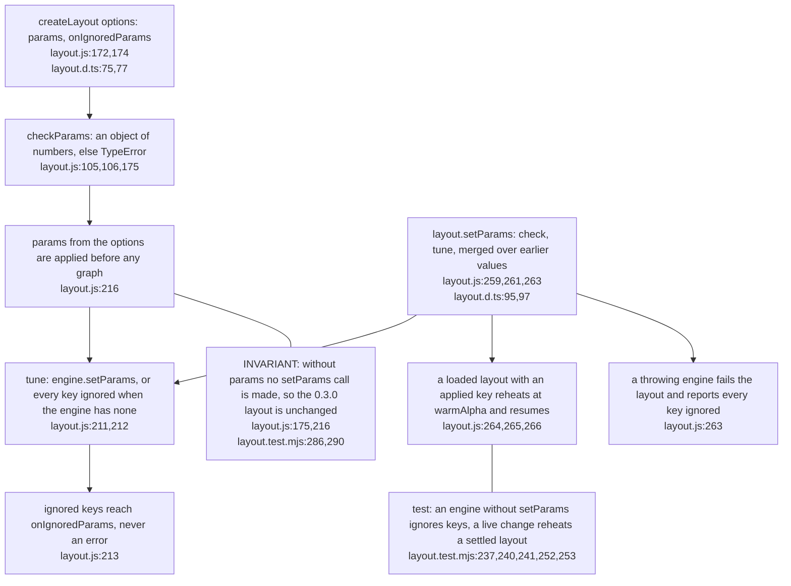
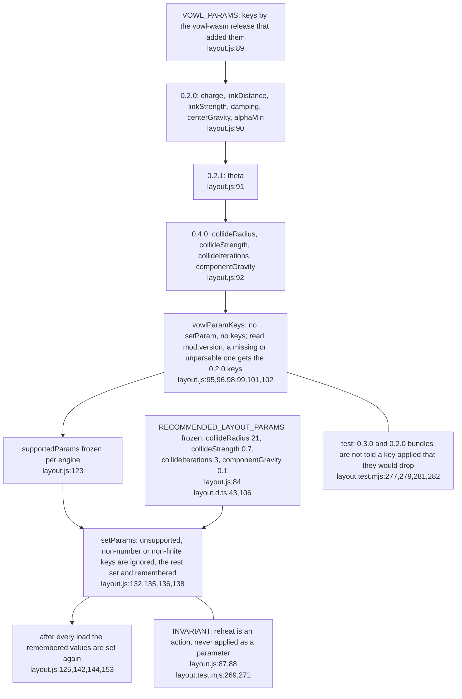
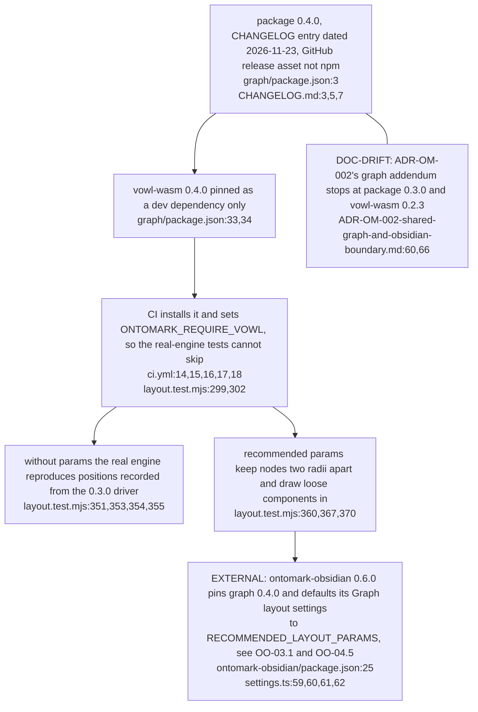

## For developers

`@dreamlab-ai/ontomark-graph` 0.4.0 (e639efe) lets a host pass engine parameters through the layout driver; every addition is opt-in, so a host that passes none gets the 0.3.0 layout.

## OM-14.1 Parameters through the driver: at creation and live

**What it shows.** Parameters are an engine concern the driver only relays; unknown keys are reported to the host, and a live change wakes a settled layout.

## OM-14.2 vowlEngine: which setParam keys a bundle has, read from its version

**What it shows.** `NggExplorer.setParam` silently drops unknown keys and has no getter, so the bundle's own `version()` is the only way the adapter can report truthfully what took effect.

## OM-14.3 Release, test evidence and the first consumer

**What it shows.** The "exactly 0.3.0 without params" claim is a recorded-position test against the real bundle, not an assertion in prose, and CI cannot skip it.
