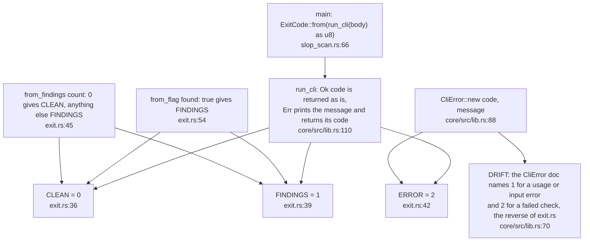
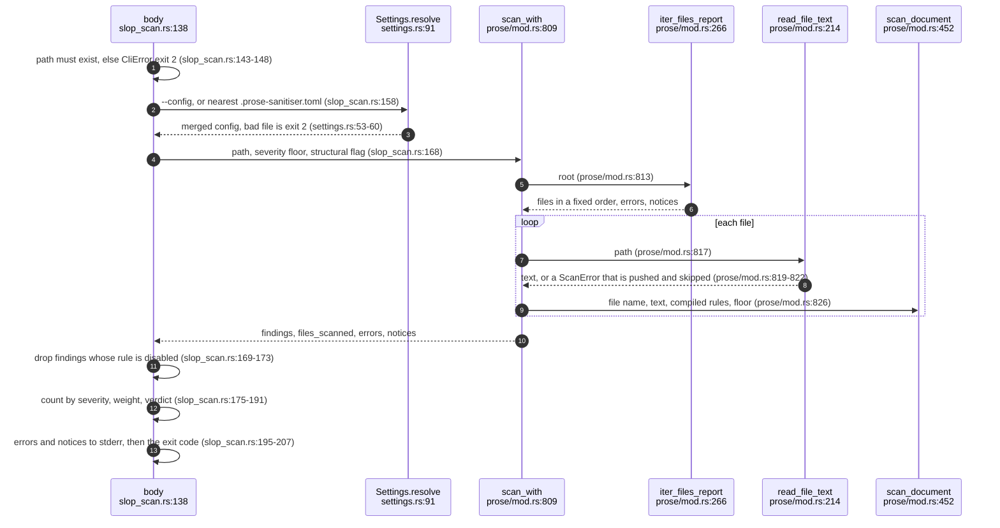
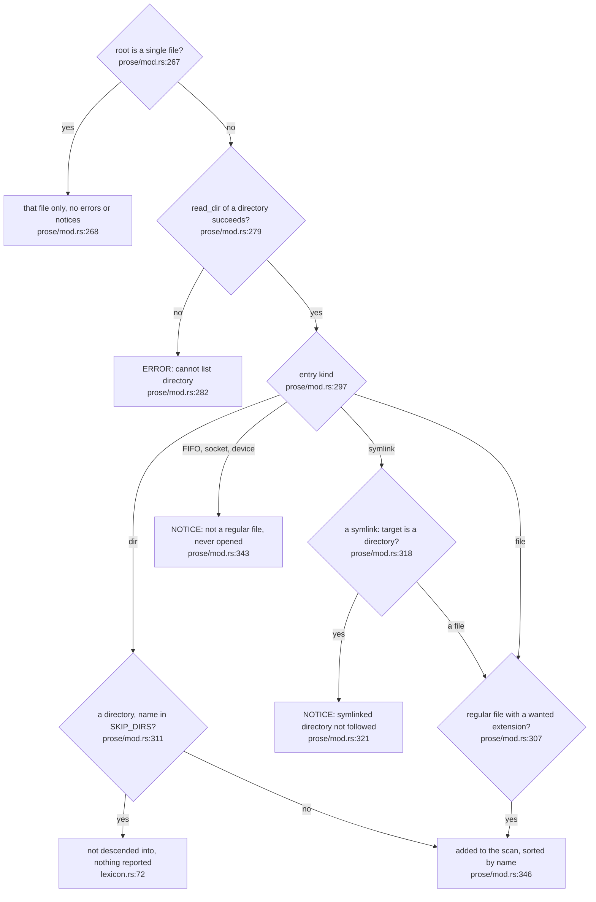
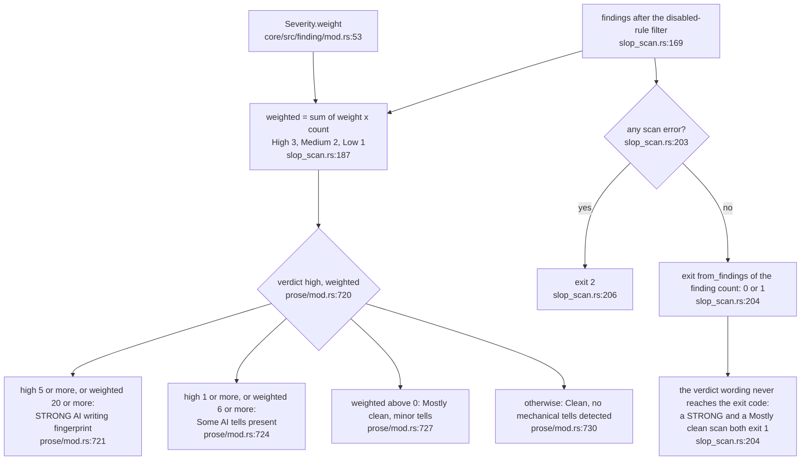
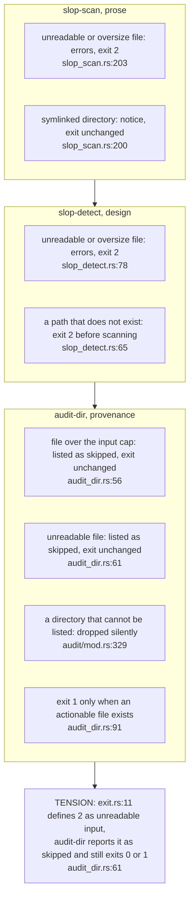

## For developers

Every binary in the workspace ends in the same three-line shim: `main` calls
`run_cli(body)` and casts the result to a byte
(`../prose-sanitiser/crates/cli/src/bin/slop_scan.rs:66`-`68`). `run_cli`
prints an error's message to stderr and returns its code
(`../prose-sanitiser/crates/core/src/lib.rs:110`-`118`). The codes themselves
live in one module: `CLEAN` is 0 (`../prose-sanitiser/crates/cli/src/exit.rs:36`),
`FINDINGS` is 1 (`:39`) and `ERROR` is 2 (`:42`). The user-facing statement of
the contract is `../prose-sanitiser/README-CLI.md:3`-`4`, and every binary prints
it under `--help` through `HELP_EPILOGUE`
(`../prose-sanitiser/crates/cli/src/exit.rs:73`-`74`).

The scan itself is `slop-scan`. It resolves a configuration, walks the path,
reads each prose file under a size cap, runs the rule table over each document
and filters the findings by the disabled-rule list. It then collapses the result
to an exit code. This topic follows that path, then compares it with the two
sibling scanners, `slop-detect` and `audit-dir`, which apply the same contract
in different ways.

Three rules carry the design:

- **A count is not an exit code.** `slop-scan` used to exit with the number of
  high-severity findings and `slop-detect` with the finding count capped at 250.
  Both now map to `FINDINGS` (`../prose-sanitiser/crates/cli/src/exit.rs:16`-`23`),
  because a count saturates at 255 and cannot be told from an error code. The
  count lives in `--format json` instead.
- **An unreadable input is never clean.** A file that cannot be read, or is over
  32 MiB, is collected as an error and the run exits 2
  (`../prose-sanitiser/crates/slop/src/prose/mod.rs:156`, then
  `../prose-sanitiser/crates/cli/src/bin/slop_scan.rs:203`-`207`).
- **A deliberate skip is not a failure.** A symlinked directory or a non-regular
  file is reported as a notice on stderr and leaves the exit code alone
  (`../prose-sanitiser/crates/cli/src/bin/slop_scan.rs:200`-`202`).

## For the business

The tool is meant to sit in a build pipeline, so what matters is what the
pipeline sees. Exit 0 means the scan finished and found nothing to report. Exit 1
means it finished and found something. Exit 2 means it could not do its job, for
example because a file was unreadable. A pipeline can therefore fail a build on
findings and page a person on a broken scan, without confusing the two.

A scan that quietly skipped a file it could not read would pass a document that
was never checked. That is the failure the contract is built to prevent for the
prose scanner, and the topic records where the sibling directory audit does not
yet follow it.

## PS-01.1 The three exit codes and who produces them

**What it shows.** Two helpers produce the success-path codes: `from_findings`
for a count and `from_flag` for a boolean. A `CliError` carries the failure
path, and every binary in this area builds it with `exit::ERROR`.

**Why it is this way.** The module header chooses the shellcheck and Vale
convention over the one `typos` uses, where findings are 2
(`../prose-sanitiser/crates/cli/src/exit.rs:13`-`14`). One shared constant set
stops twelve tools each inventing a code.

**Drift:** the `CliError.code` doc says the code is conventionally `1` for a
usage or input error and `2` for a failed check
(`../prose-sanitiser/crates/core/src/lib.rs:70`-`71`). The contract it feeds
reserves 1 for findings and 2 for errors
(`../prose-sanitiser/crates/cli/src/exit.rs:9`-`11`), so the field's own comment
describes the old Python layout, not this workspace.

**Invariant:** the three constants are distinct and ordered 0, 1, 2, and any
non-zero count collapses to 1 (`../prose-sanitiser/crates/cli/src/exit.rs:45`-`51`).

## PS-01.2 One slop-scan run

**What it shows.** The configuration is settled first and the scan second. The
disabled-rule filter is applied after the scan, on the findings, while the
severity floor is passed in because it also decides which rules are compiled
(`../prose-sanitiser/crates/cli/src/bin/slop_scan.rs:156`-`157`).

**Why it is this way.** Configuration follows the git and `.editorconfig`
convention: the nearest file up the tree wins, and a file that exists but does
not parse is an error, not a silent default
(`../prose-sanitiser/crates/cli/src/settings.rs:67`-`72`). Precedence is
defaults, then the file, then flags (`../prose-sanitiser/crates/cli/src/settings.rs:19`-`23`).

**Invariant:** a path that does not exist exits 2 before anything is read, so a
mistyped path in a pipeline cannot pass as clean
(`../prose-sanitiser/crates/cli/src/bin/slop_scan.rs:143`-`148`).

## PS-01.3 The file walk: reads, errors and notices

**What it shows.** The walk separates three outcomes. A directory it cannot read
is an error and so exits 2. A thing it chose not to follow is a notice and
changes nothing about the exit code. Everything else is scanned in a
deterministic order.

**Why it is this way.** Symlinked directories are never followed, so a loop or a
link out of the tree cannot widen the scan, yet each is reported so a partial
tree is visible (`../prose-sanitiser/crates/slop/src/prose/mod.rs:260`-`265`).
A non-regular file is never opened because opening a FIFO with no writer blocks
forever (`../prose-sanitiser/crates/slop/src/prose/mod.rs:188`-`194`). The
scanned extensions are `md`, `markdown`, `mdx`, `txt`, `rst`, `text` and `tex`
(`../prose-sanitiser/crates/slop/src/rules/lexicon.rs:69`).

**Invariant:** a file over 32 MiB is read one byte past the cap so that
exactly-at-cap and over-cap are told apart, and the over-cap case is an error,
not a silent skip (`../prose-sanitiser/crates/slop/src/prose/mod.rs:199`-`207`).
A test pins the exit-code consequences: an unreadable file gives 2 and a
symlinked directory leaves 0
(`../prose-sanitiser/crates/cli/tests/slop_scan_errors.rs:21`, then `:58`).

## PS-01.4 From findings to a verdict and an exit code

**What it shows.** The human verdict and the exit code are computed from the
same findings but separately. The verdict has four wordings chosen from the
high count and the weighted score. The exit code ignores severity: any reported
finding gives 1.

**Why it is this way.** The score separates one strong tell from a drift of weak
ones, so the verdict reads both numbers
(`../prose-sanitiser/crates/slop/src/prose/mod.rs:779`-`782`). The exit code is
deliberately coarser: the module header of `exit.rs` says a count in `$?`
reports zero for a file full of medium-severity hits
(`../prose-sanitiser/crates/cli/src/exit.rs:20`-`21`). A caller who wants a
severity gate passes `--severity`, which removes lower-severity rules before the
scan, so "findings at or above the gate" and "findings reported" are the same set
for this binary (`../prose-sanitiser/crates/cli/src/bin/slop_scan.rs:40`-`41`).

**Invariant:** the incomplete-scan text says so and exits 2 even when there are
no findings, so a run with unreadable files can never print the "Nothing
flagged" message with a zero code
(`../prose-sanitiser/crates/cli/src/bin/slop_scan.rs:291`-`304`).

## PS-01.5 How three scanners map an incomplete scan to an exit code

**What it shows.** `slop-scan` and `slop-detect` treat anything unreadable as
exit 2. `audit-dir` records an unreadable or over-cap file in a `files_skipped`
list and decides its exit code only from whether a file is actionable.

**Why it is this way.** `audit-dir` keeps going on one bad file so a large tree
still yields a report (`../prose-sanitiser/crates/cli/src/bin/audit_dir.rs:60`).
An actionable file is one with C2PA data or a `confirmed` or `probable`
confidence level (`../prose-sanitiser/crates/cli/src/audit/mod.rs:157`-`173`).
The cap is `WATERMARKS_MAX_INPUT_BYTES`, 256 MiB by default
(`../prose-sanitiser/crates/media/src/io.rs:20`-`22`), against 32 MiB for the
prose scanners.

**Tension (exit contract vs audit-dir):** the contract says exit 2 covers
unreadable input (`../prose-sanitiser/crates/cli/src/exit.rs:11`), and
`slop-scan` honours that (`../prose-sanitiser/crates/cli/src/bin/slop_scan.rs:195`-`207`).
`audit-dir` lists the same condition as skipped and exits 0 or 1
(`../prose-sanitiser/crates/cli/src/bin/audit_dir.rs:61`-`62`, then `:91`), so a
tree whose every file is unreadable exits 0.

**Drift:** the `slop-detect` module header still says the exit code is the number
of findings, capped at 250 (`../prose-sanitiser/crates/cli/src/bin/slop_detect.rs:13`-`14`).
The code maps findings through `exit::from_findings`, which returns 0 or 1
(`../prose-sanitiser/crates/cli/src/bin/slop_detect.rs:78`-`84`).

**Debt:** `walk_files` skips a directory it cannot list without recording it
(`../prose-sanitiser/crates/cli/src/audit/mod.rs:329`-`331`), whereas the prose
walk records the same failure as an error
(`../prose-sanitiser/crates/slop/src/prose/mod.rs:279`-`287`). `audit_dir.rs:38`
also passes the literal `2` rather than `exit::ERROR`.
