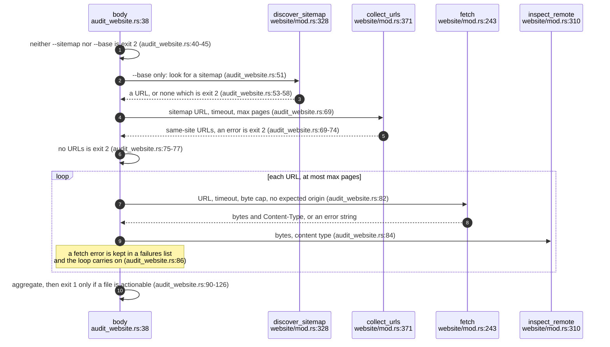
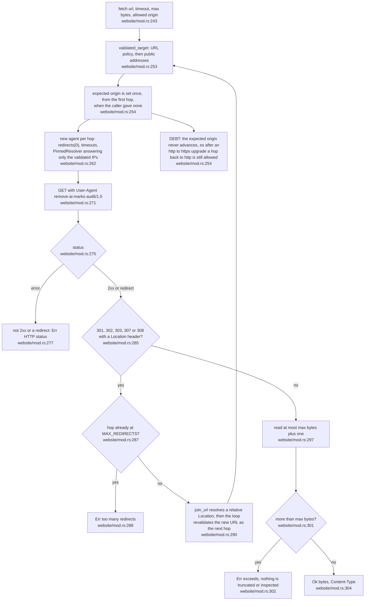
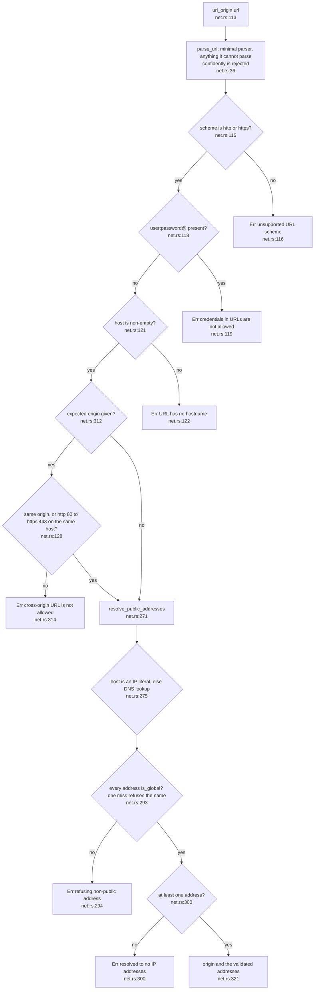
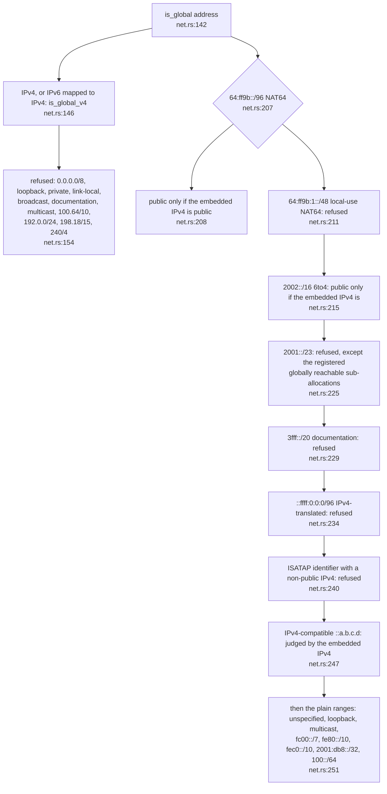
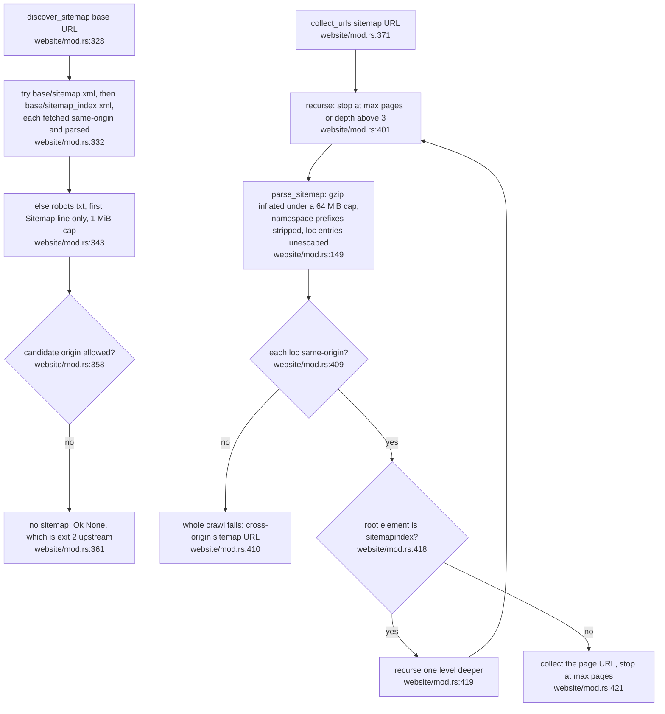
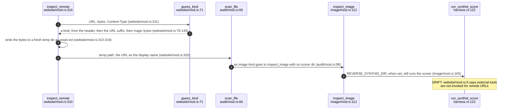

## For developers

`audit-website` crawls the URLs listed in a sitemap, downloads each one and runs
the same inspection the local directory audit uses
(`../prose-sanitiser/crates/cli/src/audit/website/mod.rs:1`-`6`). The input is a
URL that somebody else nominated, and so is every URL inside the sitemap it
points at. The module therefore validates every hop before a socket is opened:
only http and https, no credentials in the URL, the same origin as the start
(plus the ordinary http to https upgrade), and only globally routable addresses
(`../prose-sanitiser/crates/cli/src/audit/website/net.rs:1`-`7`).

The filter has two halves. `net.rs` decides whether a URL and the addresses its
host resolves to are acceptable. `mod.rs` then connects only to the addresses
that were validated, by handing the HTTP client a resolver that answers with
nothing else (`../prose-sanitiser/crates/cli/src/audit/website/mod.rs:54`-`68`).
That pinning is what stops a DNS answer that changes between the check and the
connect. The binary drives it: it finds or accepts a sitemap, collects the
same-site URLs, fetches each one under a byte cap and a timeout, and reports
(`../prose-sanitiser/crates/cli/src/bin/audit_website.rs:38`-`127`).

The defaults are a 4 MiB body cap, 15 second timeout, 200 pages and 5
redirects (`../prose-sanitiser/crates/cli/src/audit/website/mod.rs:21`-`33`).
A decompressed sitemap is capped at 64 MiB and that cap is not configurable
(`:26`-`30`).

## For the business

The tool downloads whatever a website's sitemap lists, so a hostile or mistaken
sitemap could try to make it fetch addresses inside the operator's own network,
such as an internal admin page or a cloud metadata service. The filter refuses
those. It will only talk to public internet addresses, only to the site it was
pointed at, and it never sends credentials embedded in a URL.

What an operator can rely on: a page that fails to download is listed in the
report, and the run carries on. What they cannot rely on today is the exit code
meaning "every page was checked", which the topic records below.

## PS-02.1 One audit-website run

**What it shows.** Every failure before the crawl starts is exit 2. Once the
loop starts, a download failure is recorded in `urls_failed` and does not reach
the exit code, which depends only on the actionable-file count.

**Why it is this way.** The summary block is shared with the directory audit, so
both binaries report and exit the same way on what they did inspect
(`../prose-sanitiser/crates/cli/src/audit/mod.rs:175`-`176`).

**Tension (exit contract vs crawl):** the contract defines exit 2 as unreadable
input (`../prose-sanitiser/crates/cli/src/exit.rs:11`, see PS-01), but a page
that fails to download is only appended to `failures`
(`../prose-sanitiser/crates/cli/src/bin/audit_website.rs:86`) and the exit is
`from_flag(actionable > 0)` (`:126`). A crawl in which every page was refused,
for example by the address filter, exits 0.

**Debt:** `audit_website.rs:71` passes the literal `2` where the file uses
`exit::ERROR` elsewhere (`../prose-sanitiser/crates/cli/src/bin/audit_website.rs:42`).

## PS-02.2 One fetch, hop by hop

**What it shows.** Each hop is validated and connected independently, and the
client is built with automatic redirects switched off so the code, not the
library, decides whether to follow one. A redirect status with no `Location`
falls through to the body read and is treated as an ordinary response.

**Why it is this way.** A response over the cap is abandoned rather than
truncated, so a partial file is never inspected
(`../prose-sanitiser/crates/cli/src/audit/website/mod.rs:19`-`21`). The client
resolver is replaced so that Host and TLS server name still come from the URL
while the socket address comes from the validated list (`:54`-`59`).

**Invariant:** a redirect cannot leave the validated origin, because the new URL
goes back through `validated_target` before any connection is made
(`../prose-sanitiser/crates/cli/src/audit/website/mod.rs:252`-`253`, then `:290`).

**Debt:** the redirect policy allows http, then https, then http, because the
expected origin is set once and compared by equality or the upgrade rule
(`../prose-sanitiser/crates/cli/src/audit/website/mod.rs:254`-`256`,
`../prose-sanitiser/crates/cli/src/audit/website/net.rs:128`-`137`). The
external review of 2026-09-03 recorded the same observation
(`../prose-sanitiser/docs/prose-sanitiser-external-review-2026-09-03.md:71`).

## PS-02.3 The URL policy and the address check

**What it shows.** The checks run in a fixed order, cheapest first: scheme,
credentials, host, origin, and only then DNS and the address test. A cross-origin
URL is refused before any lookup is made.

**Why it is this way.** A name with one private answer among several public ones
is refused outright, not filtered to its public answers, because it is not a
name the audit should follow
(`../prose-sanitiser/crates/cli/src/audit/website/net.rs:266`-`270`). An
IPv4-mapped IPv6 address is unwrapped to its IPv4 form before the test
(`:286`-`292`). The host is lowercased and loses a trailing dot, so
`Example.COM.` and `example.com` are the same origin (`:85`).

**Invariant:** a URL with credentials is rejected, never transmitted
(`../prose-sanitiser/crates/cli/src/audit/website/net.rs:118`-`120`).

**Invariant:** the only cross-origin move allowed is the same host from port 80
http to port 443 https, and not the reverse
(`../prose-sanitiser/crates/cli/src/audit/website/net.rs:132`-`136`).

## PS-02.4 Which IPv6 addresses count as public

**What it shows.** An IPv6 address can carry an IPv4 destination in several
transition forms. Each form is judged by the IPv4 it carries, or refused where it
can tunnel to an arbitrary host, before the ordinary IPv6 ranges are tested.

**Why it is this way.** Without the transition rules an attacker-controlled AAAA
record such as `64:ff9b::7f00:1` would pass as global while a translator
delivered the connection to an internal IPv4 host
(`../prose-sanitiser/crates/cli/src/audit/website/net.rs:201`-`205`). Teredo is
refused outright rather than unpacked (`:219`-`224`). Rust's own `is_global` is
unstable, so the ranges are spelled out (`:139`-`141`).

**Invariant:** every refused family above is exercised by a test with concrete
addresses, including the cloud metadata address
(`../prose-sanitiser/crates/cli/src/audit/website/net.rs:414`-`436`).

## PS-02.5 Sitemap discovery and collection

**What it shows.** Discovery tries two standard paths, then `robots.txt`.
Collection is a bounded recursion over sitemap indexes. One off-site entry
anywhere aborts the crawl, rather than being skipped.

**Why it is this way.** A `robots.txt` that names an off-site sitemap is a
redirect by another name, so it is refused
(`../prose-sanitiser/crates/cli/src/audit/website/mod.rs:359`-`361`). The
decompression is stopped at the cap while inflating, not checked afterwards,
because it is the zip-bomb guard (`:26`-`30`, `:153`-`162`).

**Debt:** the recursion limits depth and the final page count but not the number
of sitemaps fetched, so a wide tree of nested indexes costs one request per index
(`../prose-sanitiser/crates/cli/src/audit/website/mod.rs:401`,
`../prose-sanitiser/docs/prose-sanitiser-external-review-2026-09-03.md:70`).

**Drift:** `docs/UPSTREAM-DELTA.md` lists SSRF hardening for the crawler as an
open item, saying `audit-website` does not yet refuse private hosts or pin
redirects (`../prose-sanitiser/docs/UPSTREAM-DELTA.md:37`). The code refuses
non-public addresses and revalidates every redirect
(`../prose-sanitiser/crates/cli/src/audit/website/net.rs:293`-`295`).

## PS-02.6 What happens to a downloaded asset

**What it shows.** A download is classified, written to a temporary file and run
through the local `scan_file` pipeline, so the website audit reuses the directory
audit's inspection exactly. Classification prefers the `Content-Type` header,
then the URL suffix, then the first bytes.

**Why it is this way.** The module header chooses to reuse one pipeline so the
two audits cannot diverge
(`../prose-sanitiser/crates/cli/src/audit/website/mod.rs:3`-`6`). The c2patool
and exiftool cross-checks are behind the non-default `external-verify` feature
and report unavailable otherwise
(`../prose-sanitiser/crates/media/src/image/tools.rs:11`-`13`).

**Drift:** the module header says the optional external tools are not invoked for
remote URLs (`../prose-sanitiser/crates/cli/src/audit/website/mod.rs:5`-`6`).
`inspect_image` calls the SynthID scorer whenever `REVERSE_SYNTHID_DIR` is set
(`../prose-sanitiser/crates/media/src/image/mod.rs:165`, then
`../prose-sanitiser/crates/media/src/image/harness.rs:123`-`125`), so a downloaded
image can start that subprocess. The external review made the same observation
for the earlier tool set
(`../prose-sanitiser/docs/prose-sanitiser-external-review-2026-09-03.md:69`).
