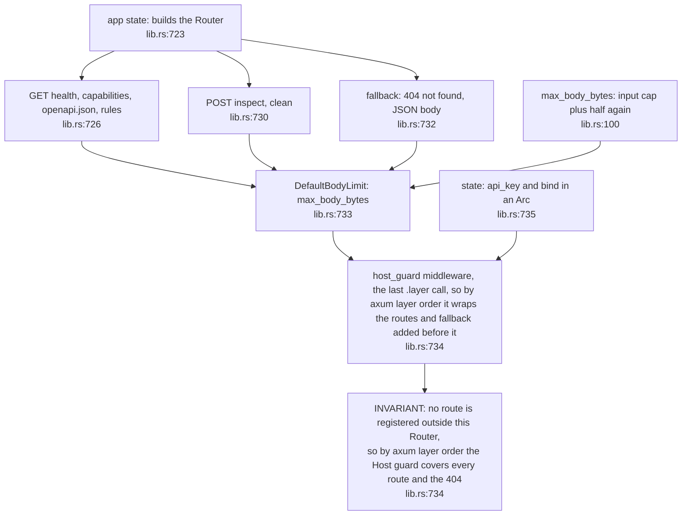
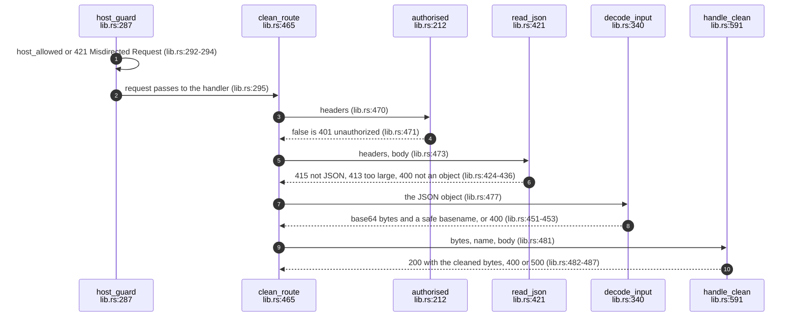
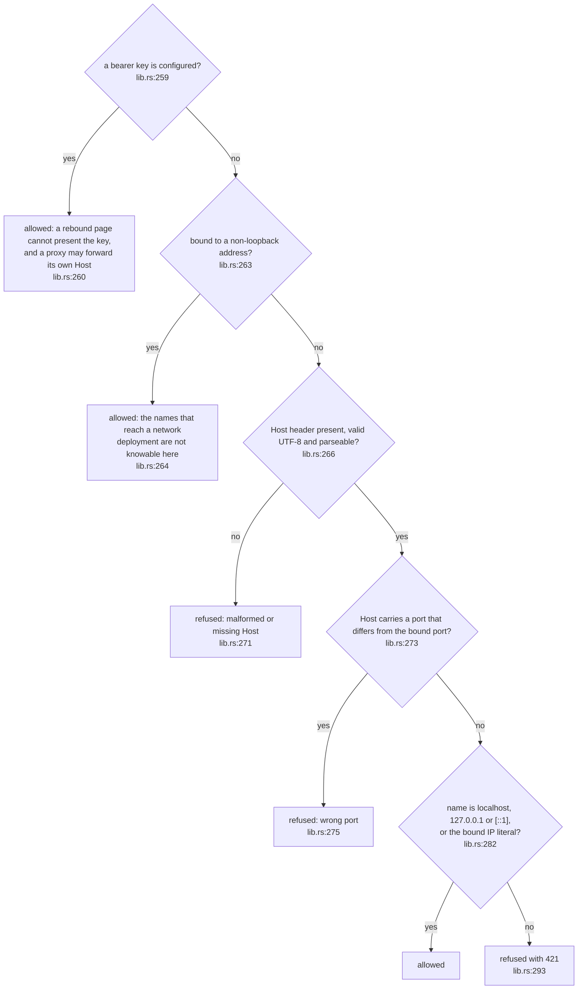
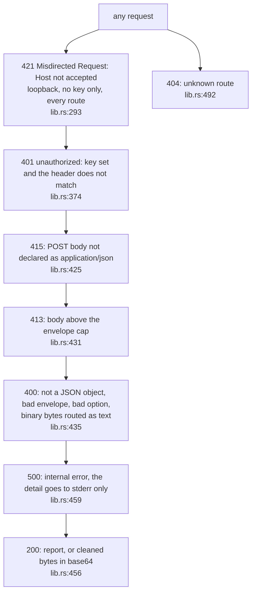
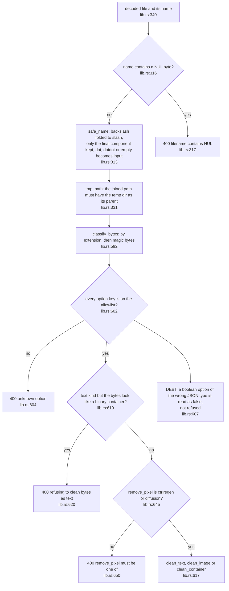
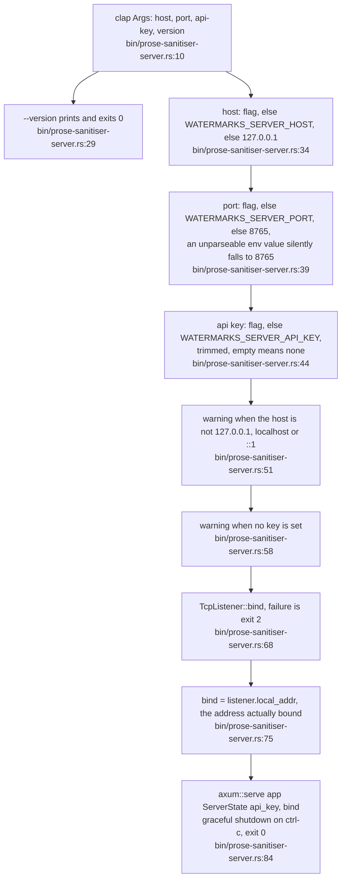

## For developers

`prose-sanitiser-server` exposes the cleaning pipeline over HTTP so an agent
skill or a web app can call it instead of running the binaries. It has six routes:
`GET /health`, `/capabilities`, `/openapi.json` and `/rules`, and `POST /inspect`
and `/clean` (`../prose-sanitiser/crates/server/src/lib.rs:723`-`736`). It binds
loopback by default and takes an optional bearer key
(`../prose-sanitiser/crates/server/src/lib.rs:1`-`7`).

Two defences matter here, and they are separate. The bearer key is checked inside
each handler. The browser-origin defences run in front of it: a `Host` header
guard layered over the whole router, and a `Content-Type` check inside the two
POST handlers. A page open in a browser on the same machine can reach a loopback
service, so those two checks run whether or not a key is set
(`../prose-sanitiser/crates/server/src/lib.rs:9`-`12`).

The checks are cheap string work on headers and none of them parses the body
first. The expensive part, the cleaning, only runs after the request has passed
all of them. This topic draws each check, the order they run in, and what each
one answers when it refuses.

## For the business

The service is meant for a trusted machine or network. Without a key it will
answer anyone who can reach it, so by default it only listens on the local
machine. But "only the local machine" is weaker than it sounds, because any web
page the user has open in their browser is also running on that machine and can
try to talk to the service.

Two protections close that gap without needing a password. The service refuses
requests whose body is not declared as JSON, which a hostile page cannot send
across sites without the browser asking permission first. And it checks which
website name the request was addressed to, which defeats a trick where a hostile
site's name is pointed at the local machine. Setting a key switches the second
check off, because a hostile page cannot present the key.

## PS-03.1 The router and its layers

**What it shows.** One router carries every route and the fallback, and the
guard wraps the lot. The bearer key is not a layer: each route handler calls
`authorised` itself.

**Why it is this way.** The `Host` guard is a layer because the doc says it
applies "on every route" (`../prose-sanitiser/crates/server/src/lib.rs:20`-`22`).
Authorisation is per handler, so the 404 fallback and the guard answer without a
key.

**Invariant:** `host_guard` is applied to the whole router with a single
`.layer` call, so a route added before it is covered without any further wiring
(`../prose-sanitiser/crates/server/src/lib.rs:734`). That the layer wraps the routes
and the fallback is axum's documented layer order, not something a line of this
repository shows: the test that refuses a foreign Host with status 421 on a POST
and on a GET sends them to two real routes, with no key configured
(`../prose-sanitiser/crates/server/src/tests.rs:361`-`386`), and no test here
sends a foreign Host to the 404 fallback or checks that the Host refusal precedes
a key refusal on a keyed server.

**Debt:** because authorisation is a call at the top of each of the six handlers
(`../prose-sanitiser/crates/server/src/lib.rs:373`, `:387`, `:401`, `:408`,
`:444` and `:470`), a seventh route that forgets the call is open. Nothing in the
router enforces it.

## PS-03.2 The life of a POST /clean

**What it shows.** The order is host, then key, then content type, then size,
then JSON shape, then the envelope, then the work. Each stage answers with its
own status.

**Why it is this way.** The `Content-Type` check runs before anything is parsed,
because a cross-origin page can send `text/plain` with no preflight and the body
would otherwise be read as JSON anyway
(`../prose-sanitiser/crates/server/src/lib.rs:422`-`424`).

**Invariant:** the decoded file, not the base64 envelope, is measured against the
input cap, so the larger envelope allowance does not become a larger file
allowance (`../prose-sanitiser/crates/server/src/lib.rs:353`-`362`).

**Open:** with a key set, a request without the key and without a JSON content
type gets 401, not 415, because the key is checked first
(`../prose-sanitiser/crates/server/src/lib.rs:470`-`476`). The README states the
two checks as independent and does not give their order
(`../prose-sanitiser/crates/server/README.md:31`-`32`).

## PS-03.3 The Host check

**What it shows.** The check only bites in one configuration: loopback bind, no
key. In every other configuration it allows the request. Where it does apply, the
name is compared exactly against a short list, and a port, when given, must be
the bound port.

**Why it is this way.** DNS rebinding makes an attacker's hostname resolve to
`127.0.0.1`, which makes the page same-origin and lets it read the replies. It
cannot make the browser send a different `Host`
(`../prose-sanitiser/crates/server/src/lib.rs:22`-`25`). The bound address is
the one the listener actually holds, not the requested name, because `localhost`
may resolve to either loopback family
(`../prose-sanitiser/crates/server/src/bin/prose-sanitiser-server.rs:73`-`75`).

**Invariant:** with no bound address recorded the check is treated as a loopback
bind on an unknown port, the strictest reading
(`../prose-sanitiser/crates/server/src/lib.rs:111`-`114`).

**Invariant:** a bare Host name has its trailing dot removed and is lowercased
before comparison, and an IPv6 literal keeps its brackets
(`../prose-sanitiser/crates/server/src/lib.rs:227`-`229`, then `:248`). Tests
cover a foreign host being refused, the server's own names being served and the
bind-dependent rules (`../prose-sanitiser/crates/server/src/tests.rs:361`,
`:390` and `:421`).

## PS-03.4 Which check answers with which status

**What it shows.** Each refusal has its own status, so a client can tell a Host
refusal from a bad key from a bad body. The chain runs top to bottom in the order
the checks execute for a POST.

**Why it is this way.** The service answers `500` with the fixed text
`internal error` and logs the detail locally, so a pipeline failure does not leak
paths or library messages to a caller
(`../prose-sanitiser/crates/server/src/lib.rs:458`-`461`). A `GET` route skips
the three body stages and meets only the Host guard and then the key.

**Invariant:** the key comparison is constant time over the bytes, and the key's
length is not hidden because `subtle` returns early when lengths differ
(`../prose-sanitiser/crates/server/src/lib.rs:217`-`224`). A test pins that the
key is compared exactly and that no key means every request is authorised
(`../prose-sanitiser/crates/server/src/tests.rs:225` and `:247`).

**Open:** the scheme is compared as part of the string `Bearer` plus the key, so
`bearer` in lower case is refused
(`../prose-sanitiser/crates/server/src/lib.rs:216`). Whether that is intended is
not stated in the README or the doc comment.

## PS-03.5 What the handlers refuse before they clean

**What it shows.** Before any cleaning runs, the client-supplied name is reduced
to a basename and joined under a per-request temporary directory, the option keys
are checked against a fixed list, and bytes that look like a binary container are
refused as text.

**Why it is this way.** A name like `../../x` would otherwise let a write escape
the request temp directory, and `tmp_path` is defence in depth in case a
separator slips through (`../prose-sanitiser/crates/server/src/lib.rs:308`-`312`,
`:327`-`330`). The option list is an allowlist, not a pass-through, so a request
cannot reach a flag the service did not intend to expose
(`../prose-sanitiser/crates/server/README.md:47`-`49`).

**Invariant:** the options accepted are `nfkc`, `aggressive_homoglyphs`,
`keep_non_ai_metadata`, `also_layer_a_text`, `remove_pixel` and
`strip_all_metadata`, and only those
(`../prose-sanitiser/crates/server/src/lib.rs:89`-`96`).

**Debt:** `flag` returns false for any option that is not a JSON boolean
(`../prose-sanitiser/crates/server/src/lib.rs:607`), while the OpenAPI document is
generated from the same list with the boolean marker on each entry
(`../prose-sanitiser/crates/server/src/lib.rs:89`-`96`). The external review of
2026-09-03 recorded the silent conversion
(`../prose-sanitiser/docs/prose-sanitiser-external-review-2026-09-03.md:67`).

## PS-03.6 Starting the service

**What it shows.** Every setting has a flag, then an environment variable, then a
default. The two warnings are advisory: neither stops the service starting. The
address the Host guard compares against is read back from the listener after the
bind.

**Why it is this way.** The default is the loopback address, so an operator who
sets nothing gets the narrowest reachable service
(`../prose-sanitiser/crates/server/src/bin/prose-sanitiser-server.rs:34`-`38`).
The runtime errors use the shared `exit::ERROR`, so a bind failure is exit 2
(`:68`-`72`).

**Drift:** the server README says API keys are read from the environment only and
that there is deliberately no flag for one, because keys on argv show in `ps`
(`../prose-sanitiser/crates/server/README.md:60`-`61`). The binary accepts
`--api-key` (`../prose-sanitiser/crates/server/src/bin/prose-sanitiser-server.rs:15`-`17`).
The sentence follows the environment table that includes the service's own key
variable, so it reads as covering this key.

**Open:** a keyless bind to a non-loopback host is accepted. The Host guard is off
for it, so the only protection is a stderr warning, and nothing states whether
that should be a refusal
(`../prose-sanitiser/crates/server/src/bin/prose-sanitiser-server.rs:51`-`60`).
