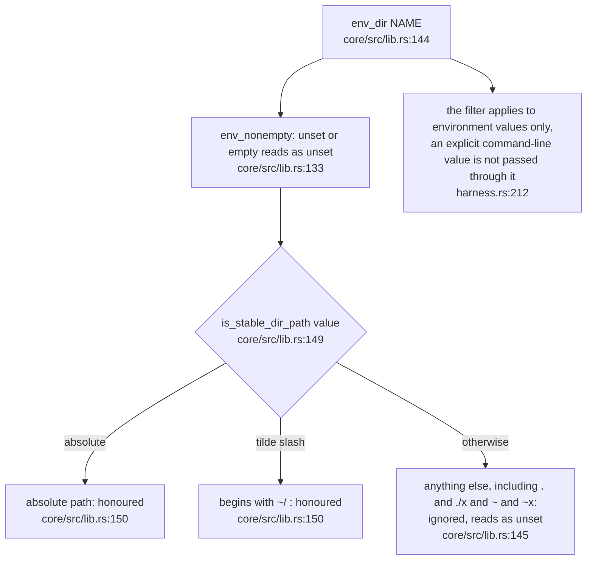
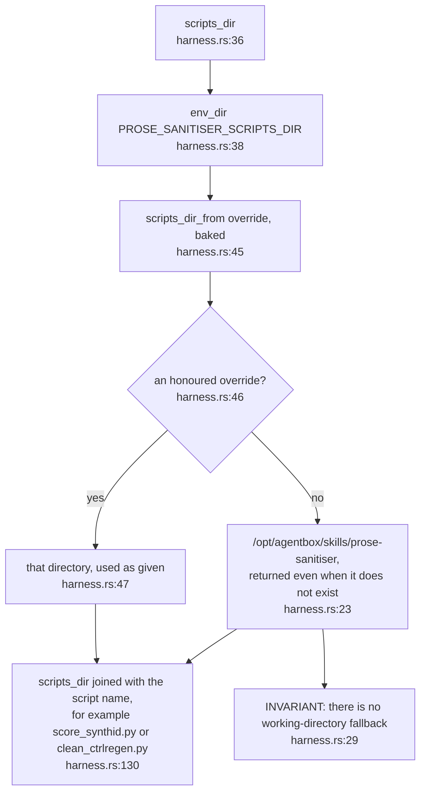
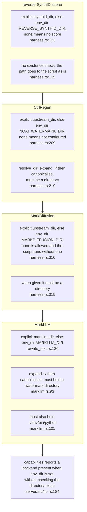
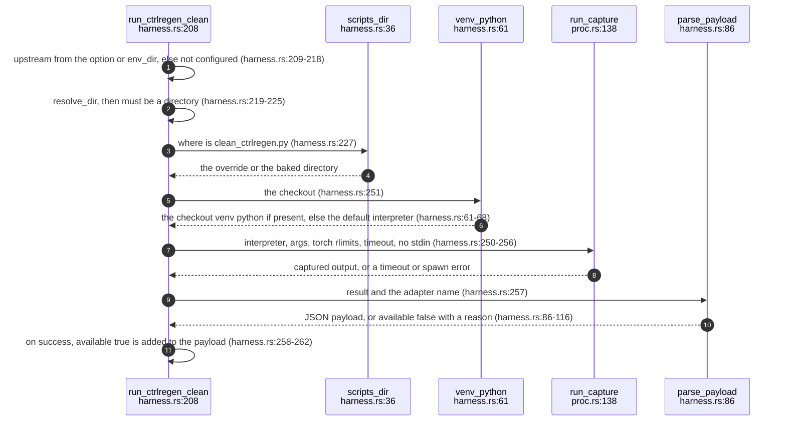
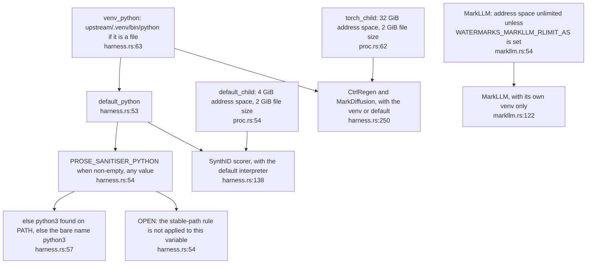
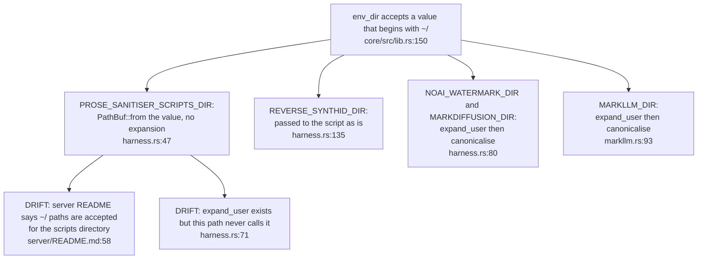

## For developers

Four heavy backends stay in Python because they are torch programs, not parsers:
the reverse-SynthID scorer, CtrlRegen, MarkDiffusion and MarkLLM
(`../prose-sanitiser/crates/media/src/image/harness.rs:1`-`11`). Rust locates them,
runs them as child processes under resource limits and parses their JSON back.
Locating them means resolving two kinds of directory. The **scripts directory**
holds the small Python entry points the Rust code invokes. Each backend's
**upstream directory**, a checkout holding the model code, is passed to those
scripts. This crate never downloads a model
(`../prose-sanitiser/crates/media/src/image/harness.rs:178`-`180`).

The resolution rules exist for one reason. A directory read from the environment
and resolved against the current working directory would let a hostile working
directory steer the tool at code it controls, and the scripts are executed with
the harness interpreter. So an environment override is only honoured when it is an
absolute path or begins `~/`
(`../prose-sanitiser/crates/core/src/lib.rs:139`-`151`), and the scripts directory
has no working-directory fallback at all
(`../prose-sanitiser/crates/media/src/image/harness.rs:28`-`35`).

This topic draws the rule, the scripts directory order, the per-backend
precedence and checks, one full harness run, and the places where the rule is not
applied uniformly.

## For the business

The optional image and text watermark removers are separate programs the
operator installs themselves. The tool finds them through settings, and it is
built so that a booby-trapped folder the user happens to be standing in can never
be picked up in place of the real installation. If a setting is not an absolute
location it is ignored, and the tool reports that the backend is not configured
instead of guessing.

The operator can expect clear failures. A missing checkout, a missing virtual
environment or a timed-out run is reported as "not available" with the reason, and
the rest of the cleaning carries on.

## PS-04.1 The rule for a directory override

**What it shows.** One helper decides whether an environment variable names a
directory. It never looks at whether the directory exists and it never expands
`~`. Both of those are left to the caller.

**Why it is this way.** A relative path would resolve against whichever directory
the tool is run from. The `CHANGELOG` records the decision as one rule for all
five variables, `PROSE_SANITISER_SCRIPTS_DIR`, `REVERSE_SYNTHID_DIR`,
`NOAI_WATERMARK_DIR`, `MARKDIFFUSION_DIR` and `MARKLLM_DIR`
(`../prose-sanitiser/CHANGELOG.md:32`-`35`). A unit test lists the cases that
must be refused, including `.`, `~` and `~x`
(`../prose-sanitiser/crates/core/src/lib.rs:211`-`232`).

**Invariant:** an empty or relative override reads as unset, never as the working
directory (`../prose-sanitiser/crates/core/src/lib.rs:144`-`151`).

## PS-04.2 Where the scripts live

**What it shows.** Two sources, in order: the override, then the image path the
scripts are baked at. There is no third. The answer is returned without checking
that it exists, so a missing script surfaces later as the interpreter's own error.

**Why it is this way.** The Rust binaries live outside the skill, so the location
is configuration, not the location of a source file. A development checkout sets
`PROSE_SANITISER_SCRIPTS_DIR`
(`../prose-sanitiser/crates/media/src/image/harness.rs:25`-`35`). The earlier
fallback to `skills/prose-sanitiser` in the working directory was removed
(`../prose-sanitiser/CHANGELOG.md:19`-`21`).

**Invariant:** with no override the answer is always the absolute baked path, and
a relative override is ignored. Two tests assert exactly that
(`../prose-sanitiser/crates/media/src/image/harness.rs:442`-`452`, then `:464`-`478`).

## PS-04.3 Upstream directory precedence per backend

**What it shows.** Every backend takes an explicit value first, then the filtered
environment variable. The checks that follow differ: CtrlRegen and MarkLLM refuse
a missing directory, MarkDiffusion tolerates having none, and the SynthID scorer
is handed the path unchecked and left to say it is unavailable.

**Why it is this way.** Each result is a small JSON object, with `available:
false` and a reason when the backend cannot run, because a missing optional
backend must never fail the cleaning around it
(`../prose-sanitiser/crates/cli/src/rewrite/markllm.rs:1`-`6`). The scorer returns
`None` for "not configured" so callers keep the default of no score
(`../prose-sanitiser/crates/media/src/image/harness.rs:118`-`121`).

**Invariant:** a relative `*_DIR` environment value yields "not configured" for
both the scorer and CtrlRegen, and a test pins that
(`../prose-sanitiser/crates/media/src/image/harness.rs:481`-`493`).

**Open:** the server reports `ctrlregen`, `diffusion`, `synthid` and `markllm` as
present from the variable alone
(`../prose-sanitiser/crates/server/src/lib.rs:184`-`188`), so a stable path that
names a missing directory reads as a capability that then fails at run time with
"dir not found" (`../prose-sanitiser/crates/media/src/image/harness.rs:221`-`224`).
Nothing states whether the capability report is meant to promise a usable backend.

## PS-04.4 One harness run

**What it shows.** The sequence is the same for CtrlRegen and MarkDiffusion. The
checkout's own virtual environment is preferred so that torch and diffusers are
importable. Failures of any kind come back as data, not as an error.

**Why it is this way.** The payload parser reads a non-zero exit as unavailable
with up to 2000 characters of stderr, treats empty stdout as an empty object and
reports invalid JSON by adapter name
(`../prose-sanitiser/crates/media/src/image/harness.rs:100`-`115`). The scorer
differs: exit 3 is the script's own "not configured" signal and is not a failure
(`:149`-`152`).

**Invariant:** a child that exceeds its wall-clock budget is reported as
`timed out after Ns`, and the CtrlRegen and MarkDiffusion budgets default to 3600
seconds, the scorer's to 180 (`../prose-sanitiser/crates/media/src/image/harness.rs:92`-`97`,
`:202`, `:299` and `:142`).

## PS-04.5 Interpreter and resource limits

**What it shows.** The scorer always uses the default interpreter. The two pixel
removers prefer the checkout's venv. MarkLLM requires its venv and has no
fallback, so a checkout without one is reported as missing. Memory caps differ by
backend because torch needs a large address space.

**Why it is this way.** A crafted file must not make a child exhaust host memory
or fill the disk, so each family carries a cap, but the torch ones are larger and
env-overridable (`../prose-sanitiser/crates/media/src/proc.rs:19`-`30`). The
MarkLLM address-space cap is opt-in for the same reason
(`../prose-sanitiser/crates/cli/src/rewrite/markllm.rs:52`-`53`).

**Open:** `PROSE_SANITISER_PYTHON` is taken verbatim when it is non-empty
(`../prose-sanitiser/crates/media/src/image/harness.rs:54`-`56`), whereas every
`*_DIR` variable is refused when relative. Nothing states whether a relative
interpreter value is meant to be accepted.

**Debt:** the two arms of `markllm_limits` take their file-size cap from different
variables. With an address cap it is the CtrlRegen one, `torch_child().file_size`
(`../prose-sanitiser/crates/cli/src/rewrite/markllm.rs:58`), and without one it is
`WATERMARKS_CHILD_RLIMIT_FSIZE` (`:64`).

## PS-04.6 Where a leading tilde is and is not expanded

**What it shows.** The filter lets a `~/` value through for all five variables,
and three of the five then expand it against `$HOME`. The scripts directory and
the SynthID directory do not.

**Why it is this way.** The `CHANGELOG` says absolute and `~/` values are
honoured (`../prose-sanitiser/CHANGELOG.md:34`-`35`), and the helper's doc says
`~/` expands against `$HOME`, not the working directory
(`../prose-sanitiser/crates/core/src/lib.rs:141`-`142`). The expansion lives in the
callers: `expand_user` is defined twice, once for the media crate
(`../prose-sanitiser/crates/media/src/image/harness.rs:71`-`78`) and once for
MarkLLM (`../prose-sanitiser/crates/cli/src/rewrite/markllm.rs:154`-`161`).

**Drift:** the server README documents `PROSE_SANITISER_SCRIPTS_DIR` as accepting
absolute or `~/` paths (`../prose-sanitiser/crates/server/README.md:58`). For a
`~/` value `scripts_dir_from` builds the path from the literal text
(`../prose-sanitiser/crates/media/src/image/harness.rs:47`), so the script path
passed to the interpreter begins with a relative `~` component, which is the
working-directory resolution the rule exists to prevent.

**Open:** `REVERSE_SYNTHID_DIR` with a `~/` value reaches the scorer script
unexpanded (`../prose-sanitiser/crates/media/src/image/harness.rs:125`, then `:135`).
The script is not part of this repository, so whether it expands the tilde is not
established here.

**Debt:** `expand_user` is duplicated in two crates
(`../prose-sanitiser/crates/media/src/image/harness.rs:71`, and
`../prose-sanitiser/crates/cli/src/rewrite/markllm.rs:154`), and `is_stable_dir_path`
lives in a third (`../prose-sanitiser/crates/core/src/lib.rs:149`), so the
acceptance rule and the expansion rule can diverge, as above.
