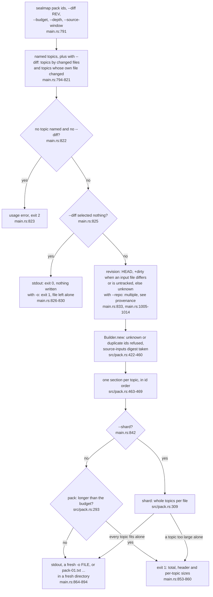
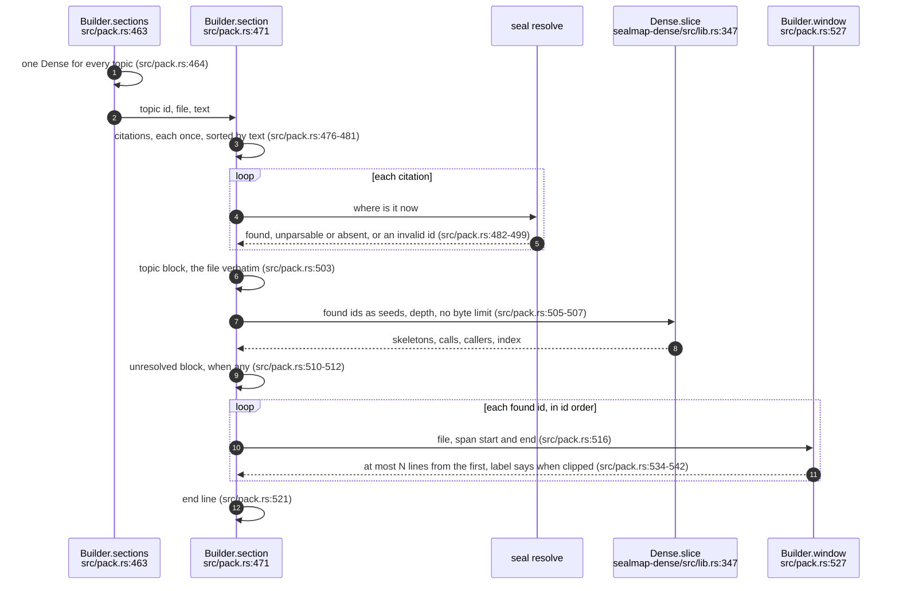
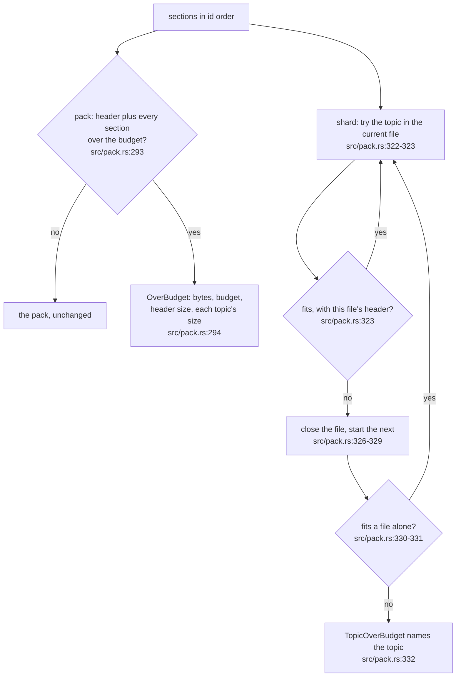
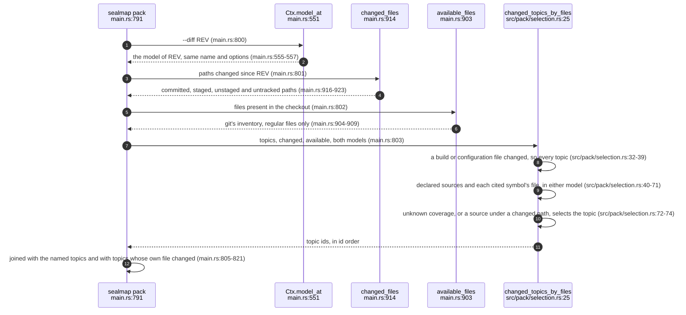

## For developers

`sealmap pack` turns chosen topics into one text a reviewer can read without
the repository (`docs/DESIGN.md:106`). For each topic the pack holds the file
verbatim, the `sealmap-dense` slice around the symbols it cites, the
citations that do not resolve, and a window of each cited symbol's current
source (`crates/sealmap-corpus/src/pack.rs:503`-`521`). The library half,
`sealmap_corpus::pack`, is pure: it takes the model, the source texts, the
topic texts and an opaque revision string, and never reads the disk or runs
git (`crates/sealmap-corpus/src/pack.rs:6`-`9`). The CLI half reads the
checkout, picks the topics and writes the result
(`crates/sealmap/src/main.rs:791`). Since pack format 2 the header also
carries a digest of every extraction input and a provenance record that the
CLI supplies (`crates/sealmap-corpus/src/pack.rs:577`-`580`).
[SM-18](18-review-evidence-and-selection.md) covers the review receipts that
consume packs.

Three rules carry the design:

- **Identical inputs give identical bytes.** Topics are a set and are
  written in id order (`crates/sealmap-corpus/src/pack.rs:438`-`448`), and
  citations are deduplicated and sorted
  (`crates/sealmap-corpus/src/pack.rs:476`-`481`). A test feeds the ids in
  another order, with a duplicate, and from a freshly extracted model, and
  gets the same pack (`crates/sealmap-corpus/tests/pack.rs:163`). The CLI
  test gets the same bytes from reordered arguments, on stdout and in a file
  (`crates/sealmap/tests/cli.rs:209`).
- **Nothing is truncated.** Over budget, `pack` refuses with the header's
  size and each topic's (`crates/sealmap-corpus/src/pack.rs:293`-`294`).
  `shard` instead fills numbered packs with whole topics and refuses only a
  topic too large to fit alone (`crates/sealmap-corpus/src/pack.rs:309`-`347`).
- **Every block states its length.** A block line ends its fixed fields with
  the payload's byte count, so a reader can skip a block exactly even when a
  topic contains a line that looks like one
  (`crates/sealmap-corpus/src/pack.rs:591`-`601`). A test walks the golden
  pack by those lengths alone (`crates/sealmap-corpus/tests/pack.rs:130`).

`--diff REV` adds every topic whose cited files changed since a revision. A
change anywhere in a cited symbol's file, or in a path the topic declares in
its `sources`, selects the topic, and build or configuration files select all
of them (`crates/sealmap-corpus/src/pack/selection.rs:25`-`39`). The
symbol-hash comparison that `--diff` used to apply is still in the library
(`crates/sealmap-corpus/src/pack.rs:371`-`385`) but the CLI no longer calls
it (`crates/sealmap/src/main.rs:803`).

## For the business

A reviewer outside the team, a seal review or a debugging session needs the
claims and the code they rest on, and nothing else. Handing over the
repository costs far more context than the question needs, and an excerpt
cut to fit can hide the line that matters. A pack is the bounded, repeatable
alternative. The same request always produces the same file, so two
reviewers, or two runs of one reviewer, see the same thing. If the file
would be too big, the tool says by how much and which topics are largest,
or splits the request into whole topics. It never quietly drops content.
Each pack also says which source files it was built from, so a reader can
tell a pack of committed code from one of uncommitted edits. That identifies
the inputs. It does not show that anything was built or deployed from them
(`README.md:188`-`193`).

`sealmap pack --diff main` selects the topics whose cited files changed, and
widens the list when build, configuration or dependency files changed or when
a topic's sources cannot be attributed. The earlier rule compared cited
symbols only and was dropped as the default because the evidence found it
loses real changes: per-file selection caught all 29 labelled stale pairs in
a sample, and symbol hashes caught 0.76 (`README.md:153`-`157`,
`README.md:356`). `--diff` is therefore a conservative review queue, not a
verdict that a topic is wrong. Naming the topics, for example every topic a
per-file flag selects, remains the dependable way to build a pack.

## SM-17.1 From a request to a pack

**What it shows.** Selection and IO live in the CLI. Validation, rendering
and the budget decision live in the library, so another caller, such as the
`sealmap-review` skill (`docs/DESIGN.md:276`-`278`), gets the same refusals
from either.

**Why it is this way.** Git stays out of the libraries
(`docs/DESIGN.md:236`-`239`). The revision is therefore an opaque string the
CLI supplies. It reads `+dirty` only when an input the pack read, a source,
build-context or topic file, differs from `HEAD` or is untracked
(`crates/sealmap/src/main.rs:945`-`975`). The pack's own output and other
untracked files do not count, so writing a pack into the checkout does not
change the next pack's header (`crates/sealmap/src/main.rs:926`-`937`,
`crates/sealmap/tests/cli.rs:323`). With `--repo` the revision is the fixed
string `multiple (see provenance)` (`crates/sealmap/src/main.rs:1012`-`1013`).
Every destination must be fresh: `-o` refuses an existing file and `--shard
-o` an existing directory, so an old pack is never mixed with a new one
(`crates/sealmap/src/main.rs:865`-`871`, `crates/sealmap/src/main.rs:880`-`881`).

**Tension (revision vs reproducibility):** `+dirty` says that an input differs
from `HEAD`, not how (`crates/sealmap/src/main.rs:1008`-`1011`). The
`source-inputs` digest separates different source edits
(`crates/sealmap-corpus/src/pack.rs:449`-`459`), but the provenance names a
changed topic file without hashing it
(`crates/sealmap/src/main.rs:929`-`938`). Two packs of different uncommitted
topic edits carry the same header. Their bodies differ, but the header alone
cannot tell them apart.

**Debt:** a failed write can leave a partial file at the fresh path, and the
README tells the caller to respect the exit status
(`README.md:173`-`174`, `crates/sealmap/src/main.rs:872`-`874`).

## SM-17.2 One topic's section

**What it shows.** A section is built from the model alone. Every citation
lands in exactly one place: the slice and a source window when it resolves,
the unresolved list when it does not.

**Why it is this way.** A pack is evidence for a review, so a citation that
no longer resolves must stay visible rather than vanish
(`docs/DESIGN.md:257`-`258`). The slice carries its own index, so the pack
needs no `_index.txt` beside it (`crates/sealmap-dense/src/lib.rs:75`-`79`).

**Invariant:** the dense slice is taken without a byte limit, so it cannot
fail on size. The only budget is the pack's
(`crates/sealmap-corpus/src/pack.rs:505`-`507`).

**Open:** a topic that cites `path:line` rather than `sym:` ids packs as its
text alone (`docs/DESIGN.md:260`-`261`, `README.md:159`-`161`). Every topic of
this corpus is such a topic, and the seal work that would have migrated
corpora to `sym:` citations is closed and will not be built
(`docs/DESIGN.md:48`-`52`), so a pack of it carries no slices and no source
windows. Should `pack` resolve `path:line` citations itself, so that corpora
which never migrate get them?

## SM-17.3 The budget: refuse, or shard by topic

**What it shows.** `pack` either fits whole or refuses with what a caller
needs to plan shards. `shard` does that planning itself, one topic at a time,
and fails only on a topic no file could hold.

**Why it is this way.** The design forbids silent truncation
(`docs/DESIGN.md:231`). Sizes are planned from the header's length and the
section lengths, so each file is assembled once
(`crates/sealmap-corpus/src/pack.rs:313`-`321`). The first version assembled
every candidate file in full. The dense projection of that code showed the
quadratic copy, and commit `673d58c` replaced it.

**Invariant:** at exactly the budget the pack is returned, one byte under it
is refused, and the refusal's sizes add up to the pack's length
(`crates/sealmap-corpus/tests/pack.rs:181`). Every topic lands in exactly one
shard, with its section unchanged (`crates/sealmap-corpus/tests/pack.rs:208`).

**Debt (designed, not built):** the diagrams-only `--review` pack for an
outside reviewer is in the design (`docs/DESIGN.md:106`) but not in the
binary (`docs/DESIGN.md:251`).

## SM-17.4 Choosing topics by changed file

**What it shows.** A topic is chosen when a file it depends on changed since
REV: a path it declares in `sources`, or the file of any symbol it cites, in
either model. A change anywhere in that file counts, whatever the symbol's
hashes say. A build, lock or configuration file selects every topic, and a
topic whose sources are missing, malformed or unattributed is selected as
well (`crates/sealmap-corpus/src/pack/selection.rs:10`-`19`,
`crates/sealmap-corpus/src/pack/selection.rs:86`-`93`). Topics whose own file
changed join too, and a corpus outside the source repository is kept whole
because it has no comparable baseline here
(`crates/sealmap/src/main.rs:810`-`814`).

**Why it is this way.** Selection is a review queue, so a wrong inclusion
costs a read and a wrong omission costs a missed change. The symbol-hash rule
caught 0.76 of the labelled stale pairs where per-file selection caught all
of them (`docs/DESIGN.md:44`-`47`), so the library keeps it as a diagnostic,
not the default (`README.md:160`-`161`). The CLI tests change one function and
find both topics that cite its file chosen, with the current code in the
window, and find nothing chosen once the edit is committed
(`crates/sealmap/tests/cli.rs:260`-`297`). A changed lockfile selects both
topics again (`crates/sealmap/tests/cli.rs:301`-`319`).
