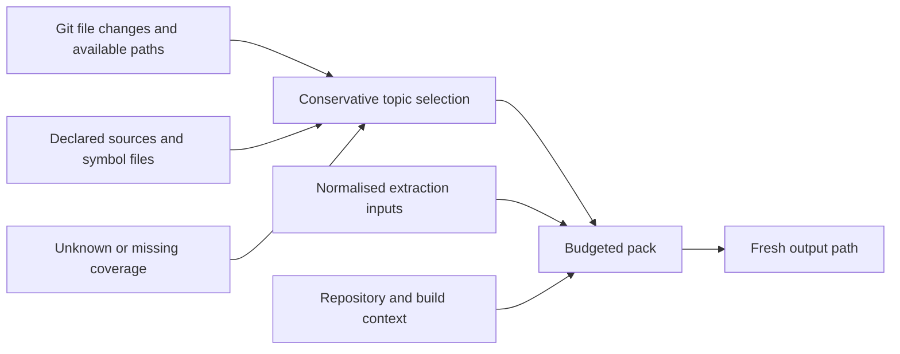
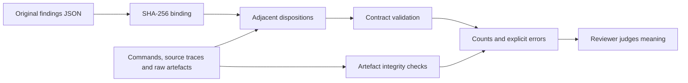

## For developers

The 0.4.0 CLI uses `changed_topics_by_files` to choose a diff review's topics
(`crates/sealmap-corpus/src/pack/selection.rs:25`). It combines declared sources
and resolved symbol files, keeping unknown coverage conservative. File and
build-context changes can select a topic even when every cited symbol hash is
unchanged. The older symbol-change helper remains a diagnostic; its measured
recall was inadequate as a skipping gate.

`pack_provenance` records repository baselines and local build-context hashes
(`crates/sealmap/src/main.rs:980`). The pack header also binds the normalised
extraction input bytes (`crates/sealmap-corpus/src/pack.rs:577`). Neither record
asserts that a deployed consumer used those inputs. Multi-repository provenance
is supported; diff selection still requires a comparable single-repository
baseline. Cross-repository uncertainty is not a reason to skip a topic.

Review findings remain unchanged. `review init` creates an adjacent receipt
(`crates/sealmap/src/review_cli.rs:90`), `review::validate` checks its evidence
contract (`crates/sealmap-corpus/src/review.rs:339`), and the CLI checks referenced
artefact bytes (`crates/sealmap/src/review_cli.rs:139`). A setup failure can stay
inconclusive; it cannot confirm or reject the claim. Every repair delivery stage
needs independent evidence. Adoption must cite a successful observation of the
actual consumed version, rather than borrow success from another check.

Routing declarations are independent of this receipt contract. `Route::parse`
accepts named providers (`crates/sealmap-corpus/src/route.rs:307`), while
`Tiers::parse_with_activities` enforces a caller's activity vocabulary
(`crates/sealmap-corpus/src/tiers.rs:141`). Explicit `parse_agentbox` adapters
retain Agentbox's narrower policy. These APIs neither invoke models nor attest
which model a service actually runs.

## For the business

This revision reduces two kinds of misleading review result: omitted topics
when nearby code changed, and closure claims unsupported by the retained
evidence. The receipt follows a finding across source repair, release, consumer
update and runtime observation without pretending those are the same event.
Finding counts remain visible during handoff.

Receipt checks establish consistency and intact artefacts. A person or reviewer
still judges whether observations support their claims. A valid receipt is not
a security certificate, and two reviewers agreeing does not verify a finding.

## SM-18.1 Inputs and selection

**What it shows.** Selection and input provenance serve different purposes.
Selection decides what needs review; hashes identify the input snapshot.

**Why it is this way.** Fine-grained hashes missed real staleness in the earlier
experiments. The bounded pack still refuses oversized requests rather than
quietly truncate them.

**Invariant:** a successful output generation cannot mix old shards with new
ones. Existing output paths are refused. An empty selection with an output path
returns failure while preserving the previous file. The CLI checks output path
components before writing (`crates/sealmap/src/main.rs:352`); a failed write can
still leave partial output in a newly created destination.

## SM-18.2 Findings and receipts

**What it shows.** Validation does not rewrite the original reviewer export or
execute commands recorded in evidence. Unverified and inconclusive findings
remain in the original denominator.

**Why it is this way.** Failed fixtures, unavailable runtimes and contradicted
claims require different dispositions. Replacing the raw result with a later
narrative would hide those distinctions.

**Invariant:** tested and deployed stages require execution evidence; adoption
requires a successful consumed-version observation. No stage implies another.

**Open:** observations and authority are self-reported and need independent
review. The CLI is a local file checker, not a sandbox against concurrent hostile
filesystem replacement. Consumers own model execution, measured tier selection
and runtime activation; declarations and receipt validation do not perform them.
