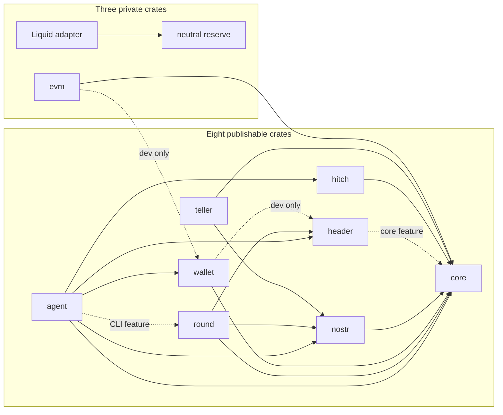
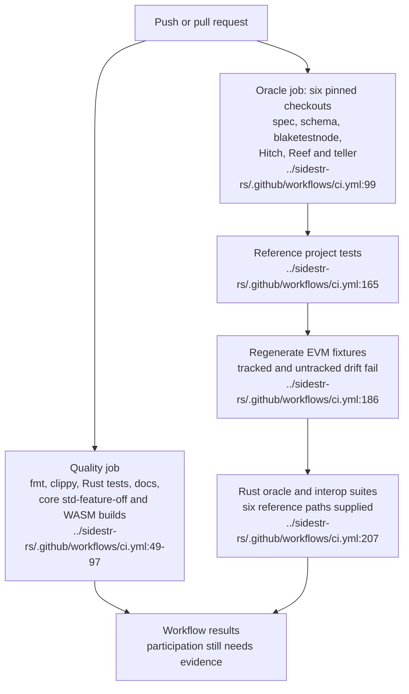
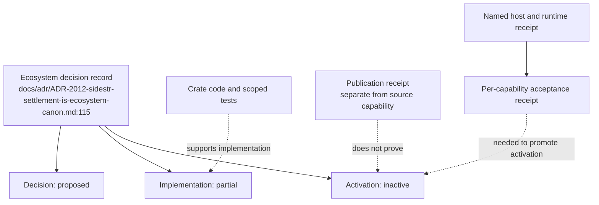
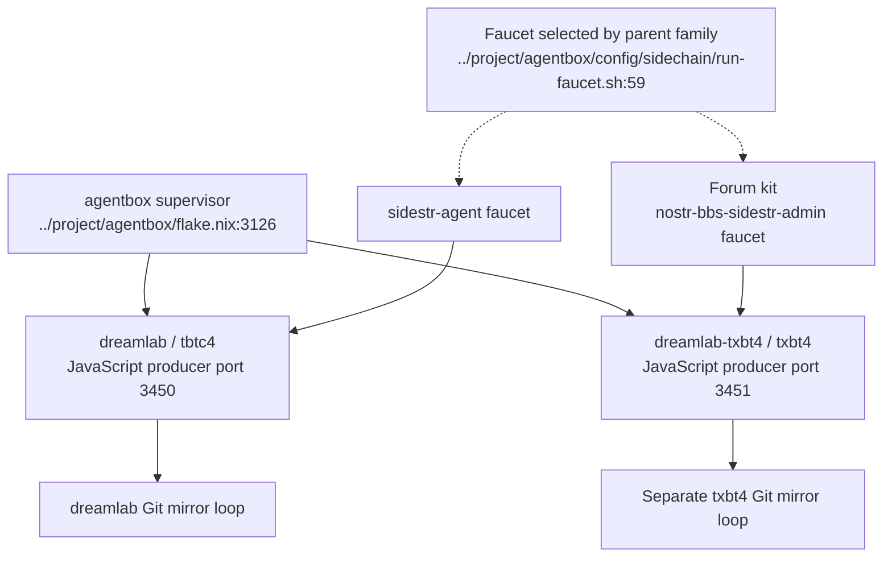

## For developers

`sidestr-rs` now has eleven workspace members. Eight publishable crates carry the reusable chain, wallet, Nostr, federation, agent, Hitch and teller surfaces; EVM and the two reserve crates remain separate, unpublished components. Compatibility is judged against pinned upstream revisions and regenerated fixtures rather than inferred from similar APIs. **Review scope (1 November):** SR-01.1/01.2 follow the [oracle audit](../../estate-review/2026-11-01-sidestr-oracle-contract.md); SR-01.3/01.4 and the core feature label follow the [crate/runtime audit](../../estate-review/2026-11-01-sidestr-crate-and-runtime-boundaries.md).

## For the business

New source expands what the estate can validate and eventually operate, but it does not change what is live. `sidestr:dreamlab` is still a test-only chain produced by the upstream JavaScript engine, and a second sealed research chain, `sidestr:dreamlab-txbt4` beside a BLAKE2b parent, is also produced by that engine. Publication, source completeness and deployment are tracked as separate facts.

## SR-01.1 Workspace ownership

**What it shows.** Arrows mean direct local dependencies; dotted edges distinguish optional features and test-only dependencies. Eleven members comprise eight `publish=true` and three private crates (`../sidestr-rs/Cargo.toml:3`). Agent's five required local dependencies and optional round are explicit (`../sidestr-rs/sidestr-agent/Cargo.toml:35`); round also imports header (`../sidestr-rs/sidestr-round/Cargo.toml:45`). Wallet-to-header and EVM-to-wallet are dev dependencies (`../sidestr-rs/sidestr-wallet/Cargo.toml:41`, `../sidestr-rs/sidestr-evm/Cargo.toml:42`). Liquid imports neutral reserve, not the reverse (`../sidestr-rs/sidestr-bridge-liquid/Cargo.toml:32`).

**Why it is this way.** The header's optional `core` feature points towards core (`../sidestr-rs/sidestr-header/Cargo.toml:30`); isolated header builds need not import it. EVM and origin adapters stay outside ordinary library dependencies. Publishable is a manifest property, not a fresh crates.io release check. The [dependency receipt](../../estate-review/evidence/2026-11-01/oracle/workspace-edges.json) records every direct local edge and its kind.

## SR-01.2 Two independent CI jobs

**What it shows.** Quality and oracle are independent jobs with no `needs` edge (`../sidestr-rs/.github/workflows/ci.yml:33`, `../sidestr-rs/.github/workflows/ci.yml:99`). Core checks disable a feature; core still imports the standard library (`../sidestr-rs/sidestr-core/src/lib.rs:298`, `../sidestr-rs/sidestr-core/src/overlays.rs:7`). Within oracle, checkouts precede reference tests, regenerated EVM fixtures and Rust suites. Drift checks include modified tracked files and untracked fixture output (`../sidestr-rs/.github/workflows/ci.yml:199`). ADR-0001 still says four references; CI now pins six (`../sidestr-rs/docs/adr/ADR-0001-reference-oracle-is-the-compatibility-contract.md:27`, `../sidestr-rs/.github/workflows/ci.yml:17`).

**Why it is this way.** Ordinary Rust tests deliberately allow absent oracles (`../sidestr-rs/.github/workflows/ci.yml:58`). Missing configured files also return early in round interop and pegtweak (`../sidestr-rs/sidestr-round/tests/support/interop.rs:18`, `../sidestr-rs/sidestr-core/tests/pegtweak.rs:406`); a reported pass alone is insufficient parity evidence. [Run 41128639012](https://github.com/DreamLab-AI/sidestr-rs/actions/runs/41128639012) supplies current implementation CI evidence, bounded by the [audit receipt](../../estate-review/evidence/2026-11-01/oracle/ci-receipt.json); it does not prove release enforcement or chain activation.

## SR-01.3 Independent evidence axes

**What it shows.** ADR-2012's recorded decision, implementation and activation axes are independent (`docs/adr/ADR-2012-sidestr-settlement-is-ecosystem-canon.md:115`, `docs/adr/ADR-2012-sidestr-settlement-is-ecosystem-canon.md:130`). Source, package publication, runtime processes and a successful capability lifecycle are different evidence. The matrix does not promote the ecosystem proposal merely because research producers run.

**Why it is this way.** N-9 closes historical source/release work while N-10 asks for activation receipts (`../project/docs/TODO-unified.md:102`, `../project/docs/TODO-unified.md:103`). Its claim that Hitch has no host is now stale: `sidestr-agent::hitch::host` exists; that still does not establish an accepted deployed channel lifecycle (`../sidestr-rs/docs/adr/ADR-0002-keep-optional-execution-and-services-behind-crate-boundaries.md:144`).

**Invariant:** source evidence may promote implementation status; it cannot by itself promote activation status.

## SR-01.4 Two supervised research chains

**What it shows.** At 14:15:29 UTC on 1 November, all six named programmes were running; both producer endpoints served documents equal to their sealed checkout documents. The producers execute baked `siding.mjs`; the faucet binaries differ as the runner specifies (`../project/agentbox/config/sidechain/run-producer.sh:167`, `../project/agentbox/config/sidechain/run-faucet.sh:59`). [Runtime receipt](../../estate-review/evidence/2026-11-01/crate-boundary/runtime.json). The second table is enabled despite the README's older disabled-default statement (`../project/agentbox/agentbox.toml:1976`, `../project/agentbox/config/sidechain/README.md:188`).

**Why it is this way.** Each chain has its own producer, mirror and faucet; the BLAKE2b family chooses the forum-kit faucet. A responding tip is not evidence of current block progress, mirror freshness, successful grants or Hitch activation. The observed producers have no checkpoint arguments, consistent with default-zero configuration (`../project/agentbox/config/sidechain/run-producer.sh:148`); historical anchoring was not inspected.

**Open:** retain separate runtime and per-capability acceptance receipts; no native Rust producer or channel lifecycle was demonstrated by this observation.
