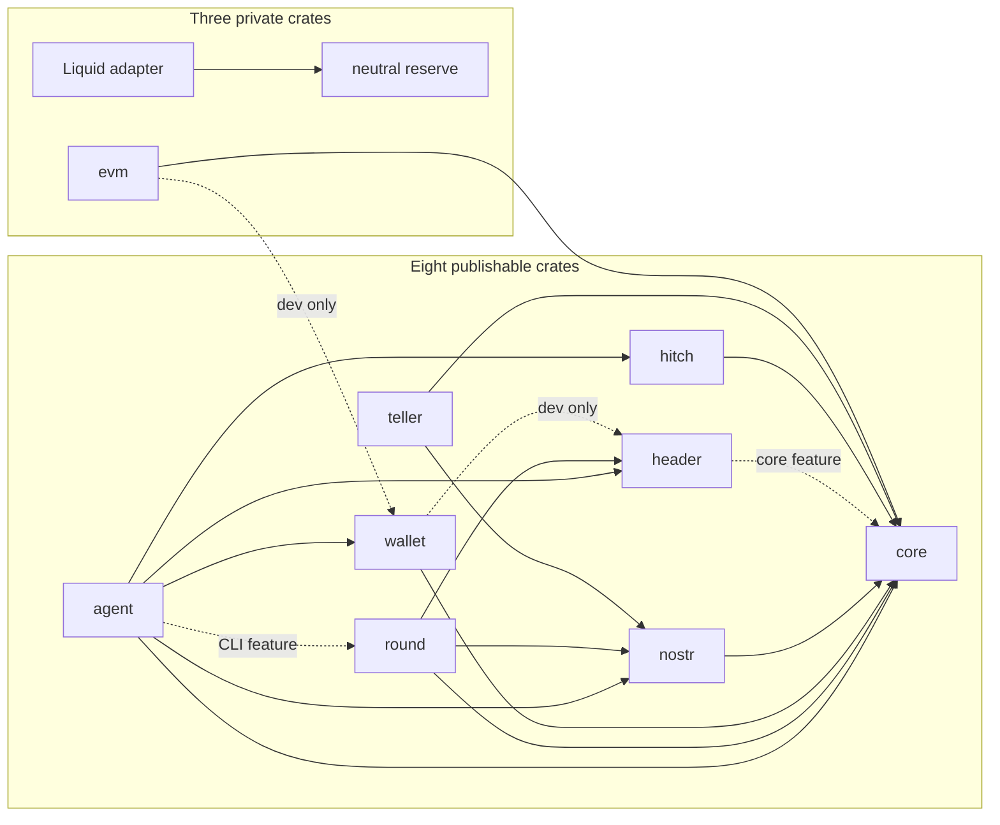
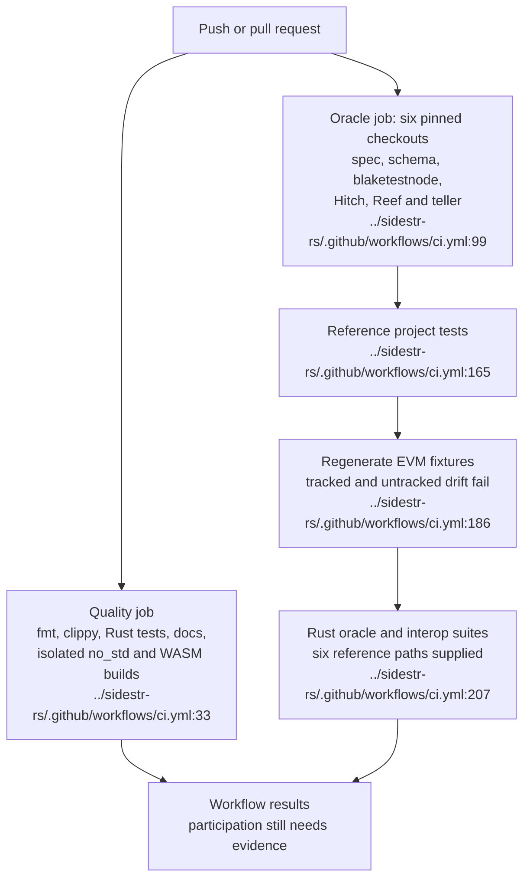
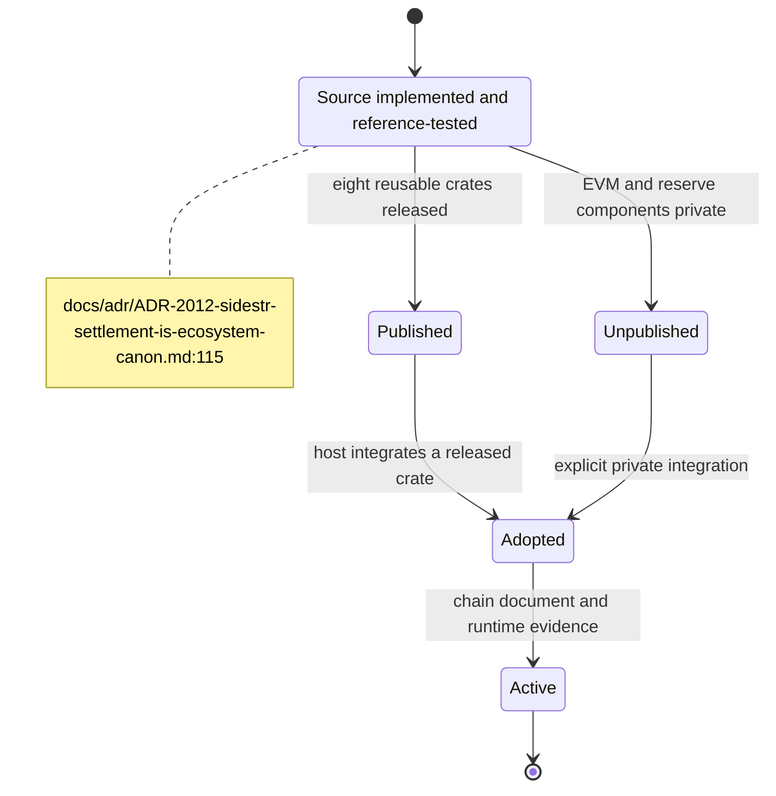
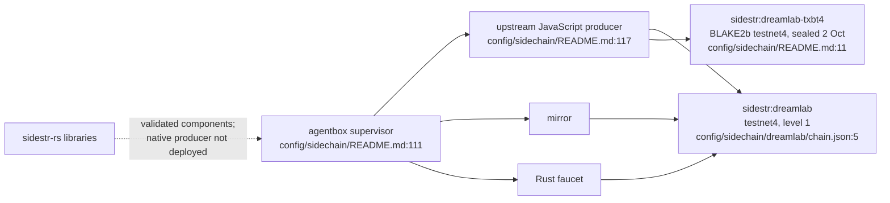

## For developers

`sidestr-rs` now has eleven workspace members. Eight publishable crates carry the reusable chain, wallet, Nostr, federation, agent, Hitch and teller surfaces; EVM and the two reserve crates remain separate, unpublished components. Compatibility is judged against pinned upstream revisions and regenerated fixtures rather than inferred from similar APIs. **Review scope (1 November):** panels SR-01.1 and SR-01.2 are refreshed in the [oracle audit](../../estate-review/2026-11-01-sidestr-oracle-contract.md). Panels SR-01.3 and SR-01.4 retain their earlier adoption/runtime evidence boundary; this pass does not re-observe deployment.

## For the business

New source expands what the estate can validate and eventually operate, but it does not change what is live. `sidestr:dreamlab` is still a test-only chain produced by the upstream JavaScript engine, and a second sealed research chain, `sidestr:dreamlab-txbt4` beside a BLAKE2b parent, is also produced by that engine. Publication, source completeness and deployment are tracked as separate facts.

## SR-01.1 Workspace ownership

**What it shows.** Arrows mean direct local dependencies; dotted edges distinguish optional features and test-only dependencies. Eleven members comprise eight `publish=true` and three private crates (`../sidestr-rs/Cargo.toml:3`). Agent's five required local dependencies and optional round are explicit (`../sidestr-rs/sidestr-agent/Cargo.toml:35`); round also imports header (`../sidestr-rs/sidestr-round/Cargo.toml:45`). Wallet-to-header and EVM-to-wallet are dev dependencies (`../sidestr-rs/sidestr-wallet/Cargo.toml:41`, `../sidestr-rs/sidestr-evm/Cargo.toml:42`). Liquid imports neutral reserve, not the reverse (`../sidestr-rs/sidestr-bridge-liquid/Cargo.toml:32`).

**Why it is this way.** The header's optional `core` feature points towards core (`../sidestr-rs/sidestr-header/Cargo.toml:30`); isolated header builds need not import it. EVM and origin adapters stay outside ordinary library dependencies. Publishable is a manifest property, not a fresh crates.io release check. The [dependency receipt](../../estate-review/evidence/2026-11-01/oracle/workspace-edges.json) records every direct local edge and its kind.

## SR-01.2 Two independent CI jobs

**What it shows.** Quality and oracle are independent jobs with no `needs` edge (`../sidestr-rs/.github/workflows/ci.yml:33`, `../sidestr-rs/.github/workflows/ci.yml:99`). Within oracle, checkouts precede reference tests, regenerated EVM fixtures and Rust suites. Drift checks include modified tracked files and untracked fixture output (`../sidestr-rs/.github/workflows/ci.yml:199`). ADR-0001 still says four references; CI now pins six (`../sidestr-rs/docs/adr/ADR-0001-reference-oracle-is-the-compatibility-contract.md:27`, `../sidestr-rs/.github/workflows/ci.yml:17`).

**Why it is this way.** Ordinary Rust tests deliberately allow absent oracles (`../sidestr-rs/.github/workflows/ci.yml:58`). Missing configured files also return early in round interop and pegtweak (`../sidestr-rs/sidestr-round/tests/support/interop.rs:18`, `../sidestr-rs/sidestr-core/tests/pegtweak.rs:406`); a reported pass alone is insufficient parity evidence. [Run 41128639012](https://github.com/DreamLab-AI/sidestr-rs/actions/runs/41128639012) supplies current implementation CI evidence, bounded by the [audit receipt](../../estate-review/evidence/2026-11-01/oracle/ci-receipt.json); it does not prove release enforcement or chain activation.

## SR-01.3 Source, publication and activation are separate states

**What it shows.** VisionFlow records source implementation as partial while keeping the ecosystem decision proposed and activation inactive (`docs/adr/ADR-2012-sidestr-settlement-is-ecosystem-canon.md:115`, `docs/adr/ADR-2012-sidestr-settlement-is-ecosystem-canon.md:130`).

**Why it is this way.** A library can be correct and published without any estate service importing it or any chain activating its rules. The master board closes source parity in N-9 and keeps estate adoption open in N-10 (`../project/docs/TODO-unified.md:102`, `../project/docs/TODO-unified.md:103`). Two releases after that closure, `sidestr-wallet` 0.5.1 (BIP 21 with the Reef oracle) and `sidestr-hitch` 0.2.0, are recorded as an annotation on the closed N-9 row, with adoption left under N-10 (`../project/docs/TODO-unified.md:116`).

**Invariant:** source evidence may promote implementation status; it cannot promote activation status.

## SR-01.4 The live boundary

**What it shows.** Agentbox supervises the producer, mirror and faucet, but the producer runs the upstream JavaScript engine baked at the upstream pins (`../project/agentbox/config/sidechain/README.md:111`, `../project/agentbox/config/sidechain/README.md:117`). A second chain, `sidestr:dreamlab-txbt4`, was sealed on 2 October beside a BLAKE2b testnet4 parent (`../project/agentbox/config/sidechain/README.md:11`). The baked spec pin now includes upstream PR #32, so an append or index-write failure latches `SIDING_PERSISTENCE_FAILED` and the producer exits before advertising or extending an unsaved tip, while `patches/peg-script.patch` keeps single-signer peg announcements (`../project/agentbox/config/sidechain/README.md:150-153`, `../project/agentbox/config/sidechain/README.md:162-165`). The sealed `sidestr:dreamlab` is level 1, and its document reaches `containmentDigest` without a `rules` field (`../project/agentbox/config/sidechain/dreamlab/chain.json:5`, `../project/agentbox/config/sidechain/dreamlab/chain.json:28`).

**Why it is this way.** The Rust workspace is currently a validated library component. No Rust producer is deployed on either chain; adoption stays under the estate board's open row (`../project/docs/TODO-unified.md:103`).

**Open:** deploy and prove a native producer before describing the Rust engine as the running estate chain.
