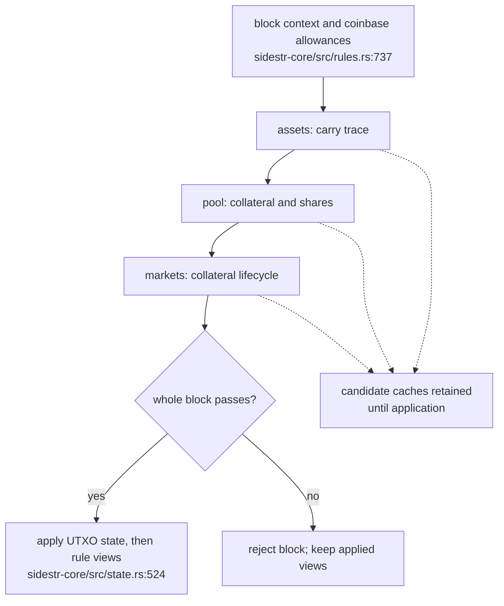
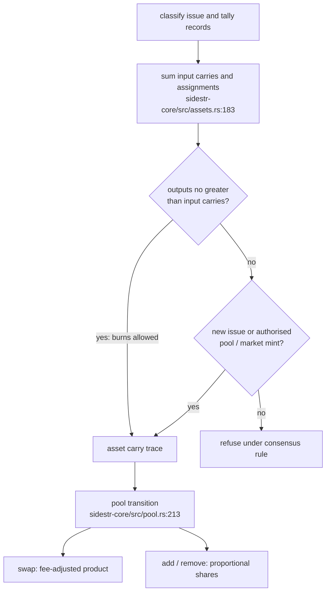
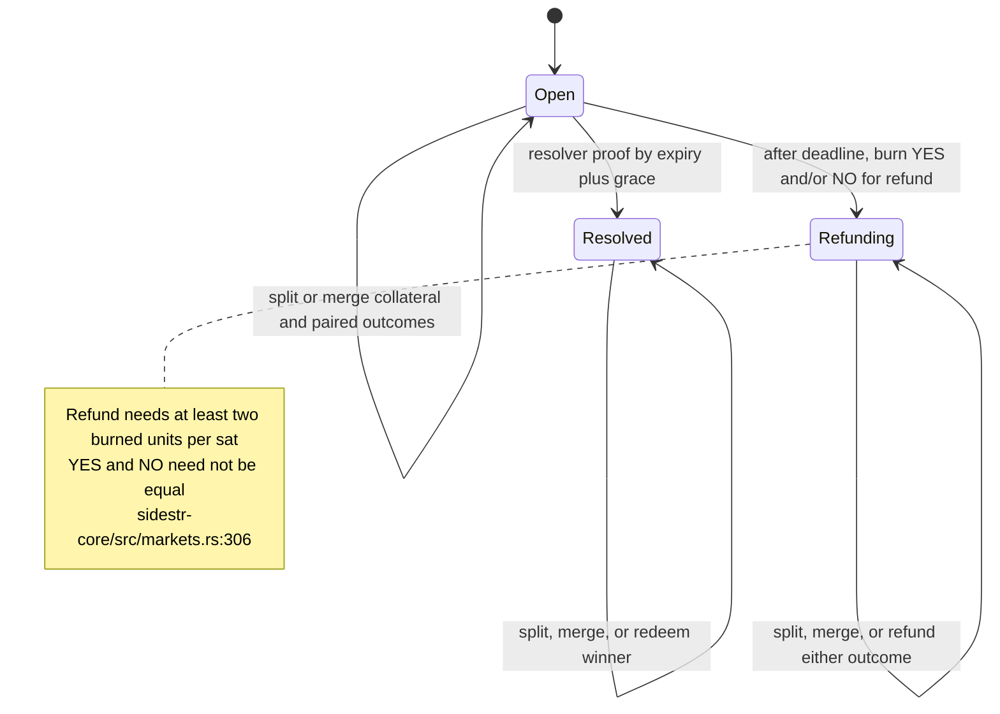
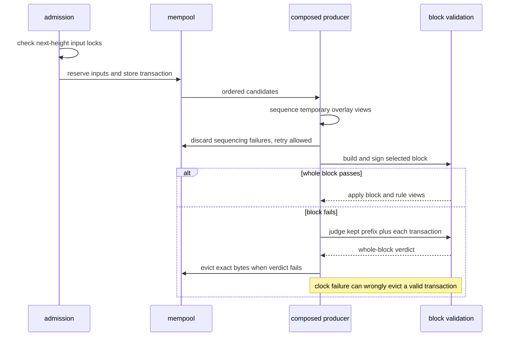

## For developers

**Repair note — 2026-11-03:** selected counterexamples below have a [scoped successor verification](06-withdrawal-snapshot-and-producer-repairs.md). This historical topic retains its declared source revision; the successor states the repaired contracts and acceptance boundaries. The canonical compositor orders assets, pool, then markets. Applied views change after successful block validation; candidate checks also retain caches. The composed producer first discards overlay sequencing failures, then uses exact-byte eviction if final block validation fails. These are different retry policies.

## For the business

Rust supplies asset reading and optional consensus rules for assets, automated pools and binary markets. The estate chain document does not enable these consensus overlays; that does not prevent clients reading asset records. The [audit](../../estate-review/2026-11-01-sidestr-overlays-and-eviction.md) records two Rust rejection-path gaps without claiming the running JavaScript producer has the same defects.

## SR-02.1 The ordered rule pipeline

**What it shows.** Coinbase allowances are queried before the ordered extra-rule checks; the canonical overlay list is assets, pool, markets (`../sidestr-rs/sidestr-core/src/rules.rs:737`, `../sidestr-rs/sidestr-core/src/rules.rs:860`, `../sidestr-rs/sidestr-core/src/overlays.rs:107`). Successful application commits rule views after the UTXO update (`../sidestr-rs/sidestr-core/src/state.rs:524`).

**Why it is this way.** Later rules require the asset trace for the candidate; pool/market mint exceptions must also pass their collateral rule. The three lightweight overlays use the default zero coinbase allowance (`../sidestr-rs/sidestr-core/src/rules.rs:562`).

**Open:** checking is not free of retained state: distinct candidate snapshots accumulate until `applied` clears them, even when another check rejects the block (`../sidestr-rs/sidestr-core/src/assets.rs:535`, `../sidestr-rs/sidestr-core/src/pool.rs:316`, `../sidestr-rs/sidestr-core/src/markets.rs:434`).

## SR-02.2 Assets and constant-product pools

**What it shows.** Issuance and collateral mint policy are explicit exceptions to the asset rule's output ceiling; ordinary transfers may burn units (`../sidestr-rs/sidestr-core/src/assets.rs:239`, `../sidestr-rs/sidestr-core/src/overlays.rs:34`). Pools enforce opening shares, swap product and proportional liquidity transitions (`../sidestr-rs/sidestr-core/src/pool.rs:112`, `../sidestr-rs/sidestr-core/src/pool.rs:213`).

**Why it is this way.** Consensus enforcement and client reading differ: `AssetView` can read a chain without optional rules; a broken tally then consumes its input carries and produces no asset outputs (`../sidestr-rs/sidestr-core/src/assets.rs:11`, `../sidestr-rs/sidestr-core/src/assets.rs:281`). A missing `rules` field does not mean assets cannot be read.

## SR-02.3 Binary market lifecycle

**What it shows.** Resolution proves a resolver input within the deadline; resolved redemption burns the winning outcome. After the unresolved deadline, refund uses combined YES/NO burns at half a sat per unit, including one-sided holdings (`../sidestr-rs/sidestr-core/src/markets.rs:202`, `../sidestr-rs/sidestr-core/src/markets.rs:306`).

**Why it is this way.** Split and merge are allowed in all three states; neither requires the market to remain open. Split creates equal YES/NO amounts; merge requires sufficient burns of each; redemption and refund impose different burn thresholds (`../sidestr-rs/sidestr-core/src/markets.rs:260`).

## SR-02.4 Admission is not block eligibility

**What it shows.** Admission checks next-height maturity; composed production sequences overlays and discards their failures with resubmission allowed (`../sidestr-rs/sidestr-core/src/state.rs:721`, `../sidestr-rs/sidestr-evm/src/rule.rs:218`, `../sidestr-rs/sidestr-evm/src/rule.rs:318`). Its fallback and the core producer instead remember exact bytes on a failed candidate verdict (`../sidestr-rs/sidestr-evm/src/rule.rs:367`, `../sidestr-rs/sidestr-core/src/state.rs:877`, `../sidestr-rs/sidestr-core/src/state.rs:759`).

**Why it is this way.** Discard lets a different ordering retry; exact-byte eviction suppresses repeated invalid forms while admitting a witness repair (`../sidestr-rs/sidestr-core/src/state.rs:742`, `../sidestr-rs/sidestr-core/tests/eviction.rs:16`). The current fallback also treats a producer-wide future-header failure as transaction invalidity: both Rust paths reproduce that gap.

**Scope:** the sealed `sidestr:dreamlab` document lacks explicit consensus overlay rules (`../project/agentbox/config/sidechain/dreamlab/chain.json:28`). Runtime activation and remediation remain separate from these source findings.
