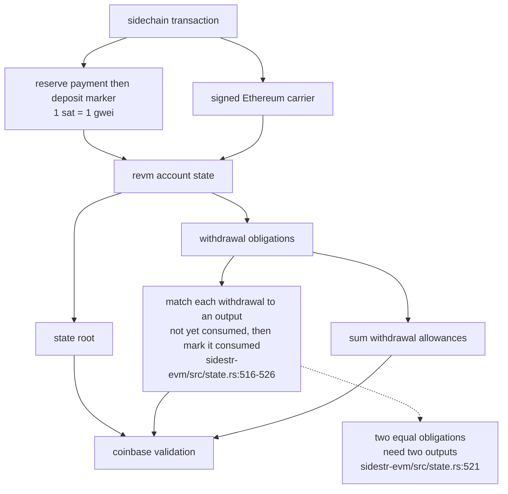
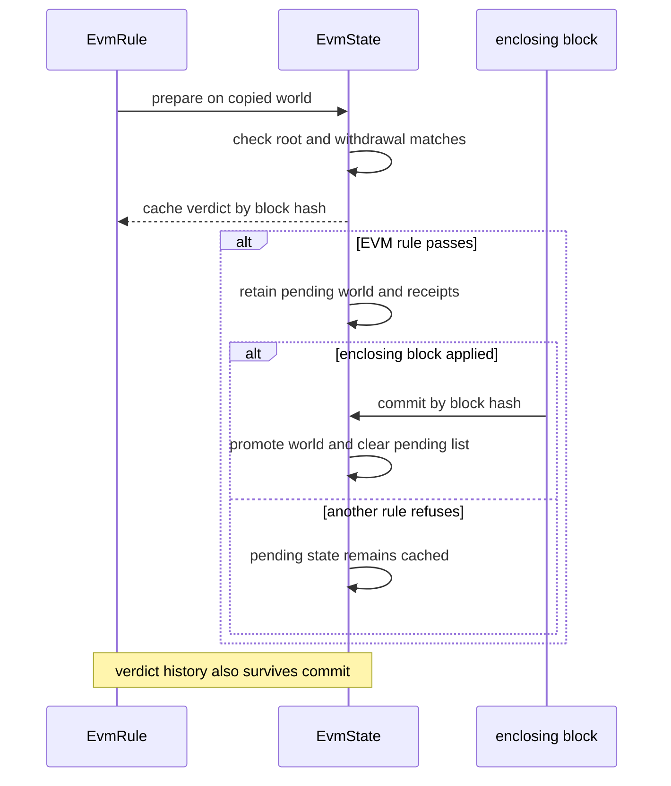
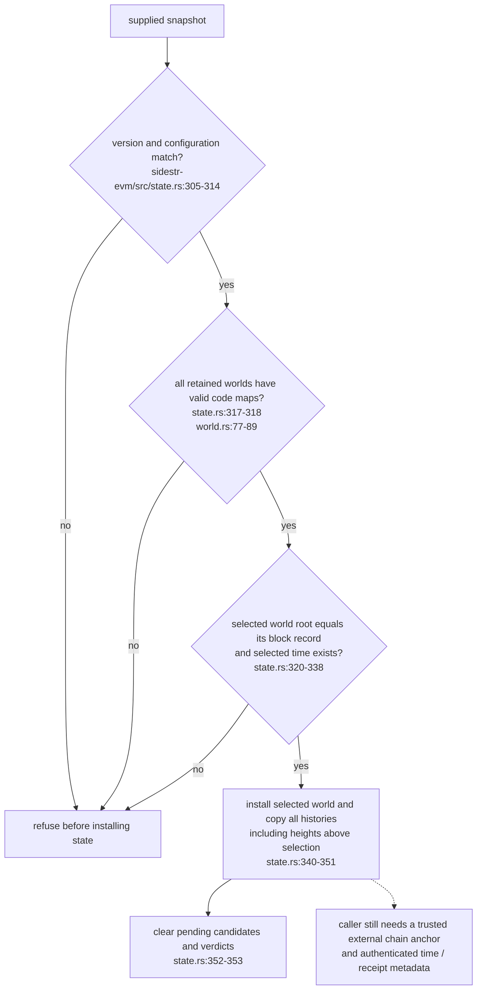
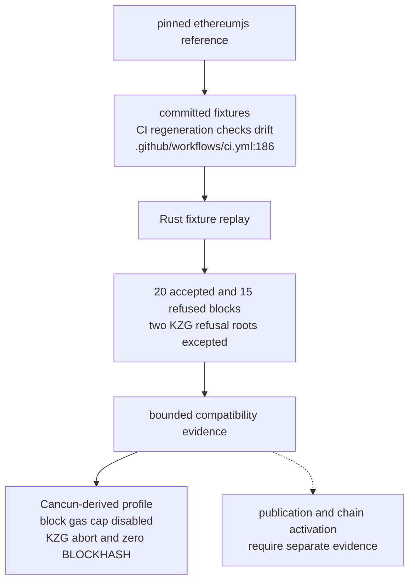

## For developers

**Source reconciliation — 2026-11-14:** this overview reads `60259e8`, including the withdrawal multiplicity and code-commitment repairs also drawn in [SR-06](06-withdrawal-snapshot-and-producer-repairs.md). The [1 November audit](../../estate-review/2026-11-01-sidestr-evm-accounting-and-snapshots.md) remains evidence about its earlier `9c6de86` source. Its underpayment and changed-bytecode counterexamples are not current-source findings. Candidate caches, snapshot metadata and retained-history semantics still have the separate limits below. Applied EVM state moves only after the enclosing block passes.

## For the business

This is smart-contract execution within a sidestr chain. Value crosses through deposits and withdrawals at one sat per gwei. The source package disables publication and the estate document does not select EVM. Each withdrawal now needs its own matching output, and restored contract bytes must match their code hashes. Snapshot metadata and the external chain commitment still require a separate trust boundary.

## SR-03.1 One chain, two coordinated state views

**What it shows.** Deposits credit reserve payments; carried transactions execute in order; the coinbase commits the root and must match withdrawal script/amount pairs (`../sidestr-rs/sidestr-evm/src/state.rs:392`, `../sidestr-rs/sidestr-evm/src/state.rs:506`, `../sidestr-rs/sidestr-evm/src/state.rs:516-526`). The allowance sums every obligation (`../sidestr-rs/sidestr-evm/src/state.rs:73`, `../sidestr-rs/sidestr-evm/src/rule.rs:105`).

**Why it is this way.** Account execution and UTXO payouts meet in one validated block. Each matched output is now marked consumed (`../sidestr-rs/sidestr-evm/src/state.rs:516`, `:521`), so equal obligations must be paid by as many outputs; the earlier existence test let one output satisfy two equal withdrawals until sidestr-rs 7f046444 enforced the multiplicity.

**Resolved (withdrawal multiplicity):** the old full-validator counterexample reused one payment for two equal obligations. The current predicate consumes each matching output and refuses any unpaid obligation (`../sidestr-rs/sidestr-evm/src/state.rs:516-531`). SR-06 records the repair boundary; this source review does not rerun the historical probe or establish chain adoption.

## SR-03.2 Prepare, retain, then commit

**What it shows.** Coinbase allowance and rule checking share preparation; a successful EVM verdict stages a world even if another rule later rejects the block (`../sidestr-rs/sidestr-evm/src/rule.rs:100`, `../sidestr-rs/sidestr-evm/src/state.rs:542-552`). Commit clears pending candidates but leaves the verdict map; restore clears both (`../sidestr-rs/sidestr-evm/src/state.rs:572-593`, `../sidestr-rs/sidestr-evm/src/state.rs:352`).

**Why it is this way.** Applied balances and receipts remain separate from speculative execution. The former discard-on-refusal arrow overstated cleanup: the dated audit retained 64 rejected outer candidates and read their verdicts after application. The current commit path still clears pending worlds without clearing the verdict map (`../sidestr-rs/sidestr-evm/src/state.rs:572-593`).

## SR-03.3 Retained-height snapshots

**What it shows.** Restore validates code in every retained world before installation, then checks the selected root against the snapshot's block record and requires a time entry (`../sidestr-rs/sidestr-evm/src/state.rs:305-355`). It retains all histories and receipts and clears transient caches. It does not authenticate time, receipts or an external chain commitment.

**Why it is this way.** Account roots contain code hashes, while executable bytes live in a separate map. Restore now requires each map key to equal Keccak of its bytes and every non-empty account code hash to have a blob (`../sidestr-rs/sidestr-evm/src/world.rs:77-89`). This closes the dated audit's changed-bytecode counterexample. Selecting genesis still leaves later block/receipt records copied into the state; code validation does not turn retained history into a pruned active-history view (`../sidestr-rs/sidestr-evm/src/state.rs:340-351`).

## SR-03.4 Evidence and activation boundary

**What it shows.** The Rust tests replay committed fixtures; CI is configured to regenerate them against the pinned module (`../sidestr-rs/.github/workflows/ci.yml:186`, `../sidestr-rs/sidestr-evm/tests/oracle.rs:155`). Two KZG refusal cases compare the error but deliberately skip intermediate-root equality (`../sidestr-rs/sidestr-evm/tests/oracle.rs:180`).

**Why it is this way.** Reference compatibility is narrower than Ethereum equivalence: the profile disables block-gas enforcement, aborts at KZG and returns zero for BLOCKHASH (`../sidestr-rs/sidestr-evm/src/exec.rs:168-170`, `../sidestr-rs/sidestr-evm/src/exec.rs:78`, `../sidestr-rs/sidestr-evm/src/world.rs:227-228`). The dated audit found the withdrawal-matching gap in its pinned reference as well; passing that historical fixture suite did not establish payment multiplicity. The Rust source now enforces the distinct-output rule above.

**Scope:** `publish = false` remains in the package configuration and the estate document lacks an EVM rule (`../sidestr-rs/sidestr-evm/Cargo.toml:16`, `../project/agentbox/config/sidechain/dreamlab/chain.json:28`). These checks neither publish the crate nor establish deployed contract use.
