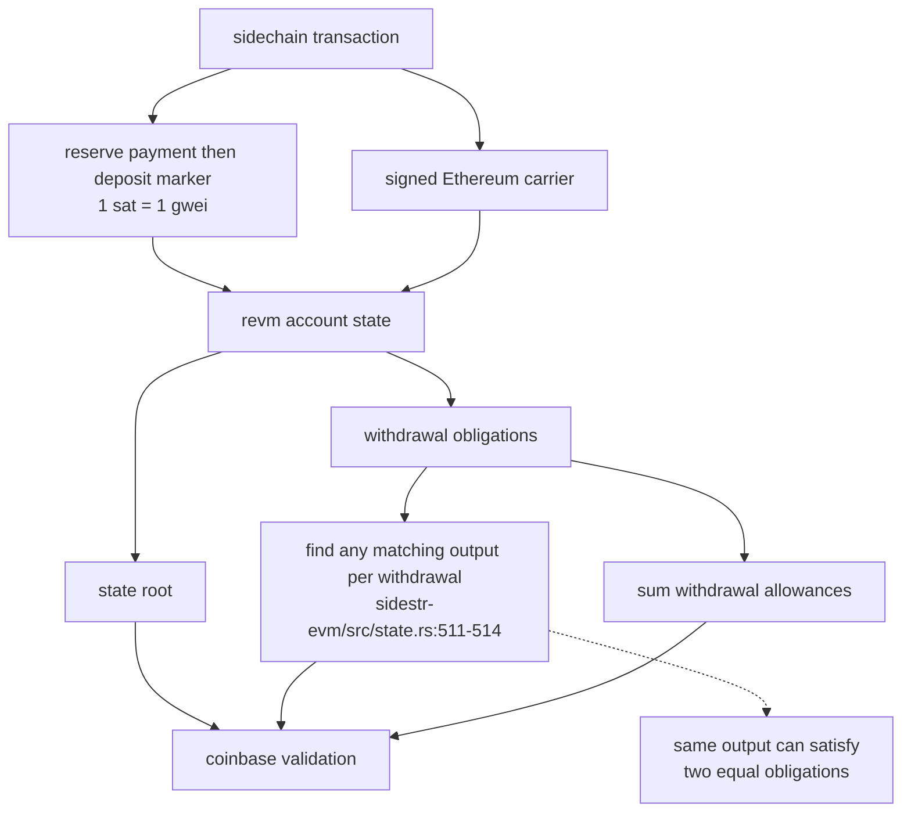
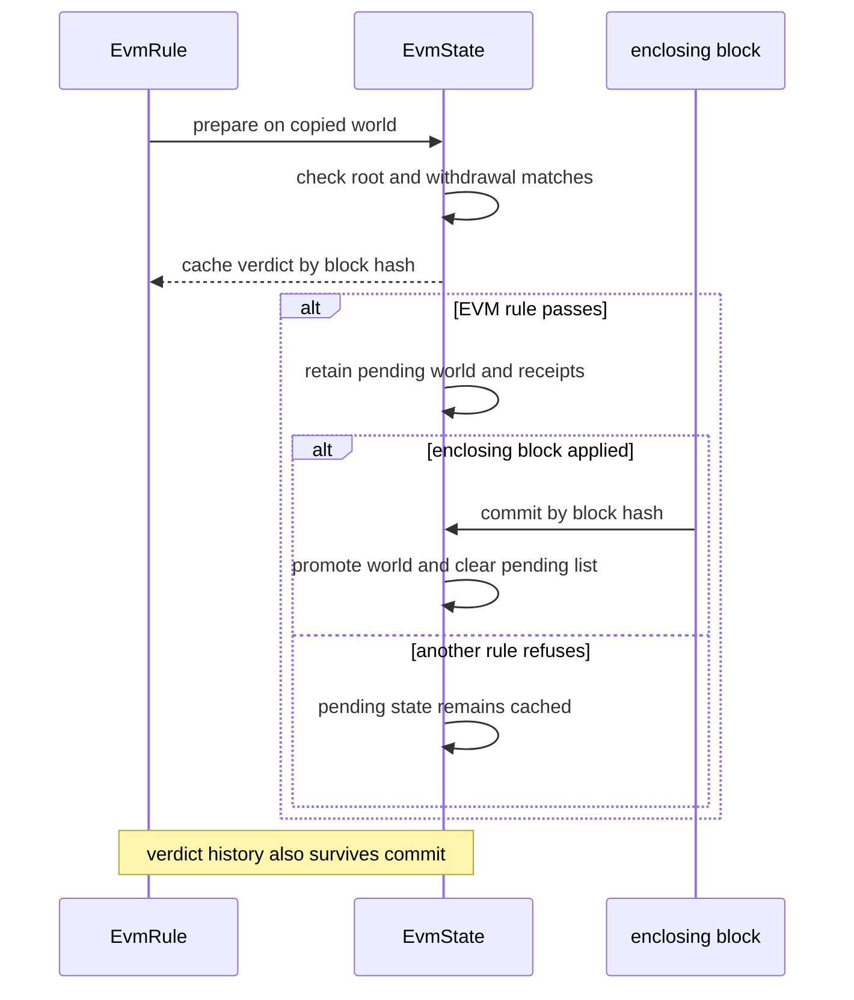
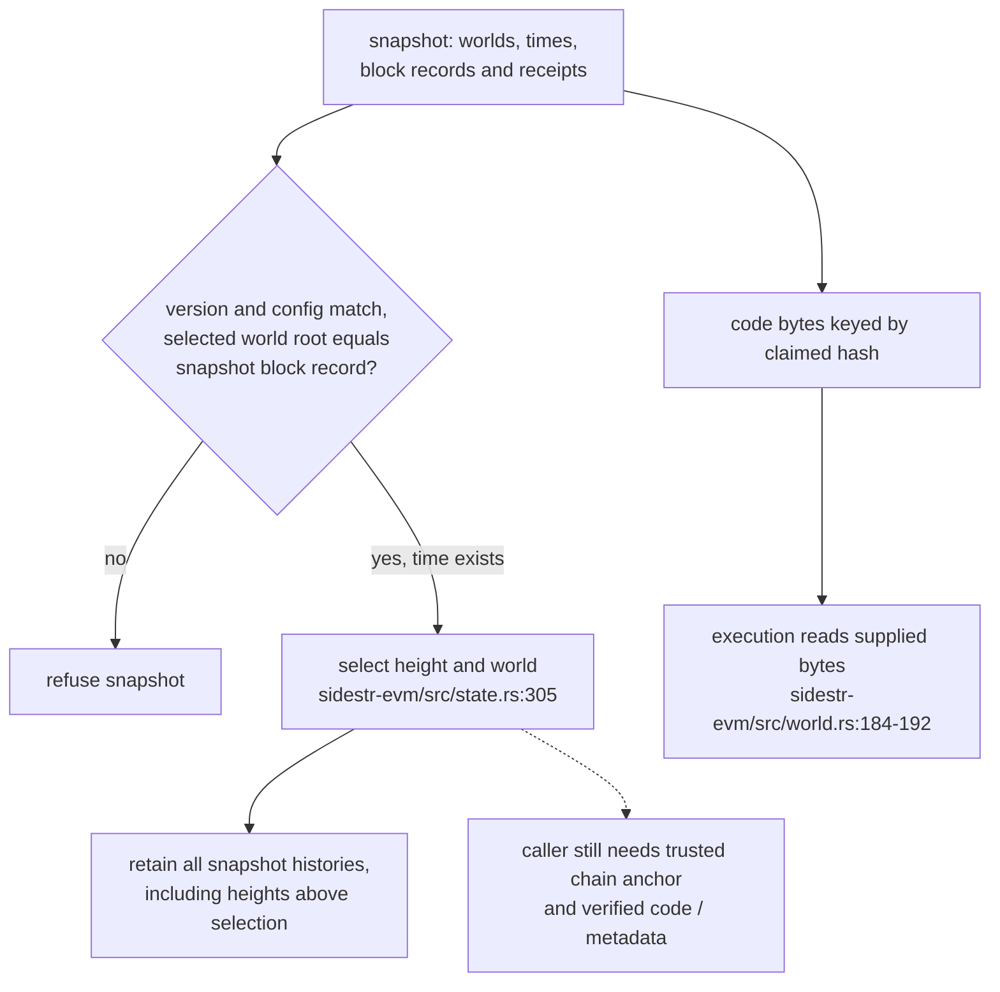
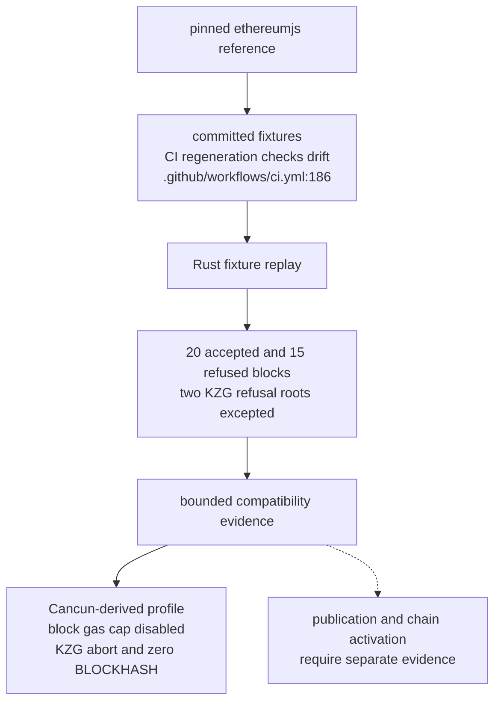

## For developers

**Repair note — 2026-11-03:** selected counterexamples below have a [scoped successor verification](06-withdrawal-snapshot-and-producer-repairs.md). This historical topic retains its declared source revision; the successor states the repaired contracts and acceptance boundaries. The optional `evm` rule executes carried Ethereum transactions with revm alongside the UTXO ledger. Applied EVM state moves after the enclosing block passes. Candidate caches, withdrawal multiplicity and snapshot validation have separate limits; the [audit](../../estate-review/2026-11-01-sidestr-evm-accounting-and-snapshots.md) reproduces them through production libraries.

## For the business

This is smart-contract execution within a sidestr chain. Value crosses through deposits and withdrawals at one sat per gwei. The source package disables publication and the estate document does not select EVM. Current validation can underpay duplicate withdrawals; snapshot root agreement alone does not establish trustworthy executable state.

## SR-03.1 One chain, two coordinated state views

**What it shows.** Deposits credit reserve payments; carried transactions execute in order; the coinbase commits the root and must match withdrawal script/amount pairs (`../sidestr-rs/sidestr-evm/src/state.rs:384`, `../sidestr-rs/sidestr-evm/src/state.rs:501`, `../sidestr-rs/sidestr-evm/src/state.rs:511-514`). The allowance sums every obligation (`../sidestr-rs/sidestr-evm/src/state.rs:73`, `../sidestr-rs/sidestr-evm/src/rule.rs:105`).

**Why it is this way.** Account execution and UTXO payouts meet in one validated block. The current existence test does not consume an output match, so matching each obligation is weaker than paying their full multiplicity.

**Open:** a full-validator probe accepts two 10,000-sat withdrawals with one 10,000-sat recipient output and the remaining allowance paid to the signer. Complete withdrawal payment is a required invariant that the current predicate does not enforce.

## SR-03.2 Prepare, retain, then commit

**What it shows.** Coinbase allowance and rule checking share preparation; a successful EVM verdict stages a world even if another rule later rejects the block (`../sidestr-rs/sidestr-evm/src/rule.rs:100`, `../sidestr-rs/sidestr-evm/src/state.rs:531-541`). Commit clears pending candidates but leaves the verdict map; restore clears both (`../sidestr-rs/sidestr-evm/src/state.rs:561-582`, `../sidestr-rs/sidestr-evm/src/state.rs:347`).

**Why it is this way.** Applied balances and receipts remain separate from speculative execution. The former discard-on-refusal arrow overstated cleanup: the native probe retains 64 rejected outer candidates, then still reads all 64 verdicts after application.

## SR-03.3 Retained-height snapshots

**What it shows.** Restore checks schema/configuration, selected world-root equality with the snapshot's own record and time presence. It copies all histories and receipts, then clears transient caches (`../sidestr-rs/sidestr-evm/src/state.rs:305-350`). It does not authenticate that time, receipts or an external chain commitment.

**Why it is this way.** Account roots contain code hashes; execution looks up code bytes separately without rehashing them (`../sidestr-rs/sidestr-evm/src/world.rs:111`, `../sidestr-rs/sidestr-evm/src/world.rs:184-192`). A probe changes a contract answer from 42 to 43 under the same root. Selecting genesis also leaves future block/receipt records queryable; this is not a pruned active-history view.

## SR-03.4 Evidence and activation boundary

**What it shows.** Fresh Rust tests replay committed fixtures; CI is configured to regenerate them against the pinned module (`../sidestr-rs/.github/workflows/ci.yml:186`, `../sidestr-rs/sidestr-evm/tests/oracle.rs:155`). Two KZG refusal cases compare the error but deliberately skip intermediate-root equality (`../sidestr-rs/sidestr-evm/tests/oracle.rs:180`).

**Why it is this way.** Reference compatibility is narrower than Ethereum equivalence: the profile disables block-gas enforcement, aborts at KZG and returns zero for BLOCKHASH (`../sidestr-rs/sidestr-evm/src/exec.rs:168-170`, `../sidestr-rs/sidestr-evm/src/exec.rs:78`, `../sidestr-rs/sidestr-evm/src/world.rs:209-210`). The pinned reference also contains the withdrawal-matching gap.

**Scope:** `publish = false` remains in the package configuration and the estate document lacks an EVM rule (`../sidestr-rs/sidestr-evm/Cargo.toml:16`, `../project/agentbox/config/sidechain/dreamlab/chain.json:28`). These checks neither publish the crate nor establish deployed contract use.
