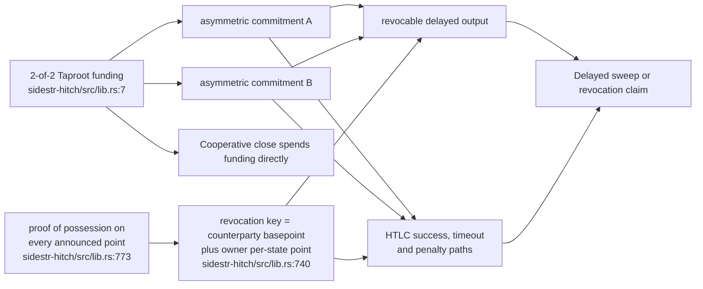
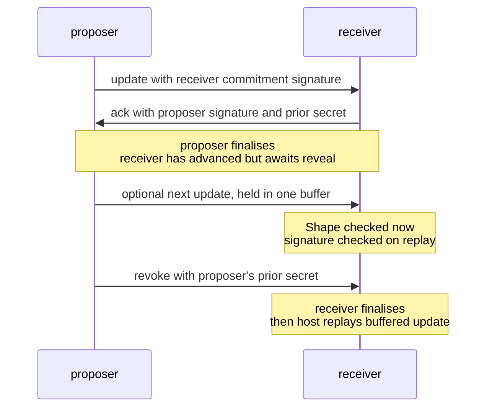
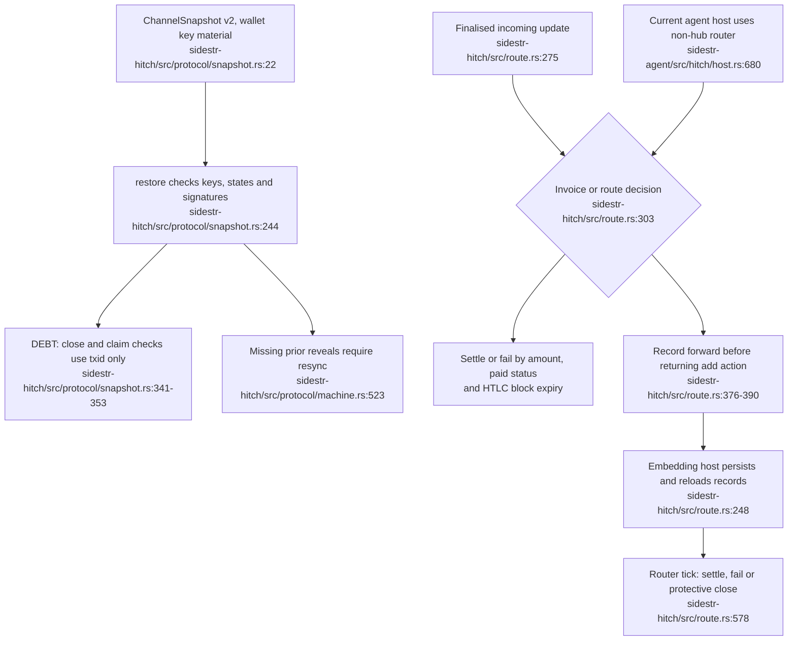
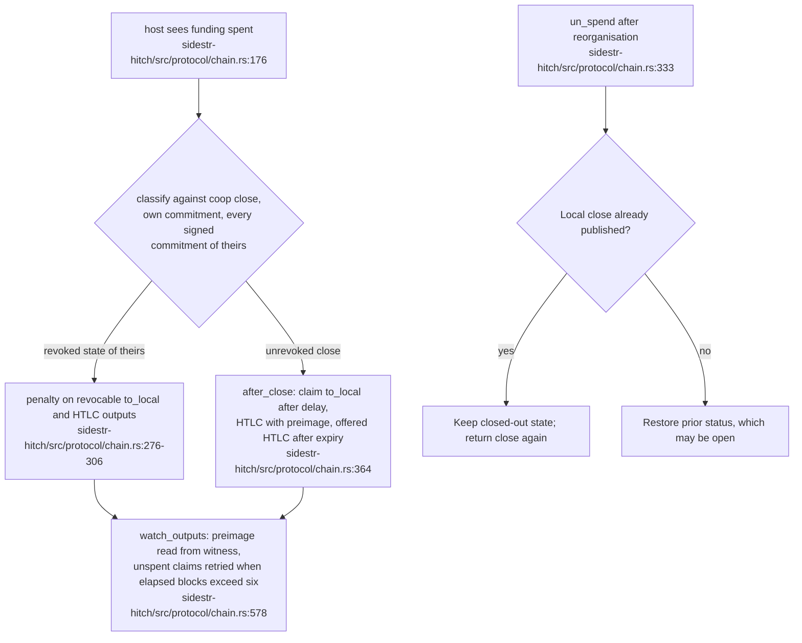
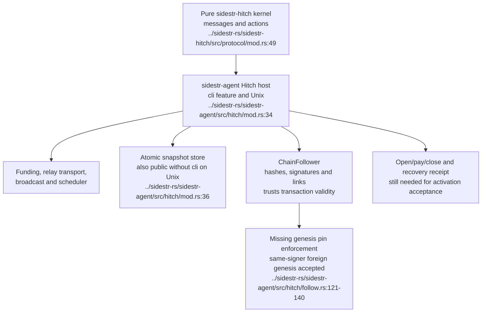

## For developers

`sidestr-hitch` is a pure channel kernel. Since 0.2.0 (sidestr-rs `5a1e89ae`, 1 Oct) it tracks Hitch at `62f8e39`, through the five rounds of Hitch's adversarial review: `lib/channel.mjs` for the transactions, `lib/peer.mjs` for the sans-IO peer machine and `lib/route.mjs` for the router. The single 2,972-line `protocol.rs` of 0.1 is now a `protocol/` module split by concern: wire messages, opening, the update machine, chain following and snapshots. It constructs Hitch funding, commitment, HTLC and close transactions, runs the update protocol, answers a close seen on the chain with penalties, sweeps and claims, serialises recovery snapshots, and returns routing actions for a host to execute. The release is breaking. Commitments now use a two-party revocation key, so the transactions differ and a 0.1 channel cannot be restored by 0.2: the 0.1 key let a commitment's owner spend its own revocation leaf, which is the flaw this release fixes. Read SR-04.1 for the revocation construction, SR-04.2 for finality, SR-04.3 for recovery and routing, SR-04.4 for the chain side and SR-04.5 for what a host still owes. Since 0.2.1 a chain-consensus suite constructs five transaction-kernel channels from one funding transaction, drives them through close, sweep, penalty and claim on all seven leaf templates, and has `sidestr-core`'s `Chain` validate every spend, with siding replaying to the same tip hash when the oracle environment is set. The agent host exists in source. SR-04.5 is refreshed in the [crate/runtime audit](../../estate-review/2026-11-01-sidestr-crate-and-runtime-boundaries.md); SR-04.3 is refreshed in the [recovery/routing audit](../../estate-review/2026-11-01-sidestr-hitch-recovery.md); SR-04.1, SR-04.2 and SR-04.4 are refreshed in the [finality/identity audit](../../estate-review/2026-11-01-sidestr-hitch-finality-and-identity.md). The chain fixture does not establish host support for batched funding: protocol IDs omit the output index.

## For the business

Hitch gives two sidestr users fast off-chain updates and a one-hop hub path. It is Lightning-shaped but cannot connect to Lightning peers. Version 0.2.0 closes a hole in which a party could cheat with its own penalty path. It also takes over the money-bearing reactions to a channel being closed on the chain: punishing an old state and claiming what is owed. Any channel opened with the earlier version has to be closed with that version. The agent supplies host code for funding, relay transport, storage, watching and broadcasts. A current deployed open/pay/close receipt is not established here, and the watcher needs a genesis-identity check before activation acceptance.

## SR-04.1 Channel transaction boundary and the two-party revocation key

**What it shows.** The crate builds the funding, asymmetric revocable commitments and optional HTLC paths for both ordinary BIP-341 and the Knots unified sighash (`../sidestr-rs/sidestr-hitch/src/lib.rs:7`, `../sidestr-rs/sidestr-hitch/src/lib.rs:22`). A commitment's revocation key combines the counterparty's basepoint with the owner's per-state point, so the owner never holds its secret; the counterparty signs with `revocation_key` once it learns the per-state secret (`../sidestr-rs/sidestr-hitch/src/lib.rs:11`, `../sidestr-rs/sidestr-hitch/src/lib.rs:740`, `../sidestr-rs/sidestr-hitch/src/lib.rs:753`). Every announced point carries a proof of possession so neither side can choose a point that cancels the other's (`../sidestr-rs/sidestr-hitch/src/lib.rs:773`, `../sidestr-rs/sidestr-hitch/src/lib.rs:785`).

**Why it is this way.** The kernel contains the money-bearing script and signature rules while leaving networking and custody to the embedding service. The two-party key arrived with Hitch `62f8e39` and is the reason commitments changed in 0.2.0 (`../sidestr-rs/sidestr-hitch/CHANGELOG.md:45`, `../sidestr-rs/sidestr-hitch/CHANGELOG.md:52`).

**Boundary:** Hitch does not speak the Lightning peer protocol (`../sidestr-rs/sidestr-hitch/src/lib.rs:24`). Native checks refuse owner-only revocation keys and accept the combined key; the independent Hitch/schema test runs only when its reference environment is set (`../sidestr-rs/sidestr-hitch/tests/oracle.rs:58-66`, `../sidestr-rs/sidestr-hitch/tests/oracle.rs:465`). **Debt:** the short channel ID uses only the transaction ID, so different funding outputs share it (`../sidestr-rs/sidestr-hitch/src/protocol/wire.rs:37-40`).

## SR-04.2 Update finality

**What it shows.** Hitch uses an update, acknowledgement and revocation handshake. The receiver treats the new state as final only after the last secret reveal, and until then nothing is forwarded, settled or announced and its own further proposal is blocked. A shape-valid next update can be buffered before signature verification; after finality the host must replay it through receive_update (`../sidestr-rs/sidestr-hitch/src/protocol/mod.rs:4`, `../sidestr-rs/sidestr-hitch/src/protocol/mod.rs:27`). A pending update is never simply dropped: on a collision the lower key's update stands, and the other signed state, like a rejected one, is kept as an alternative whose HTLCs stay bound until that state number is revoked or the funding is spent by something else (`../sidestr-rs/sidestr-hitch/src/protocol/mod.rs:20`, `../sidestr-rs/sidestr-hitch/src/protocol/machine.rs:561`).

**Why it is this way.** Each peer must hold the remedy for an old commitment before external code treats the balance change as settled. 0.2.0 added the `reject` message and the binding of set-aside states from Hitch's peer (`../sidestr-rs/sidestr-hitch/CHANGELOG.md:45`, `../sidestr-rs/sidestr-hitch/CHANGELOG.md:66`). **Boundary:** shape checks precede buffering, while proof, state and signature checks precede adoption. The blanket no-write-before-full-verification invariant does not cover the buffer (`../sidestr-rs/sidestr-hitch/src/protocol/machine.rs:833-836`, `../sidestr-rs/sidestr-hitch/src/protocol/machine.rs:845-884`). The [native check](../../estate-review/2026-11-01-sidestr-hitch-finality-and-identity.md) confirms a misbound signature survives buffering/restore but is rejected on replay.

## SR-04.3 Recovery checks and one-hop routing contract

**What it shows.** Version 2 snapshots contain signing keys, revocation secrets and preimages; restore checks key relationships and retained signatures, but recorded closes/claims are checked only by transaction ID (`../sidestr-rs/sidestr-hitch/src/protocol/snapshot.rs:22`, `../sidestr-rs/sidestr-hitch/src/protocol/snapshot.rs:244`, `../sidestr-rs/sidestr-hitch/src/protocol/snapshot.rs:341-353`). The pure router settles invoices or records a forward before returning its action, with fee and both-channel timeout deductions; the embedding host must persist/reload those records (`../sidestr-rs/sidestr-hitch/src/route.rs:198`, `../sidestr-rs/sidestr-hitch/src/route.rs:248`, `../sidestr-rs/sidestr-hitch/src/route.rs:303`). The present agent host constructs a non-hub router, and its payee lookup supplies no invoice Unix-expiry filter (`../sidestr-rs/sidestr-agent/src/hitch/host.rs:680`, `../sidestr-rs/sidestr-agent/src/hitch/host.rs:1676-1683`).

**Why it is this way.** Save-before-send is a host obligation; the machine itself performs no IO (`../sidestr-rs/sidestr-hitch/src/protocol/mod.rs:30`). Missing prior reveals block normal updates and are requested through sync, while snapshots with an awaiting final revocation remain valid recovery states (`../sidestr-rs/sidestr-hitch/src/protocol/machine.rs:523`, `../sidestr-rs/sidestr-hitch/src/protocol/machine.rs:647`, `../sidestr-rs/sidestr-hitch/src/protocol/machine.rs:1205`, `../sidestr-rs/sidestr-hitch/src/protocol/snapshot.rs:325`).

**Debt:** [Native recovery checks](../../estate-review/2026-11-01-sidestr-hitch-recovery.md) reproduce damaged-witness rebroadcasts and missing-secret close classification that persists after a late reveal; snapshot acceptance alone does not establish protection. Invoice wall-clock expiry policy and durable hub integration remain explicit acceptance tasks.

## SR-04.4 Following a close on the chain

**What it shows.** Chain handling moved into the kernel in 0.2.0. `on_spend` classifies a funding spend and answers a revoked close with penalties on revocable to_local and HTLC outputs; `after_close` claims what this peer is owed; `watch_outputs` follows every output, reads a preimage from the other side's HTLC claim and republishes an unconfirmed claim; `un_spend` clears followed claims and restores the preceding status, which can be open if no local close was published (`../sidestr-rs/sidestr-hitch/src/protocol/chain.rs:176`, `../sidestr-rs/sidestr-hitch/src/protocol/chain.rs:364`, `../sidestr-rs/sidestr-hitch/src/protocol/chain.rs:578`, `../sidestr-rs/sidestr-hitch/src/protocol/chain.rs:333`). The machine's own tick takes a claimable HTLC to the chain `delay + CLAIM_MARGIN` blocks before expiry (`../sidestr-rs/sidestr-hitch/src/protocol/machine.rs:1306`).

**Why it is this way.** Hitch's peer does these steps itself; keeping them in the sans-IO machine means a host only supplies the chain lookups and broadcasts the returned transactions. The independent Hitch/schema oracle checks selected protocol-run broadcasts only with its configured checkouts (`../sidestr-rs/sidestr-hitch/tests/oracle.rs:58-66`, `../sidestr-rs/sidestr-hitch/tests/oracle.rs:358`). A separate chain suite always runs native checks; optional siding replay and the consensus-oracle feature add separate judges (`../sidestr-rs/sidestr-hitch/tests/chain_consensus.rs:404-418`, `../sidestr-rs/sidestr-hitch/tests/chain_consensus.rs:876-900`).

## SR-04.5 Implemented host and remaining trust boundaries

**What it shows.** The host is implemented, not missing (`../sidestr-rs/sidestr-agent/src/hitch/host.rs:647`). It loads a spend-key binding and state, drives funding and kind-23600 transport, and watches/broadcasts channel actions. Unix storage remains available without the CLI feature (`../sidestr-rs/sidestr-agent/src/hitch/mod.rs:36`). The watcher intentionally does not validate transactions, but it also drops the document's genesis pin (`../sidestr-rs/sidestr-agent/src/hitch/follow.rs:133`); [native scenarios](../../estate-review/evidence/2026-11-01/crate-boundary/follower-probe.json) reproduce same-signer foreign-genesis acceptance and replacement at fork zero.

**Why it is this way.** Kernel actions stay separate from host side effects. Binding checks protect the spend identity (`../sidestr-rs/sidestr-agent/src/hitch/host.rs:652`), while chain identity needs its own enforced anchor at the watch boundary. The broadcast maturity guard is implemented (`../sidestr-rs/sidestr-agent/src/hitch/host.rs:484`, `../sidestr-rs/sidestr-agent/src/hitch/host.rs:1028`). Script compatibility and a running faucet do not prove channel service acceptance.

**Open:** pin the watched genesis; exercise open, pay, close, restart and reorganisation with retained receipts. No deployed channel exploit or completed activation is claimed.
