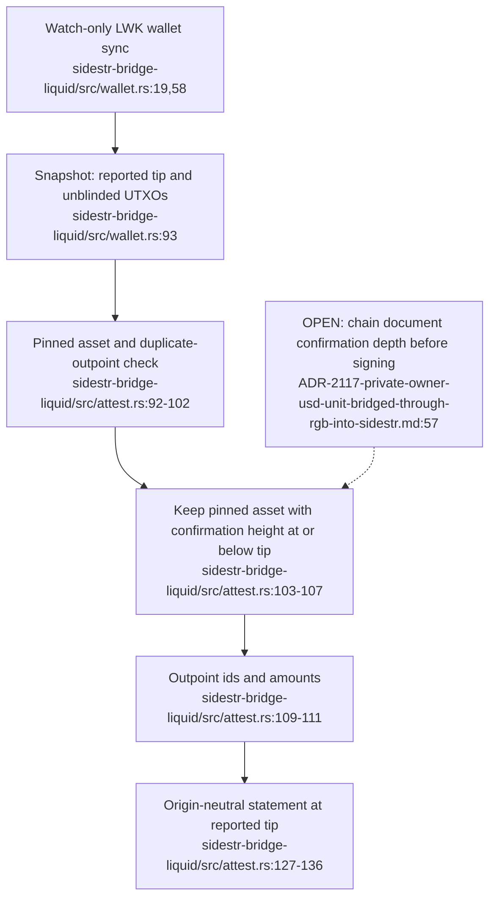
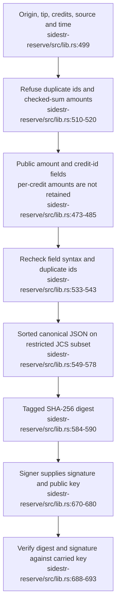
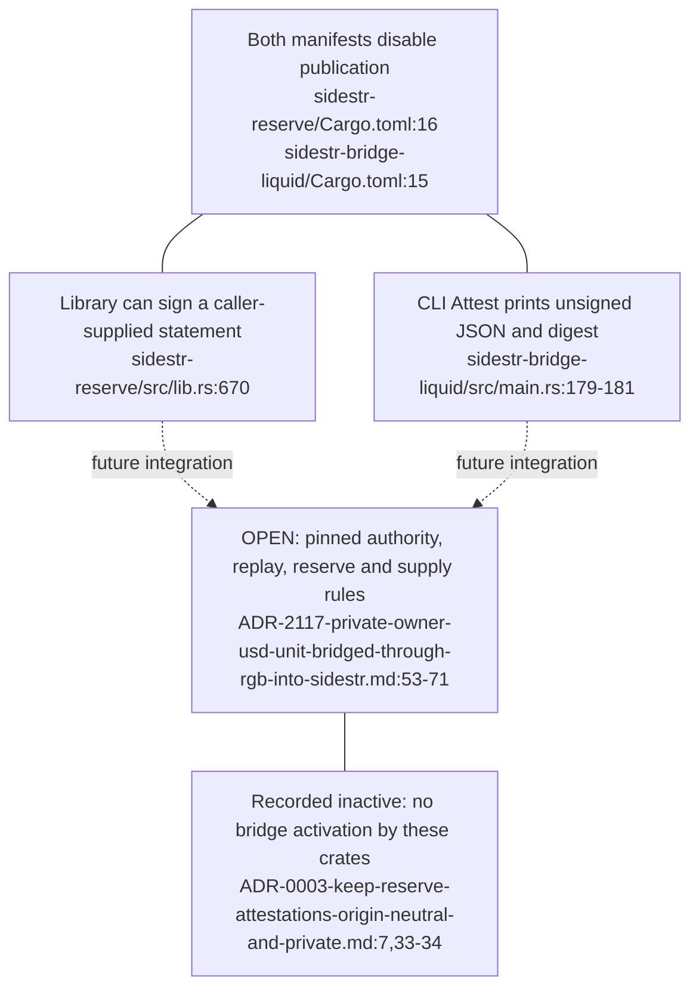

## For developers

SideStr’s neutral reserve crate builds a deterministic statement with an aggregate amount, sorted credit ids, origin, tip, source and time. Its canonicaliser accepts a restricted RFC 8785 subset; signing commits those bytes through a tagged SHA-256 digest and BIP-340. The Liquid adapter reads a watch-only wallet and counts outputs confirmed at or below the reported tip. It does not enforce a configurable confirmation depth. The [audit and fourteen production-library probes](../../estate-review/2026-11-01-reserve-attestation-boundaries.md) separate construction, signature validity and future bridge policy.

## For the business

This is a private reserve-reading and signed-statement component. A valid signature identifies the key that signed a statement; it does not establish that the key is authorised, the reading is recent, or issuing another unit is allowed. The source and decisions record no activated bridge. This review does not inspect a funded wallet or certify a current reserve balance.

## SR-05.1 Adapter boundary and confirmation depth

**What it shows.** The adapter excludes unconfirmed and future-height outputs, but includes an output in the current tip block. No depth parameter enters `credits` or `attest`. The reported tip and source come from wallet sync; the adapter documents reliance on the public server for completeness and freshness (`../sidestr-rs/sidestr-bridge-liquid/src/attest.rs:14-25`). **Why it is this way.** ADR-0003 assigns origin-specific interpretation to the adapter (`../sidestr-rs/docs/adr/ADR-0003-keep-reserve-attestations-origin-neutral-and-private.md:30`). Its “Liquid finality” verification wording is broader than the implemented height filter (`../sidestr-rs/docs/adr/ADR-0003-keep-reserve-attestations-origin-neutral-and-private.md:50`).

**Tension:** configured `bridgeConfirmations` before signing is an estate obligation, while the adapter implements only confirmed-at-tip selection; the CLI emits an unsigned statement, so this is an unclosed integration gate, not evidence of premature production signing (`../sidestr-rs/sidestr-bridge-liquid/src/main.rs:179-181`).

## SR-05.2 Deterministic statement and signature scope

**What it shows.** Construction checks the total, but subsequent field validation cannot reconstruct it from credit ids alone. A caller can change the amount before signing and obtain a valid signature over that new statement. Changing it after signing invalidates the signature. These are distinct boundaries, reproduced by the audit. **Why it is this way.** The crate signs an attester's claim; it does not verify holdings. Origin-specific evidence and the future consumer's pinned key, freshness, replay and supply checks remain separate responsibilities (`../sidestr-rs/sidestr-reserve/src/lib.rs:26-38`, `../project/agentbox/docs/adr/ADR-2117-private-owner-usd-unit-bridged-through-rgb-into-sidestr.md:53-65`).

**Drift:** the struct says “Built only by attest”, but its fields are public; `check` preserves field syntax and duplicate rejection, not the original total (`../sidestr-rs/sidestr-reserve/src/lib.rs:468-485`, `../sidestr-rs/sidestr-reserve/src/lib.rs:529-544`).

## SR-05.3 Publication, CLI and activation are separate

**What it shows.** Publication restrictions, signing capability and runtime activation are independent facts. `SignedAttestation.verify` has no expected-authority, clock or replay-set argument (`../sidestr-rs/sidestr-reserve/src/lib.rs:688`). The CLI's unsigned output does not establish a live mint path. **Why it is this way.** ADR-0003 keeps the format project-private and leaves funding, deployment and consumer activation to separate estate evidence (`../sidestr-rs/docs/adr/ADR-0003-keep-reserve-attestations-origin-neutral-and-private.md:32-34`). An inactive source record does not prove a present-day wallet is unfunded.

**Open:** the master board keeps reserve custody and service-account isolation open; library publication does not close those runtime gates (`../project/docs/TODO-unified.md:99`).
