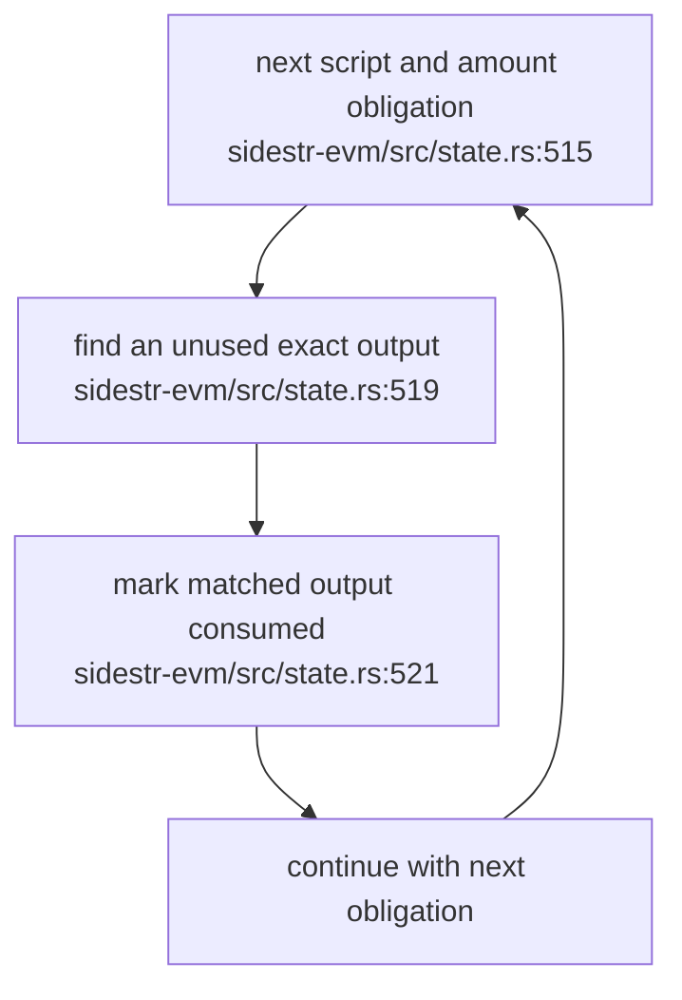
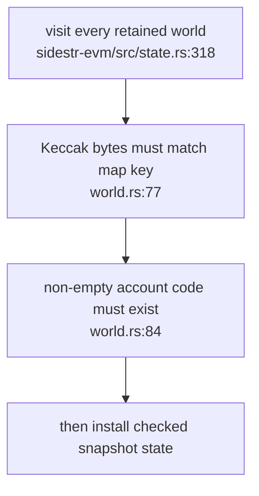
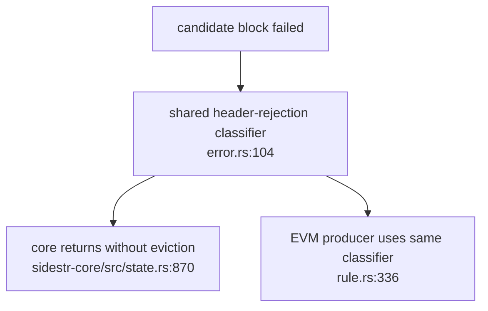

## For developers

This scoped successor records the repaired SR-03.1 withdrawal and snapshot cases and SR-02.4/SR-03.3 producer eviction boundary. It does not close the remaining Hitch or snapshot-metadata findings.

## For the business

One payment output cannot satisfy two withdrawals, restored contract code must match its commitment, and a bad block clock no longer discards valid queued transactions. Consensus consumers still need coordinated adoption; these source changes do not restart a chain.

## SR-06.1 One output satisfies at most one withdrawal

**What it shows:** the validator tracks output multiplicity instead of independently reusing an output for every equal obligation. **Why it is this way:** the earlier predicate allowed duplicate withdrawals to share one payment while the allowance summed both. ADR-0002's optional execution boundary does not excuse an inconsistent payout rule.

**Invariant:** a consumed output cannot satisfy another obligation (`sidestr-evm/src/state.rs:519`).

## SR-06.2 Restore validates executable bytes before state mutation

**What it shows:** checking an account-trie root alone is insufficient when executable bytes are stored in a separate hash map. **Why it is this way:** every retained world may be selected on rewind. Validation therefore covers the entire snapshot's code maps, not only the selected height.

**Invariant:** code validation precedes snapshot installation (`sidestr-evm/src/state.rs:318`).

## SR-06.3 Header refusal preserves the mempool

**What it shows:** a Bitcoin or Knots header failure is distinct from transaction invalidity. **Why it is this way:** dropping transactions cannot repair a clock or header error. Genuine transaction-rule eviction remains tested and supported.

**Invariant:** header classification is shared by core and the EVM producer (`error.rs:104`).
