## SP-02.1 Process entry point — CLI to listening socket

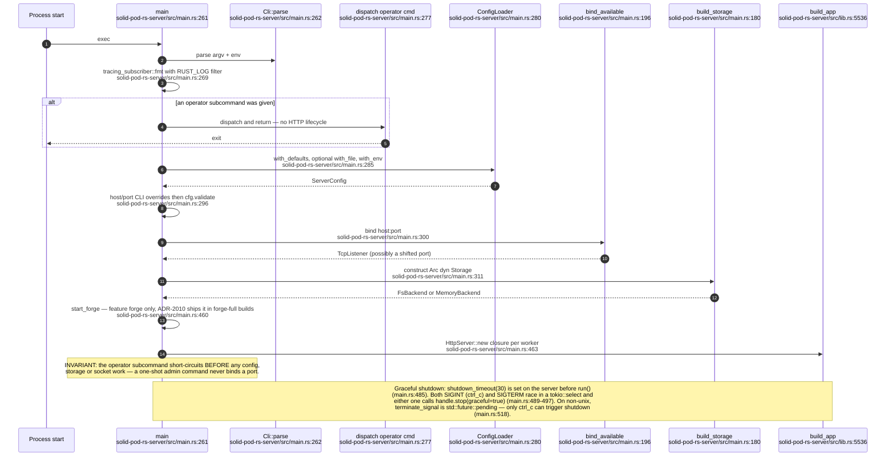

**Tension:** `--ssl-key` and `--ssl-cert` are parsed in every build, but only the `tls` arm reads them (`solid-pod-rs-server/src/main.rs:467`). A build without `tls` takes the plain `listen` arm (`solid-pod-rs-server/src/main.rs:481`) and serves HTTP with no warning that the key and certificate were ignored.

## SP-02.2 AppState assembly order

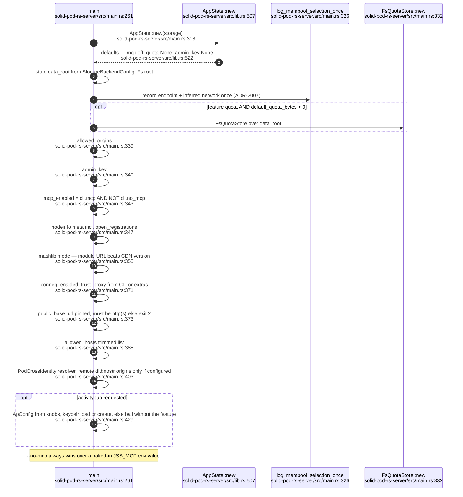

## SP-02.3 The security-relevant CLI/env register

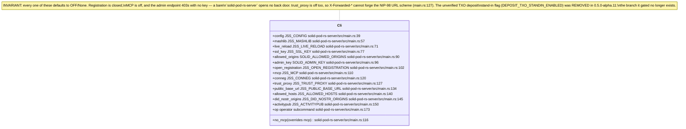

**Open:** the off-by-default claim is about the CLI flags. Registration can also open from configuration, since `open_registrations` is true when `extras.invite_only` is false (`solid-pod-rs-server/src/main.rs:350`). The `trust_proxy` claim rests on the scheme helpers honouring proxy headers only when trusted (`solid-pod-rs-server/src/scheme.rs:29`); no request was run through them.

## SP-02.5 ServerConfig shape and the one hard validation

```mermaid
classDiagram
    class ServerConfig {
        +server ServerSection  solid-pod-rs/src/config/schema.rs:27
        +storage StorageBackendConfig  solid-pod-rs/src/config/schema.rs:31
        +auth AuthConfig  solid-pod-rs/src/config/schema.rs:35
        +notifications NotificationsConfig  solid-pod-rs/src/config/schema.rs:39
        +security SecurityConfig  solid-pod-rs/src/config/schema.rs:43
        +extras ExtrasConfig  solid-pod-rs/src/config/schema.rs:51
        +validate()  solid-pod-rs/src/config/schema.rs:356
    }
    class ServerSection {
        +host  solid-pod-rs/src/config/schema.rs:146
        +port  solid-pod-rs/src/config/schema.rs:150
        +base_url Option  solid-pod-rs/src/config/schema.rs:154
    }
    class AuthConfig {
        +oidc_enabled (default false)  solid-pod-rs/src/config/schema.rs:223
    }
    class SecurityConfig {
        +dotfile_allowlist  solid-pod-rs/src/config/schema.rs:314
        +default_quota_bytes (default 0 = off)  solid-pod-rs/src/config/schema.rs:322
    }
    ServerConfig *-- ServerSection
    ServerConfig *-- AuthConfig
    ServerConfig *-- SecurityConfig
    note for ServerConfig "validate() rejects oidc_enabled = true with no oidc_issuer\n  solid-pod-rs/src/config/schema.rs:360 — a pod cannot claim OIDC with no issuer."
    note for ServerConfig "Resolution order (solid-pod-rs/src/config/loader.rs:79,94,101,127): defaults\n  -> file -> env -> CLI overlay, later layers win. The binary never calls the\n  CLI overlay: it sets host and port by hand after load (main.rs:290).\n  The only loader warning is memory storage with a root set (loader.rs:181);\n  a bad shape is fatal at deserialisation (loader.rs:196). parse_size accepts\n  50MB/1.5GB or bare bytes (solid-pod-rs/src/config/sources.rs:488)."
```

**Drift:** an unparseable boolean in an env var is dropped without a warning; `JSS_OIDC_ENABLED` is inserted only when `parse_bool` succeeds (`solid-pod-rs/src/config/sources.rs:277`).

## SP-02.6 Storage backend selection — only two survive

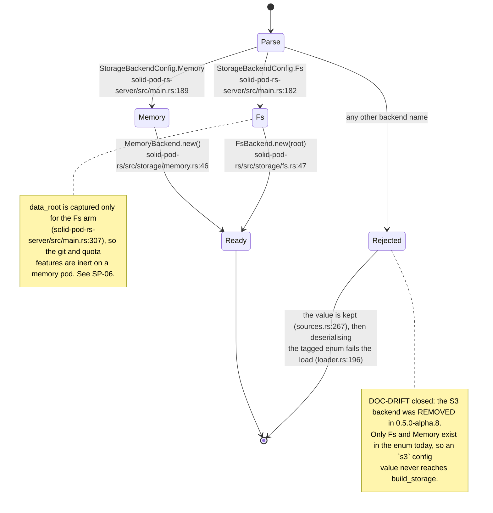

## SP-02.7 Port binding — busy-port shift

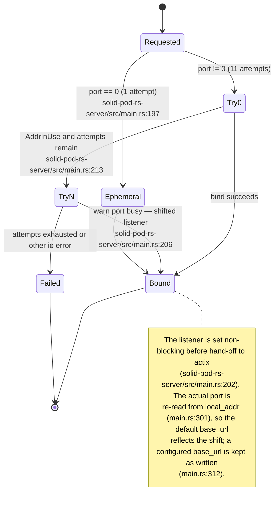

## SP-02.8 Middleware stack — registration order versus execution order

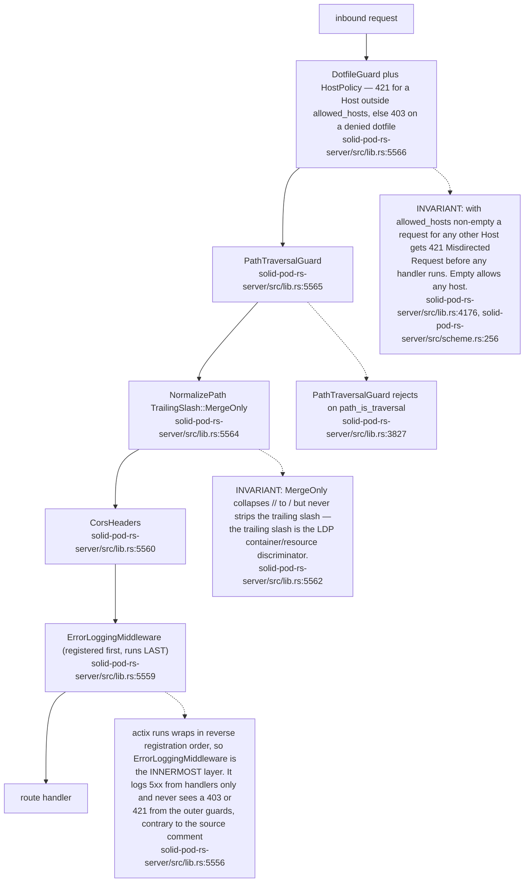

**Drift:** the product comment says `ErrorLoggingMiddleware` is the outermost layer and observes guard short-circuits (`solid-pod-rs-server/src/lib.rs:5555`). Under actix-web's documented reverse-order rule it is the innermost.

**Tension:** both guards run before `NormalizePath`, so they inspect the raw path before `//` is merged. A 403 or 421 from a guard also never passes through `CorsHeaders`, whose headers are added on the inner service's response (`solid-pod-rs-server/src/lib.rs:3901`), so a browser sees those rejections as CORS failures. This is source reading against the framework rule; no request was run.

## SP-02.9 Route table — discovery, payments, admin and account routes

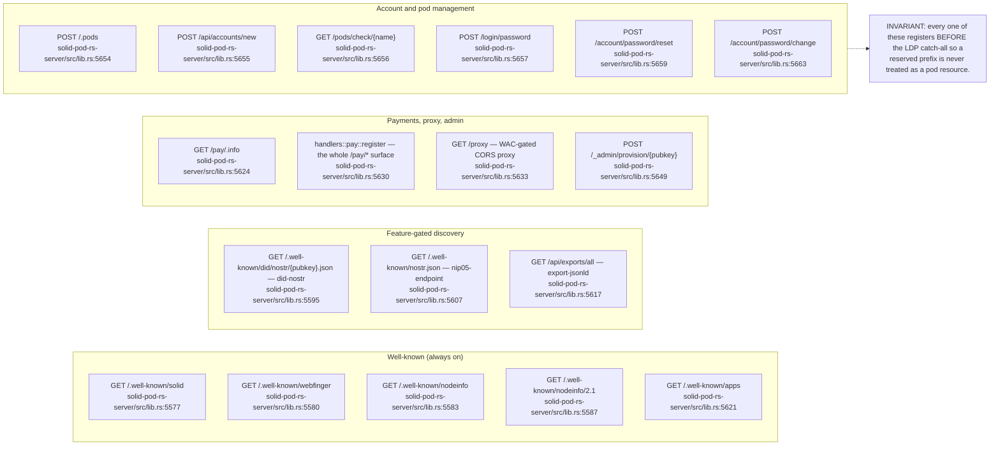

## SP-02.10 Route table — git, forge and MCP surfaces

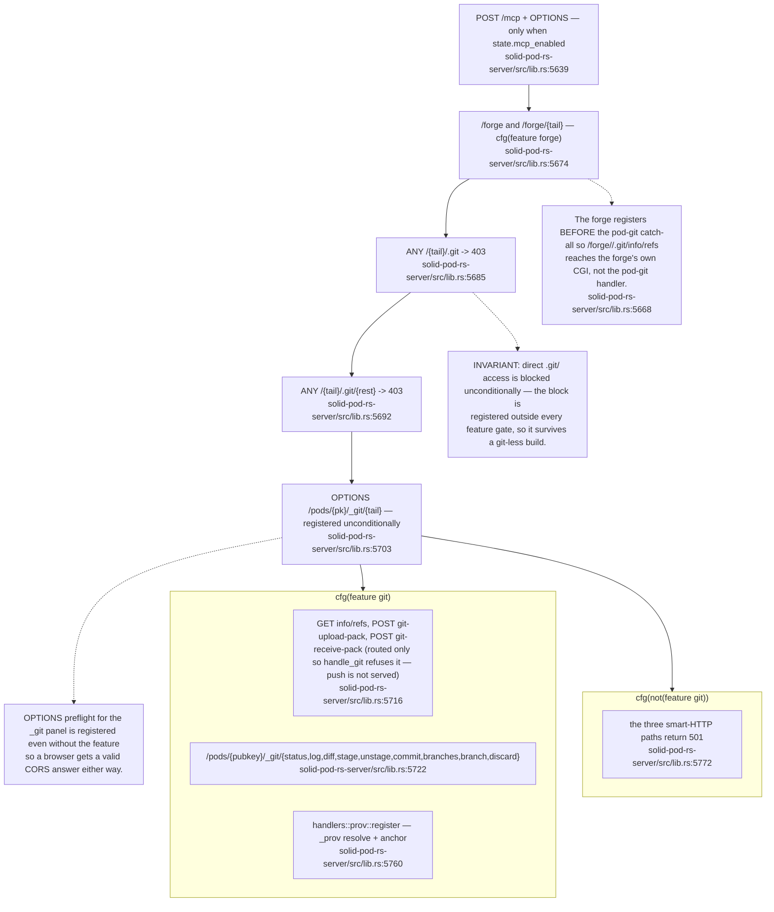

## SP-02.11 Route table — the LDP catch-all, registered last

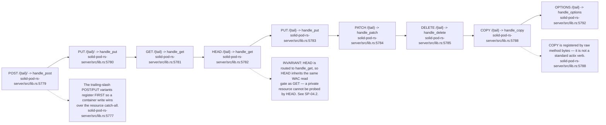

## SP-02.13 Operator subcommands — the no-HTTP path

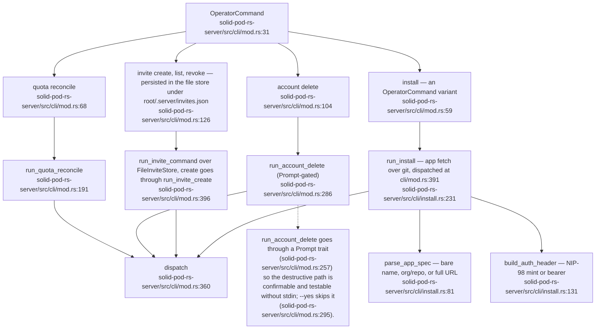

**Debt:** the shipped `account delete` builds a fresh `InMemoryUserStore` inside `dispatch` (`solid-pod-rs-server/src/cli/mod.rs:380`), so it can never find a real user and always reports "no such user". Its help text promises removal of pods and the WebID profile as well (`solid-pod-rs-server/src/cli/mod.rs:105`), but nothing on that path touches either.

**Debt:** `quota reconcile` is compiled only with the `quota` feature (`solid-pod-rs-server/src/cli/mod.rs:190`). The empty default build ships a fallback that returns a rebuild error (`solid-pod-rs-server/src/cli/mod.rs:250`).
