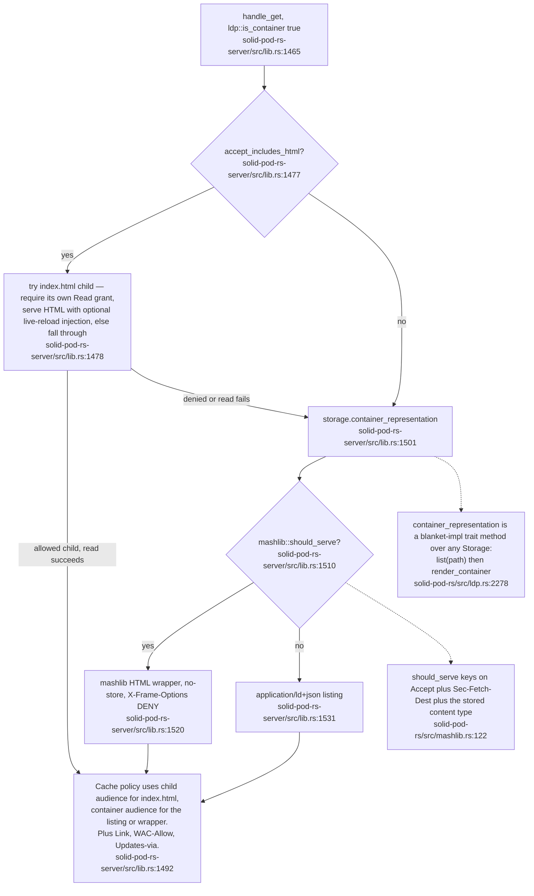
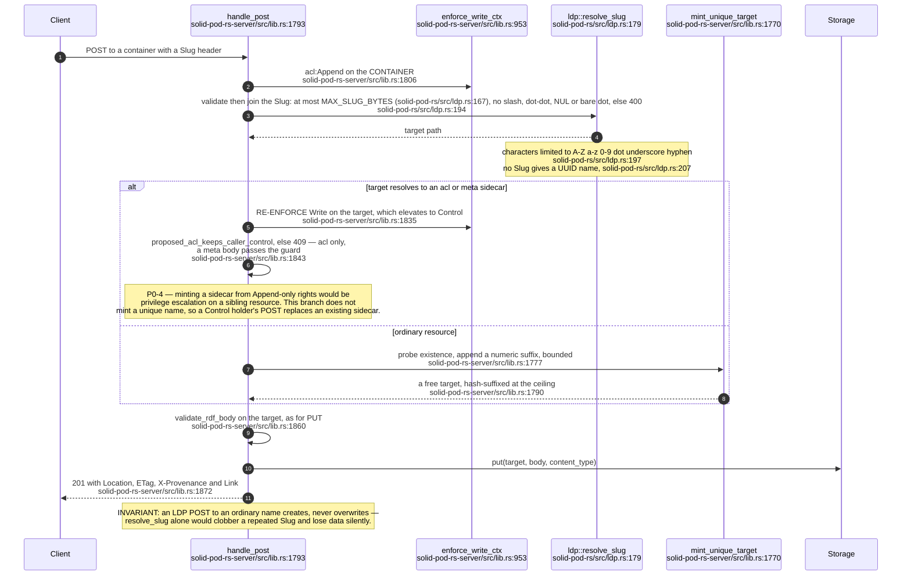
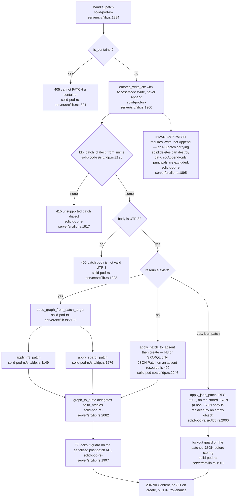
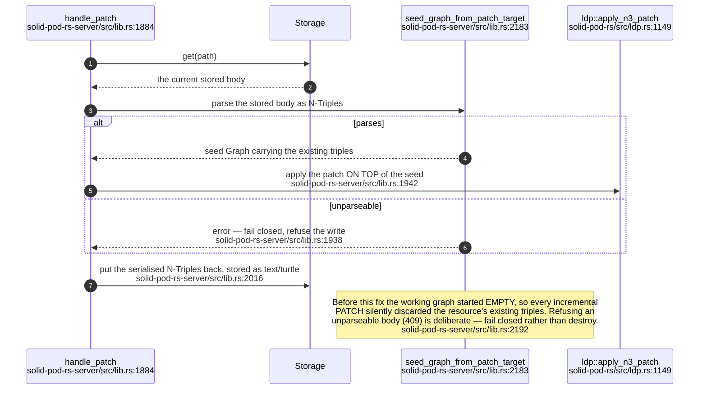
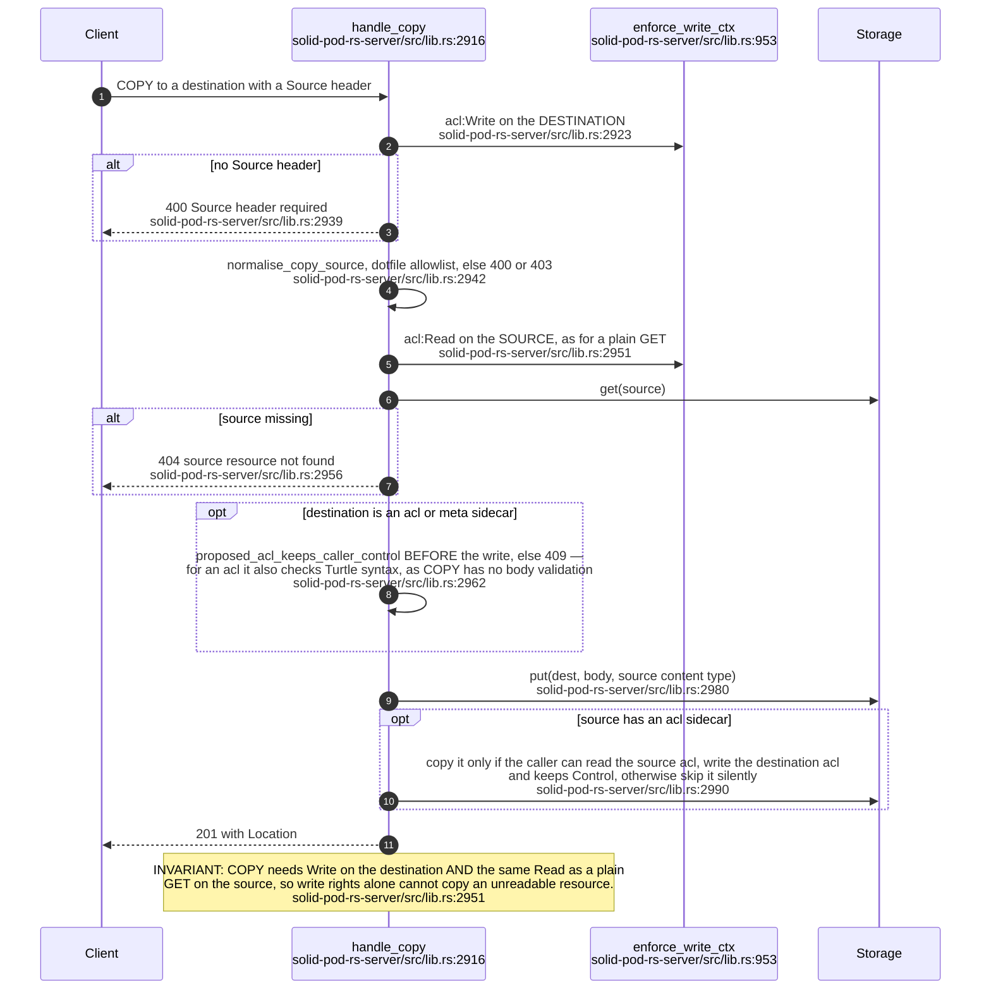
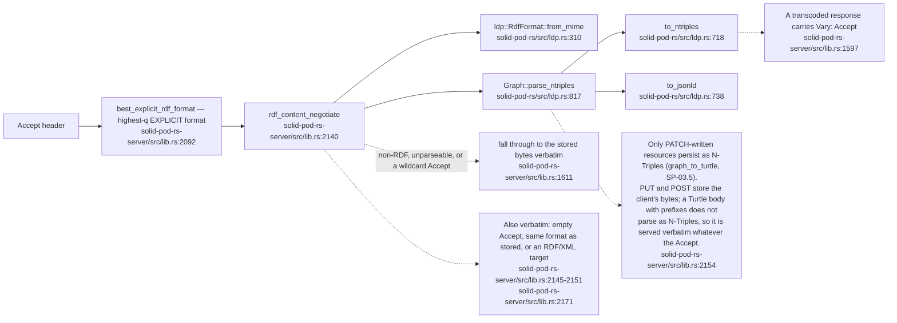
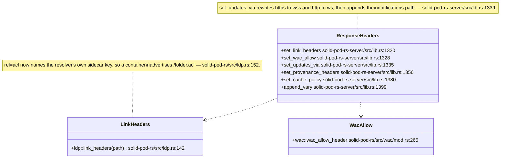

## SP-03.1 GET — the full read path

## SP-03.2 Container GET — three representations

## SP-03.3 PUT — resource and container creation

## SP-03.4 POST — Append, Slug resolution and unique-name minting

**Tension:** `mint_unique_target` probes with `exists` and the later `put` is a plain write (`solid-pod-rs-server/src/lib.rs:1771`, `solid-pod-rs-server/src/lib.rs:1865`), so the no-overwrite rule is a check-then-act. Two concurrent POSTs with the same Slug can both choose the same free name. The hash fallback is a deterministic hash of the target, so it is not guaranteed fresh either (`solid-pod-rs-server/src/lib.rs:1788`). Only a concurrent run could confirm the race; the source does not prevent it.

## SP-03.5 PATCH — non-destructive, three dialects

**Debt:** an N3 or SPARQL PATCH cannot change or create an `.acl` at this revision. A stored Turtle ACL with `@prefix` lines does not parse as N-Triples, so the seed refuses it with 409 (`solid-pod-rs-server/src/lib.rs:2192`). Creating one through PATCH serialises N-Triples with full IRIs and passes them to the guard as `application/n-triples` (`solid-pod-rs-server/src/lib.rs:2035-2044`). The shared policy reader recognises Turtle only by a Turtle media type, `@prefix` or `acl:Authorization` (`solid-pod-rs/src/wac/resolver.rs:309-316`), so the guard classifies that body as Malformed and refuses it with 409. PUT, POST to a sidecar Slug, COPY onto a sidecar and JSON Patch still write ACLs; RDF PATCH cannot. This is source tracing; no route test exercises RDF PATCH on an ACL.

## SP-03.6 The non-destructive-write invariant

**Debt:** the invariant covers the N3 and SPARQL dialects only. The JSON Patch branch treats a stored body that is not JSON as `{}` and writes the patched object back under the stored content type (`solid-pod-rs-server/src/lib.rs:1949-1952`, `solid-pod-rs-server/src/lib.rs:1978`). So a JSON Patch that applies cleanly to an empty object, sent to a Turtle resource, replaces its triples where an N3 patch would be refused. This is source tracing and was not reproduced over HTTP.

## SP-03.8 COPY — the non-standard verb

## SP-03.9 Glob GET

## SP-03.10 RDF content negotiation

## SP-03.11 Response header helpers for LDP responses

**Drift:** this panel's heading used to say "every LDP response", but each handler picks its own subset. Successful GET branches set Link, WAC-Allow, Updates-Via and the cache policy (`solid-pod-rs-server/src/lib.rs:1623-1626`). PUT and POST set Link and X-Provenance (`solid-pod-rs-server/src/lib.rs:1759-1760`). PATCH sets only X-Provenance (`solid-pod-rs-server/src/lib.rs:2022`). COPY sets only Location (`solid-pod-rs-server/src/lib.rs:3024-3027`). Glob GET sets only the cache policy (`solid-pod-rs-server/src/lib.rs:3097`). A GET that misses storage returns a bare 404 (`solid-pod-rs-server/src/lib.rs:1629`). The panel lists the helpers, not a guarantee that every response carries them.

## SP-03.12 ADR-2002 cache policy — audience beats media type

**Boundary:** this policy applies to the audience produced by the parsed ACL. Lost restrictions can misclassify a response as Public. Headers do not prove revocation through an intermediary cache. [HTTP acceptance and remaining delivery gaps](../../estate-review/2026-11-01-solid-http-delivery.md).
