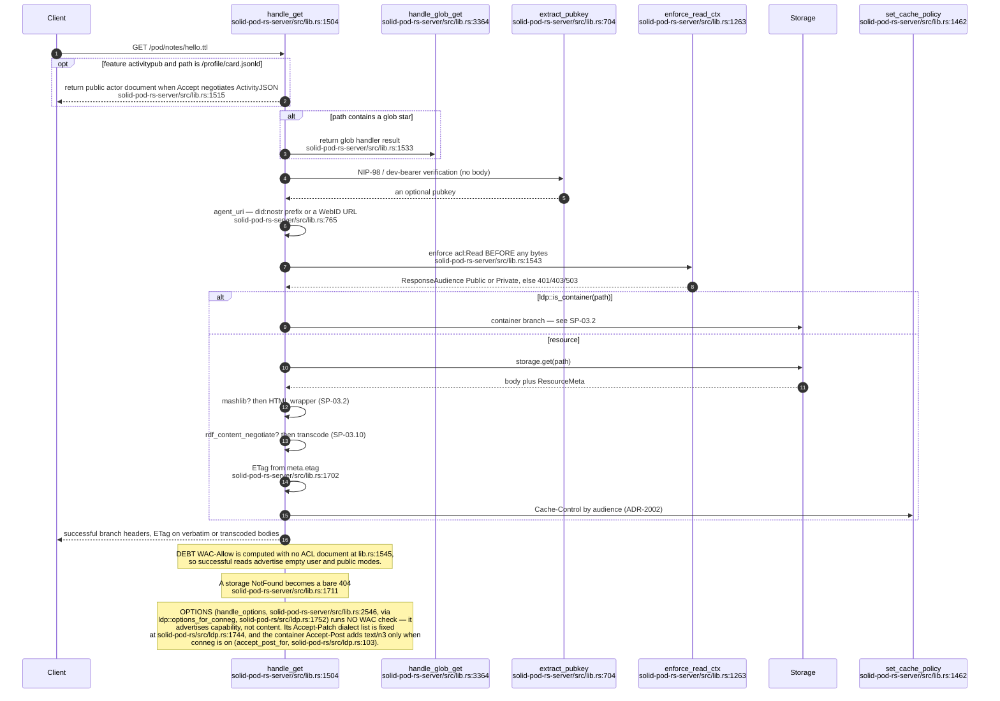
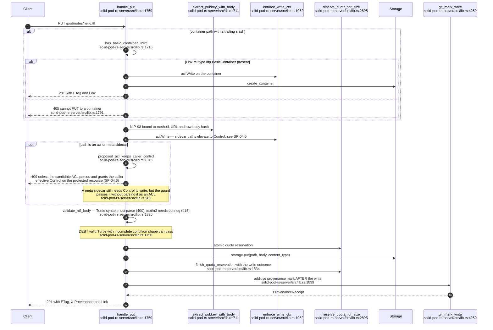
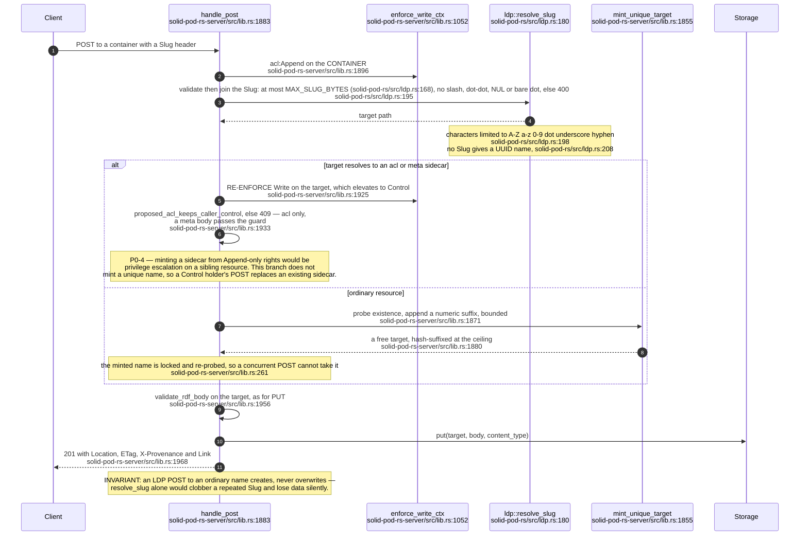
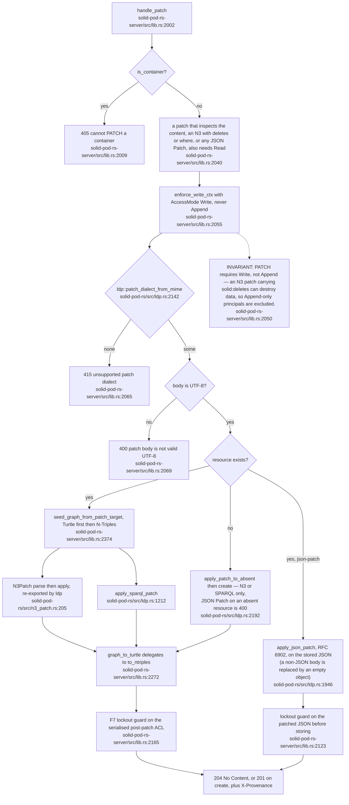
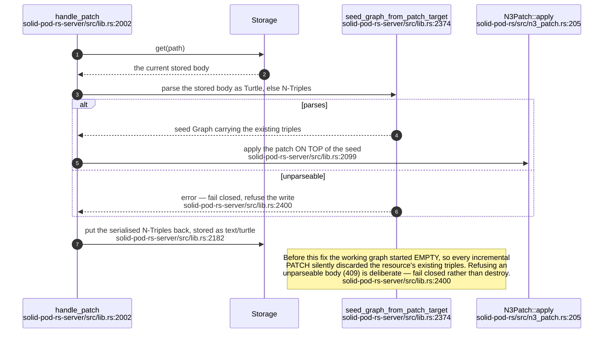
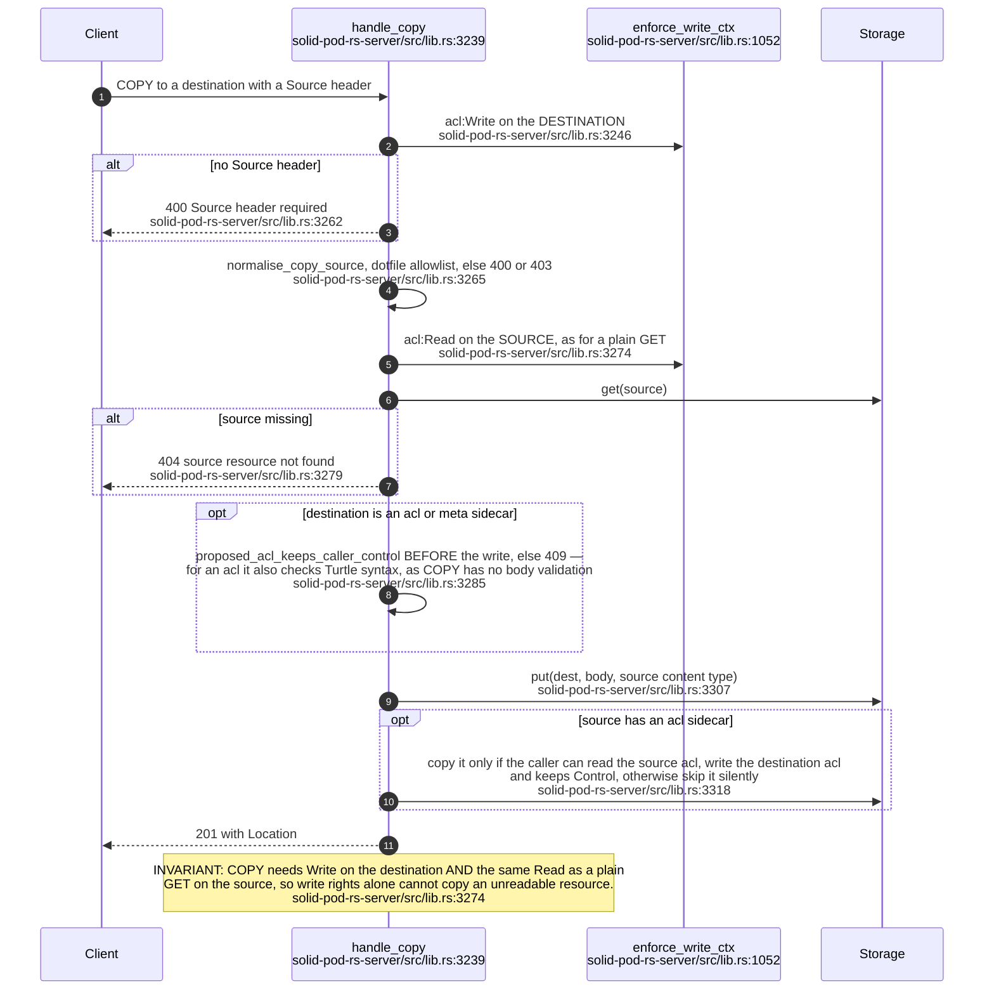
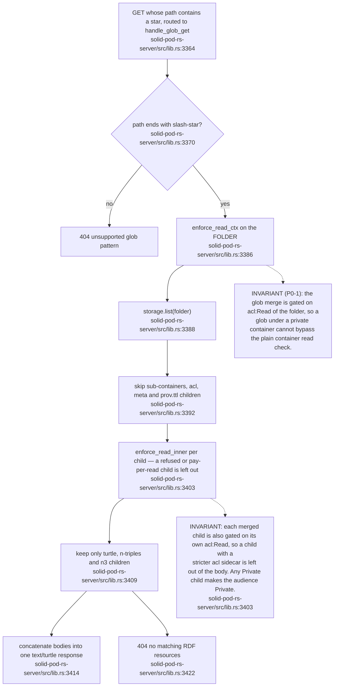
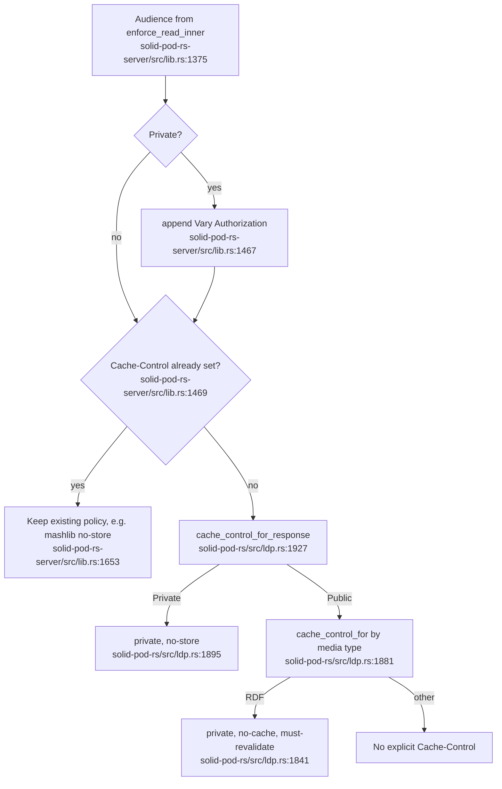

## SP-03.1 GET — the full read path

## SP-03.2 Container GET — three representations

## SP-03.3 PUT — resource and container creation

## SP-03.4 POST — Append, Slug resolution and unique-name minting

**Tension:** RESOLVED at solid-pod-rs 27e1899. `mint_unique_target` still probes with `exists` (`solid-pod-rs-server/src/lib.rs:1856`), but POST now takes the name through `mint_and_lock_target`, which holds the resource's write lock across the re-check and the write, retries up to 64 times and refuses with 409 when no name is free (`solid-pod-rs-server/src/lib.rs:261-283`, `solid-pod-rs-server/src/lib.rs:1949`). The hash fallback is still a deterministic hash of the target (`solid-pod-rs-server/src/lib.rs:1878`), and the lock loop stops rather than re-probe it (`solid-pod-rs-server/src/lib.rs:268-271`).

## SP-03.5 PATCH — non-destructive, three dialects

**Debt:** RESOLVED at solid-pod-rs 27e1899. An N3 or SPARQL PATCH can now change or create an `.acl`. The seed reads a stored Turtle ACL with `@prefix` lines (`solid-pod-rs-server/src/lib.rs:2397`), the patched graph's ACL targets are put back in path form (`solid-pod-rs-server/src/lib.rs:2151-2153`), and the lockout guard sees the result as `text/turtle` (`solid-pod-rs-server/src/lib.rs:2000`, `solid-pod-rs-server/src/lib.rs:2165-2173`). A patched ACL that carries `acl:condition` is refused with 409, because the N-Triples write-back cannot preserve it (`solid-pod-rs-server/src/lib.rs:1981-1984`, `solid-pod-rs-server/src/lib.rs:2156-2158`, `solid-pod-rs-server/src/lib.rs:2216-2217`). This is source tracing; no route test was run for RDF PATCH on an ACL.

## SP-03.6 The non-destructive-write invariant

**Debt:** the invariant covers the N3 and SPARQL dialects only. The JSON Patch branch treats a stored body that is not JSON as `{}` and writes the patched object back under the stored content type (`solid-pod-rs-server/src/lib.rs:2111-2114`, `solid-pod-rs-server/src/lib.rs:2140`). So a JSON Patch that applies cleanly to an empty object, sent to a Turtle resource, replaces its triples where an N3 patch would be refused. This is source tracing and was not reproduced over HTTP.

## SP-03.8 COPY — the non-standard verb

## SP-03.9 Glob GET

## SP-03.10 RDF content negotiation

## SP-03.11 Response header helpers for LDP responses

**Drift:** this panel's heading used to say "every LDP response", but each handler picks its own subset. Successful GET branches set Link, WAC-Allow, Updates-Via and the cache policy (`solid-pod-rs-server/src/lib.rs:1705-1708`). PUT and POST set Link and X-Provenance (`solid-pod-rs-server/src/lib.rs:1844-1845`). PATCH sets only X-Provenance (`solid-pod-rs-server/src/lib.rs:2194`). COPY sets only Location (`solid-pod-rs-server/src/lib.rs:3353-3356`). Glob GET sets only the cache policy (`solid-pod-rs-server/src/lib.rs:3426`). A GET that misses storage returns a bare 404 (`solid-pod-rs-server/src/lib.rs:1711`). The panel lists the helpers, not a guarantee that every response carries them.

## SP-03.12 ADR-2002 cache policy — audience beats media type

**Boundary:** this policy applies to the audience produced by the parsed ACL. Lost restrictions can misclassify a response as Public. Headers do not prove revocation through an intermediary cache. [HTTP acceptance and remaining delivery gaps](../../estate-review/2026-11-01-solid-http-delivery.md).
