## SP-03.1 GET — the full read path

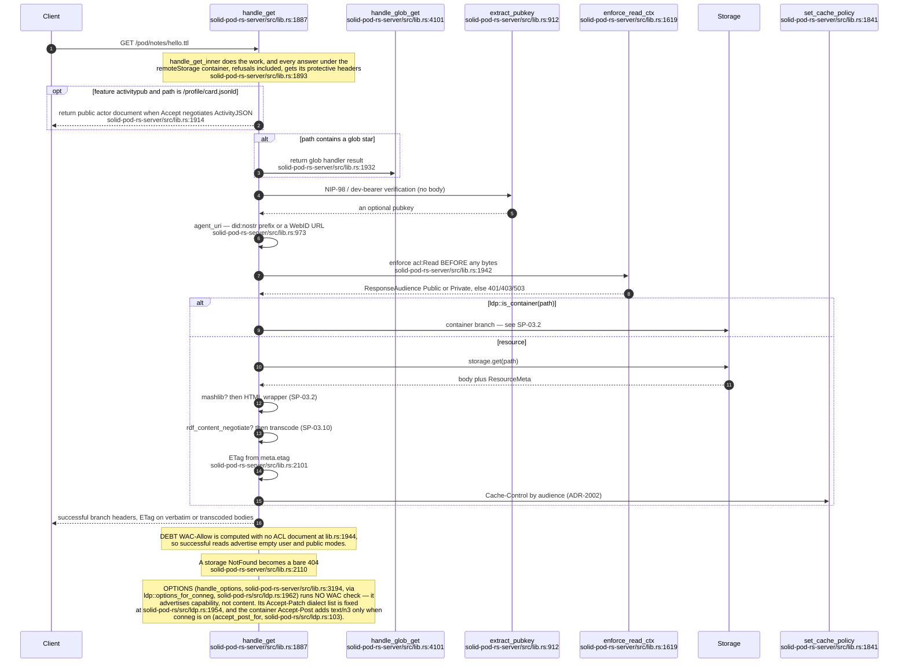

## SP-03.2 Container GET — three representations

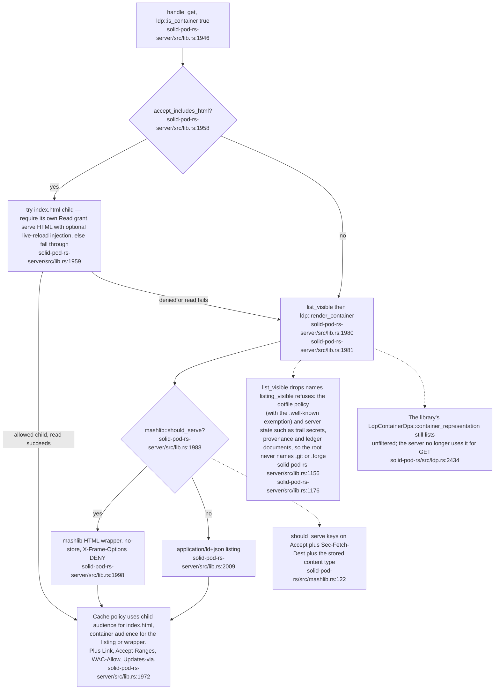

## SP-03.15 What a container listing carries — and the helpers the server does not call

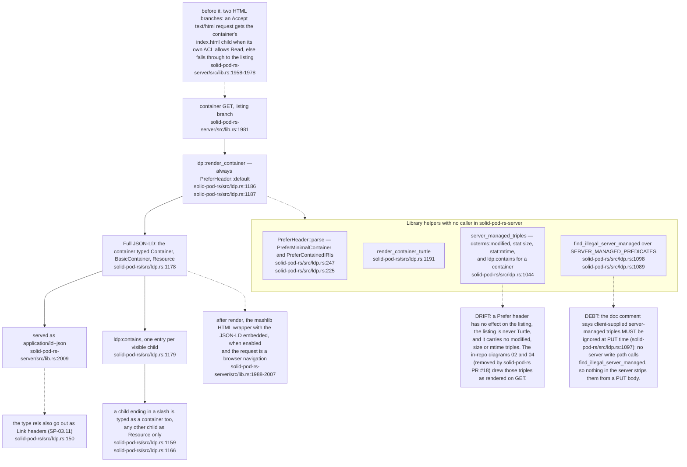

- **What it shows:** the reference server's RDF listing is one fixed shape, the Full JSON-LD view with typed `ldp:contains` members; the only other answers to a container GET are HTML, the container's own `index.html` for an `Accept: text/html` request (`solid-pod-rs-server/src/lib.rs:1958-1978`) or the mashlib wrapper around that same JSON-LD (`solid-pod-rs-server/src/lib.rs:1988-2007`). The Prefer, Turtle and server-managed-triple helpers are library surface for embedders.
- **Why it is this way:** `render_container` is the backwards-compatible Phase 1 alias with the default preference, and the server's GET branch calls that alias rather than `render_container_jsonld` with a parsed `Prefer`.

## SP-03.3 PUT — resource and container creation

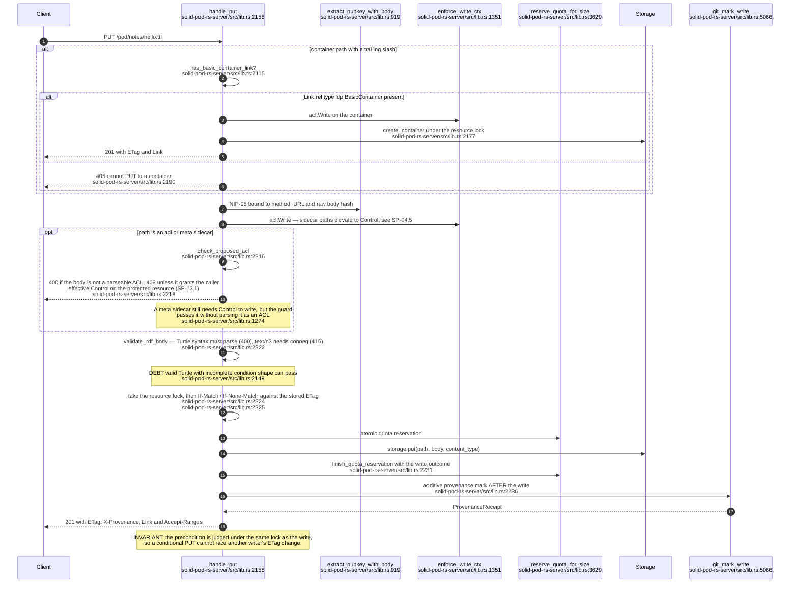

## SP-03.4 POST — Append, Slug resolution and unique-name minting

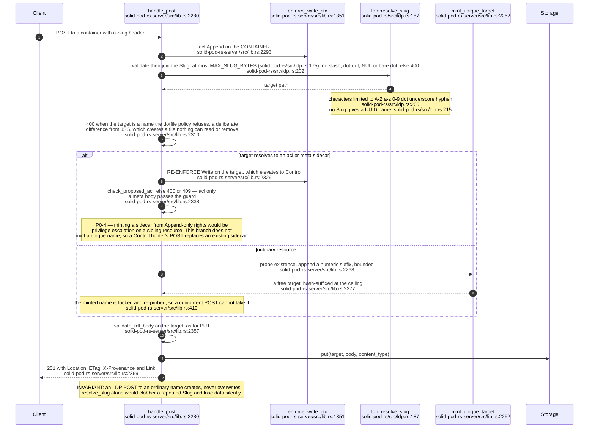

**Tension:** RESOLVED at solid-pod-rs 27e1899 and unchanged at a28a748. `mint_unique_target` still probes with `exists` (`solid-pod-rs-server/src/lib.rs:2253`), but POST takes the name through `mint_and_lock_target`, which holds the resource's write lock across the re-check and the write, retries up to `MINT_LOCK_ATTEMPTS` and refuses with 409 when no name is free (`solid-pod-rs-server/src/lib.rs:410-440`, `solid-pod-rs-server/src/lib.rs:2350`); a lock another process holds past the wait is 503 (`solid-pod-rs-server/src/lib.rs:409`). The hash fallback is still a deterministic hash of the target (`solid-pod-rs-server/src/lib.rs:2275`), and the lock loop stops rather than re-probe it (`solid-pod-rs-server/src/lib.rs:425-428`).

## SP-03.5 PATCH — the access mode is decided before parsing errors are answered

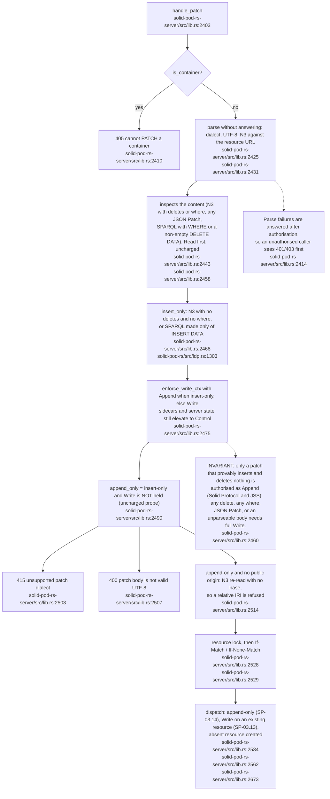

## SP-03.13 PATCH with Write on an existing or absent resource

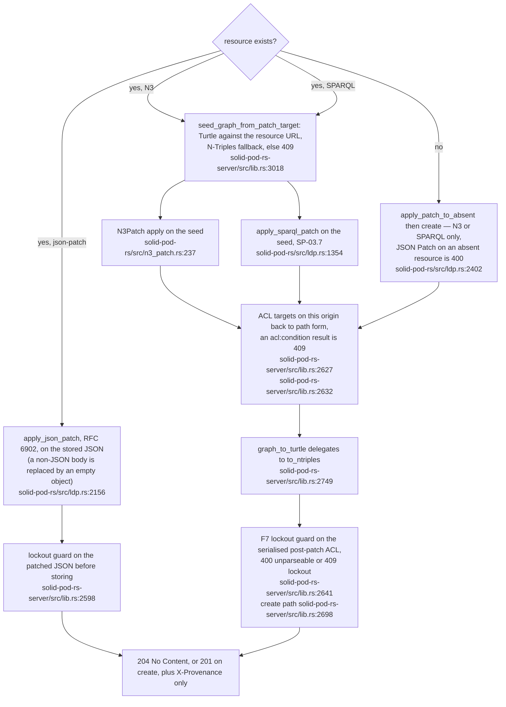

**Debt:** RESOLVED at solid-pod-rs 27e1899. An N3 or SPARQL PATCH can change or create an `.acl`. The seed reads a stored Turtle ACL with `@prefix` lines (`solid-pod-rs-server/src/lib.rs:3041`), the patched graph's ACL targets are put back in path form (`solid-pod-rs-server/src/lib.rs:2626-2628`), and the lockout guard sees the result as `text/turtle` (`solid-pod-rs-server/src/lib.rs:2401`, `solid-pod-rs-server/src/lib.rs:2640-2656`). A patched ACL that carries `acl:condition` is refused with 409, because the N-Triples write-back cannot preserve it (`solid-pod-rs-server/src/lib.rs:2382-2385`, `solid-pod-rs-server/src/lib.rs:2631-2633`, `solid-pod-rs-server/src/lib.rs:2692-2693`). This is source tracing; no route test was run for RDF PATCH on an ACL.

## SP-03.14 Append-only PATCH — exactly the inserted triples, or nothing

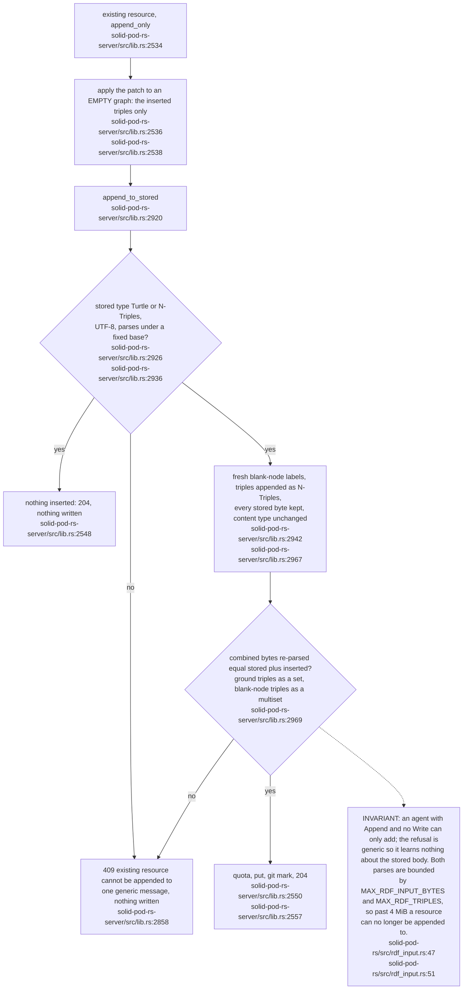

## SP-03.7 SPARQL Update — bounded, WHERE evaluated, absent deletes refused

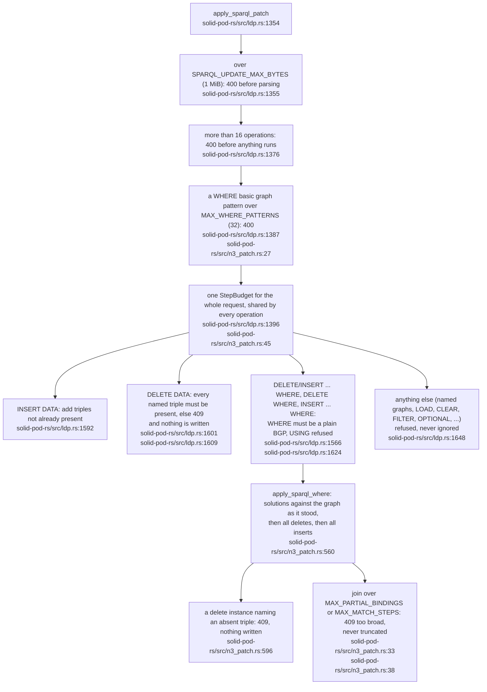

## SP-03.6 The non-destructive-write invariant

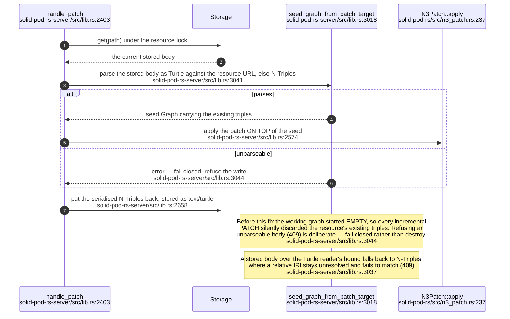

**Debt:** the invariant covers the N3 and SPARQL dialects only. The JSON Patch branch treats a stored body that is not JSON as `{}` and writes the patched object back under the stored content type (`solid-pod-rs-server/src/lib.rs:2586-2589`, `solid-pod-rs-server/src/lib.rs:2615`). So a JSON Patch that applies cleanly to an empty object, sent to a Turtle resource, replaces its triples where an N3 patch would be refused. This is source tracing and was not reproduced over HTTP.

## SP-03.8 COPY — the non-standard verb

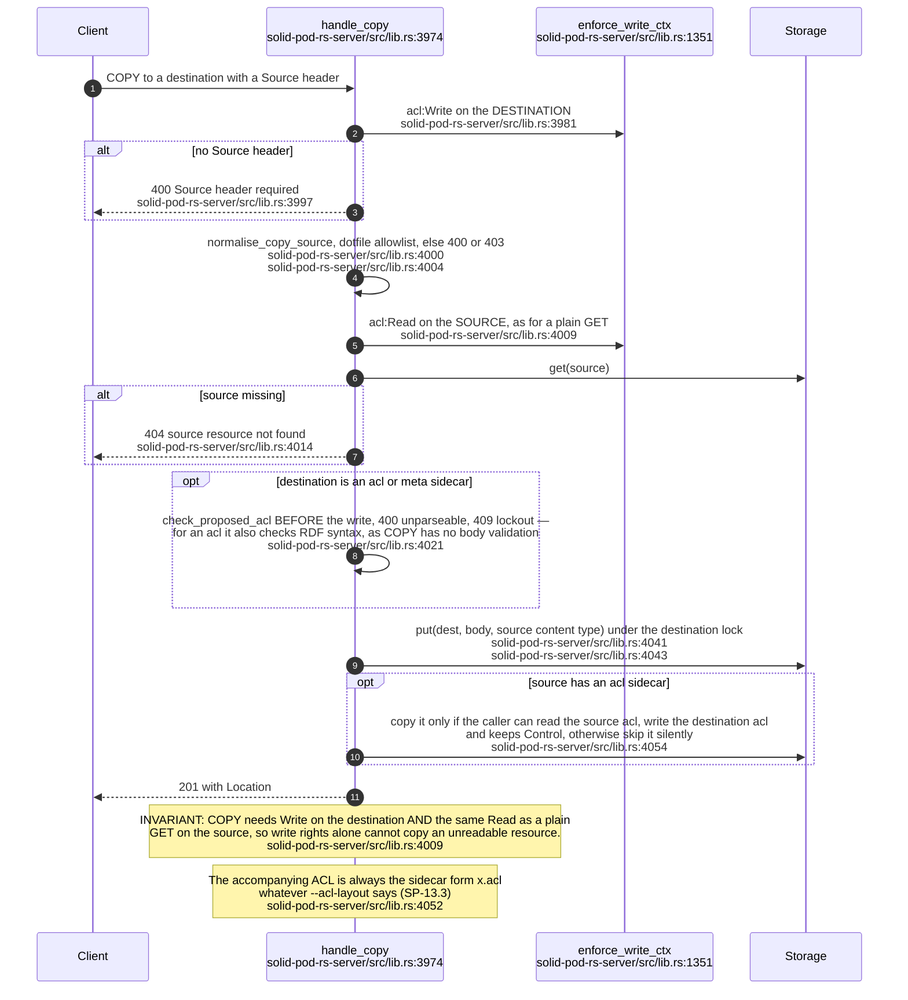

## SP-03.9 Glob GET

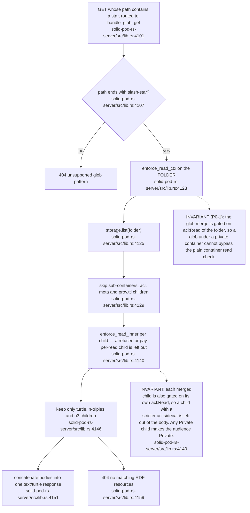

## SP-03.10 RDF content negotiation

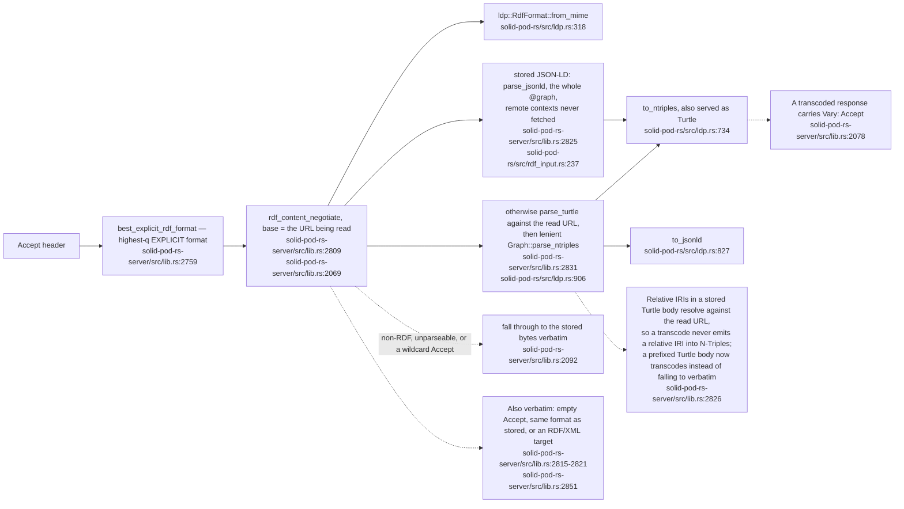

## SP-03.11 Response header helpers for LDP responses

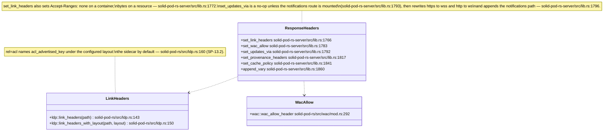

**Drift:** each handler picks its own subset of these helpers. Successful GET branches set Link with Accept-Ranges, WAC-Allow, Updates-Via and the cache policy (`solid-pod-rs-server/src/lib.rs:2104-2107`). PUT and POST set X-Provenance and Link with Accept-Ranges (`solid-pod-rs-server/src/lib.rs:2241-2242`, `solid-pod-rs-server/src/lib.rs:2376-2377`). PATCH sets only X-Provenance (`solid-pod-rs-server/src/lib.rs:2670`). COPY sets only Location (`solid-pod-rs-server/src/lib.rs:4090-4093`). Glob GET sets only the cache policy (`solid-pod-rs-server/src/lib.rs:4163`). A GET that misses storage returns a bare 404 (`solid-pod-rs-server/src/lib.rs:2110`). So the CHANGELOG's "Accept-Ranges is sent on GET, HEAD and write responses" (`CHANGELOG.md:364`) does not hold for PATCH, COPY or a 404.

## SP-03.12 ADR-2002 cache policy — audience beats media type

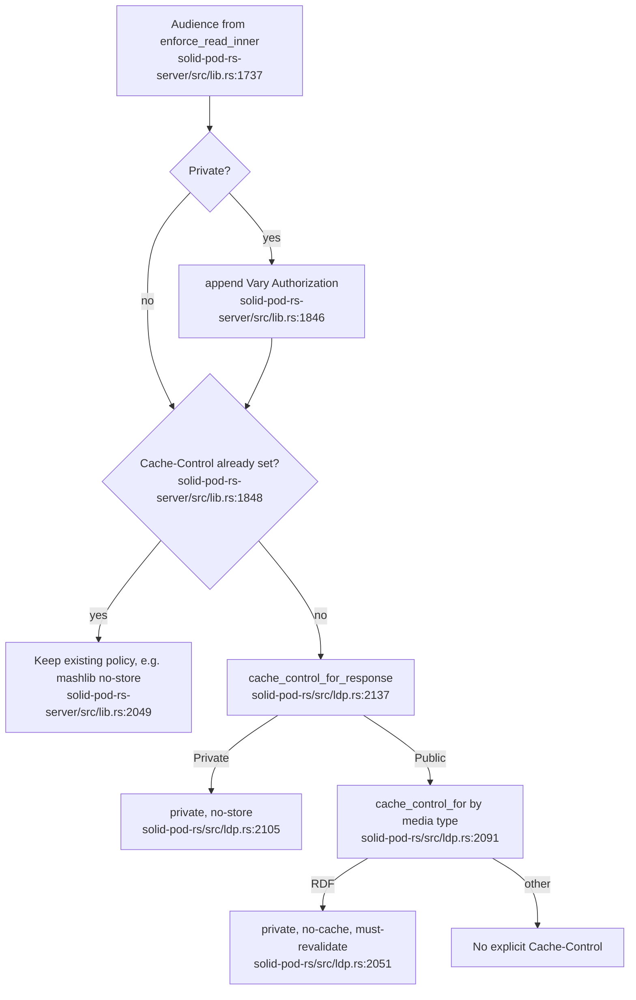

**Boundary:** this policy applies to the audience produced by the parsed ACL. Lost restrictions can misclassify a response as Public. Headers do not prove revocation through an intermediary cache. [HTTP acceptance and remaining delivery gaps](../../estate-review/2026-11-01-solid-http-delivery.md).
