**Repair note — 2026-11-03:** selected counterexamples below have a [scoped successor verification](15-authority-and-payment-repairs.md). This historical topic retains its declared source revision; the successor states the repaired contracts and acceptance boundaries.

## SP-04.1 The write gate, end to end

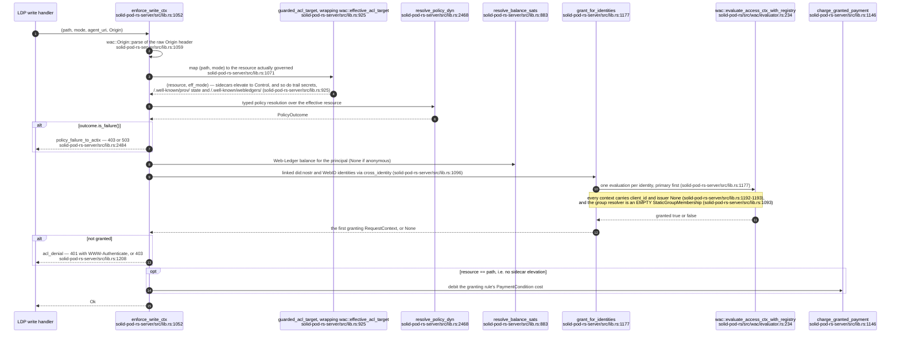

**What it shows / Why it is this way:** the write gate no longer calls `effective_acl_target` directly: `guarded_acl_target` adds the server-managed state paths, and `grant_for_identities` evaluates the ACL once per linked identity so a `did:nostr` caller with a verified WebID link matches an ACL naming either.

**Invariant:** trail secrets, `/.well-known/prov/` state and `/.well-known/webledgers/` are evaluated as `acl:Control` on themselves, so no ordinary Read or Write grant reaches them over HTTP (`solid-pod-rs-server/src/lib.rs:925`). A path that cannot be canonicalised is also held to Control (`solid-pod-rs-server/src/lib.rs:938`).

**Tension:** the admission context is narrower than the WAC 2.0 vocabulary the evaluator accepts. The native gate never supplies a client or issuer, and it passes an empty group map, so `acl:agentGroup`, and client or issuer conditions other than the `foaf:Agent` class, cannot grant here (see SP-04.13 and SP-04.15).

## SP-04.2 The read gate and the ADR-2002 audience classification

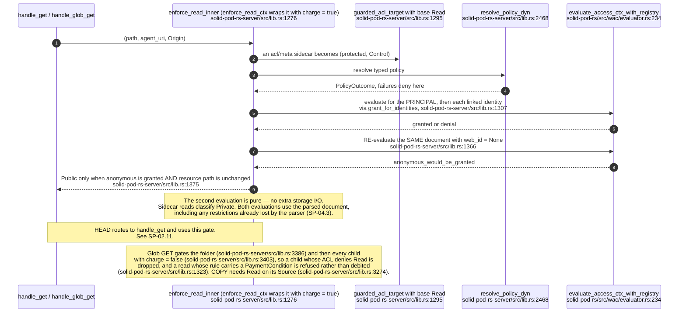

## SP-04.3 Typed policy outcomes — only absence inherits

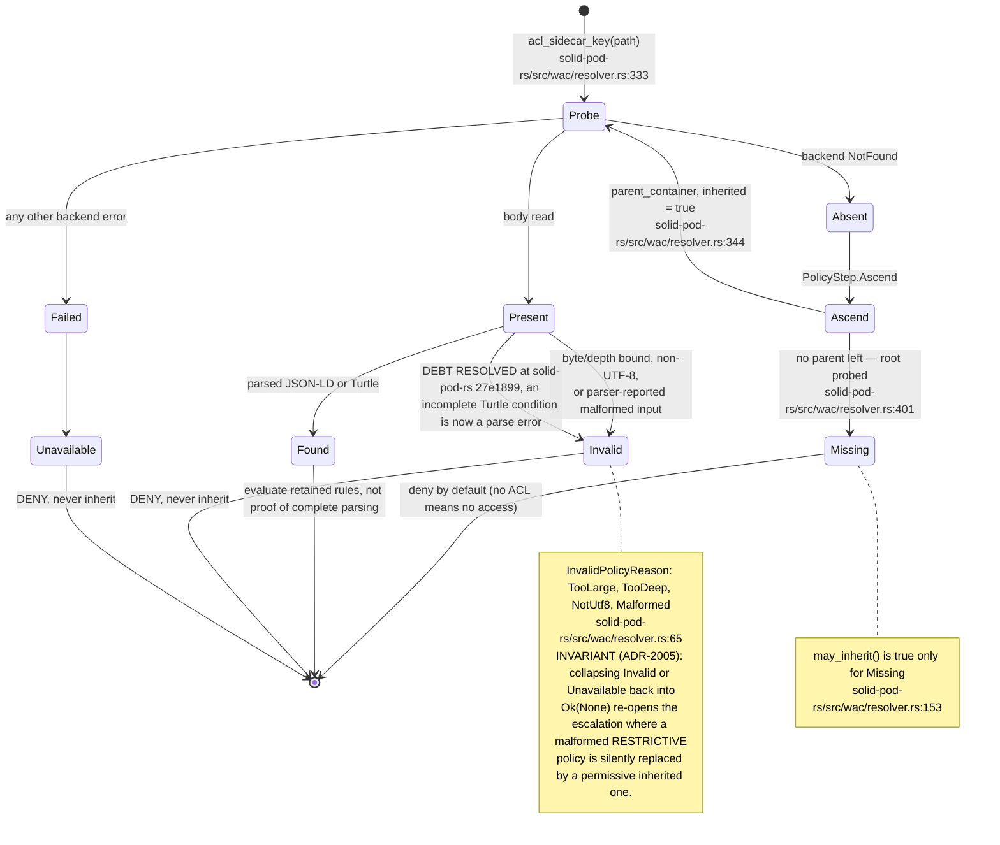

**Debt:** RESOLVED at solid-pod-rs 27e1899. The typed resolver prevents fallback after reported failure, and the Turtle parser now reports an unbalanced or typeless condition as an error (`solid-pod-rs/src/wac/parser.rs:422-424`, `solid-pod-rs/src/wac/parser.rs:427-429`) that the resolver maps to Malformed (`solid-pod-rs/src/wac/resolver.rs:209-211`), instead of reporting Found after discarding it. [Native probes](../../estate-review/2026-11-01-solid-policy-parsing.md) distinguish that direct grant from inheritance.

## SP-04.4 classify_policy_read — one level, runtime-free

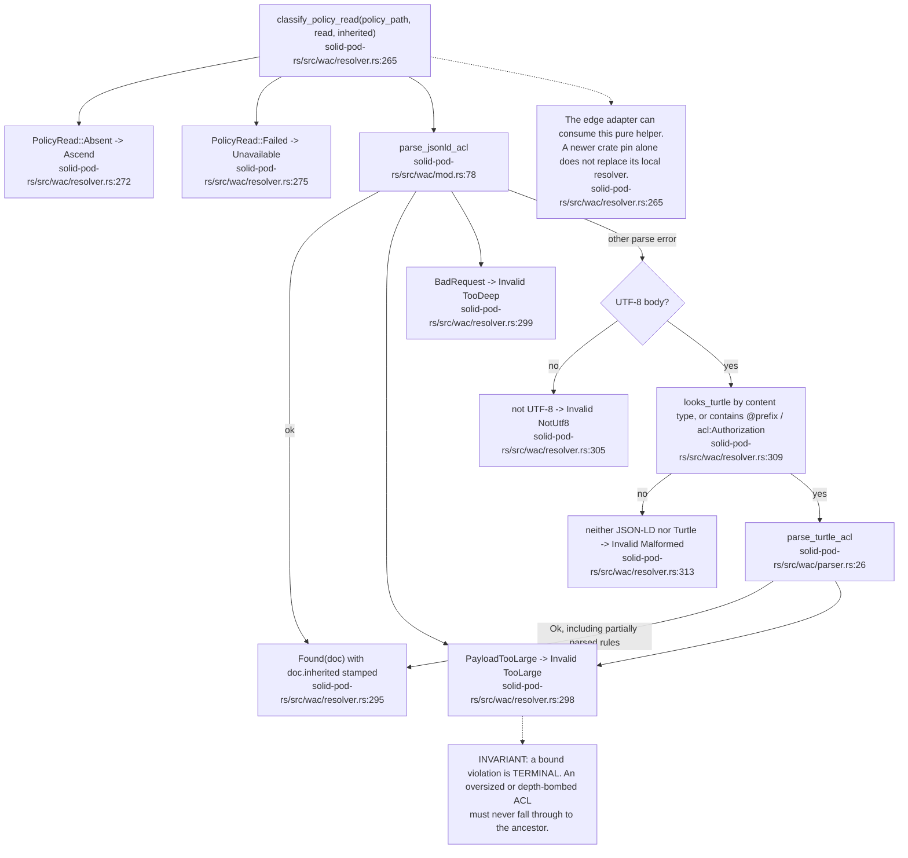

## SP-04.5 The sidecar rule — one function for read and write

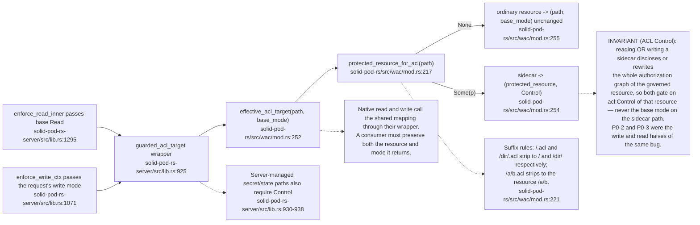

**Open:** the elevation and the resolver disagree about an inner container ACL. `protected_resource_for_acl` maps `/dir/.acl` to `/dir/` (`solid-pod-rs/src/wac/mod.rs:220`), so writing it needs Control on `/dir/`. The resolver reads `acl_sidecar_key("/dir/")`, which is `/dir.acl` (`solid-pod-rs/src/wac/resolver.rs:333-338`, `solid-pod-rs/src/wac/resolver.rs:379`). So a stored `/dir/.acl` is protected but never enforced. Discovery headers now advertise `/dir.acl` (`solid-pod-rs/src/ldp.rs:153`-`154`), and the upstream changelog leaves existing inner copies to a migration review rather than moving them.

## SP-04.6 The lockout guard — syntactic Control is not effective Control

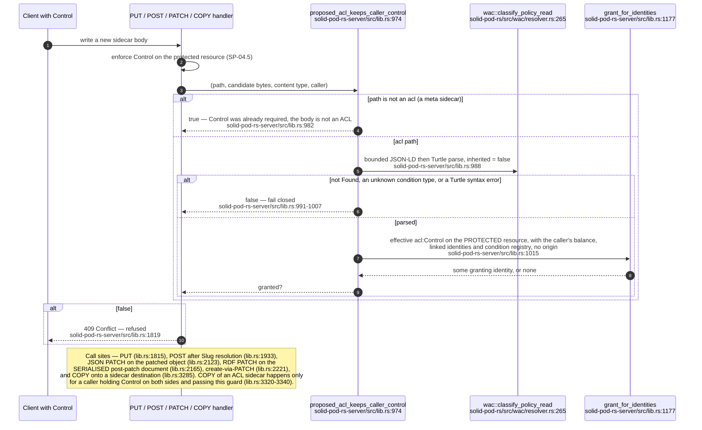

**What changed:** at `09ec90f` the guard was synchronous and syntactic. It accepted any authorisation naming Control for the caller, a recognised class, or an unparseable body. Upstream commit `daff10d` replaced it with an evaluation of effective Control on the protected resource, using the same identities, balance and conditions as admission. A Control rule aimed at a different resource, an unsatisfied condition or an unparseable body now gets 409. The [2026-11-01 HTTP reproduction](../../estate-review/2026-11-01-solid-http-delivery.md) of the wrong-target lockout predates this change. The closure here comes from source tracing; this audit did not re-run it.

**Debt:** the guard still evaluates what the lenient Turtle reader retained, so a condition the parser discards is invisible to it as it is to enforcement (SP-04.3). It passes an empty group map, so a candidate whose only Control grant is an `acl:agentGroup` is refused (`solid-pod-rs-server/src/lib.rs:1012`). An RDF PATCH serialisation is refused as Malformed (see the SP-03.5 debt).

## SP-04.7 evaluate_access_ctx_inner — the decision loop

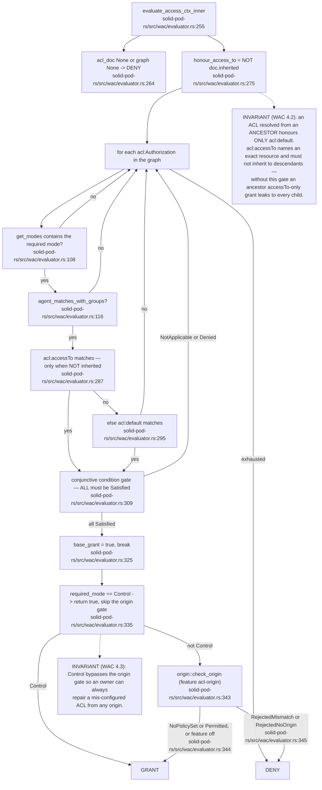

## SP-04.8 The origin gate — off in the library, on in the server

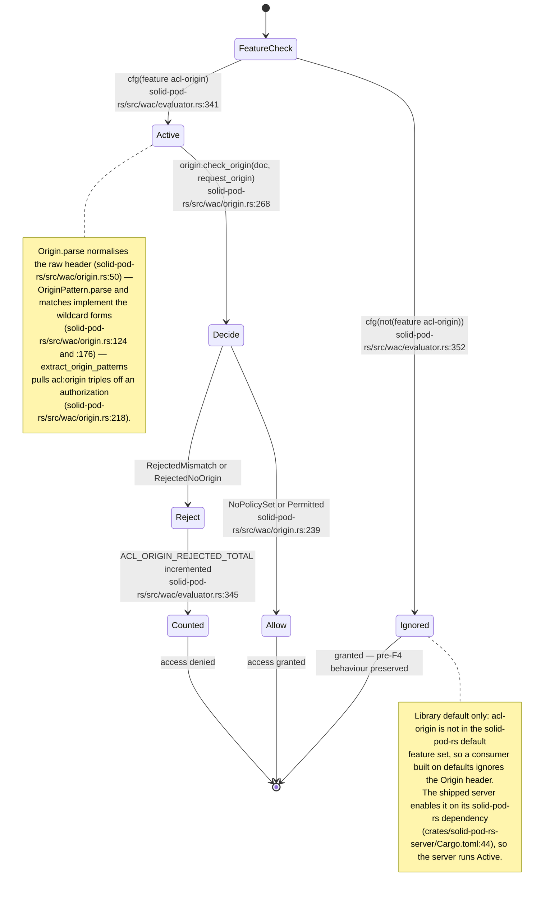

**Drift:** this panel used to say that no default build enables `acl-origin`, so a stock server ignored the Origin header. The server crate has enabled the feature on its `solid-pod-rs` dependency since `51ecbf4` (2026-07-03), and still does at this revision (`crates/solid-pod-rs-server/Cargo.toml:42-44`). The core crate's own comment that the replay guard is "Wired into the default server build (unlike `acl-origin`)" is stale in the same way (`crates/solid-pod-rs/Cargo.toml:142-143`).

**Tension:** under the shipped server the gate is document-wide, not per rule. `check_origin` gathers `acl:origin` patterns from every authorisation in the document (`solid-pod-rs/src/wac/origin.rs:282-304`). So one rule with an origin restriction makes every non-Control grant in that ACL require a matching `Origin`, and a request with no `Origin` header, such as a server-to-server or command-line client, is refused as RejectedNoOrigin. That follows from source; it was not exercised over HTTP.

## SP-04.9 Parser bounds — fail closed at the boundary

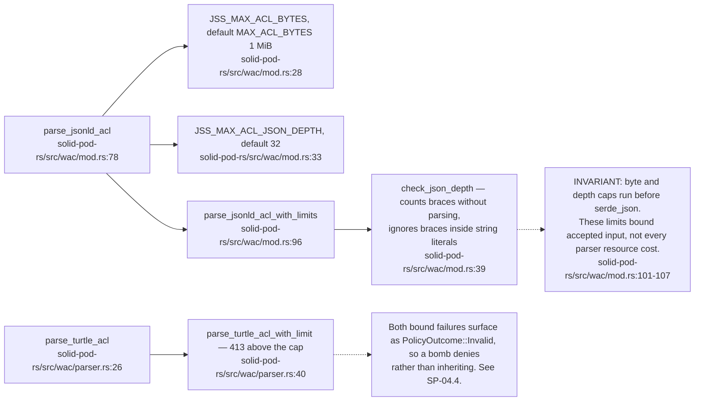

## SP-04.10 The Turtle ACL parser

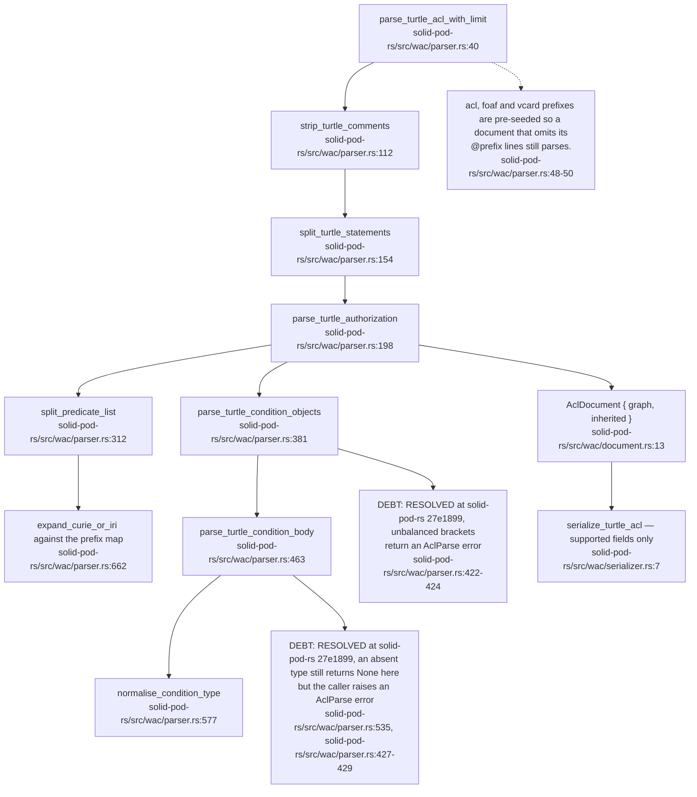

## SP-04.13 Payment, client, issuer and provenance-anchor conditions

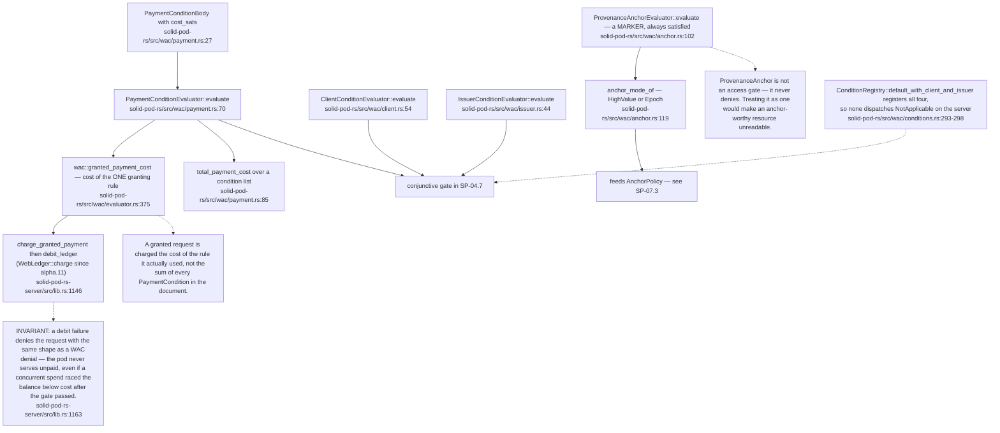

**Debt:** client and issuer conditions are registered but never fed. Every admission context the server builds sets `client_id` and `issuer` to `None` (`solid-pod-rs-server/src/lib.rs:1192-1193`, `solid-pod-rs-server/src/lib.rs:1362-1363`). So `ClientConditionEvaluator` can be satisfied only by the `foaf:Agent` class shortcut (`solid-pod-rs/src/wac/client.rs:61-64`), and `IssuerConditionEvaluator` denies whenever no class matches (`solid-pod-rs/src/wac/issuer.rs:57-61`). Any rule carrying a specific client or issuer condition cannot grant on this server.

## SP-04.14 Denial shape

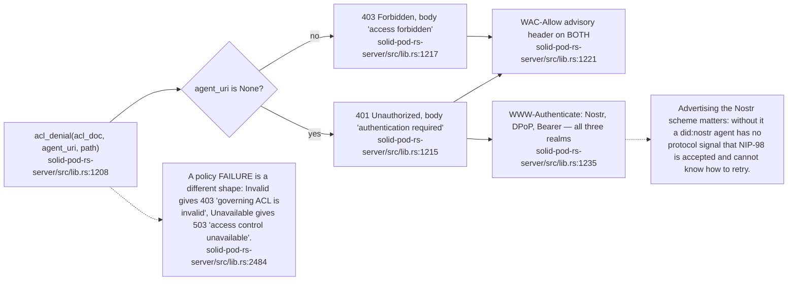

## SP-04.15 Agent and group matching, and accessTo-vs-default containment

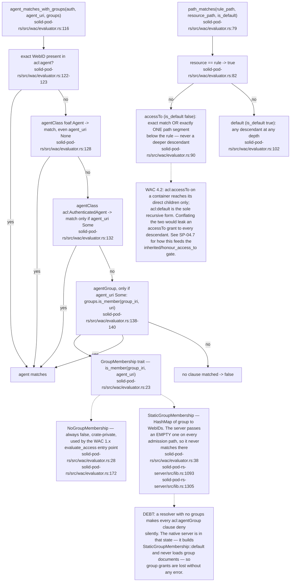
