## SP-05.1 REST identity extraction and anonymous fallback

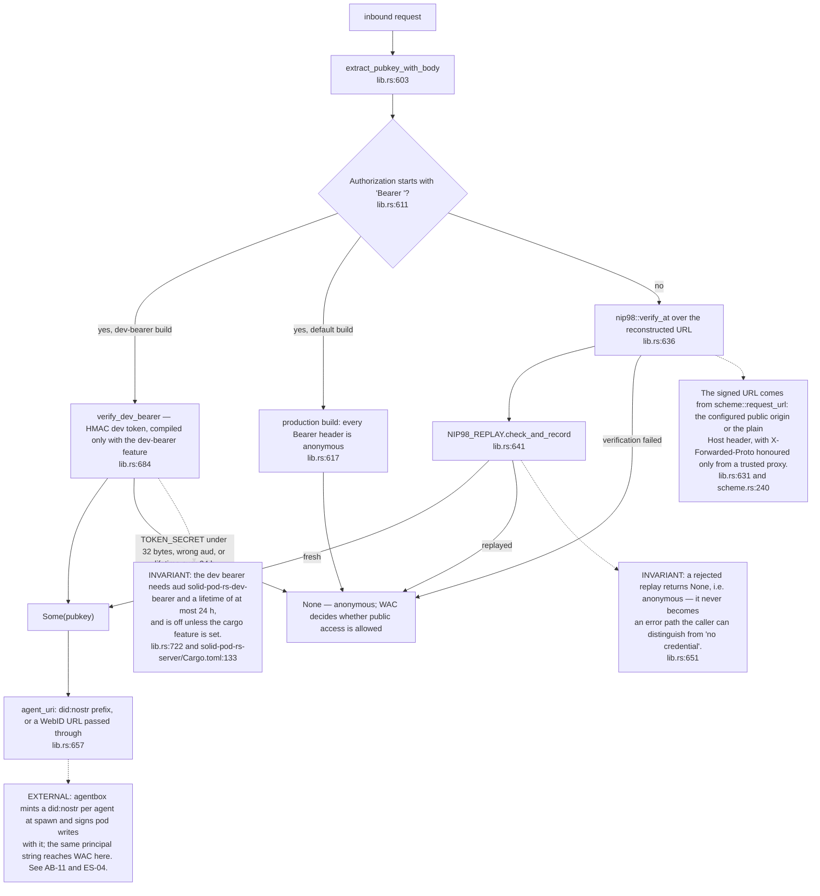

## SP-05.2 NIP-98 verification, step by step

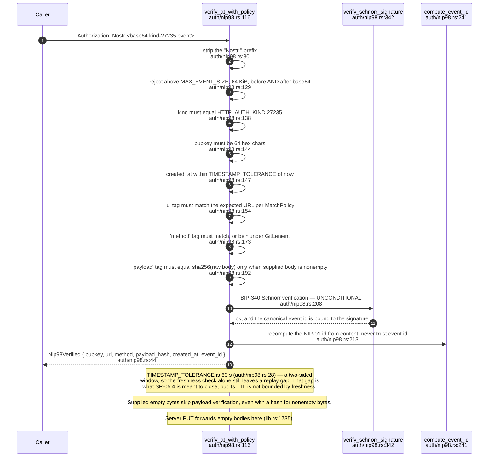

## SP-05.3 The two match policies

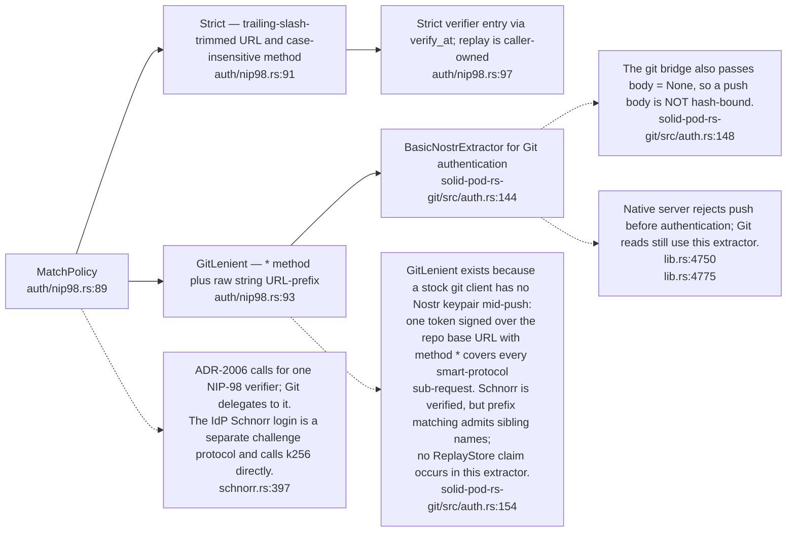

## SP-05.4 The single-use replay store (ADR-2006)

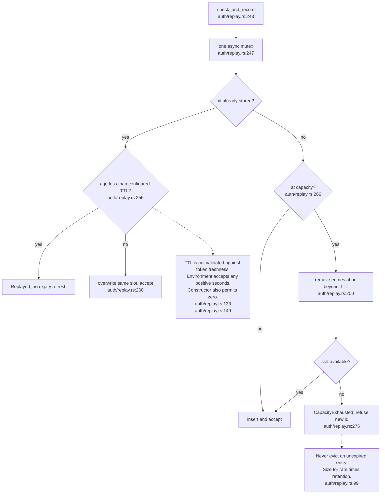

## SP-05.5 The ReplayStore seam and its tier limits

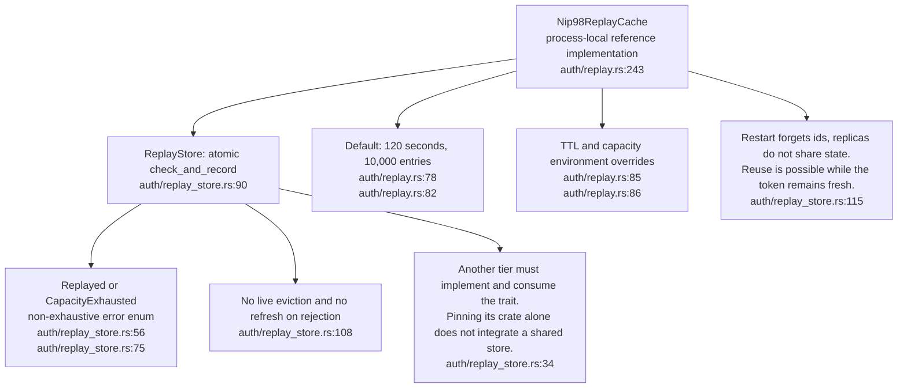

## SP-05.7 Solid-OIDC DPoP proof checks and optional replay admission

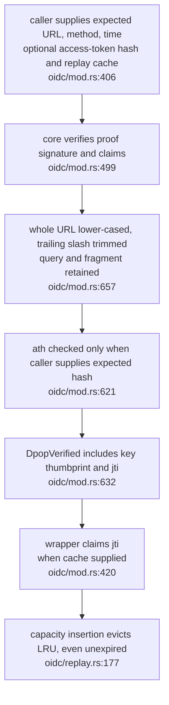

## SP-05.8 Access-token checks and the separate WebID authority step

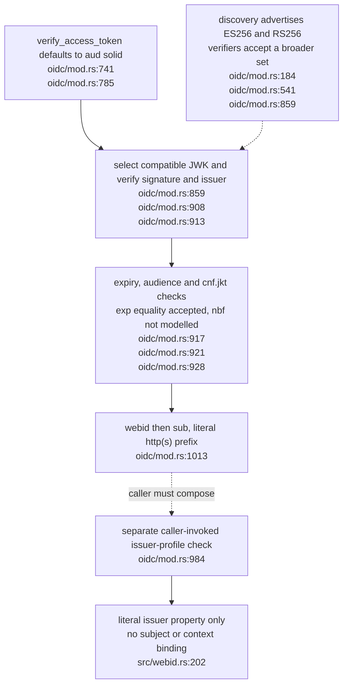

## SP-05.10 Historical JWKS fetch boundaries and redirect gap

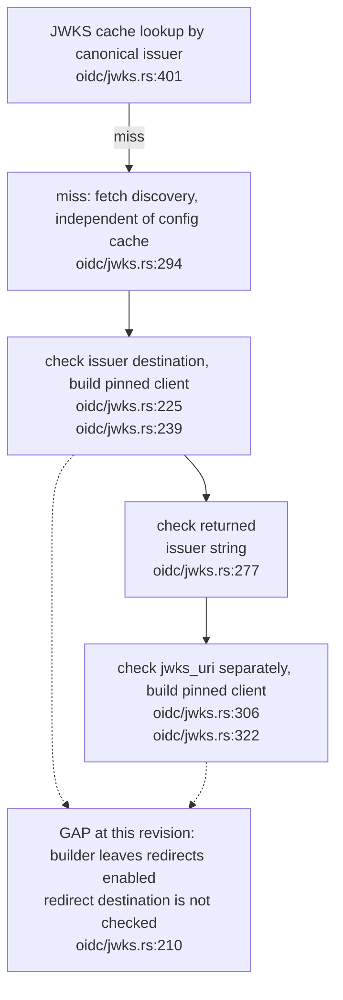

## SP-05.12 did:nostr — document rendering, the parity model and the bidirectional binding

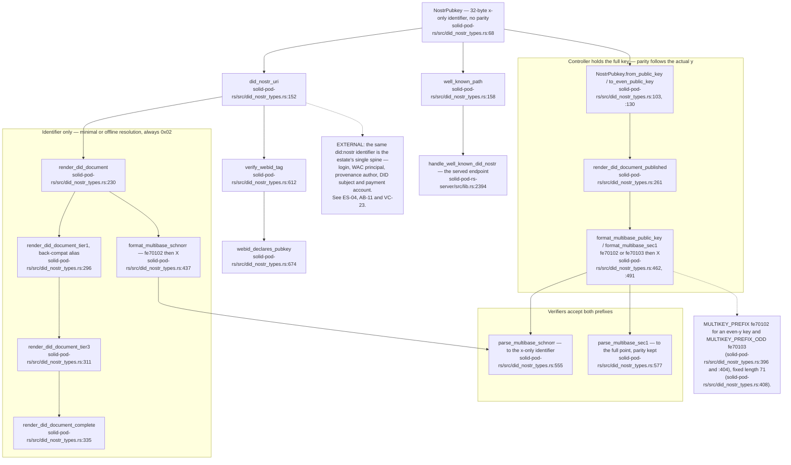
- **What it shows:** since `0.5.0-alpha.10` (2026-10-01, `8b5d0a5` and `0302cde`) the module follows the did:nostr parity model of nostrcg/did-nostr#145 (`solid-pod-rs/src/did_nostr_types.rs:36-49`). The identifier carries no parity. A resolver holding only the identifier emits `0x02`, so `render_did_document` and `format_multibase_schnorr` never change. A controller holding its full key publishes through `render_did_document_published`, which emits `fe70103` when y is odd (`solid-pod-rs/src/did_nostr_types.rs:261-266`, `:462-463`). Decoders accept both prefixes in `split_multikey` (`solid-pod-rs/src/did_nostr_types.rs:512-515`).
- **Why it is this way:** before alpha.10 the encoder always produced `fe70102` and the docs called `0x02` invariant. A key derived by additive tweaking has unpredictable parity, and its controller must be able to publish it truthfully. Point reading matches `basePoint()` and `multikey()` in sidestr/spec PR #28. The module deliberately has no key-arithmetic (tweak) API until that PR settles (`solid-pod-rs/src/did_nostr_types.rs:56-57`).
- **Invariant:** the x-coordinate is the identifier whichever prefix a document carries. `parse_multibase_schnorr` drops the parity byte and returns X (`solid-pod-rs/src/did_nostr_types.rs:555-556`), so a BIP-340 signature verifies against the same key either way.

## SP-05.13 did:nostr resolution — WebID and DID-Doc must agree

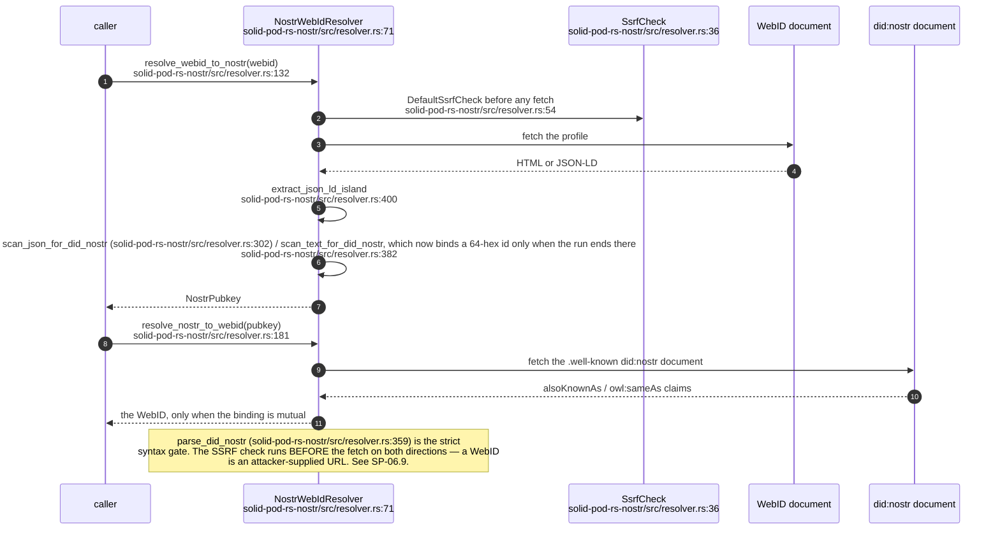

## SP-05.14 did:key — multicodec and self-signed JWT

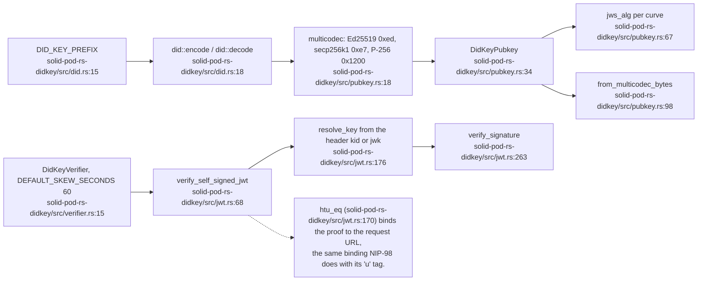

## SP-05.15 The self-signed / CID verifier registry

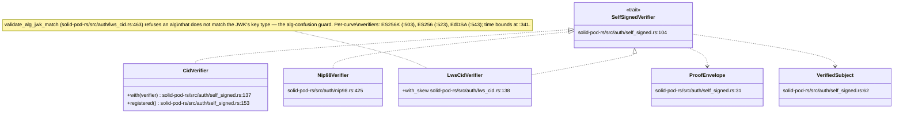

## SP-05.16 The bundled IdP — authorisation-code flow with PKCE and DPoP

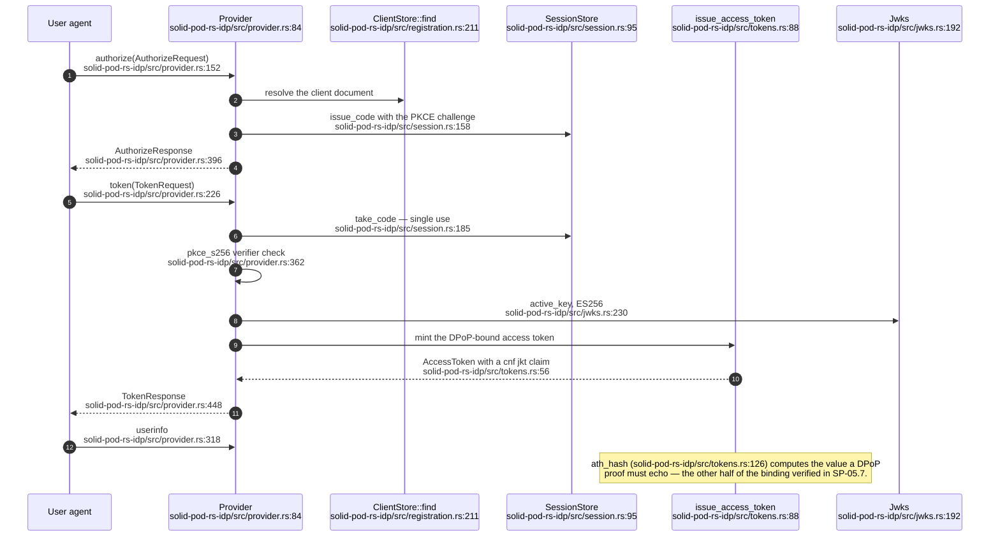

## SP-05.17 IdP key management and discovery

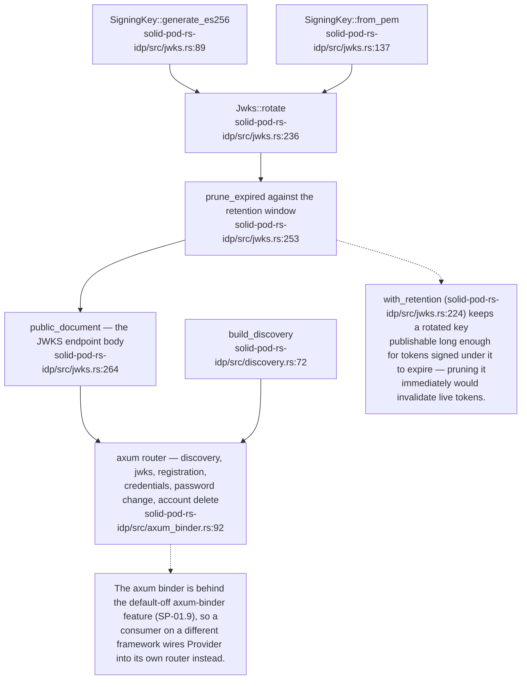

## SP-05.18 IdP credential surfaces

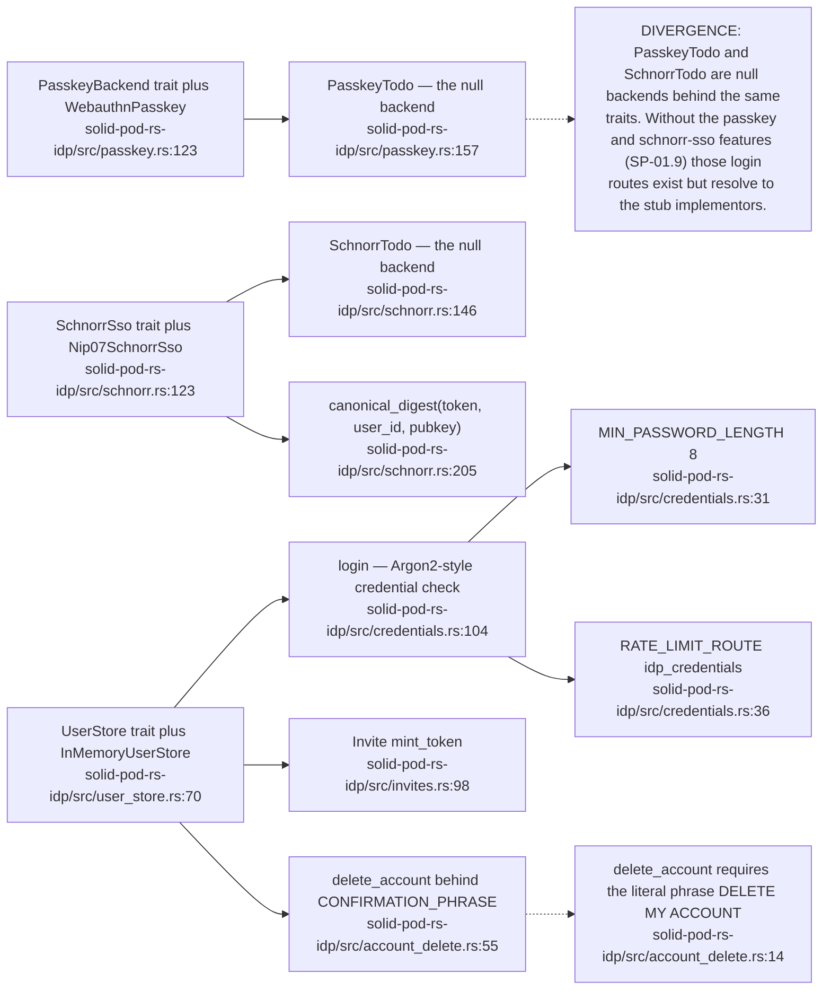

## SP-05.19 Pod key provisioning — deliberately not an HTTP route

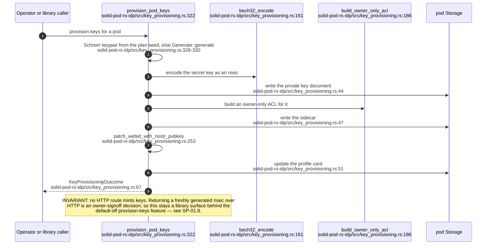

## SP-05.21 Password change — the one credential-MUTATION path

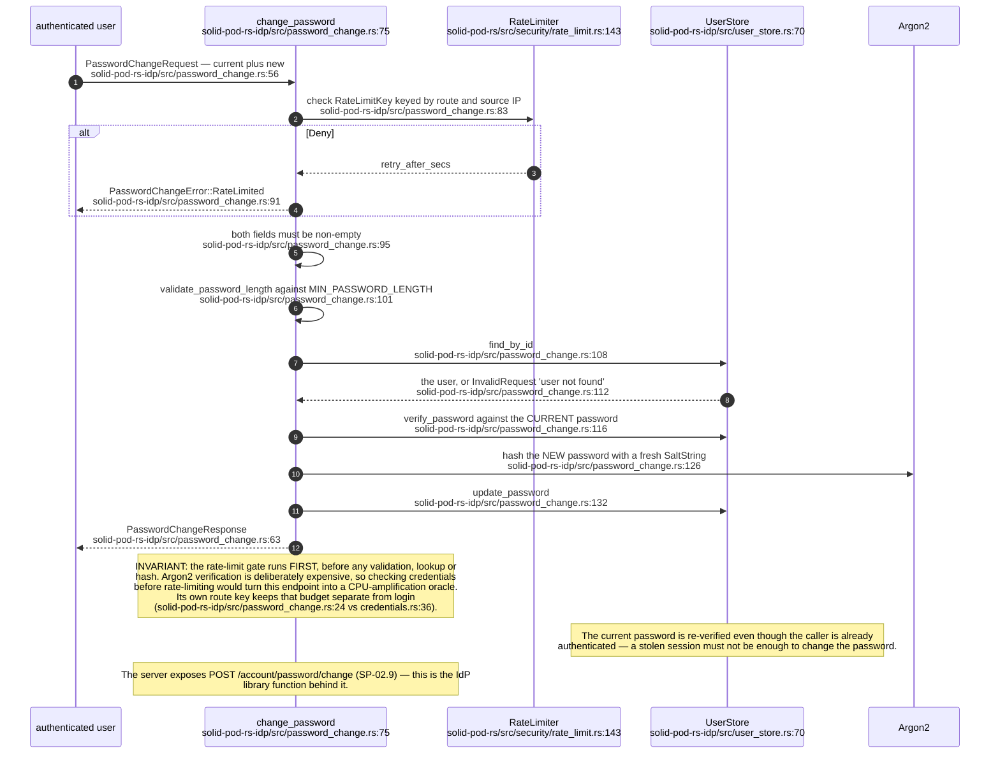

## SP-05.22 Cross-identity — a did:nostr caller presenting as its WebID too

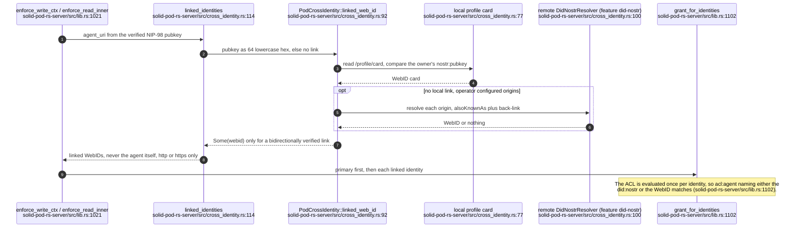

**What it shows:** after NIP-98 succeeds, the server asks a resolver whether the pubkey is bound to a WebID and, if so, the caller presents as both.

**Why it is this way:** JSS replaces the did:nostr agent with the WebID; keeping both is a deliberate superset (`solid-pod-rs-server/src/cross_identity.rs:8`), and a one-way link is never accepted (`solid-pod-rs-server/src/cross_identity.rs:6`).

**Invariant:** `linked_web_id` returns a WebID only when the link is bidirectional, either through the pod's own profile card or through a remote origin with a back-link check (`solid-pod-rs-server/src/cross_identity.rs:92`).
