## SP-06.1 The Storage seam and its two shipped backends

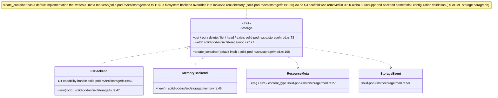

**Drift:** the ecosystem explanation still says "S3 is configuration/dependency scaffolding only; no implementation ships yet" (`crates/solid-pod-rs/docs/explanation/ecosystem-integration.md:105`). At `9b6143c` there is no S3 scaffold at all, and the root README says unsupported backend names, the removed S3 one included, fail validation. Wave-1 audit, 2026-11-02.

## SP-06.2 Path normalisation — the traversal gate

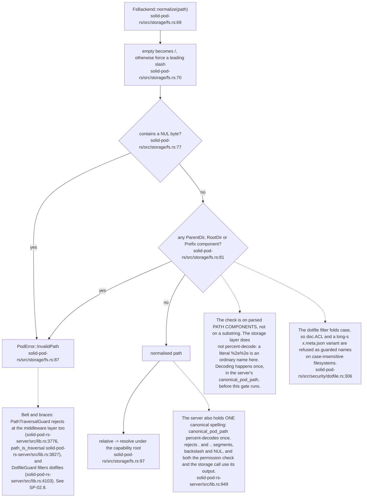

## SP-06.3 Capability-confined filesystem access

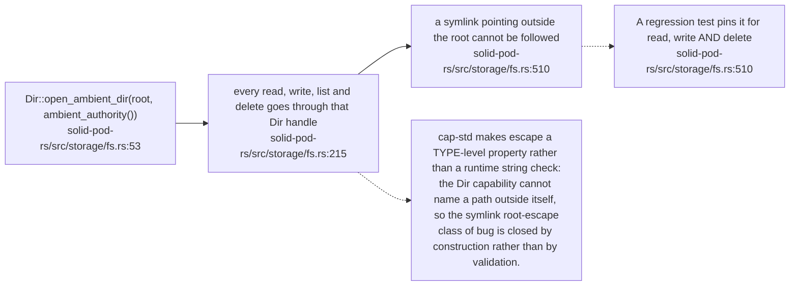

**Tension:** `watch` is the one operation outside the capability. It resolves an ambient `PathBuf` under `root` (`solid-pod-rs/src/storage/fs.rs:368`) and hands it to `notify`, because the watcher API takes host paths. It only observes events and never reads or writes content, but symlinks are not confined on that path.

## SP-06.4 Atomic write and the body/metadata pair

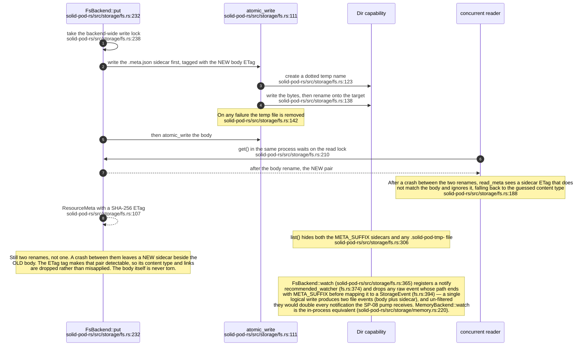

**Drift:** this panel previously cited the README status section for an open atomic-storage violation. At `9b6143c` the README says the dated audit's findings are remediated (0.5.0-alpha.13) and describes "atomic replacement writes". The code now pairs a backend-wide `RwLock` (`solid-pod-rs/src/storage/fs.rs:210`, `:238`) with an ETag-tagged sidecar (`solid-pod-rs/src/storage/fs.rs:254-257`) and a reader-side check (`solid-pod-rs/src/storage/fs.rs:185-193`).

**Invariant:** the lock is process-local. A second process writing the same root is not serialised. It relies on the ETag check alone, and between the two renames it can read a stale sidecar's content type.

## SP-06.6 Per-pod quota — atomic reservation

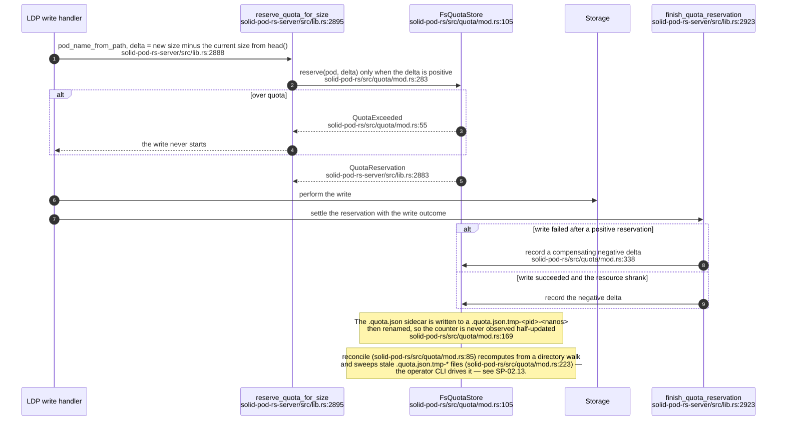

**Open:** the old size is read with `head()` before `reserve` takes the per-pod lock (`solid-pod-rs-server/src/lib.rs:2903-2909`). Two concurrent overwrites of one resource can both compute their delta from the same old size, so the counter can drift until `reconcile` recomputes it. Source tracing only; no concurrent-write probe was run.

## SP-06.7 Multitenancy — normalisation and path fallback

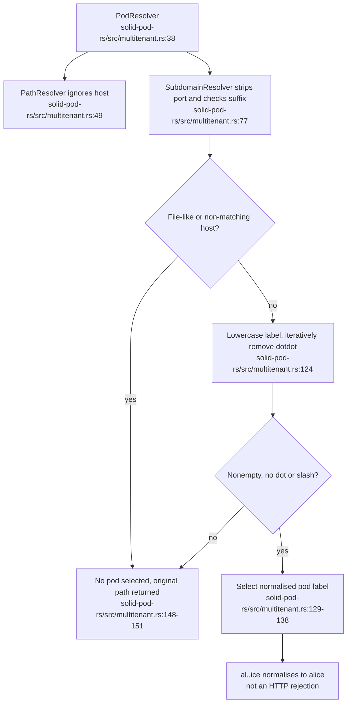

**Boundary:** the helper prevents a residual traversal-like pod label, but normalises malformed labels and falls back to path semantics when it cannot select a pod. [P3](../../estate-review/2026-11-01-solid-policy-parsing.md) verifies these helper outputs; authority and host validation remain separate server contracts.

## SP-06.8 Pod provisioning

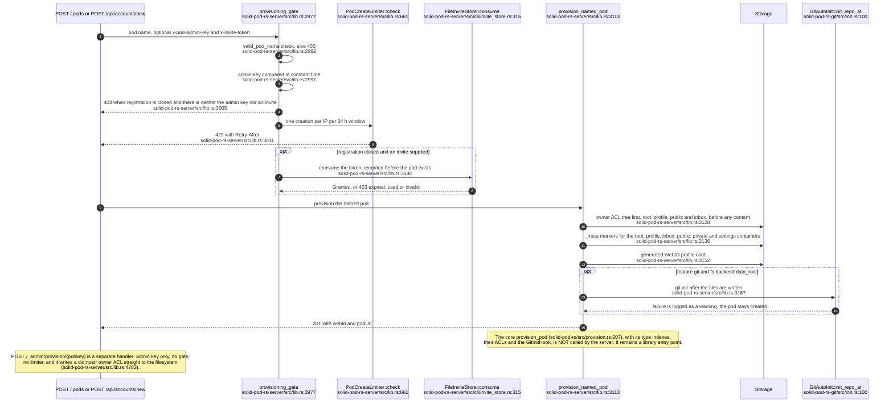

**What it shows:** both public provisioning routes go through the same gate, in this order: name check, closed-registration check, per-IP limiter, invite redemption. Then `provision_named_pod` writes an owner ACL tree, container markers and a profile card through the server's storage.

**Drift:** this panel previously drew the server delegating to the core `provision_pod` and `provision_pod_ext`, and cited `check_admin_override` as the key comparison. At `27e1899` the server still does neither. It writes its own tree, ACLs first (`solid-pod-rs-server/src/lib.rs:3128-3134`), then `.meta` markers (`solid-pod-rs-server/src/lib.rs:3136-3151`), runs `GitAutoInit` directly under the `git` feature (`solid-pod-rs-server/src/lib.rs:3164-3169`), and compares the admin key with `subtle::ConstantTimeEq` (`solid-pod-rs-server/src/lib.rs:2997`). The library's `check_admin_override` (`solid-pod-rs/src/provision.rs:454`) is an exact, non-constant-time match with no in-tree server caller.

**Open:** RESOLVED at solid-pod-rs 27e1899. `provision_named_pod` now writes the pod's ACL tree before any content, so no resource of a new pod is governed by the operator's root ACL: the owner holds Read, Write and Control, the public may read the root, `profile/` and `public/` and append to `inbox/`, and `private/` and `settings/` inherit owner-only (`solid-pod-rs-server/src/lib.rs:3061-3108`, `solid-pod-rs-server/src/lib.rs:3124-3134`). The admin route likewise writes an owner-only ACL naming `did:nostr:<pubkey>` (`solid-pod-rs-server/src/lib.rs:4860-4866`). It writes with `tokio::fs`, outside the `FsBackend` capability handle (SP-06.3), under `data_root/pods/<pubkey>` (`solid-pod-rs-server/src/lib.rs:4845`).

## SP-06.9 The SSRF policy

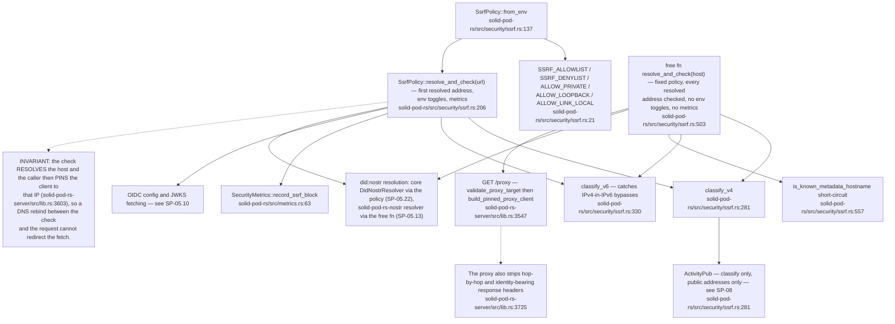

**Tension:** there are two SSRF tiers. `SsrfPolicy::resolve_and_check` is env-configurable (`SSRF_ALLOW_PRIVATE` and the rest) and checks only the first resolved address (`solid-pod-rs/src/security/ssrf.rs:223-226`). It serves OIDC JWKS fetching and, through `SsrfPolicy::from_env`, the server's remote did:nostr cross-identity (`crates/solid-pod-rs-server/src/main.rs:417`). The free `resolve_and_check(host)` ignores every env toggle, checks every resolved address (`solid-pod-rs/src/security/ssrf.rs:529-535`) and short-circuits metadata hostnames. It serves `/proxy` (`solid-pod-rs-server/src/lib.rs:3594`) and the `solid-pod-rs-nostr` default check. An operator who sets `SSRF_ALLOWLIST` therefore changes OIDC behaviour but not `/proxy`, and only the policy tier records `record_ssrf_block` metrics. This panel previously drew one entry point serving all four consumers.

## SP-06.10 CORS policy — origin echo and the credentials trap

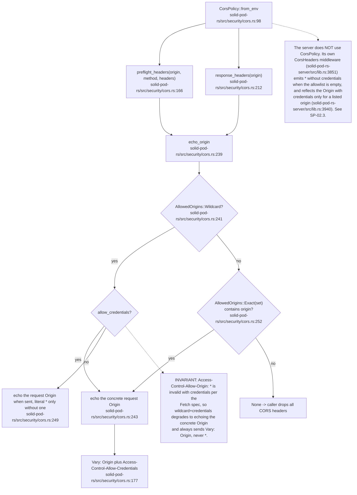

**Tension:** the library and the server answer the credentials trap in opposite ways. With wildcard origins and credentials on, `CorsPolicy` reflects any request Origin together with `Access-Control-Allow-Credentials: true` (`solid-pod-rs/src/security/cors.rs:242-247`). The server's `add_cors_headers` comment calls exactly that unsafe and never does it (`solid-pod-rs-server/src/lib.rs:3929-3941`). `CorsPolicy` has no in-tree server consumer, so this only matters to a library user who sets `CORS_ALLOW_CREDENTIALS` without an allowlist.

**Drift:** the doc comments on `CorsHeaders` (`solid-pod-rs-server/src/lib.rs:3850`) and its config field (`solid-pod-rs-server/src/lib.rs:348`) still say an empty allowlist echoes the request Origin. `add_cors_headers` emits `*` instead. This panel had repeated the comment.

## SP-06.11 Git-versioned pods — repository lifecycle

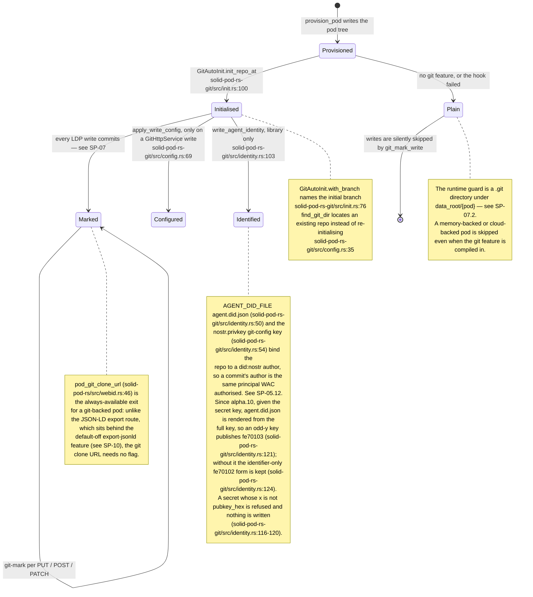

**Drift:** this panel previously drew a single chain from Initialised through Configured and Identified to Marked. In the native server, `git_mark_write` needs only the `.git` directory (`solid-pod-rs-server/src/lib.rs:4287-4290`), so writes are marked straight after init. `apply_write_config` runs only inside `GitHttpService::handle` for a write request (`solid-pod-rs-git/src/service.rs:358-359`), and `handle_git` refuses every push before the service runs (SP-06.12). `write_agent_identity` has no in-tree caller. `init_repo_at` itself sets only `receive.denyCurrentBranch updateInstead` (`solid-pod-rs-git/src/init.rs:130-140`).

**Open:** pods from `POST /_admin/provision/{pubkey}` live under `data_root/pods/<pubkey>` (SP-06.8). `git_mark_write` takes the first path segment as the pod and looks for `data_root/<segment>/.git` (`solid-pod-rs-server/src/lib.rs:4278-4288`). If those pods are addressed as `/pods/<pubkey>/...`, the repository the admin route creates would never be found and their writes would be skipped as not git-backed. Source tracing suggests this; no request was run to confirm it.

## SP-06.12 Git smart-HTTP — the WAC-gated CGI bridge, clone and fetch only

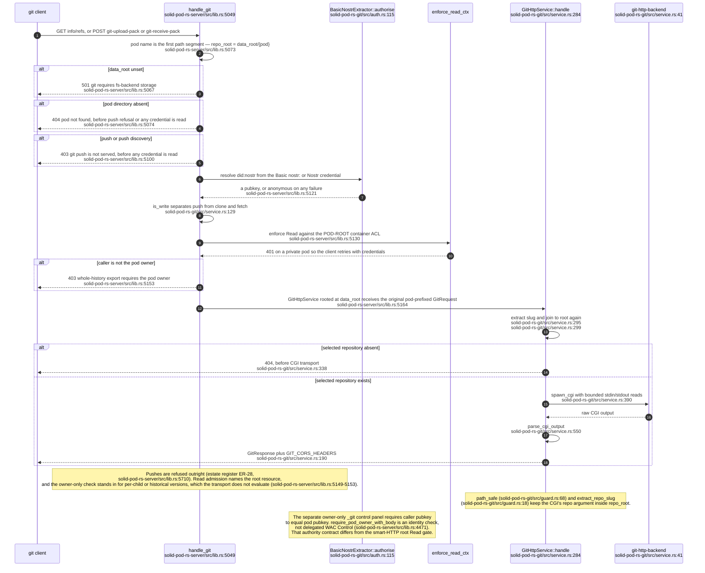

**Debt:** the pre-receive path guard (`solid-pod-rs-git/src/push_guard.rs:1`) and `GitHttpService::with_push_guard` (`solid-pod-rs-git/src/service.rs:255`) ship in the git crate, but `handle_git` refuses every push before the service runs (`solid-pod-rs-server/src/lib.rs:5100`), so the server installs no guard and the code is unreachable from it.

**Boundary:** the CGI constructs a restricted environment and sets `core.symlinks=false`; this transport setup does not implement per-child or historical WAC. The [Git export assessment](../../estate-review/2026-11-01-solid-git-export-and-baseline.md) separates the root/path mismatch from export authority. Both defects must be considered before making normal clones reachable. The topic is restamped at `9b6143c` by the 2026-11-02 wave-1 audit; SP-14 records the mirror publication repair.

**Drift:** since `1a66c2d` (2026-11-01) the CGI environment no longer sets `uploadpack.allowTipSHA1InWant=true`, as JSS does. It sets `allowTipSHA1InWant`, `allowReachableSHA1InWant` and `allowAnySHA1InWant` to `false` (`solid-pod-rs-git/src/service.rs:425-432`), so a client cannot fetch a hidden ref's objects by their hash. The service's own comment says this is not a read-isolation boundary inside a shared object store (`solid-pod-rs-git/src/service.rs:420-423`). The Boundary paragraph above still holds.

