## SP-06.1 The Storage seam and its two shipped backends

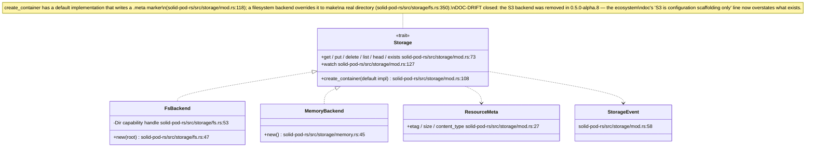

## SP-06.2 Path normalisation — the traversal gate

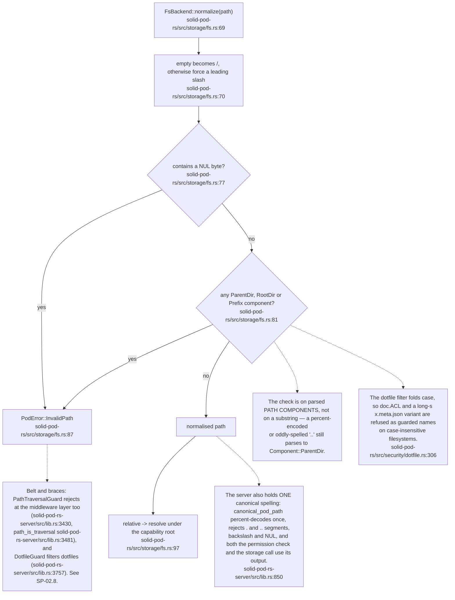

## SP-06.3 Capability-confined filesystem access

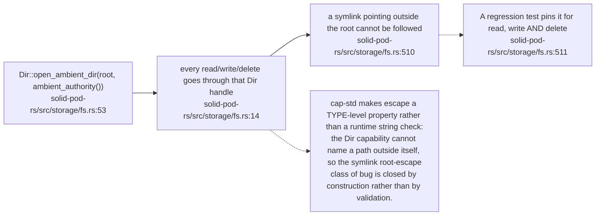

## SP-06.4 Atomic write and the body/metadata pair

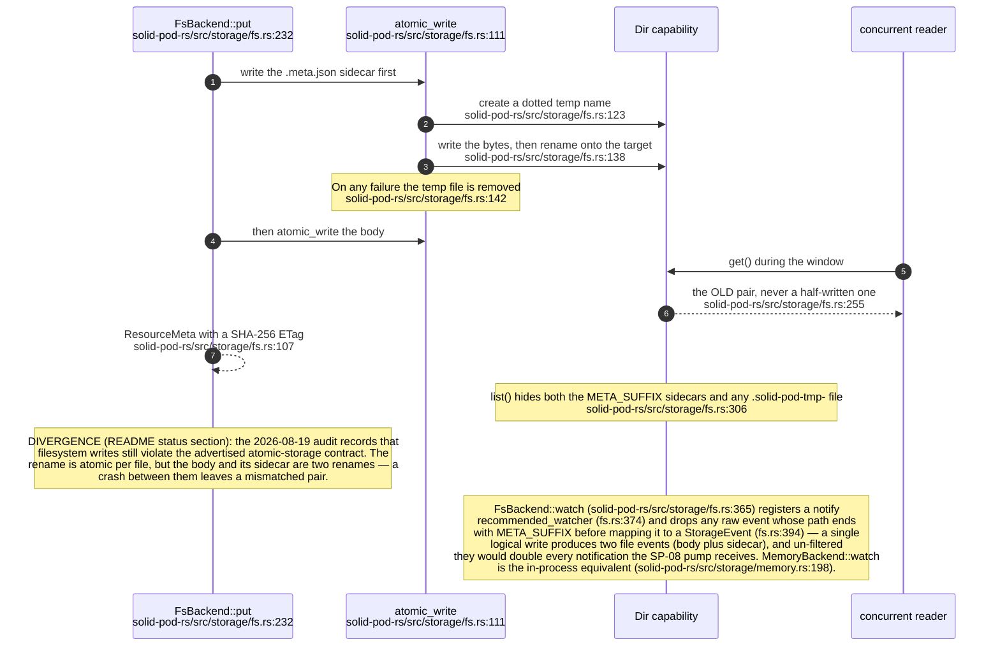

## SP-06.6 Per-pod quota — atomic reservation

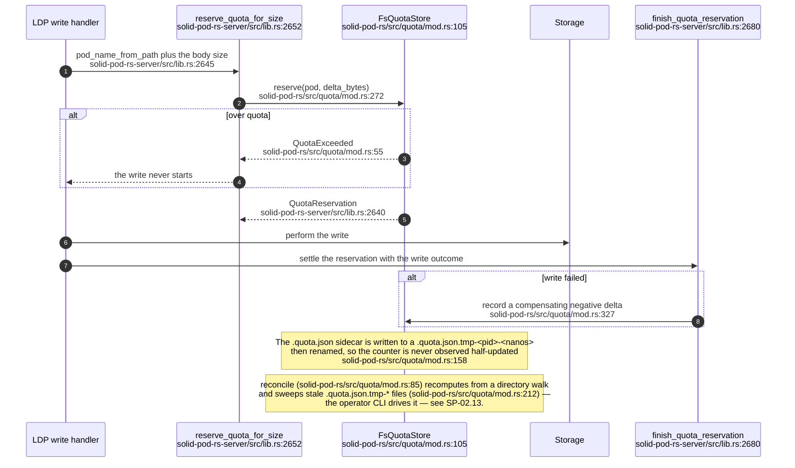

## SP-06.7 Multitenancy — path versus subdomain resolution

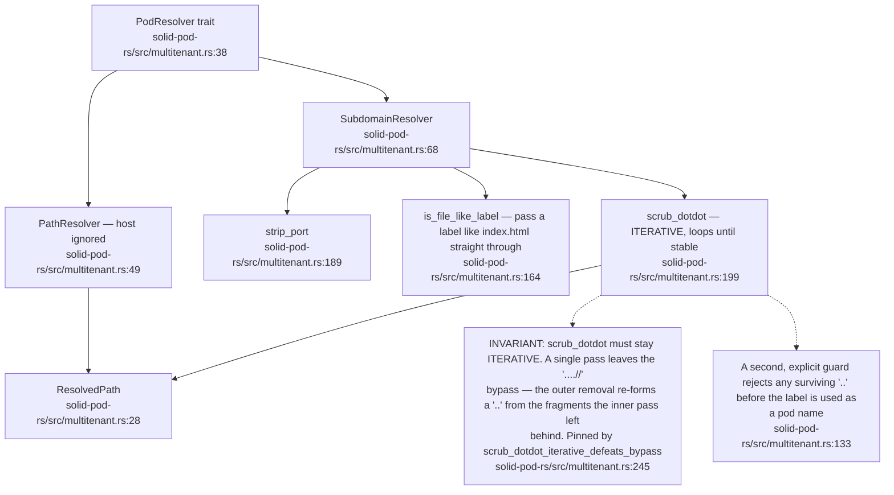

## SP-06.8 Pod provisioning

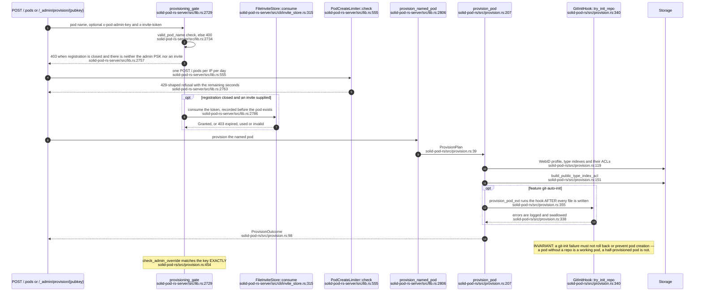

## SP-06.9 The SSRF policy

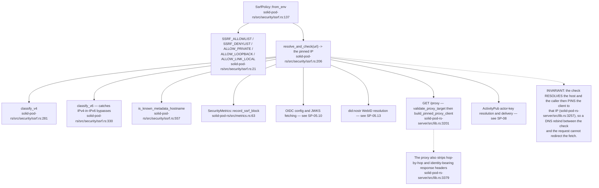

## SP-06.10 CORS policy — origin echo and the credentials trap

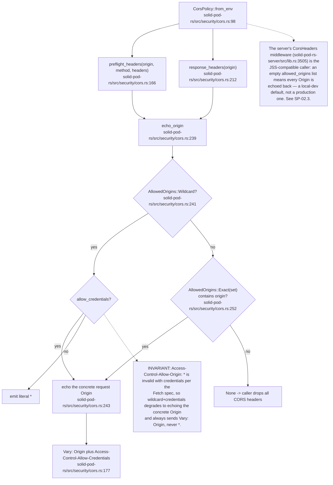

## SP-06.11 Git-versioned pods — repository lifecycle

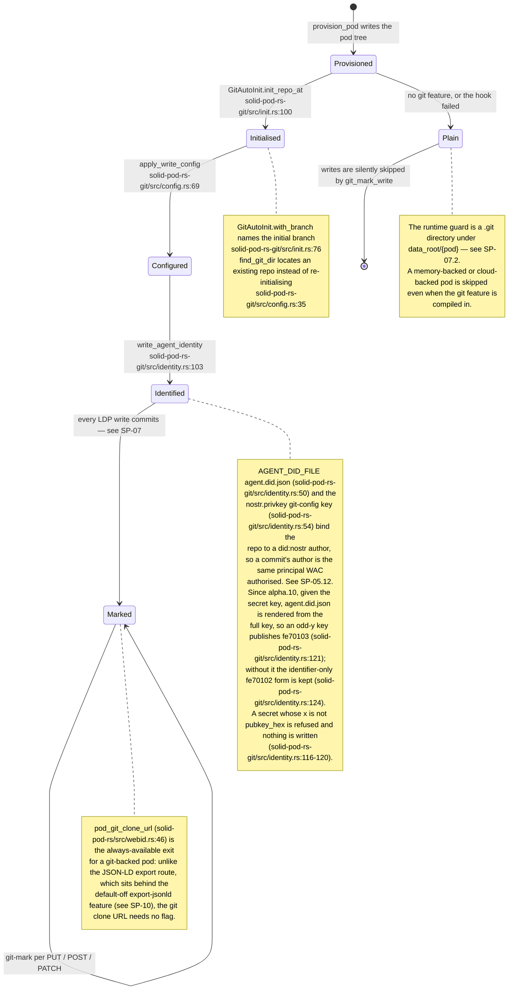

## SP-06.12 Git smart-HTTP — the WAC-gated CGI bridge, clone and fetch only

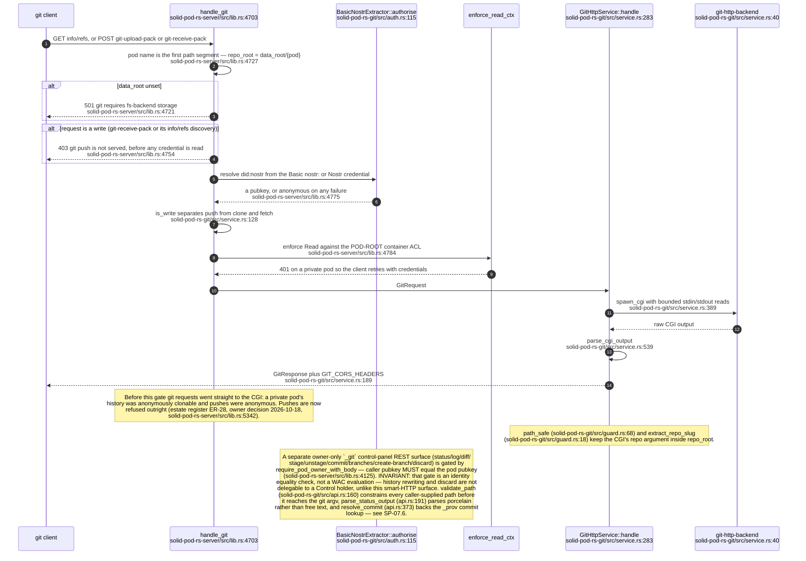

**Debt:** the pre-receive path guard (`solid-pod-rs-git/src/push_guard.rs:1`) and `GitHttpService::with_push_guard` (`solid-pod-rs-git/src/service.rs:254`) ship in the git crate, but `handle_git` refuses every push before the service runs (`solid-pod-rs-server/src/lib.rs:4754`), so the server installs no guard and the code is unreachable from it.

**Invariant:** every production `git` spawn goes through the hardened constructors: repo hooks, fsmonitor and ambient config are neutralised (`solid-pod-rs-git/src/hardened.rs:44`), and the CGI also runs with `core.symlinks=false` (`solid-pod-rs-git/src/service.rs:421`).
