**Repair note — 2026-11-03:** selected counterexamples below have a [scoped successor verification](15-authority-and-payment-repairs.md). This historical topic retains its declared source revision; the successor states the repaired contracts and acceptance boundaries.

## SP-07.1 The two provenance tiers

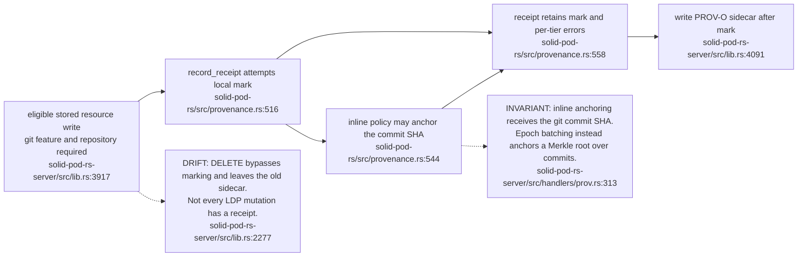

- **What it shows:** resource storage precedes provenance. An eligible local mark can be accompanied by an optional inline anchor — epoch anchoring is a separate batch path.
- **Why it is this way:** ADR-2004 keeps Git opt-in and makes achieved tiers observable without changing a successful storage response. It does not make storage, marking and sidecar persistence atomic.

## SP-07.2 git_mark_write — the skip ladder

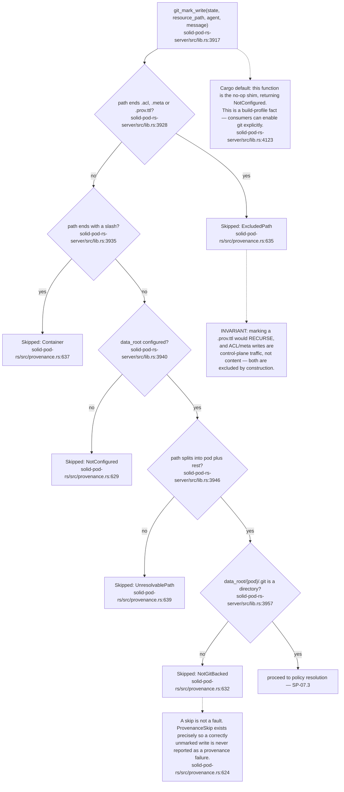

- **What it shows:** the skip ladder applies when a handler calls the hook — it does not establish mutation coverage. The default build skips even a configured filesystem repository.
- **Why it is this way:** ADR-2004 distinguishes ineligible writes from failed attempts. Agentbox enables Git in its package — its path patch and runtime configuration need separate verification.

## SP-07.3 Anchor policy resolution

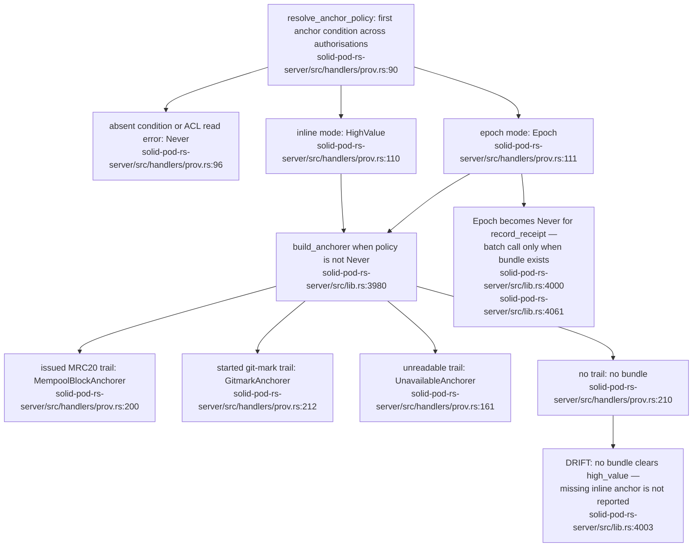

- **What it shows:** the HTTP resolver returns Never, HighValue or Epoch — the library's Always variant is not selected here. The first matching authorisation condition determines the policy, independently of which rule granted the write.
- **Why it is this way:** inline and batch work share provider construction, but the server currently drops the requested-policy distinction when no provider exists. An unreadable inline trail does produce an anchor error.
- **Drift:** the explicit anchor endpoint still says no pay-token or minted trail at solid-pod-rs-server/src/handlers/prov.rs:501, although build_anchorer also accepts a started git-mark trail at solid-pod-rs-server/src/handlers/prov.rs:212.
- **Open:** the native-server source search found only test calls to GitmarkAnchorer::genesis at solid-pod-rs-server/src/mempool.rs:1400. No native route or boot call initiating that trail was found — external provisioning remains unassessed.

## SP-07.4 record_receipt — typed, per-tier outcomes (ADR-2004)

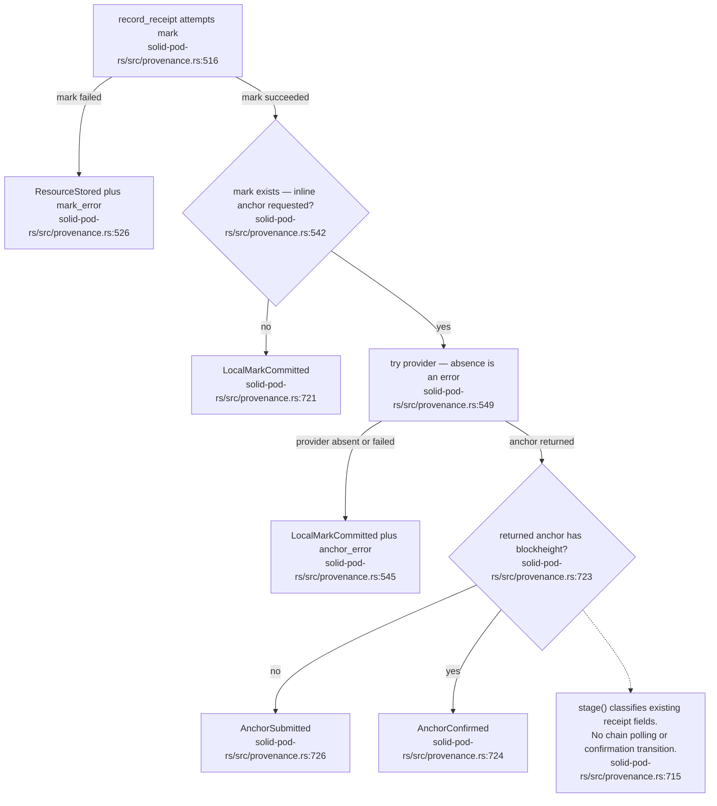

- **What it shows:** the library returns the achieved tier plus separate errors after resource storage. Submitted and confirmed are alternative classifications of the returned anchor.
- **Why it is this way:** ADR-2004 separates local history from anchoring evidence without changing the already successful resource write. Stub tests cover classification — they do not establish live chain confirmation.

## SP-07.5 The receipt on the wire

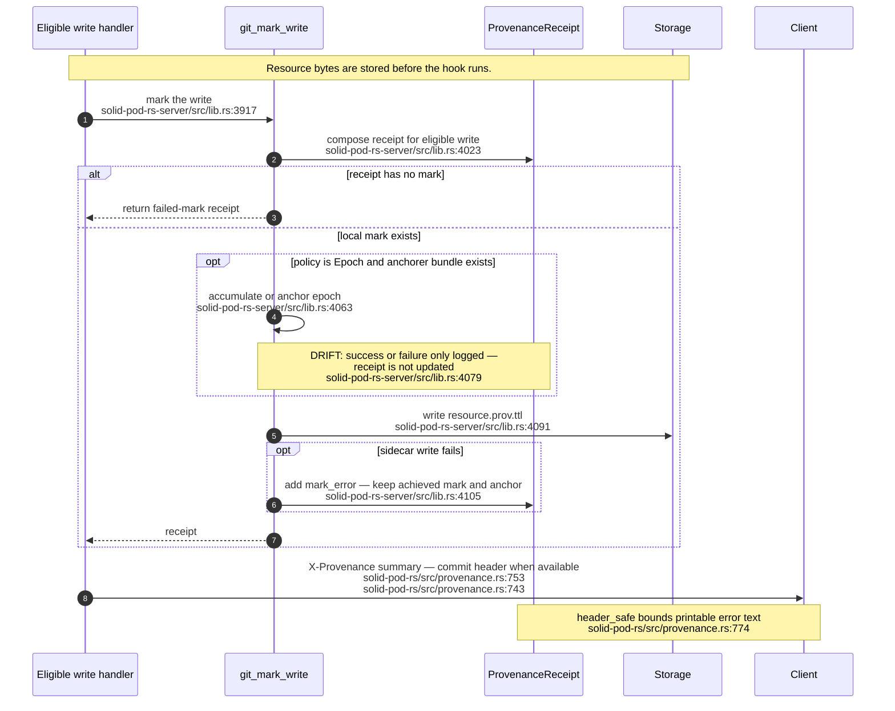

- **What it shows:** eligible PUT/POST/PATCH paths return the receipt while keeping the successful storage status. Earlier skip guards return before composition. The hook's epoch result is not attached to the response or its per-resource sidecar.
- **Why it is this way:** the receipt exposes local marking and sidecar failures without rolling back storage. A crash before the receipt reaches the client still needs durable reconciliation — a response header cannot close that window.

## SP-07.6 Provenance queries and explicit paid anchors

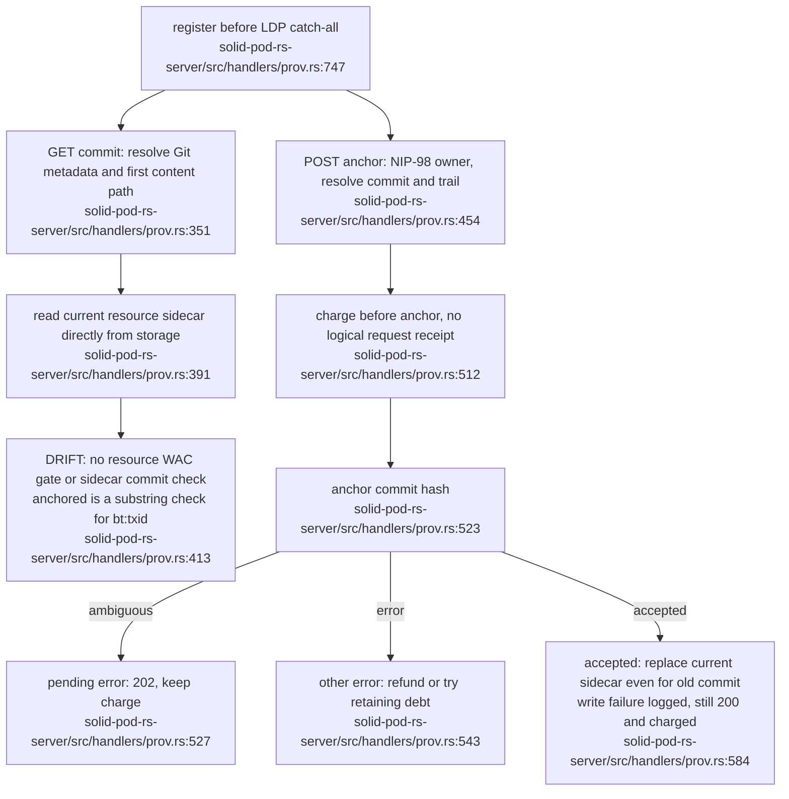

- **What it shows:** the point query bypasses the ordinary LDP read path. A known old commit can return a newer sidecar, and an owner can overwrite that sidecar by anchoring the old commit. The endpoint does not deduplicate logical requests.
- **Why it is this way:** the explicit upgrade composes a local charge, chain submission and mutable sidecar. NIP-98 rejects reuse of an authentication event, but a retry with a new event is a fresh charge.
- **Debt:** a failed refund is only *attempted* in the pending file; a second storage failure is logged at solid-pod-rs-server/src/handlers/prov.rs:692. No repayment worker was found in the crate search. This is not a guaranteed durable refund.
- **Tension:** private resource and sidecar reads returned 401 in the audit fixture, while the unauthenticated commit query returned their metadata and sidecar text. No pod-wide query enumeration or live deployment exposure is claimed.

## SP-07.7 Epoch batching — one transaction, many commits

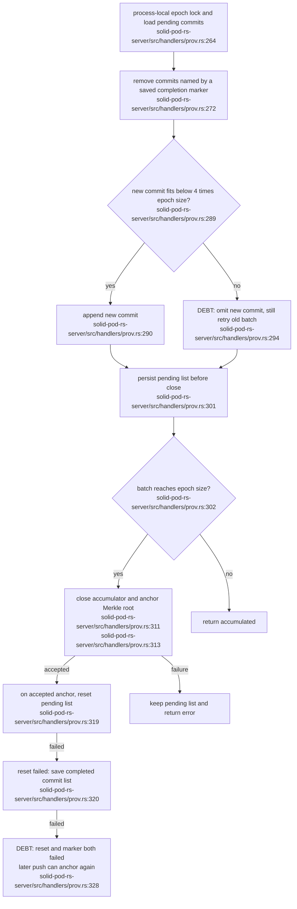

- **What it shows:** pending commits survive a failed close; a saved completion marker can repair a failed reset. The backlog limit omits new commits, including the write that triggers successful draining of a full backlog.
- **Why it is this way:** batch anchoring bounds transaction cost and retained backlog. The returned anchor is discarded here, and broadcast acceptance does not establish confirmation. Per-resource receipts still omit epoch outcomes (SP-07.5).
- **Open:** lock_path is process-local at solid-pod-rs-server/src/trail_store.rs:340. Multi-process safety, durable proof export and process-restart reconciliation are not established by the in-memory fault tests.

## SP-07.9 MRC20 state chain and Bitcoin anchoring

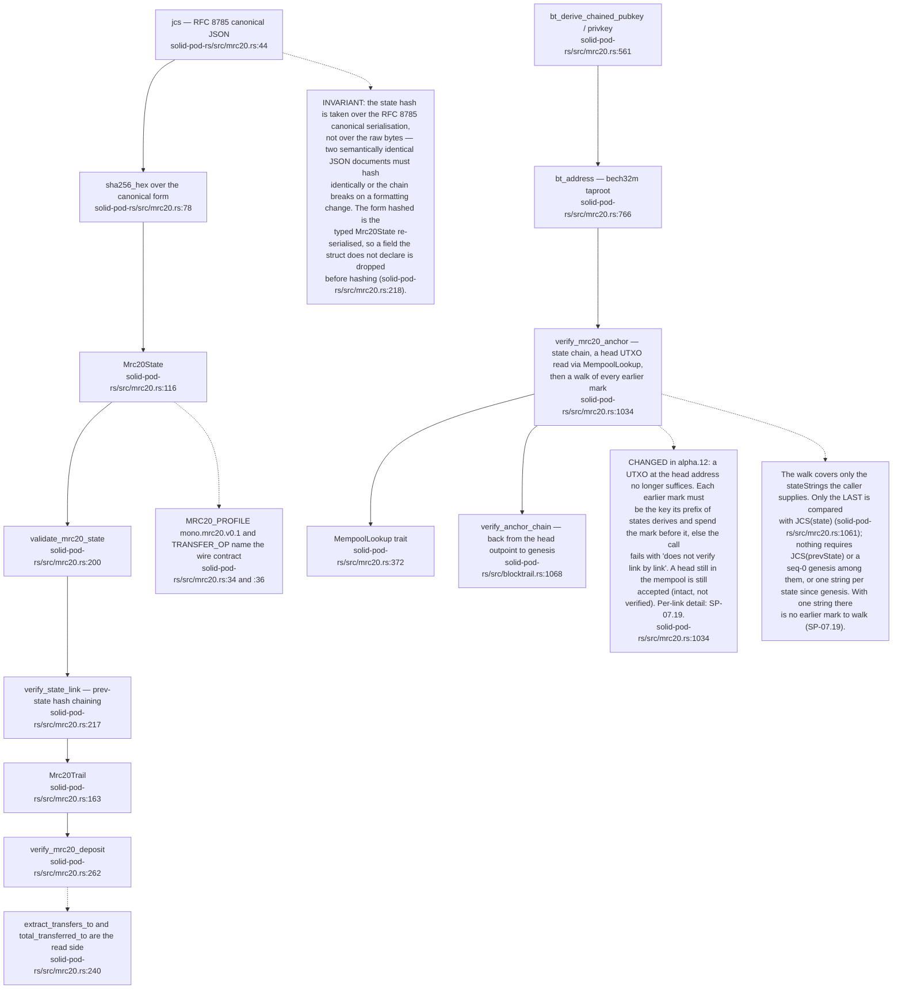

- **Tension:** "every earlier mark" is only as long as the proof the caller sends. A one-element `stateStrings` proof turns the walk into the head-only check that alpha.12 replaced, because mark 0's input is never examined (solid-pod-rs/src/blocktrail.rs:1114). Its head address is derived from the public issuer key alone (solid-pod-rs/src/mrc20.rs:766), so funding it needs no issuer secret. Only a mark after genesis needs that secret to spend its predecessor. The deposit consequence is recorded at SP-07.17. Closing it needs `verify_mrc20_anchor` to require at least two strings, with the second-to-last equal to `JCS(prevState)`, or to bind the proof to a trail the pod has recorded. This is source tracing only: no probe was run.

## SP-07.10 The rust-bitcoin transaction builder (ADR-2008 D1, landed)

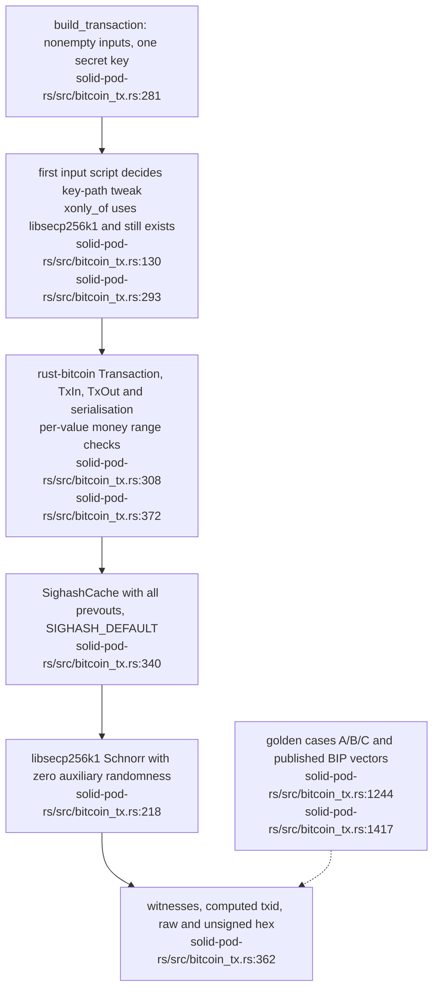

- **What it shows:** the primitive port is implemented. The xonly_of wrapper remains; the removed code is the handwritten primitive arithmetic and encoders. The golden fixtures use deterministic signing for cross-implementation equality.
- **Why it is this way:** ADR-2008 D1/D2 replaces crypto primitives with maintained libraries while retaining the transaction policy and compatibility surface. One key signs all inputs; callers must group compatible inputs, as the builder documentation states at solid-pod-rs/src/bitcoin_tx.rs:230.
- **Open:** native vector tests do not prove fee adequacy, chain acceptance, consumer activation or WASM transaction building. The write module remains native-only at solid-pod-rs/src/bitcoin_tx.rs:53.

## SP-07.11 Mempool endpoint selection (ADR-2007)

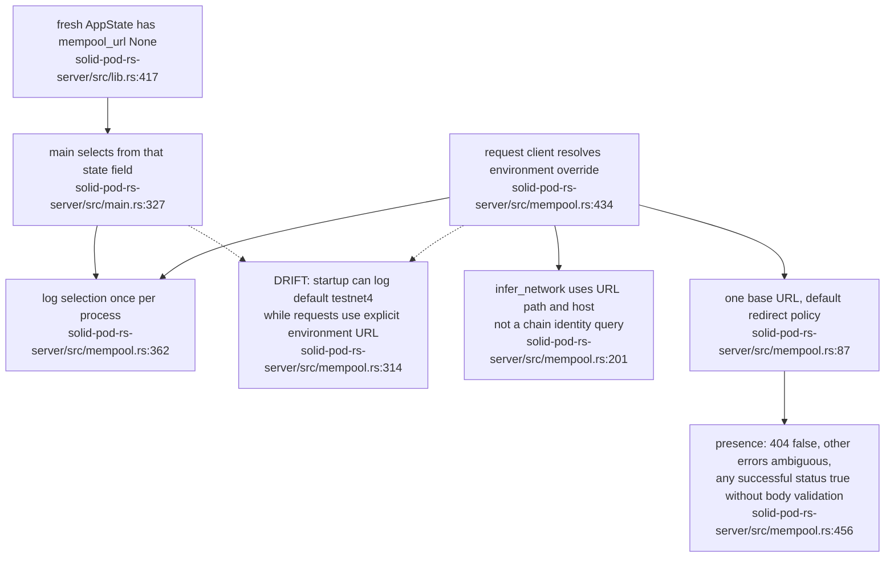

- **What it shows:** startup and request construction resolve different inputs. Once-only logging can retain the startup default. The client keeps one configured base but follows a local cross-origin redirect in the audit probe.
- **Why it is this way:** ADR-2007 rejects ordered endpoint failover. That decision does not pin redirect destinations or turn URL-based network inference into chain verification.
- **Open:** to_manifest_json at solid-pod-rs-server/src/mempool.rs:280 exposes the selection value, but a deployed queryable manifest and chain identity remain unverified.

## SP-07.12 The block anchorer

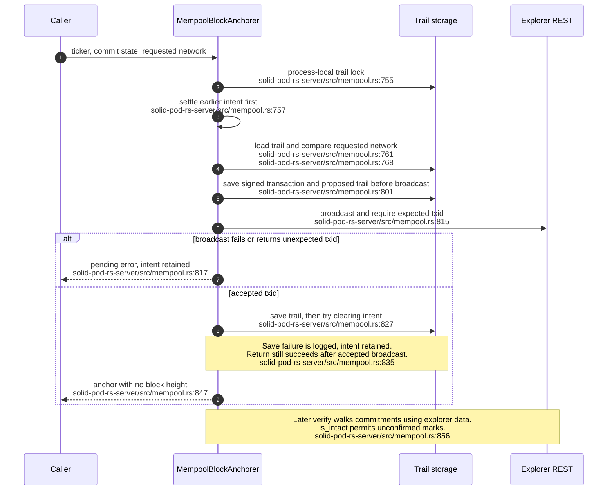

- **What it shows:** issued MRC20 trails retain their profile. Broadcast ambiguity and a failed save after acceptance have different caller outcomes; acceptance is not chain confirmation.
- **Why it is this way:** the retained intent supports retry before another advance, without refunding an accepted transaction solely because local persistence failed. Existing fixture tests cover this path.
- **Open:** settle_trail_intent validates retained transaction identity and head input at solid-pod-rs-server/src/mempool.rs:1129, then trusts the longer proposed trail at solid-pod-rs-server/src/mempool.rs:1147. The analogous git-mark metadata failure is reproduced in SP-07.20; altered MRC20 state is not freshly probed.

## SP-07.13 The stored web ledger and its public operations

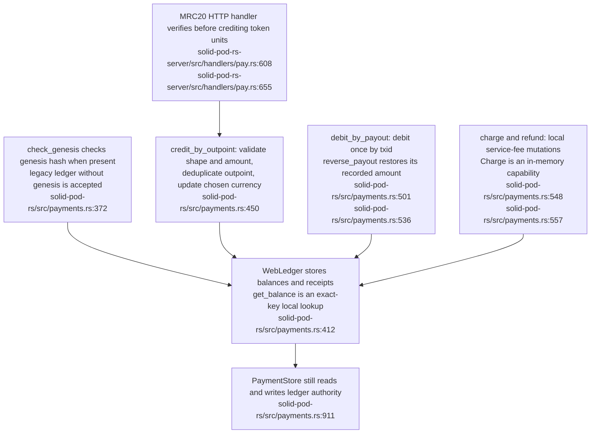

- **What it shows:** outpoint and payout receipts are local replay controls. The public credit_by_outpoint method performs no network lookup; its caller supplies the verified facts. The handler does verify before it credits, but what verify_mrc20_anchor accepts is weaker than "verified" suggests: a one-string trail passes, so the credited amount is self-asserted (SP-07.17 Tension). Service charges and refunds are additional balance mutations.
- **Why it is this way:** Teller-shaped receipts improve the stored ledger without delivering ADR-2008's chain-derived authority. Bare credit/debit are now crate-private at solid-pod-rs/src/payments.rs:565 and solid-pod-rs/src/payments.rs:579, but public receipt operations and write_ledger still change stored balances.
- **Invariant:** the MRC20 deposit route refuses a ticker that aliases sats at solid-pod-rs-server/src/handlers/pay.rs:591. Its credit goes to token units, not the satoshi balance. Genesis identity does not authenticate the changing balances.

## SP-07.14 The `/pay/*` route family

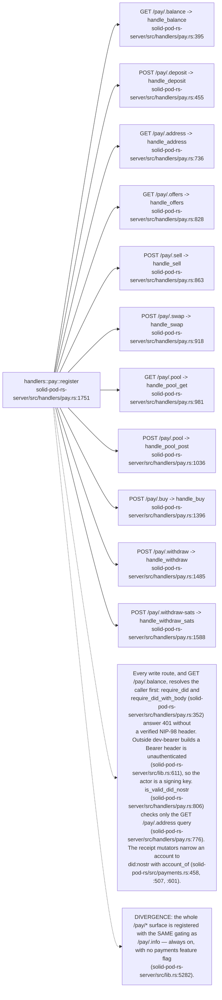

- **Drift:** the README opens by saying payments are added "through explicit features" (../solid-pod-rs/README.md:3), and its payments paragraph describes deposits, withdrawals, the order book and the AMM with no caution (../solid-pod-rs/README.md:141). The `/pay/*` routes are mounted unconditionally (solid-pod-rs-server/src/lib.rs:5282). An earlier version of this panel cited a README warning against carrying value through these routes. That sentence is in neither 09ec90f nor 9b6143c.

## SP-07.15 Payment-state commits and the read-failure gap

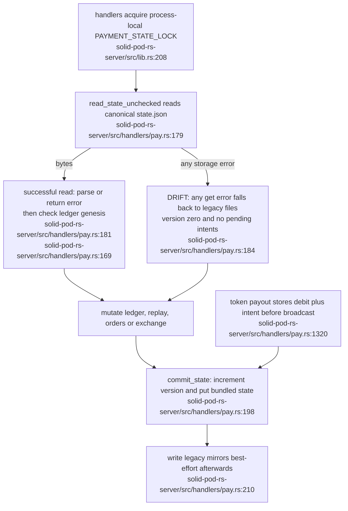

- **What it shows:** bundled state prevents a local transition being split between authoritative ledger, replay and market files. But a read outage can select stale mirrors and the next successful write can replace the canonical state with them, losing intents and resetting the version.
- **Why it is this way:** the implementation has a useful single-document commit and process-local serialisation. It has no cross-process compare-and-swap, and its compatibility fallback is broader than its own missing-file-only contract.
- **Debt:** recovery at solid-pod-rs-server/src/handlers/pay.rs:242 trusts explorer presence, advances a saved trail when behind and reverses a payout on 404. A missing payout receipt retains the intent. These are bounded recovery rules, not proof of finality or safe absence across explorers.
- **Invariant:** token transfer waits at most two seconds for its trail lock while holding the payment lock, then returns 503 with Retry-After at solid-pod-rs-server/src/handlers/pay.rs:1253. The existing tests establish this local bound.

## SP-07.16 Order book and AMM

```mermaid
classDiagram
    class OrderBook {
        +create_order  solid-pod-rs/src/trading.rs:183
        +list_offers  solid-pod-rs/src/trading.rs:209
        +cancel_order  solid-pod-rs/src/trading.rs:221
        +execute_swap  solid-pod-rs/src/trading.rs:243
    }
    class SellOrder {
        solid-pod-rs/src/trading.rs:148
    }
    class AmmPool {
        +new(a, b, fee_bps)  solid-pod-rs/src/trading.rs:345
        +add_liquidity  solid-pod-rs/src/trading.rs:362
        +remove_liquidity  solid-pod-rs/src/trading.rs:411
        +swap — constant product  solid-pod-rs/src/trading.rs:462
        +pool_info  solid-pod-rs/src/trading.rs:534
    }
    class Exchange {
        +get_or_create_pool  solid-pod-rs/src/trading.rs:571
        +get_pool  solid-pod-rs/src/trading.rs:584
    }
    class WebLedgerTrading {
        <<impl WebLedger>>
        +get_currency_balance  solid-pod-rs/src/trading.rs:37
        -credit_currency  solid-pod-rs/src/trading.rs:46
        -debit_currency  solid-pod-rs/src/trading.rs:90
    }
    Exchange *-- AmmPool
    OrderBook *-- SellOrder
    OrderBook ..> WebLedgerTrading
    AmmPool ..> WebLedgerTrading
    note for AmmPool "pool_key (solid-pod-rs/src/trading.rs:601) normalises the currency pair so\n(A,B) and (B,A) resolve to one pool; isqrt_u128 (:610) is the integer square\nroot the LP-share maths needs — everything is integer arithmetic, no floats\nin a value path. Per-currency credit/debit are crate-private helpers on WebLedger.\nOutside this crate the only new value is credit_by_outpoint; the public swap,\nremove_liquidity and execute_swap move value through those helpers, and the\npublic refund (solid-pod-rs/src/payments.rs:557) and reverse_payout (:536) restore it."
```

## SP-07.17 Deposits are MRC20-only — the stand-in is deleted (ADR-2008 D6)

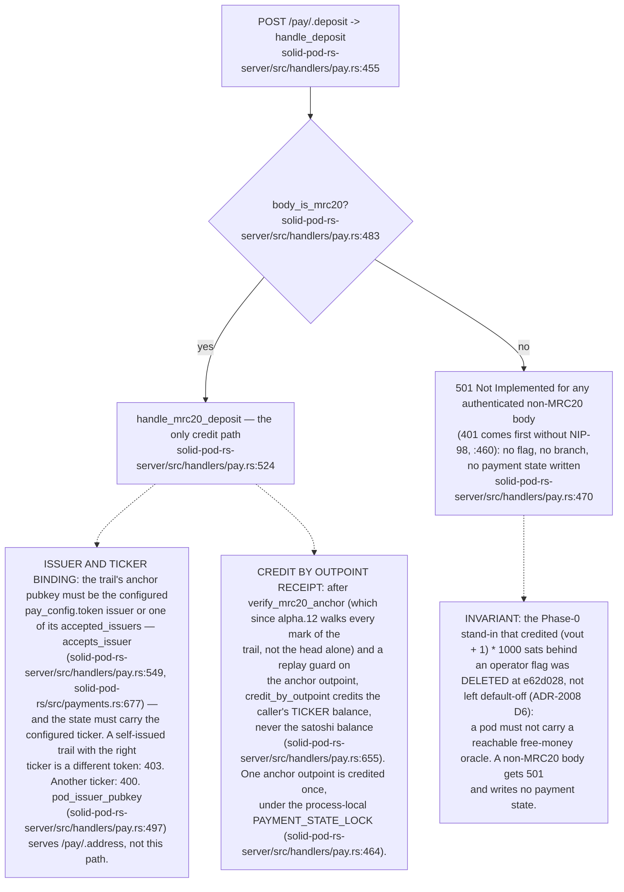

- **Tension:** the INVARIANT names what D6 removed: the stand-in. It does not show that the remaining credit path is closed. The credited amount is whatever `state.ops` transfer to the pod's address (solid-pod-rs/src/mrc20.rs:253), and no balance or supply rule limits it beyond the 21-million-coin ceiling per credit (solid-pod-rs/src/payments.rs:469, :622). The whole proof binding is SP-07.9's walk over caller-supplied `stateStrings`. That walk needs no issuer secret when the proof has one string (SP-07.9, SP-07.19). Nothing on this path rejects such a proof (solid-pod-rs-server/src/handlers/pay.rs:603-620). The anchor network comes from the body, defaulting to testnet4 (solid-pod-rs-server/src/handlers/pay.rs:566), so the configured mempool endpoint bounds the chain, not the code. The server's route tests have no one-string or head-only negative case. Source tracing at 9b6143c only: no request was sent. Closure is the SP-07.9 binding plus a route test that refuses a one-string proof.

## SP-07.18 ADR-2008 — completed port and unfinished ledger authority

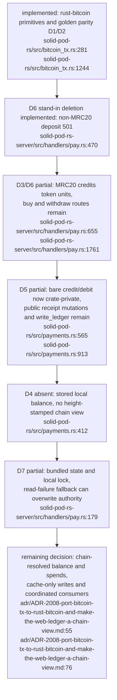

- **What it shows:** code has moved beyond the October implementation note, but not to a chain-derived ledger. D6's stand-in deletion is complete while its requested removal of MRC20 crediting is not. D5's old function-name grep now passes without satisfying its authority requirement.
- **Why it is this way:** this remains a proposed, partially implemented, staged decision at adr/ADR-2008-port-bitcoin-tx-to-rust-bitcoin-and-make-the-web-ledger-a-chain-view.md:5. The audit distinguishes landed library changes from chain activation and consumer versions.
- **Drift:** the implementation note still says bare credit/debit are public and D7 is not built at adr/ADR-2008-port-bitcoin-tx-to-rust-bitcoin-and-make-the-web-ledger-a-chain-view.md:147. The current code has narrowed those methods and added bundled commits, with the remaining failure in SP-07.15.
- **Open:** D8 remains unmet in the audited consumer lockfiles: VisionClaw resolves alpha.17 and the forum alpha.18. Detailed consumer source receipts and the whole-section assessment are in the dated payment audit; this topic does not certify either deployment.

## SP-07.19 Whole-trail verification — every mark walked back from the head (alpha.12)

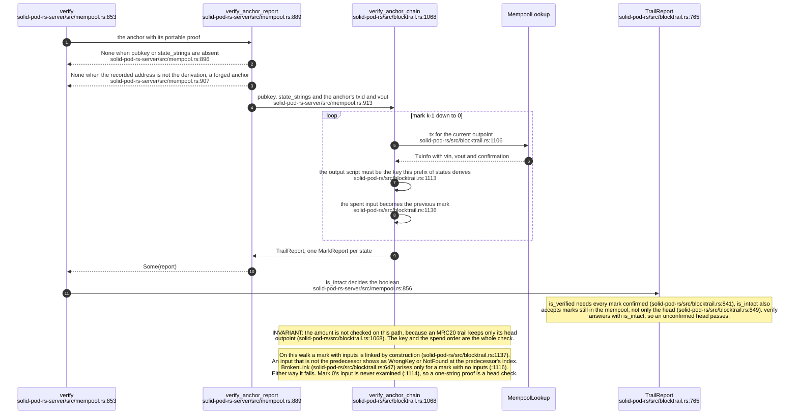
- **What it shows:** `verify` on either anchorer is a walk, not a lookup. From the anchor's own outpoint back to genesis every mark must exist, be the key its prefix of states derives, and be spent by the next.
- **Why it is this way:** a UTXO at the head address proves only that the head key was paid, so the earlier version accepted a trail whose history was missing or paid other keys (0.5.0-alpha.12 CHANGELOG, `Changed`). Verification follows blocktrails/verify 043e7af, with fixtures generated from the page itself. On the full-trail walk, `verify_blocktrail` counts BrokenLink as a failure where the page still labels such a mark verified. Here the crate is deliberately stricter than its reference.
- **Tension:** the walk is as long as `state_strings`, and the caller supplies them. See SP-07.9 for the missing binding and SP-07.17 for its deposit consequence.

## SP-07.20 GitmarkAnchorer — the git-mark profile for new trails (alpha.12)

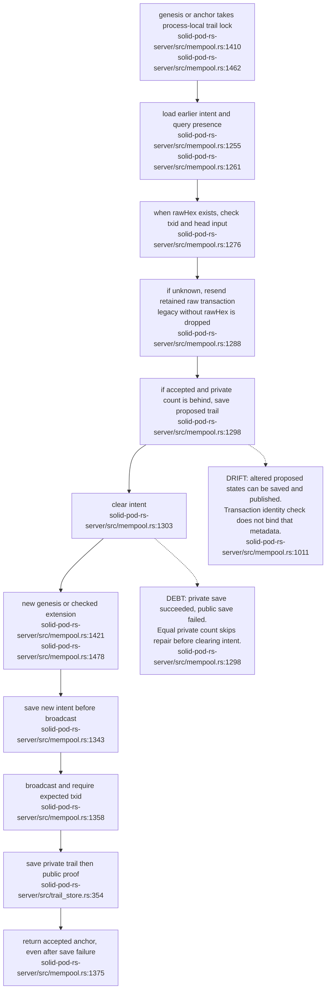

- **What it shows:** recovery precedes a new advance. The raw transaction guard rejects a wrong txid, but the audit probe recovers altered state metadata and publishes a non-intact trail. A later extension refuses it.
- **Why it is this way:** durable intents protect against lost broadcast responses and failed private saves. Recovery uses private mark count to decide whether persistence is complete, which misses a failed public proof write.
- **Invariant:** a new extension compares the latest output with the key derived from the trail states at solid-pod-rs/src/bitcoin_tx.rs:963. That later check does not prevent recovery from first replacing stored metadata.
- **Open:** native server source contains no non-test genesis caller (SP-07.3). Full process restart, multi-process locking and external provisioning remain unverified. The fixture transport used here is not a consensus node.
