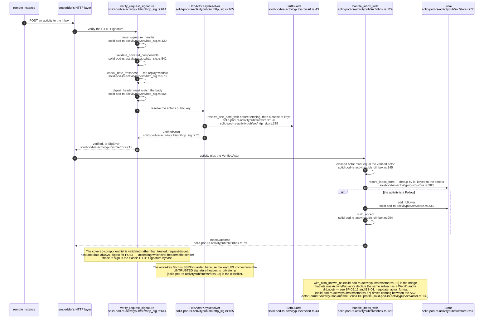
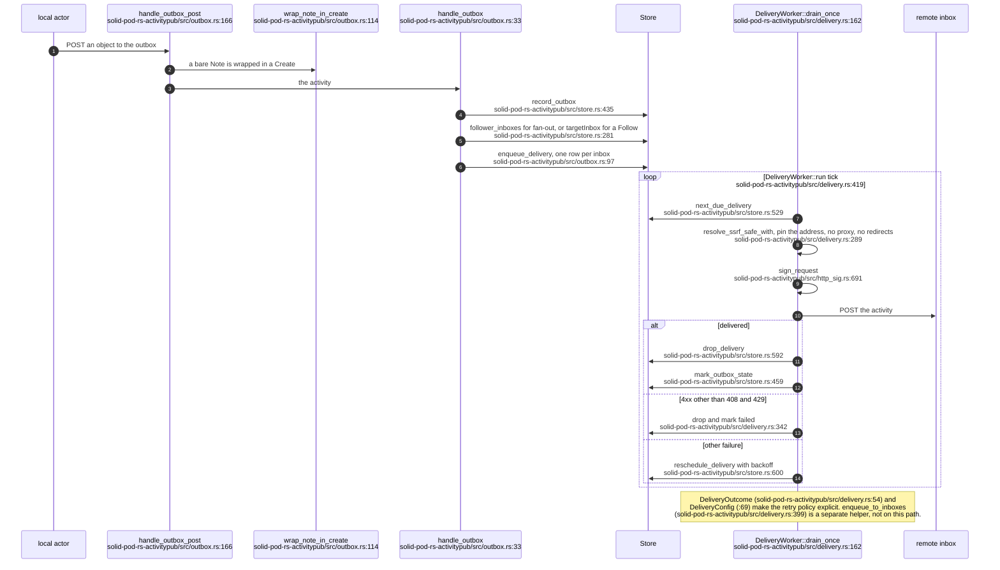
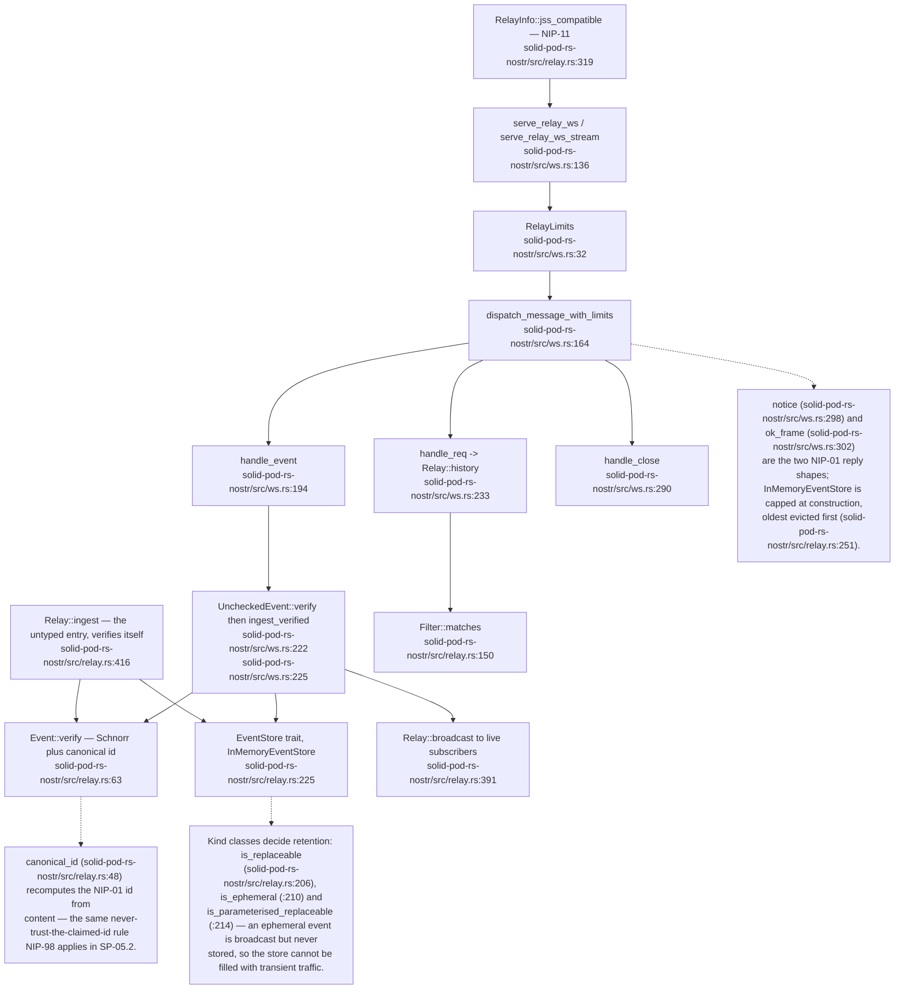
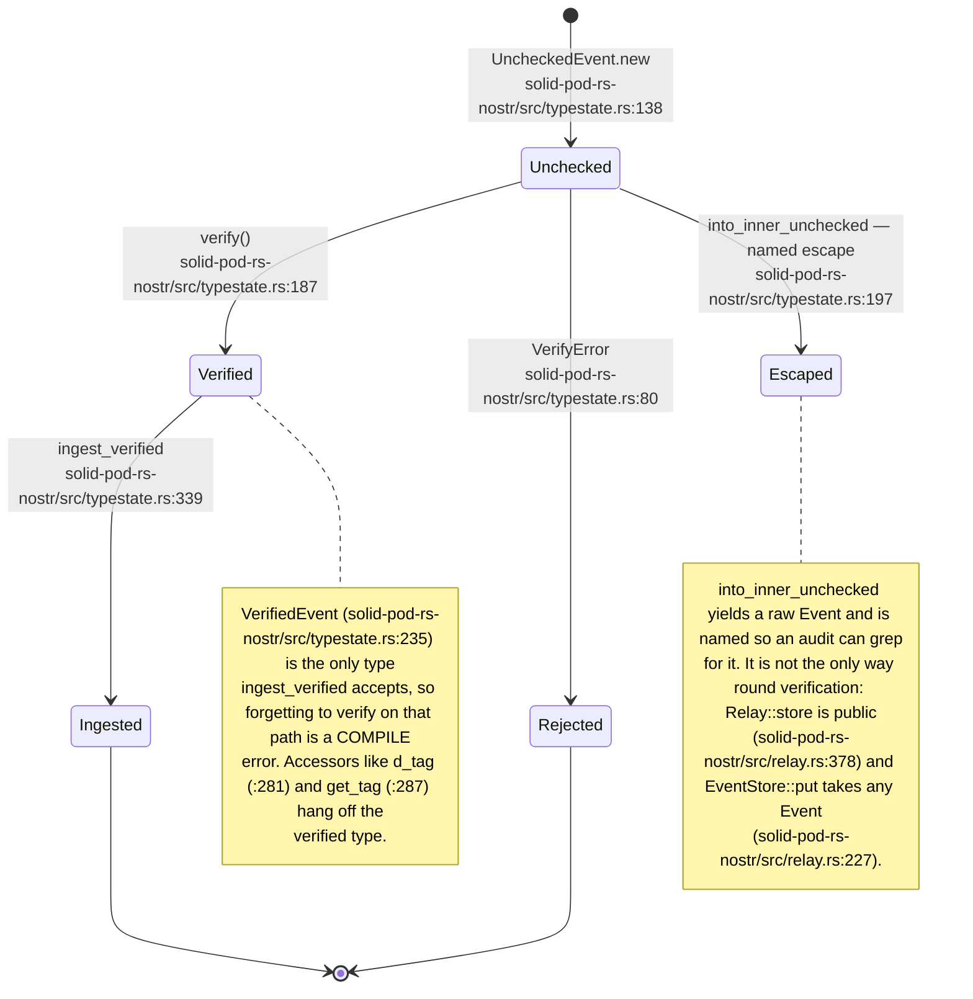
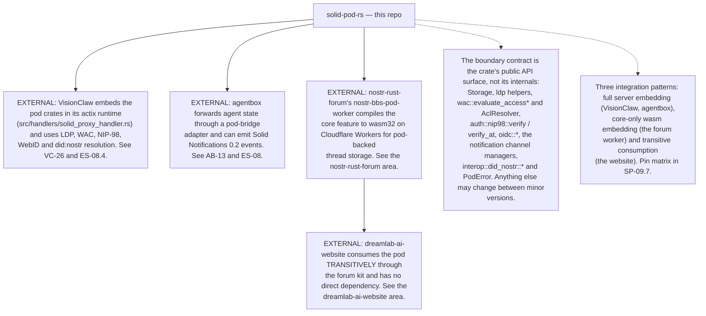
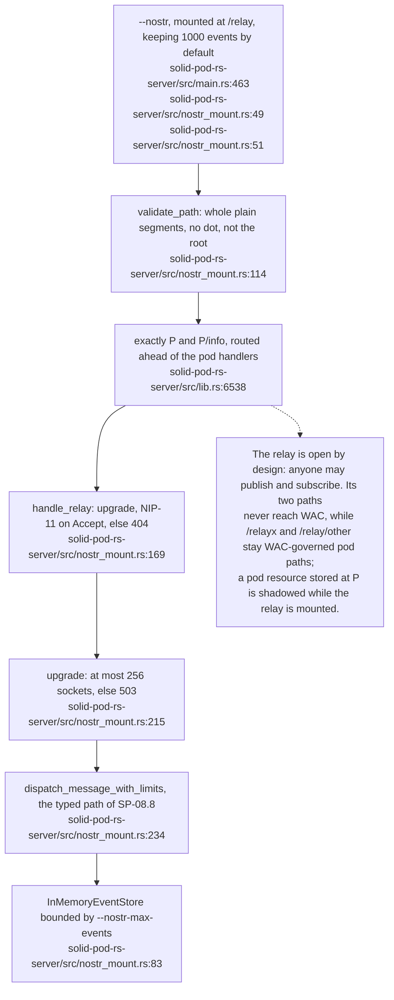

Split 2026-11-23: SP-08.1 to SP-08.4, SP-08.17, SP-08.19 and SP-08.23 moved to [SP-16](16-solid-notifications-and-the-legacy-adapters.md) as SP-16.1 to SP-16.7; SP-08.10 to SP-08.15, SP-08.18 and SP-08.22 moved to [SP-17](17-forge-and-mcp-tool-surface.md) as SP-17.1 to SP-17.8. The old IDs resolve through the aliases declared there.

## SP-08.5 ActivityPub — signature verification and the inbox

**What it shows.** Verification and inbox handling are separate calls. `handle_inbox` does not verify; it requires a `VerifiedActor`, binds the activity's `actor` to it, then records and dispatches.

**Invariant:** nothing is stored before the claimed actor matches the verified actor and every Follow bound passes (`solid-pod-rs-activitypub/src/inbox.rs:145` precedes `solid-pod-rs-activitypub/src/inbox.rs:204`).

**Tension:** "verify before store" is a caller contract, not a type guarantee. `VerifiedActor` has public fields (`solid-pod-rs-activitypub/src/http_sig.rs:76`) and the doc invites soft-logged callers to hand one through (`solid-pod-rs-activitypub/src/inbox.rs:106`). The reference server meets it: its inbox, mounted only with `--ap-federation`, verifies before it calls the library (`solid-pod-rs-server/src/activitypub.rs:603`, then `:613`). See SP-08.20.

## SP-08.6 ActivityPub — outbox and delivery

**Drift:** RESOLVED at a28a748. `handle_outbox` now always replaces `actor` with the pod's own (`solid-pod-rs-activitypub/src/outbox.rs:51`) and replaces an `id` outside the actor's origin (`solid-pod-rs-activitypub/src/outbox.rs:60`).

## SP-08.8 The embedded NIP-01 relay

**What it shows.** The WebSocket path takes the typestate route (SP-08.9); `Relay::ingest` is a second, untyped entry that verifies internally. Both reach the same NIP-16 retention rules. The reference server mounts the typed path behind `--nostr` (SP-08.21).

## SP-08.9 The relay typestate — verification on the typed path

**Tension:** the panel's earlier title, "verification cannot be skipped", held only for `ingest_verified`. Any holder of a `Relay` can call `relay.store().put(event)` and persist an unverified event that later `REQ` history returns. Making `store()` crate-private, or giving it a read-only view, would make the typestate claim true for the whole relay.

## SP-08.16 Estate consumers of these surfaces

## SP-08.20 ActivityPub federation mounted on the server — `--ap-federation`

```mermaid
flowchart TD
    FLAG["--ap-federation needs --activitypub and --public-base-url<br/>solid-pod-rs-server/src/main.rs:635<br/>solid-pod-rs-server/src/main.rs:672"]
    START["Federation::start_with_limits, SsrfGuard::strict,<br/>delivery worker spawned<br/>solid-pod-rs-server/src/main.rs:653<br/>solid-pod-rs-server/src/activitypub.rs:405"]
    ROUTES["POST /inbox, the actor's inbox and outbox, followers, following,<br/>registered ahead of the pod handlers<br/>solid-pod-rs-server/src/lib.rs:6562"]
    subgraph IN["Inbox"]
        HOST["Host must be the configured authority, else 421<br/>solid-pod-rs-server/src/activitypub.rs:582"]
        BODY["body read within 5 s and 256 KiB before a slot is taken<br/>solid-pod-rs-server/src/activitypub.rs:589"]
        SLOT["16 inbox slots, else 503 with Retry-After<br/>solid-pod-rs-server/src/activitypub.rs:593"]
        SIG["verify_request_signature, key fetch guarded and cached<br/>solid-pod-rs-server/src/activitypub.rs:603"]
        BIND["actor equals signer, id on the signer's origin,<br/>a follower's inbox on its own origin<br/>solid-pod-rs-activitypub/src/inbox.rs:145<br/>solid-pod-rs-activitypub/src/inbox.rs:158<br/>solid-pod-rs-activitypub/src/inbox.rs:180"]
        CAPS["5000 followers, 50 per host by default, else 429<br/>solid-pod-rs-activitypub/src/inbox.rs:186<br/>solid-pod-rs-activitypub/src/inbox.rs:192<br/>solid-pod-rs-server/src/main.rs:647"]
        TRIM["200 rows per sender, then 10000 in all,<br/>evicting from the heaviest sender<br/>solid-pod-rs-activitypub/src/inbox.rs:210<br/>solid-pod-rs-activitypub/src/inbox.rs:212<br/>solid-pod-rs-activitypub/src/store.rs:766"]
        ACC["Accept queued only under the delivery-queue bound<br/>solid-pod-rs-server/src/activitypub.rs:626"]
    end
    subgraph OUT["Outbox and delivery"]
        OWN["POST outbox: NIP-98 bound to the body, Control on /<br/>solid-pod-rs-server/src/activitypub.rs:684"]
        TGT["a Follow's target inbox is fetched, never read from the request<br/>solid-pod-rs-server/src/activitypub.rs:702<br/>solid-pod-rs-server/src/activitypub.rs:716"]
        RUN["8 deliveries at once, 2 per host, a breaker per host<br/>solid-pod-rs-activitypub/src/delivery.rs:33<br/>solid-pod-rs-activitypub/src/delivery.rs:37<br/>solid-pod-rs-activitypub/src/delivery.rs:202"]
        HP["the signed Host keeps a non-default port<br/>solid-pod-rs-activitypub/src/http_sig.rs:700"]
    end
    FLAG --> START --> ROUTES
    ROUTES --> HOST --> BODY --> SLOT --> SIG --> BIND --> CAPS --> TRIM --> ACC
    ROUTES --> OWN --> TGT --> RUN --> HP
    ACC --> RUN
    N["Keys and the store file are written 0600 through a fresh temp file<br/>(solid-pod-rs-server/src/activitypub.rs:275). A slow or hostile host holds<br/>at most its own two delivery slots and never delays another host's rows."]
    RUN -.-> N
```

Every bound above is a refusal, not a queue: past it the remote is told 429, 503 or 421 and the store is untouched.

## SP-08.21 The relay mounted on the server — `--nostr`

