## SP-08.1 Solid Notifications 0.2 — the three channels

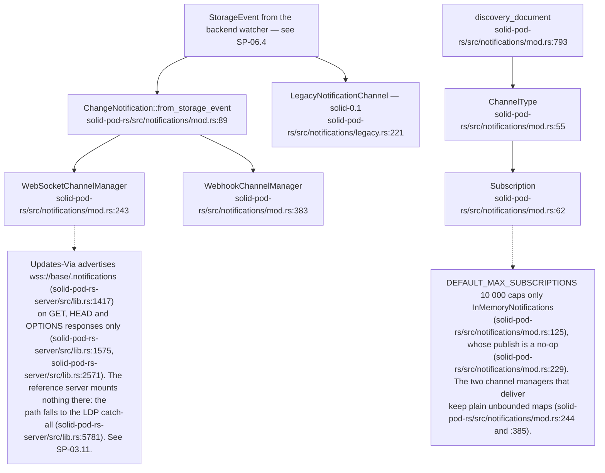

**What it shows.** The core crate defines two Notifications 0.2 channel managers, the legacy `solid-0.1` adapter and the discovery document. They are library types: none of them is instantiated by `solid-pod-rs-server`.

**Why it is this way.** The crate owns protocol and leaves routing to the embedder (the same line SP-08.17 draws). The consequence is that the reference server advertises a channel it does not serve.

**Tension:** `set_updates_via` points every GET, HEAD and OPTIONS response at `/.notifications` on the WebSocket scheme, but no route in the server builds a `WebSocketChannelManager` or upgrades that path, so a client that follows the header reaches the LDP GET handler (`solid-pod-rs-server/src/lib.rs:5781`). Either the header should be dropped from the reference server or a channel mounted behind it.

**Drift:** the subscription cap note in earlier readings implied the delivering channels were bounded. Only `InMemoryNotifications` is capped, and it delivers nothing.

## SP-08.2 WebSocket notification pump

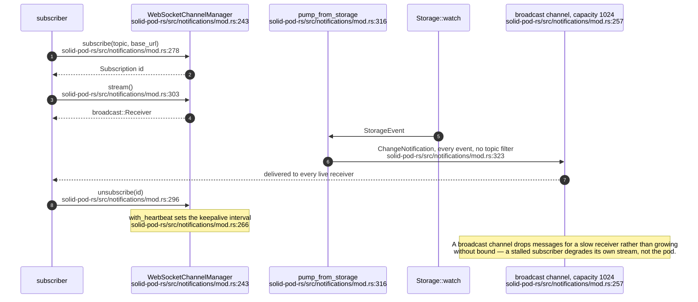

**Drift:** the doc comment on `pump_from_storage` says each event goes to clients "whose subscription topic covers the event path" (`solid-pod-rs/src/notifications/mod.rs:314`); the body sends every event to the one broadcast channel (`solid-pod-rs/src/notifications/mod.rs:323`). Topic filtering and any WAC check are left to the transport that reads the receiver.

## SP-08.3 Webhook delivery — signing, retry and the circuit breaker

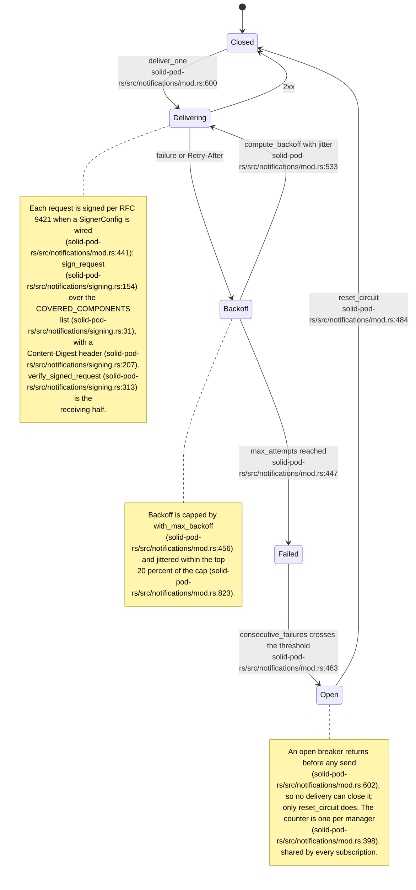

**Tension:** the breaker is one counter per manager, not per target. Any 2xx or 410 from any subscriber's target resets it (`solid-pod-rs/src/notifications/mod.rs:618`, `solid-pod-rs/src/notifications/mod.rs:624`), so one dead endpoint among healthy ones rarely trips it. It opens after ten consecutive exhausted deliveries across the whole manager with no success in between (a correlated outage, or a dead sole subscriber). Once open it is permanent until an operator calls `reset_circuit`, because the open check at `solid-pod-rs/src/notifications/mod.rs:602` runs before any send, and it then blocks every subscriber. A per-URL breaker, or a half-open timer, would bound both effects.

**Drift:** the struct comment says the circuit stays open "until a successful delivery resets the counter" (`solid-pod-rs/src/notifications/mod.rs:380`); while it is open no delivery is attempted, so that cannot happen. `with_max_attempts` says "Default 5" (`solid-pod-rs/src/notifications/mod.rs:446`); the constructor sets `max_retries: 3`, four attempts (`solid-pod-rs/src/notifications/mod.rs:421`).

## SP-08.4 The two legacy `solid-0.1` adapters

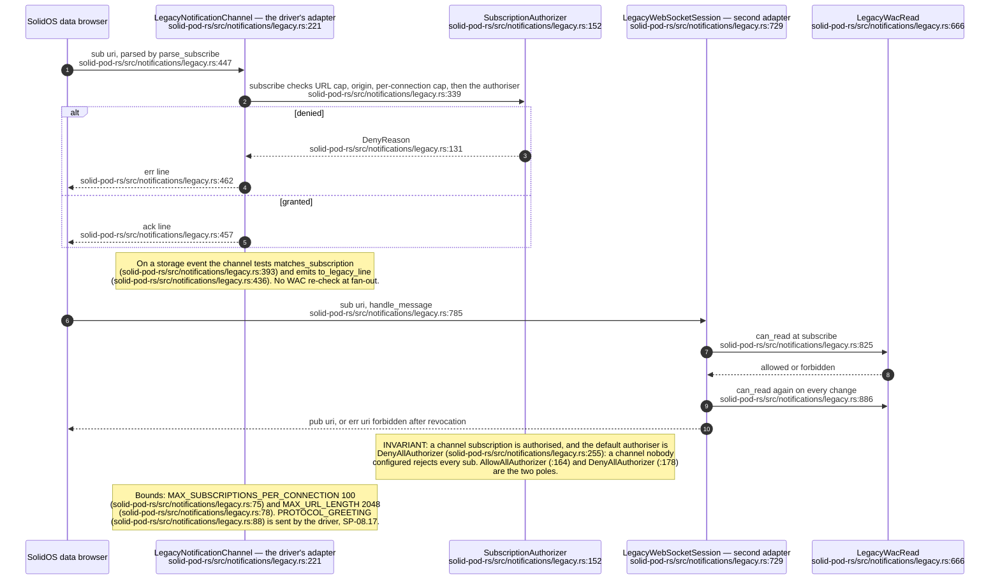

**What it shows.** The module holds two independent adapters. `LegacyNotificationChannel` authorises once, at `sub`, through a synchronous `SubscriptionAuthorizer`. `LegacyWebSocketSession` checks an asynchronous `LegacyWacRead` at `sub` and again on every change, and tells a revoked reader `forbidden`.

**Tension:** the transport driver (SP-08.17) wraps the channel, not the session, so the path a consumer actually wires never re-checks access after `ack`. A reader whose grant is revoked keeps receiving `pub` lines for that subtree until it disconnects. Only the integration tests construct `LegacyWebSocketSession`. Either the driver should use the session, or the channel should re-check on fan-out.

## SP-08.5 ActivityPub — signature verification and the inbox

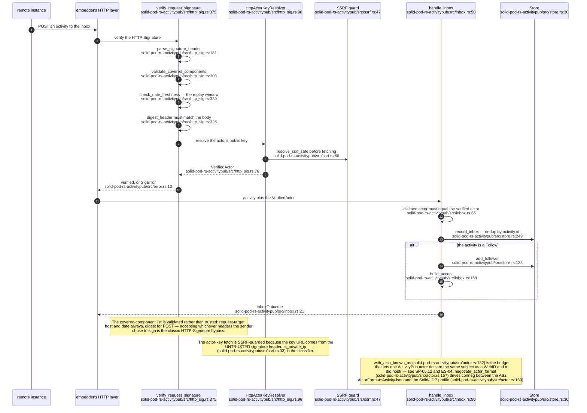

**What it shows.** Verification and inbox handling are separate calls. `handle_inbox` does not verify; it requires a `VerifiedActor`, binds the activity's `actor` to it, then records and dispatches.

**Invariant:** nothing is stored before the claimed actor matches the verified actor (`solid-pod-rs-activitypub/src/inbox.rs:65` precedes `solid-pod-rs-activitypub/src/inbox.rs:72`).

**Tension:** "verify before store" is a caller contract, not a type guarantee. `VerifiedActor` has public fields (`solid-pod-rs-activitypub/src/http_sig.rs:76`) and the doc invites soft-logged callers to hand one through (`solid-pod-rs-activitypub/src/inbox.rs:48`). The reference server mounts no inbox at all: with `activitypub` it serves only the actor document at `/profile/card.jsonld` (`solid-pod-rs-server/src/lib.rs:1515`).

## SP-08.6 ActivityPub — outbox and delivery

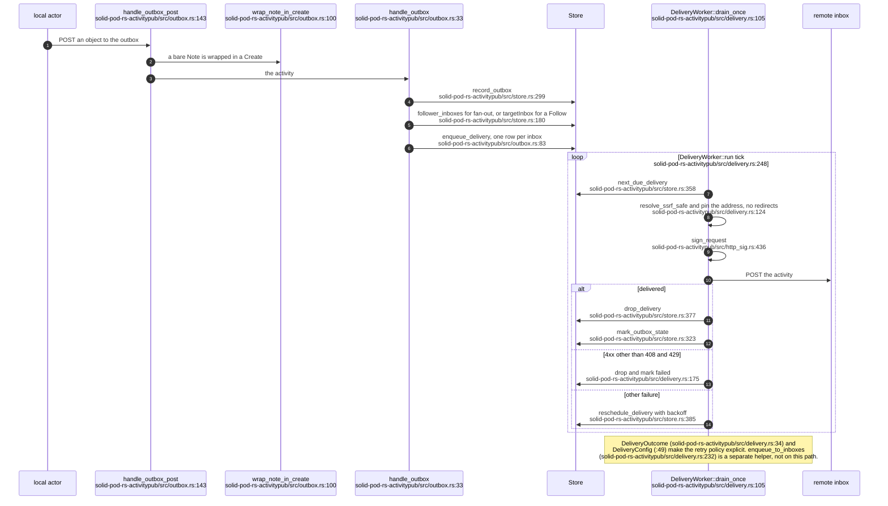

**Drift:** `handle_outbox` says "Ensure actor field is present and matches" (`solid-pod-rs-activitypub/src/outbox.rs:57`) but only fills a missing `actor`; a caller-supplied foreign `actor` is kept and then signed with the pod's key. The caller is the local owner, so this is a correctness gap rather than an external bypass.

## SP-08.8 The embedded NIP-01 relay

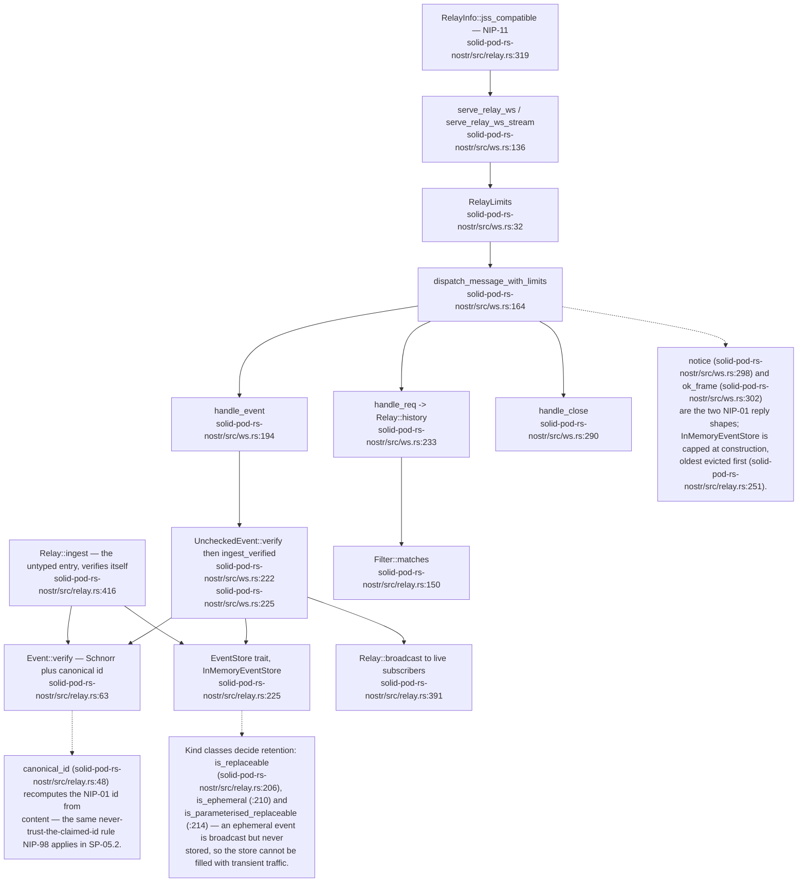

**What it shows.** The WebSocket path takes the typestate route (SP-08.9); `Relay::ingest` is a second, untyped entry that verifies internally. Both reach the same NIP-16 retention rules. The reference server mounts no relay endpoint; this is a library surface for embedders.

## SP-08.9 The relay typestate — verification on the typed path

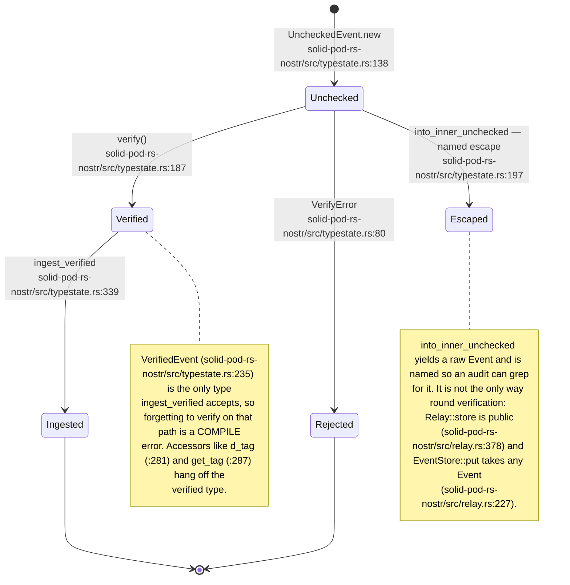

**Tension:** the panel's earlier title, "verification cannot be skipped", held only for `ingest_verified`. Any holder of a `Relay` can call `relay.store().put(event)` and persist an unverified event that later `REQ` history returns. Making `store()` crate-private, or giving it a read-only view, would make the typestate claim true for the whole relay.

## SP-08.10 The forge — request dispatch

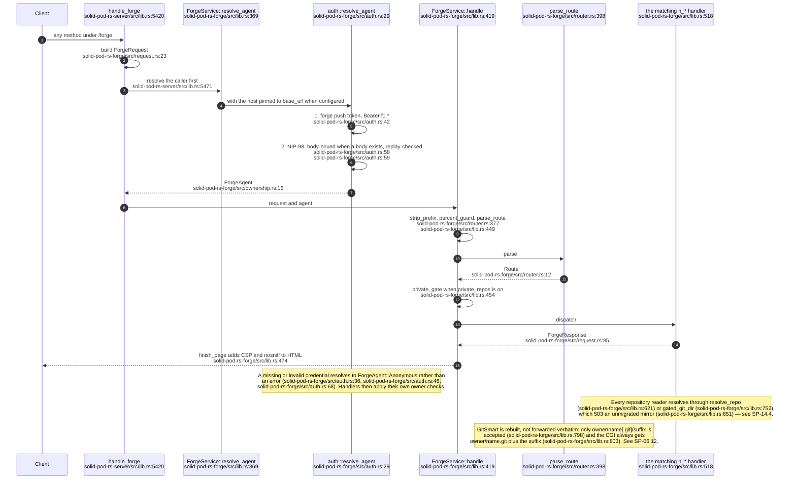

**Drift:** `auth.rs` numbers NIP-98 as "Scheme 3" and says scheme 2, a pod session, "is injected by the server" (`solid-pod-rs-forge/src/auth.rs:50`). The reference server never injects one: it always calls `resolve_agent`, and its own comment says a pod session "would be" injected (`solid-pod-rs-server/src/lib.rs:5470`). In this server a forge caller is a token holder, a NIP-98 signer or anonymous.

## SP-08.11 The forge push token

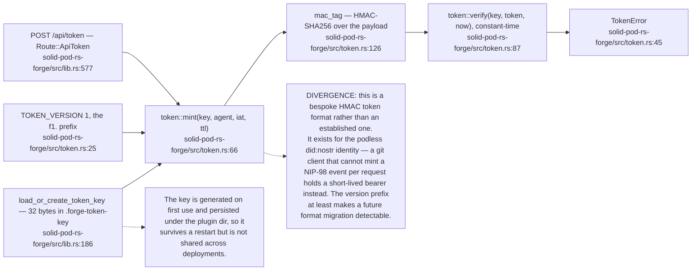

**Tension:** a token is "short-lived" only per token. `h_api_token` mints for any non-anonymous agent (`solid-pod-rs-forge/src/lib.rs:1465`), and a valid `f1.` bearer resolves to that agent, so a holder can renew indefinitely. There is no revocation short of replacing the key file. Requiring NIP-98 (not a bearer) to mint would bound a stolen token's life.

**Debt:** the key is two v4 UUIDs (`solid-pod-rs-forge/src/lib.rs:196`), 244 bits from the OS RNG rather than a direct 256-bit fill, and it is written (`solid-pod-rs-forge/src/lib.rs:198`) before being set to `0600` (`solid-pod-rs-forge/src/lib.rs:202`), so it exists briefly with the process umask's mode. The MAC itself uses the RustCrypto `hmac` crate.

## SP-08.12 The forge ownership model

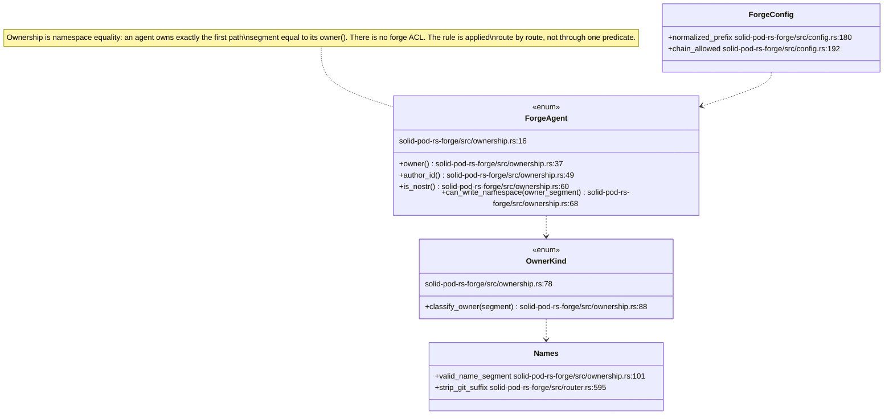

**What it shows.** Owner identity is one segment: a pod username or a 64-hex nostr key. Write rights follow from equality with that segment.

**Drift:** `can_write_namespace` is not the single predicate for mutating routes. It guards smart-HTTP push (`solid-pod-rs-forge/src/lib.rs:814`) and trail ownership (`solid-pod-rs-forge/src/trail.rs:921`). Other routes compare `agent.owner()` inline (`solid-pod-rs-forge/src/api.rs:515`, `solid-pod-rs-forge/src/labels.rs:296`) and also let the author of an issue or pull request act on it in someone else's namespace (`solid-pod-rs-forge/src/api_issues.rs:165`, `solid-pod-rs-forge/src/pulls.rs:765`). Two further rules sit beside ownership: `open_edit` bypasses it for edits (SP-08.18), and any write into a mirror's served store is refused with 409 (`solid-pod-rs-forge/src/lib.rs:733`).

## SP-08.13 Forge repository browsing and the issue spine

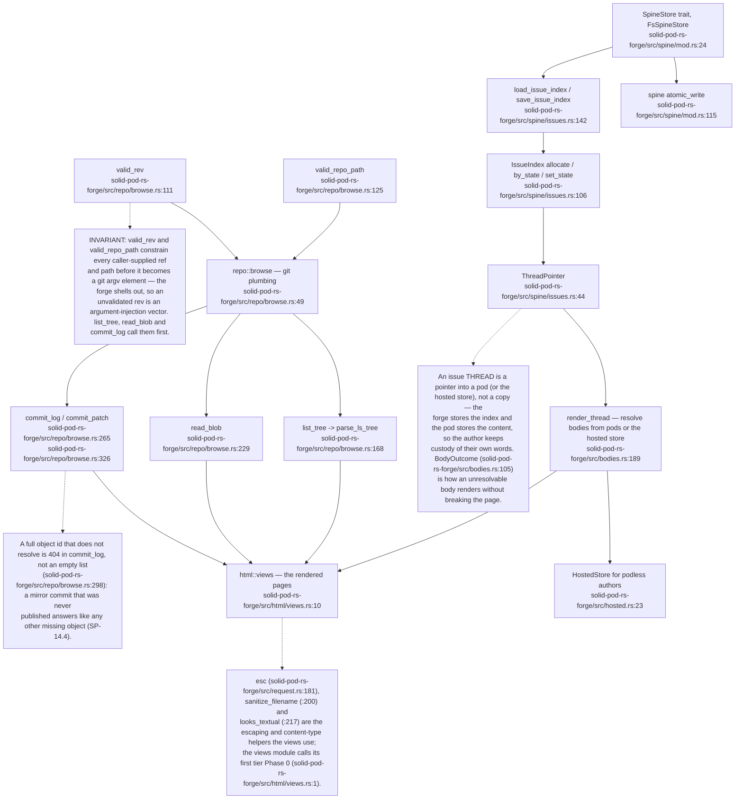

## SP-08.14 The pod as an MCP tool surface

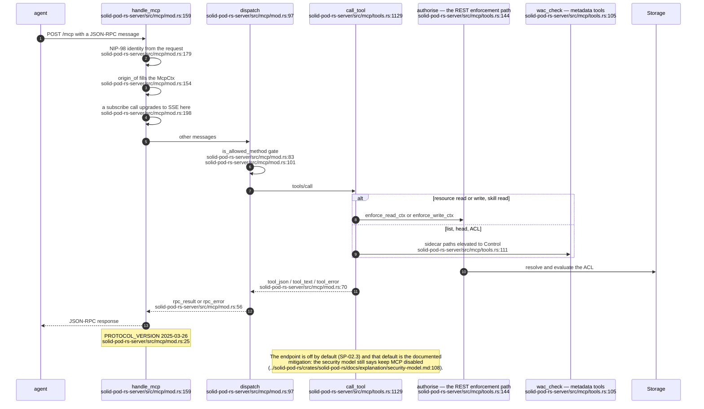

**Drift:** the security model's warning (`../solid-pod-rs/crates/solid-pod-rs/docs/explanation/security-model.md:108`, AUD-009) describes an anonymous read path and sidecar operations without Control. At the pinned revision the source has the fixes that audit asked for: resource and skill reads go through `authorise` (`solid-pod-rs-server/src/mcp/tools.rs:144`), and the metadata gate elevates sidecars to Control (`solid-pod-rs-server/src/mcp/tools.rs:111`). An earlier reading attributed the warning to the README, which no longer mentions MCP.

**Open:** whether AUD-009 is closed needs the audit's own regression tests (anonymous read, Write without Control) run against this revision. This trace shows the gate is wired, not that every tool reaches it.

## SP-08.15 The MCP tool catalogue

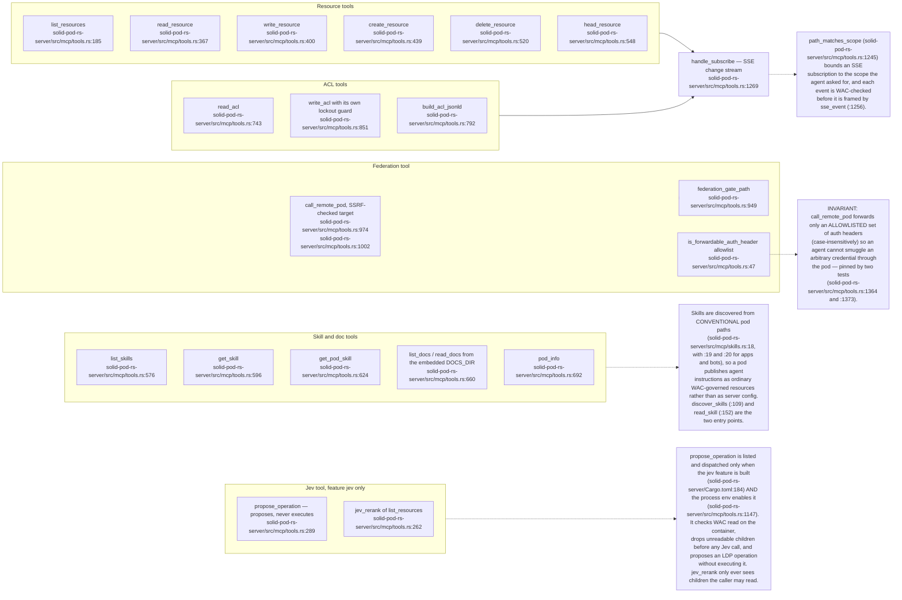

## SP-08.18 The forge has outgrown the request-dispatch picture

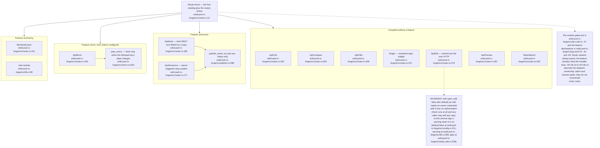

**What it shows.** The forge's route table includes fork, compare, pull-request, search, web-edit and preview routes that compile unconditionally, plus NIP-34 announcement (feature `announce`), relay mirroring (feature `mirror`) and repo-held blocktrails (feature `anchoring`). Since SP-GIT-02 the `migrate` module (`solid-pod-rs-forge/src/lib.rs:69`) and the reader gate are compiled without the `mirror` feature, so a plugin directory that was mirrored once stays gated in any build (SP-14.4).

**Why it is this way.** Each optional tier is a feature gate so a plain forge adds neither relay sockets nor the Bitcoin stack. The README states announcement publication is opt-in: with no `announce_relays` nothing is sent (`../solid-pod-rs/crates/solid-pod-rs-forge/README.md:24-33`).

**Drift (ADR-2009 vs code):** ADR-2009 says the mirror is default off and "nothing in `solid-pod-rs-server` starts it" (`../solid-pod-rs/crates/solid-pod-rs/docs/adr/ADR-2009-forge-plugins-comparator-and-default-off-mirror.md:34`); the server calls `start_forge` at boot when built with `forge` (`../solid-pod-rs/crates/solid-pod-rs-server/src/main.rs:459-460`) and reads `FORGE_MIRROR_RELAYS` (`../solid-pod-rs/crates/solid-pod-rs-server/src/lib.rs:5328`). ADR-2010 supersedes the default-off clause and defines "on" as compiled in and started at boot, acting on nothing until relays and follow entries are configured (`../solid-pod-rs/crates/solid-pod-rs/docs/adr/ADR-2010-forge-and-mirror-are-on-in-shipped-builds.md:41`).

**Drift (ADR text vs the SP-GIT-02 repair):** both ADRs gained a review qualification dated 2026-11-01 (`../solid-pod-rs/crates/solid-pod-rs/docs/adr/ADR-2009-forge-plugins-comparator-and-default-off-mirror.md:71`, `../solid-pod-rs/crates/solid-pod-rs/docs/adr/ADR-2010-forge-and-mirror-are-on-in-shipped-builds.md:72`) that still treats hidden refs as the mechanism and complete object withholding as open (`../solid-pod-rs/crates/solid-pod-rs/docs/adr/ADR-2010-forge-and-mirror-are-on-in-shipped-builds.md:79`). At this revision the boundary is store isolation plus the reader gate (SP-14.3, SP-14.4), and neither ADR says so.

**Tension (ADR-2010 vs agentbox):** ADR-2010 reads accepted / complete / staged (`../solid-pod-rs/crates/solid-pod-rs/docs/adr/ADR-2010-forge-and-mirror-are-on-in-shipped-builds.md:5-7`), and agentbox's pin enables `forge-full` (`../project/agentbox/lib/solid-pod-rs.nix:18`). That pin is `76ab7aab` (`../project/agentbox/lib/solid-pod-rs.nix:58`), which predates both the hidden-tip repair and the SP-GIT-02 store isolation. A shipped agentbox build therefore carries the pre-repair mirror; it stays inert only while no follow entries are configured. ADR-2009 moved the same way, accepted / complete / staged (`../solid-pod-rs/crates/solid-pod-rs/docs/adr/ADR-2009-forge-plugins-comparator-and-default-off-mirror.md:5-7`).

**Open:** the forge README (`../solid-pod-rs/crates/solid-pod-rs-forge/README.md:33`) records the web-edit tier as "not included" for announce triggering, while `ApiEdit` is routed (`solid-pod-rs-forge/src/router.rs:279`); nothing states whether an edit announces.

## SP-08.16 Estate consumers of these surfaces

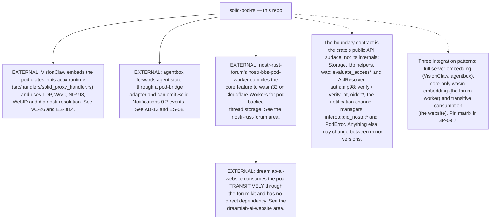

## SP-08.17 The legacy `solid-0.1` driver — the crate mounts nothing

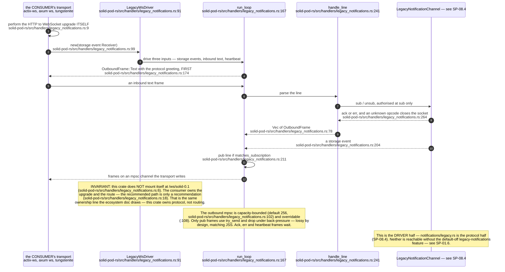

**Open:** `matches_subscription` compares the stored subscription string with the storage event's path as-is (`solid-pod-rs/src/notifications/legacy.rs:393`, called at `solid-pod-rs/src/handlers/legacy_notifications.rs:211`). A client subscribes with an absolute URL, and the origin check expects one; whether a `pub` line is ever emitted therefore depends on the form of path the consumer's storage events carry. The driver does not normalise either side. Only a running consumer can show which.
