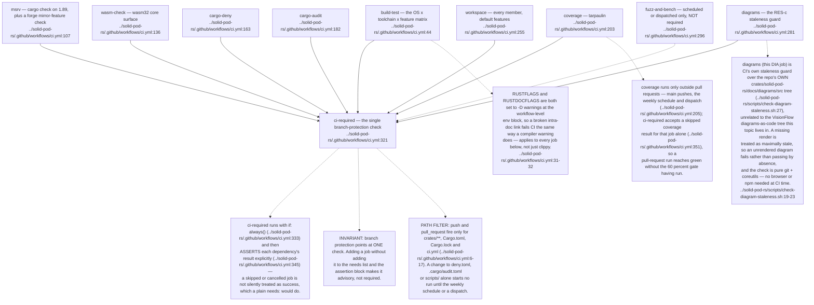
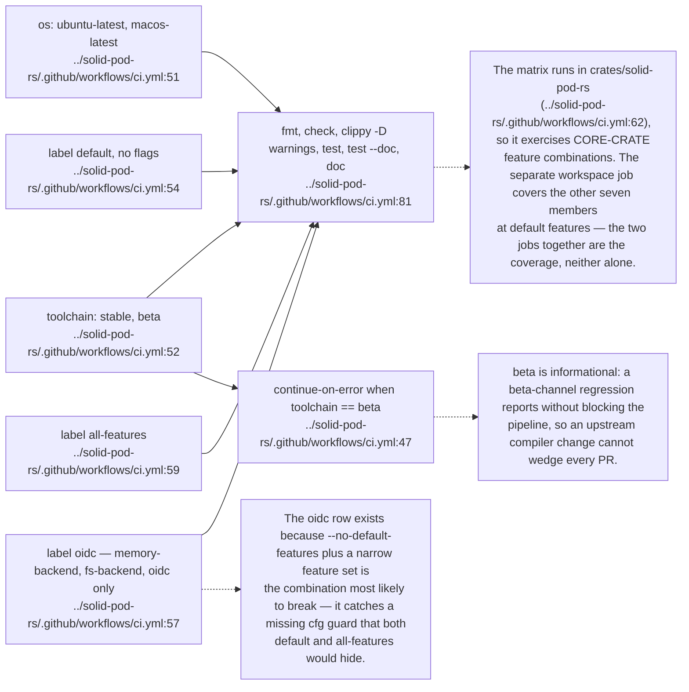
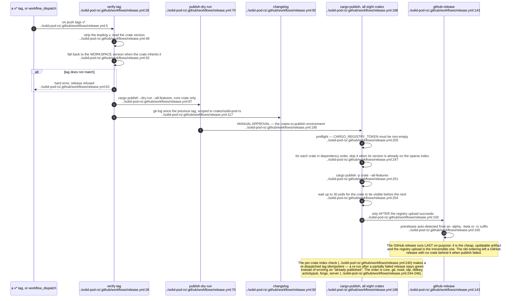
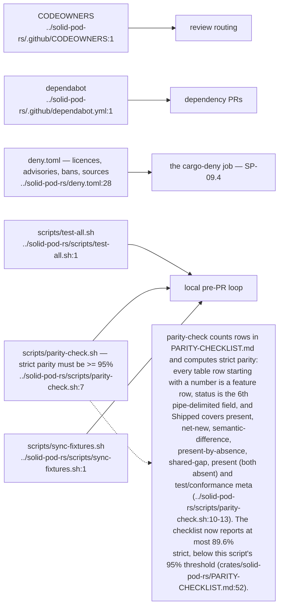
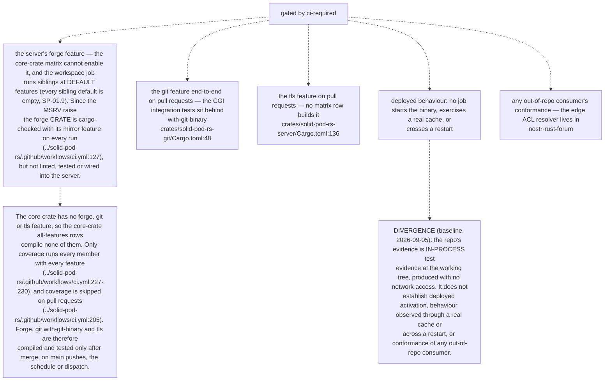
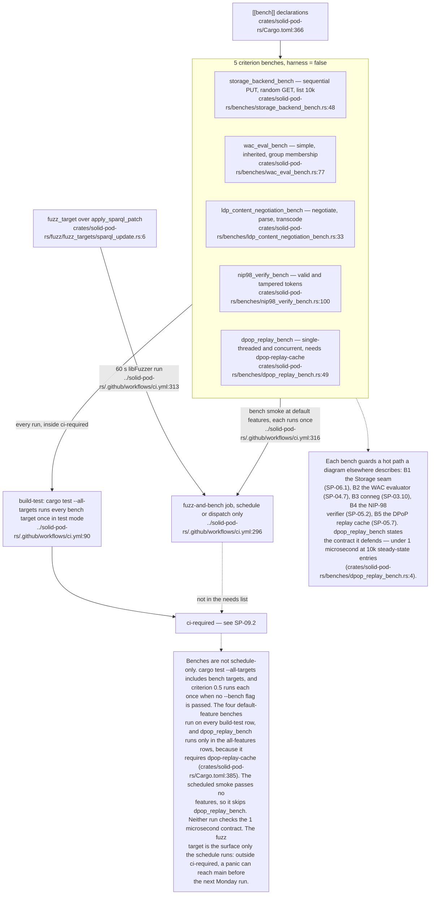
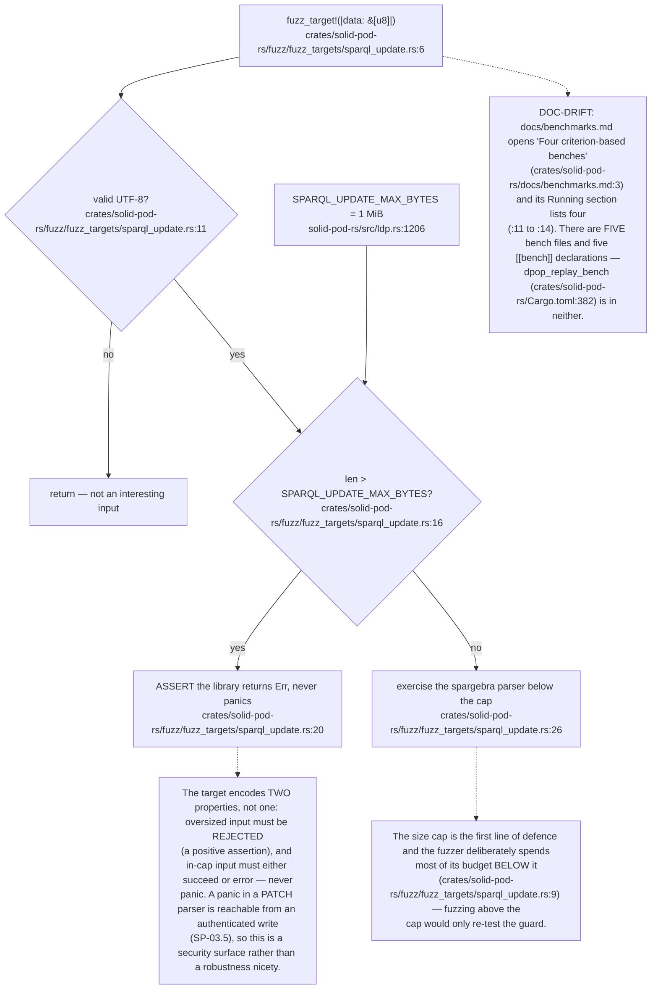

## SP-09.2 The CI jobs and the required-check aggregator

- **Drift:** the workspace job's comment counts "the six sibling crates (server, idp, activitypub, nostr, git, didkey)" (../solid-pod-rs/.github/workflows/ci.yml:248-251), and the audit comment says "all 7 members" (../solid-pod-rs/.github/workflows/ci.yml:192). The workspace has eight members, with `solid-pod-rs-forge` as the seventh sibling (../solid-pod-rs/Cargo.toml:2-11). The commands are workspace-wide, so the gates themselves are unaffected.
- **Open:** if branch protection requires `ci-required`, a pull request that touches only files outside the path filter never gets that check reported. Whether such a PR is then blocked, or the rule is configured to allow it, is repository configuration that source cannot show.

## SP-09.3 The build matrix

- **Open:** "beta does not block" depends on how GitHub reports a failed `continue-on-error` matrix leg to `needs.build-test.result`, which ci-required compares with `success` (../solid-pod-rs/.github/workflows/ci.yml:345). That is runner behaviour, not something the workflow source settles.

## SP-09.4 Supply-chain and quality gates

```mermaid
flowchart TD
    MSRV["cargo check --all-targets on toolchain 1.89<br/>../solid-pod-rs/.github/workflows/ci.yml:123"]
    MSRVF["cargo check --locked -p solid-pod-rs-forge --features mirror --all-targets<br/>../solid-pod-rs/.github/workflows/ci.yml:127"]
    WASM["cargo check --target wasm32-unknown-unknown<br/>--no-default-features --features core<br/>../solid-pod-rs/.github/workflows/ci.yml:152"]
    DENY["cargo-deny-action against the root deny.toml<br/>../solid-pod-rs/.github/workflows/ci.yml:171"]
    AUD["cargo audit --deny warnings, at the REPO ROOT<br/>../solid-pod-rs/.github/workflows/ci.yml:195"]
    COV["cargo tarpaulin --engine llvm --all-features --workspace --fail-under 60<br/>../solid-pod-rs/.github/workflows/ci.yml:227"]
    CC["Codecov upload, fail_ci_if_error false<br/>../solid-pod-rs/.github/workflows/ci.yml:235"]
    WSJ["cargo clippy --workspace and cargo test --workspace<br/>(both --all-targets, plus an explicit --doc run)<br/>../solid-pod-rs/.github/workflows/ci.yml:255"]
    DIA["bash scripts/check-diagram-staleness.sh<br/>../solid-pod-rs/.github/workflows/ci.yml:289"]

    MSRV --> GATE["ci-required"]
    MSRVF --> GATE
    WASM --> GATE
    DENY --> GATE
    AUD --> GATE
    COV --> GATE
    WSJ --> GATE
    DIA --> GATE

    N["INVARIANT: the wasm job is the ONLY thing keeping the core feature genuinely<br/>no-IO. A stray tokio import behind core compiles fine on the host and fails only<br/>here — which is what protects the edge consumer in SP-01.4."]
    WASM -.-> N
    N1["MSRV 1.89 is held in three places in lockstep: the workspace rust-version<br/>(../solid-pod-rs/Cargo.toml:22), clippy.toml (crates/solid-pod-rs/clippy.toml:9) and this job.<br/>The forge mirror's std::fs::File::lock is the 1.89 user, so the job also checks that crate."]
    MSRVF -.-> N1
    N2["cargo audit runs at the REPO ROOT deliberately, so the whole-workspace<br/>Cargo.lock is audited rather than the core crate's slice.<br/>../solid-pod-rs/.github/workflows/ci.yml:192-193"]
    AUD -.-> N2
    N3["The coverage GATE is tarpaulin's --fail-under; the Codecov upload is reporting<br/>only, so a missing CODECOV_TOKEN cannot mask a passing gate.<br/>../solid-pod-rs/.github/workflows/ci.yml:240-244"]
    CC -.-> N3
    N4["Three dated, justified advisory exceptions with no in-semver fix — RUSTSEC-2026-0258<br/>(h2 0.3 via actix-http, no HTTP/2 listener enabled), RUSTSEC-2023-0071 (rsa 0.9<br/>Marvin, verification-only) and, since alpha.18, RUSTSEC-2026-0387 (crypto-bigint 0.5.5 via openidconnect, exposure unassessed) — are ignored in lockstep by deny.toml:48,57,64 and<br/>.cargo/audit.toml. The README no longer states the gate PASSES: it says its refresh<br/>did not establish current dependency-advisory status<br/>(../solid-pod-rs/README.md:175) and that historical green checks are no claim for<br/>today (../solid-pod-rs/README.md:178)."]
    AUD -.-> N4
    N5["The audit job also runs on the weekly schedule (SP-09.2), not just push/PR, so<br/>cargo-audit re-checks against a moving advisory database even when nothing in<br/>the repo changed — a dependency becomes vulnerable without a commit.<br/>../solid-pod-rs/.github/workflows/ci.yml:19"]
    AUD -.-> N5
    N6["The licence check carries one crate-scoped exception, MITNFA for hex_lit,<br/>which rust-bitcoin 0.32 pulls in since the ADR-2008 port. It is allowed for<br/>that crate only, never workspace-wide.<br/>../solid-pod-rs/deny.toml:110"]
    DENY -.-> N6
    N7["The mrc20 feature now enables rust-bitcoin, which links the C libsecp256k1.<br/>It stays outside the core feature the wasm job checks, so this gate does not<br/>cover it; a wasm32 build with mrc20 needs a C toolchain for the target.<br/>crates/solid-pod-rs/Cargo.toml:214-215"]
    WASM -.-> N7
```

- **Drift:** deny.toml says its exceptions are mirrored in `../../.cargo/audit.toml` (../solid-pod-rs/deny.toml:38). The file sits at the repository root beside deny.toml, so the path is `.cargo/audit.toml`. The two lists do agree.

## SP-09.6 The release pipeline

- **Tension:** the dry run packages only the core crate. It runs in `crates/solid-pod-rs` with no `-p` (../solid-pod-rs/.github/workflows/release.yml:76, :87). A packaging error in any of the seven siblings first shows after manual approval, part-way through the publish loop. The idempotent skip makes the re-run safe, but crates already uploaded stay published.
- **Drift:** the release body comes from `git log` over `crates/solid-pod-rs` only (../solid-pod-rs/.github/workflows/release.yml:117), not from CHANGELOG.md. Sibling-crate commits, including forge and server fixes, are left out of the GitHub release text.
- **Open:** the "manual approval" step is real only if the `crates-io-publish` environment has required reviewers. The workflow comment says it must (../solid-pod-rs/.github/workflows/release.yml:183-184), but that is repository configuration that source cannot show.

## SP-09.7 Version alignment and the consumer pin matrix

```mermaid
flowchart TD
    WSV["workspace.package.version 0.5.0-alpha.21<br/>../solid-pod-rs/Cargo.toml:15"]
    INH["every crate inherits it — version.workspace = true<br/>crates/solid-pod-rs/Cargo.toml:3"]
    REL21["0.5.0-alpha.21, 2026-11-08 — RUSTSEC-2026-0387 cleared from the OIDC path, the actix advisories,<br/>the NIP-98 GitLenient path-segment boundary, in-memory backend path refusal<br/>../solid-pod-rs/CHANGELOG.md:9"]
    REL20["0.5.0-alpha.20, 2026-11-03 — pod creation writes an owner ACL tree under the pod root lock,<br/>full N3 Patch grammar, repeated ACL predicates kept<br/>../solid-pod-rs/CHANGELOG.md:34"]
    REL19["0.5.0-alpha.19, 2026-11-03 — the SP-GIT-02 mirror and fork migrations, MSRV 1.89<br/>../solid-pod-rs/CHANGELOG.md:139"]
    REL18["0.5.0-alpha.18, 2026-10-29 — RustCrypto 0.14 (k256 and p256), the RUSTSEC clearances,<br/>RUSTSEC-2026-0387 ignored for the openidconnect path<br/>../solid-pod-rs/CHANGELOG.md:493"]
    REL17["0.5.0-alpha.17, 2026-10-20 — the rest of the forge feature set, mirror hardening,<br/>security-review fixes<br/>../solid-pod-rs/CHANGELOG.md:522"]
    REL16["0.5.0-alpha.16, 2026-10-19 — tracks JSS 0.0.221, repo-held git-mark trails<br/>../solid-pod-rs/CHANGELOG.md:568"]
    REL15["0.5.0-alpha.15, 2026-10-19 — the server stops serving git push (403)<br/>../solid-pod-rs/CHANGELOG.md:605"]
    REL14["0.5.0-alpha.14, 2026-10-18 — MCP skill reads are charged, dependency advisories<br/>../solid-pod-rs/CHANGELOG.md:619"]
    REL13["0.5.0-alpha.13, 2026-10-14 — the security release: COPY authorises its source;<br/>every server release from 0.4.0-alpha.3 to 0.5.0-alpha.12 yanked<br/>../solid-pod-rs/CHANGELOG.md:665"]
    REL12["0.5.0-alpha.12, 2026-10-03 — the whole-trail verification release:<br/>blocktrail module, git-mark anchors, verify_mrc20_anchor walks every link<br/>../solid-pod-rs/CHANGELOG.md:741"]
    REL11["0.5.0-alpha.11, 2026-10-02 — the deposit-binding release:<br/>rust-bitcoin anchor validation, the TXO stand-in deleted,<br/>WebLedger receipts<br/>../solid-pod-rs/CHANGELOG.md:806"]
    REL10["0.5.0-alpha.10, 2026-10-01 — the did:nostr parity release,<br/>re-pinned all eight crates<br/>../solid-pod-rs/CHANGELOG.md:958, :965-966"]
    REL["0.5.0-alpha.9 re-pins ALL EIGHT crates and yanks the superseded versions<br/>../solid-pod-rs/CHANGELOG.md:1030-1031"]
    DRIFT["the drift it fixed: siblings sat at alpha.7 on crates.io while the root<br/>crate moved to alpha.8<br/>../solid-pod-rs/CHANGELOG.md:1028-1029"]

    WSV --> INH --> REL21
    REL19 --> REL20 --> REL21
    REL18 --> REL19
    REL17 --> REL18
    REL16 --> REL17
    REL15 --> REL16
    REL14 --> REL15
    REL13 --> REL14
    REL12 --> REL13
    REL11 --> REL12
    REL10 --> REL11
    REL --> REL10
    DRIFT --> REL

    AB["EXTERNAL: agentbox builds a PINNED solid-pod-rs-server binary through Nix for<br/>the native pod tier — version 0.5.0-alpha.21 at rev 27e18995<br/>(../project/agentbox/lib/solid-pod-rs.nix:61-64), with forge-full added unless the manifest's<br/>forge.enable is false (../project/agentbox/flake.nix:1563). 27e18995 is this topic's<br/>head, so the pin carries its crate fixes: SP-GIT-02 commits A, B1 and B2, the hidden-object fetch<br/>refusal, the NIP-98 empty-body binding, the OIDC redirect check and the ACL-control fix.<br/>The server's Jev option stays local-only unless SOLID_POD_JEV_ALLOW_CLOUD=1 admits the proxy and the<br/>TypeSafe step (../solid-pod-rs/crates/solid-pod-rs-server/src/jev.rs:153). See AB-08, AB-06 and ES-08."]
    VC["EXTERNAL: VisionClaw requires solid-pod-rs, -nostr, -idp and -server at 0.5.0-alpha.21,<br/>optional, level with this workspace's alpha.21, superseding the former 0.4.0-alpha.15 pin<br/>(../project/Cargo.toml:219-220 and :240-243). See VC-26."]
    NF["EXTERNAL: nostr-rust-forum requires solid-pod-rs 0.5.0-alpha.20 as a CARET range on main,<br/>default-features = false, features = core (../nostr-rust-forum/Cargo.toml:185), locked at alpha.20<br/>(../nostr-rust-forum/Cargo.lock:4228-4229); the exact pin was dropped by owner decision 2026-10-18<br/>(../nostr-rust-forum/Cargo.toml:181-184). Main carries the RUSTSEC-2026-0387 bump. See the nostr-rust-forum area."]
    DW["EXTERNAL: dreamlab-ai-website has no direct dependency; it inherits whatever<br/>the forum kit pins. See the dreamlab-ai-website area."]

    REL12 --> AB
    REL12 --> VC
    REL12 --> NF
    NF --> DW

    N["The forum's alpha.7 lag is long closed: it moved to alpha.10 for the<br/>full-key Multikey encoder and decoder (../solid-pod-rs/CHANGELOG.md:970-973)<br/>and is now required at 0.5.0-alpha.18 as a caret range on main. Every type intended for the edge tier<br/>compiles under core. A dependency bump alone does not change caller<br/>behaviour — wiring the edge ACL, audience and replay seams is separate work."]
    NF -.-> N
    N2["The source-compatibility notes since alpha.9: ReplayError gained<br/>CapacityExhausted and is non_exhaustive (nip98-replay is not in core, so no<br/>in-estate consumer was affected); alpha.11 makes WebLedger::credit/debit<br/>pub(crate) receipt-only (../solid-pod-rs/CHANGELOG.md:895-898) and restricts the<br/>paying routes to did:nostr<br/>accounts (../solid-pod-rs/CHANGELOG.md:930-934) — the core wasm surface is<br/>untouched. See SP-05.5."]
    REL11 -.-> N2
    N3["A registry-alignment bump like alpha.9 has happened before: alpha.3 was also a<br/>whole-workspace re-publish after a per-crate publish left the siblings on<br/>alpha.1 while the core crate alone moved to alpha.2<br/>(../solid-pod-rs/CHANGELOG.md:1311-1316, :1335). Publishing the workspace as a<br/>set is what the release job's version check (SP-09.6) now enforces."]
    REL -.-> N3
    N4["0.5.0-alpha.6 is absent from CHANGELOG.md — the release line skips from<br/>alpha.5 (../solid-pod-rs/CHANGELOG.md:1207) straight to alpha.7<br/>(../solid-pod-rs/CHANGELOG.md:1130)."]
    REL -.-> N4
```

- **Open (ADR-2008, proposed):** the record makes closing the host/forum skew an exit criterion rather than a follow-up, with both consumers adopting one post-port version in lockstep (adr/ADR-2008-port-bitcoin-tx-to-rust-bitcoin-and-make-the-web-ledger-a-chain-view.md:90-93). D8 is still listed as not built after the 2026-10-02 port (adr/ADR-2008-port-bitcoin-tx-to-rust-bitcoin-and-make-the-web-ledger-a-chain-view.md:161-162), and nothing states which version the lockstep bump adopts, or who publishes it first.
- The record no longer contradicts the pins it lists: its D8 text still quotes the forum at `=0.5.0-alpha.7` (adr/ADR-2008-port-bitcoin-tx-to-rust-bitcoin-and-make-the-web-ledger-a-chain-view.md:90-93), but its 2026-10-02 Disposition names those pins as overtaken and restates them as workspace `0.5.0-alpha.10`, forum `=0.5.0-alpha.10`, host `0.4.0-alpha.15` (adr/ADR-2008-port-bitcoin-tx-to-rust-bitcoin-and-make-the-web-ledger-a-chain-view.md:130). agentbox's Nix build — now pinned at `0.5.0-alpha.21` (`../project/agentbox/lib/solid-pod-rs.nix:61`) — and the host's `0.5.0-alpha.21` requirement (`../project/Cargo.toml:240`) are versions the record does not mention.
- **Debt (resolved by the pins, kept for the record):** the rust-bitcoin port, the TXO stand-in deletion and the WebLedger receipt rework all shipped in 0.5.0-alpha.11 (../solid-pod-rs/CHANGELOG.md:806). The deletion removes the public `AppState` field and the `--deposit-txo-standin` CLI flag (../solid-pod-rs/CHANGELOG.md:867-868), and `credit`/`debit` are now `pub(crate)` receipt-only (../solid-pod-rs/CHANGELOG.md:895-898), so a consumer pinned at alpha.10 or older would not run the current surface; none of the three in the matrix now is (agentbox `0.5.0-alpha.21`, host `0.5.0-alpha.21`, forum `0.5.0-alpha.20` locked at alpha.20 on main).
- **Debt (agentbox pin behind the head):** RESOLVED at agentbox 720e0d8. The Nix pin is now `27e18995` (../project/agentbox/lib/solid-pod-rs.nix:64), this topic's head, so a native pod built from it carries the SP-GIT-02 publication isolation and boot migrations recorded in SP-14, and `[Unreleased]` is empty (../solid-pod-rs/CHANGELOG.md:7). agentbox still compiles `forge-full`, and therefore the mirror, by default (../project/agentbox/flake.nix:1563). ADR-2010 still says compiling `forge-full` does not prove held objects cannot be served (adr/ADR-2010-forge-and-mirror-are-on-in-shipped-builds.md:72-82).
- **Drift (ADR-2008 vs agentbox):** the record says agentbox's payments route proxies `{txo_uri, amount_sats}` to this server's `/pay/.deposit` and will surface the 501 (adr/ADR-2008-port-bitcoin-tx-to-rust-bitcoin-and-make-the-web-ledger-a-chain-view.md:165-166); `POST /v1/pay/deposit` now answers 501 `deposit-not-served` itself and points callers at the pod's own `/pay/.deposit` (../project/agentbox/management-api/routes/payments.js:278-304).
- **Tension (forum pin comment vs pin), partly resolved at the 2026-10-30 pins:** the forum manifest's note still says the build requires alpha.12 to be published (../nostr-rust-forum/Cargo.toml:178-180) while the requirement beneath it is `0.5.0-alpha.20` as a caret range (../nostr-rust-forum/Cargo.toml:185). The k256 half is resolved on main: alpha.18 puts `k256` 0.14 types in the public API of `did_nostr_types` (../solid-pod-rs/CHANGELOG.md:500-503) and the forum workspace now pins `k256` 0.14.0 (../nostr-rust-forum/Cargo.toml:104), so the bump and the range agree. Still open: the host manifest says its alpha.17 pin is "in lockstep with nostr-rust-forum" (../project/Cargo.toml:219-220) while the requirement beneath it is now alpha.21 and the forum main is on alpha.20, a lockstep agentbox had already left.
- **Open (deployment, not source):** earlier revisions of this panel recorded that the running agentbox container was still on an older pin, and that the forum's production edge ran kit `9c36b60` with `k256` 0.13.4. Neither claim can be checked from source at these revisions, and this topic certifies no deployment.
- **Open (ADR-2010, accepted / complete / staged):** the record states agentbox and the host consume the forge only by their own decision and that VisionClaw needs a `/forge` adapter (adr/ADR-2010-forge-and-mirror-are-on-in-shipped-builds.md:53); the host manifest lists `solid-pod-rs-server` as an optional dependency (../project/Cargo.toml:243), and nothing records whether it ever enables a forge feature.
- Packaging hygiene since alpha.10: the core crate's manifest excludes `.claude-flow` agent runtime state from the published package (`crates/solid-pod-rs/Cargo.toml:15`, `f5a191e`, 2026-10-01).
- **Debt (resolved in alpha.11):** removing `credit` and `debit` from the public API was named in the record as the one deliberately breaking change in the estate and a semver-major event for this crate (adr/ADR-2008-port-bitcoin-tx-to-rust-bitcoin-and-make-the-web-ledger-a-chain-view.md:74-80, :100). It has now happened: both are `pub(crate)` receipt-only in 0.5.0-alpha.11 (../solid-pod-rs/CHANGELOG.md:895-898), so the pin matrix above is the surface that absorbed it. D5 remains not built (adr/ADR-2008-port-bitcoin-tx-to-rust-bitcoin-and-make-the-web-ledger-a-chain-view.md:161).

## SP-09.9 Repository governance and maintenance automation

- **Debt:** the CODEOWNERS "security-sensitive" rules name `/src/auth/`, `/src/oidc.rs` and `/src/wac.rs` from the repository root (../solid-pod-rs/.github/CODEOWNERS:18-20). Those paths do not exist; the code is under `crates/solid-pod-rs/src/`. The catch-all `*` rule routes the same team anyway (../solid-pod-rs/.github/CODEOWNERS:7), so review routing is unchanged, but the rules protect nothing of their own.
- **Debt:** both dependabot entries use `directory: "/crates/solid-pod-rs"` (../solid-pod-rs/.github/dependabot.yml:6, :44). The workflows live at the repository root's `.github/workflows`, so the github-actions entry probably scans nothing. The cargo entry names only the core crate's manifest. What Dependabot actually opens for this layout is service behaviour, not source.
- **Drift:** an older SP-10 R6 quoted 99.2% strict over 264 rows. The README now says at most 89.6% over 300 rows (../solid-pod-rs/README.md:171), and SP-10 R6 has been brought to that figure. This panel records the figure, not the repair.

## SP-09.10 What CI does NOT gate

## SP-09.11 Benches and the fuzz target — what each PR runs, and what only the scheduled job runs

## SP-09.12 The SPARQL-Update fuzz contract

- **Open:** the scheduled run passes only `-max_total_time=60` (../solid-pod-rs/.github/workflows/ci.yml:313), and the fuzz crate ships no seed corpus. libFuzzer's documented default input length in that case is a few kilobytes, so the over-cap ASSERT branch is probably never reached by this job. Whether it is reached is runtime behaviour this source review did not observe.
