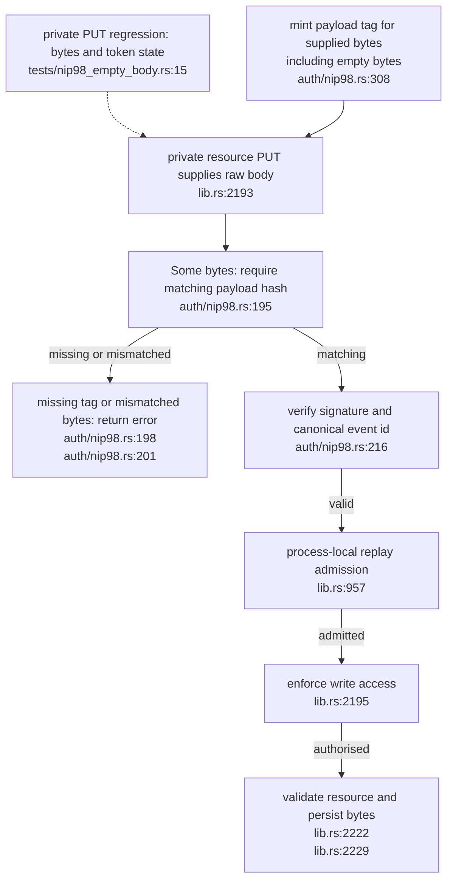

## For developers

Every supplied body requires its payload hash, including empty bytes; explicit None skips binding. The minting helper agrees with the verifier. SP-05 draws the wider NIP-98 path.

## For the business

A signed private-document update cannot be reused to remove its content. Intentional empty writes require the empty-body hash. Released in 0.5.0-alpha.19; consumer adoption and deployment are not re-checked here.

## SP-11.1 Commit to the bytes before consuming the request

Binding rejection precedes replay admission. SP-ID-01 is repaired; the replay TTL is now floored at the freshness window (SP-ID-02, SP-05), while restart/replica scope and GitLenient scoping remain open. See the [repair evidence](../../estate-review/2026-11-01-solid-empty-body-repair.md).
