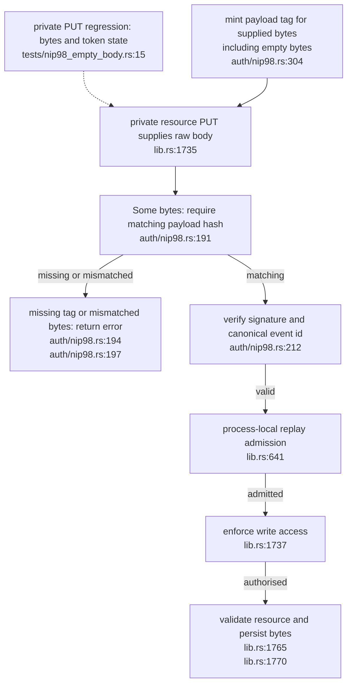

## For developers

Every supplied body requires its payload hash, including empty bytes; explicit None skips binding. The minting helper agrees with the verifier. Historical SP-05 retains its original revision.

## For the business

A signed private-document update cannot be reused to remove its content. Intentional empty writes require the empty-body hash. Release, consumer adoption and deployment remain open.

## SP-11.1 Commit to the bytes before consuming the request

Binding rejection precedes replay admission. SP-ID-01 is repaired in producer source; retention, restart/replica scope and GitLenient scoping remain open. See the [repair evidence](../../estate-review/2026-11-01-solid-empty-body-repair.md).
