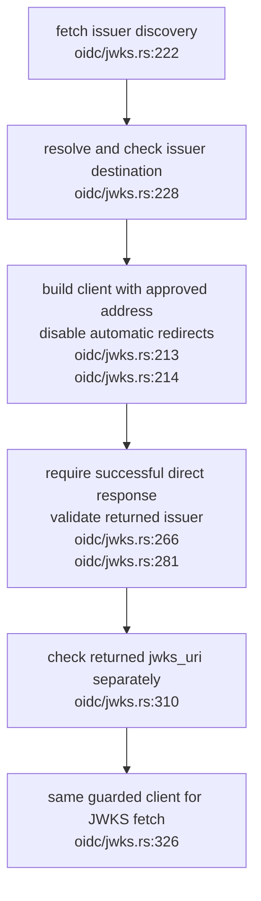
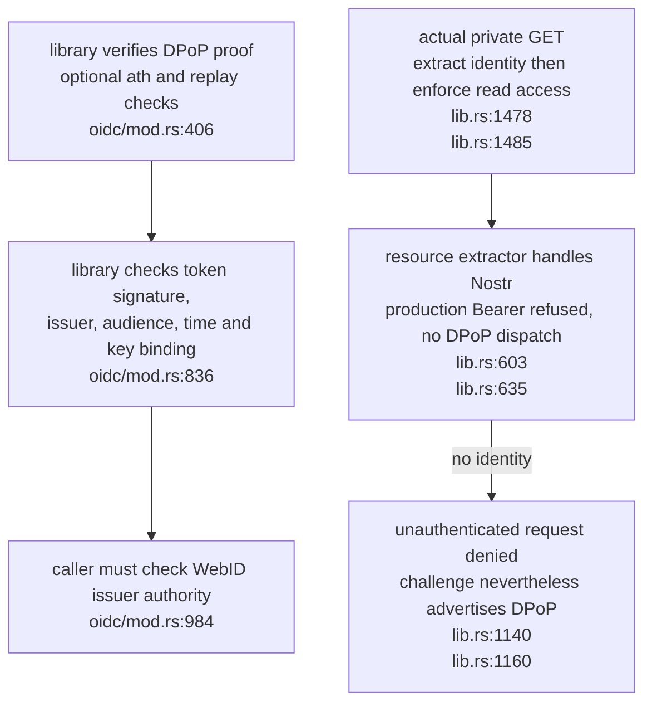

## For developers

The library and resource server are separate admission paths. Historical SP-05 records the older verifier/fetcher revision; these panels record the merged redirect repair and the remaining missing resource dispatch.

## For the business

The producer now refuses redirected discovery and key documents. OIDC components do not yet provide an external-client private-resource journey on the main pod server. Publication, consumer upgrades and deployment remain open.

## SP-12.1 Refuse unapproved redirect destinations

Direct-fetch success and both denied-host redirect regressions are retained in the [assessment](../../estate-review/2026-11-01-solid-oidc-boundaries.md). Direct address pinning does not establish an inherited proxy's routing policy.

## SP-12.2 Library verification does not wire resource authentication

The disposable route probe verifies its ES256 token/proof in the library, then observes HTTP 401; the Nostr positive control reads the same private bytes. This is an integration finding, not an authorisation bypass claim.
