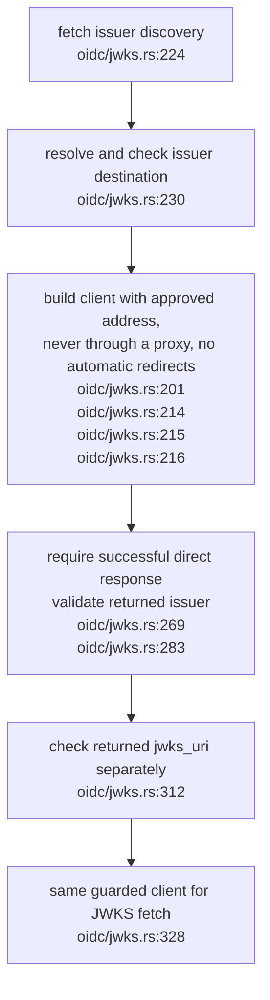
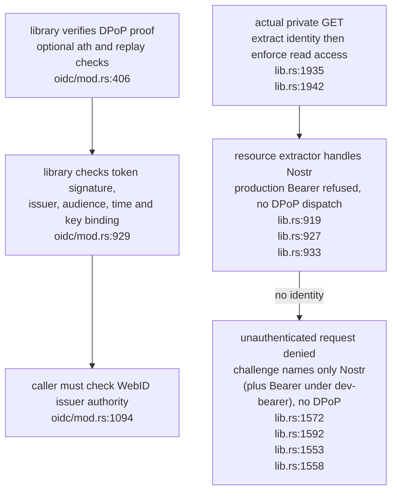

## For developers

The library and resource server are separate admission paths. SP-05 draws the whole identity surface; these panels record the redirect repair and the still-missing resource dispatch of OIDC tokens.

## For the business

The producer refuses redirected discovery and key documents (released in 0.5.0-alpha.19). OIDC components still provide no external-client private-resource journey on the main pod server, and its 401 no longer advertises one. Consumer upgrades and deployment are not re-checked here.

## SP-12.1 Refuse unapproved redirect destinations

Direct-fetch success and both denied-host redirect regressions are retained in the [assessment](../../estate-review/2026-11-01-solid-oidc-boundaries.md). The pinned client sets `no_proxy`, so an inherited proxy cannot re-route the approved address.

## SP-12.2 Library verification does not wire resource authentication

The disposable route probe verifies its ES256 token/proof in the library, then observes HTTP 401; the Nostr positive control reads the same private bytes. This is an integration finding, not an authorisation bypass claim.
