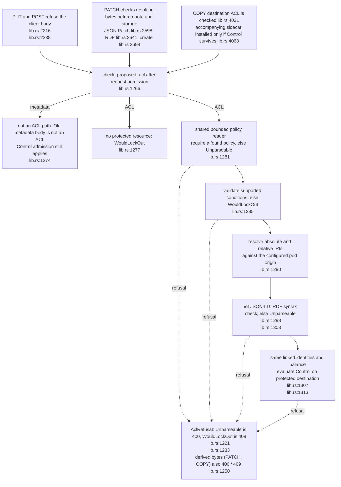
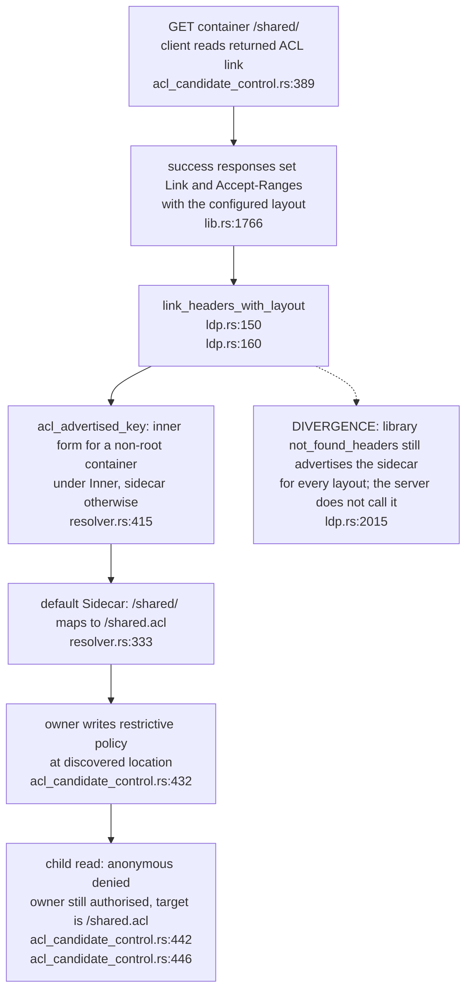
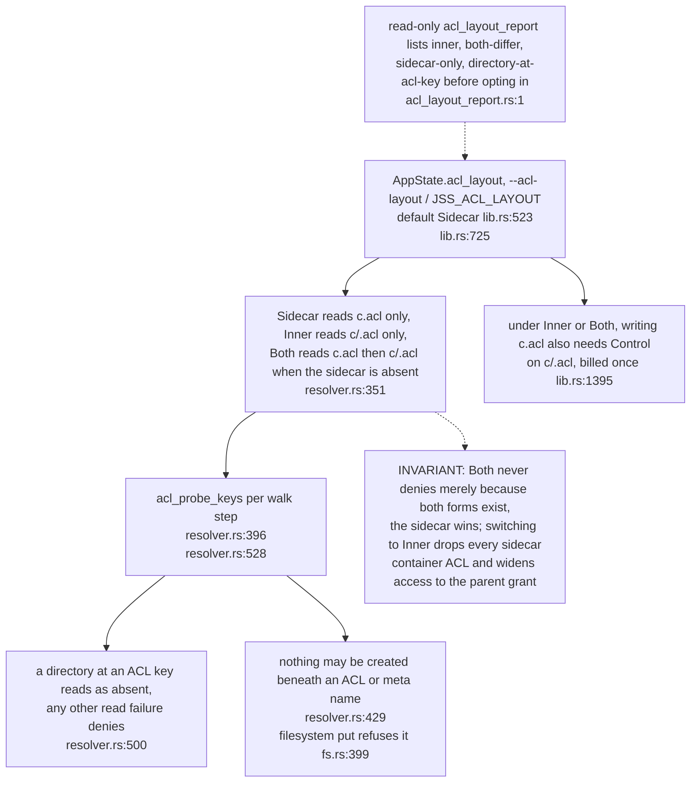

## For developers

Candidate validation composes the shared policy reader and evaluator. Historical SP-04 records the earlier syntactic guard; this topic records the repair. Existing parser information loss, target-IRI limitations and concurrent updates remain outside this change.

## For the business

Malformed or inapplicable permission changes are refused before replacing the policy, and the advertised container ACL is the one enforcement reads. Existing misplaced ACL files still need migration; package publication and deployment are separate steps.

## SP-13.1 Evaluate Control on the candidate destination

The guard now returns a typed refusal: a malformed body is 400 on every write verb (SP-PAR-266), a lockout or unsupported condition 409. Resource COPY still skips an unsuitable accompanying ACL rather than failing. Admission may already have collected a payment, so the guard does not establish transactional charging; the [repair assessment](../../estate-review/2026-11-01-solid-acl-control-repair.md) distinguishes executed route tests from unverified RDF ACL PATCH interoperability.

## SP-13.2 Follow the ACL link through to enforced access

The route test runs under the default layout only. Root discovery is `/.acl` in every layout.

## SP-13.3 Opt-in container ACL layout and what it guards

Inner and Both honour every existing inner `.acl`, including ones planted before Control was required, so the report is the migration step.
