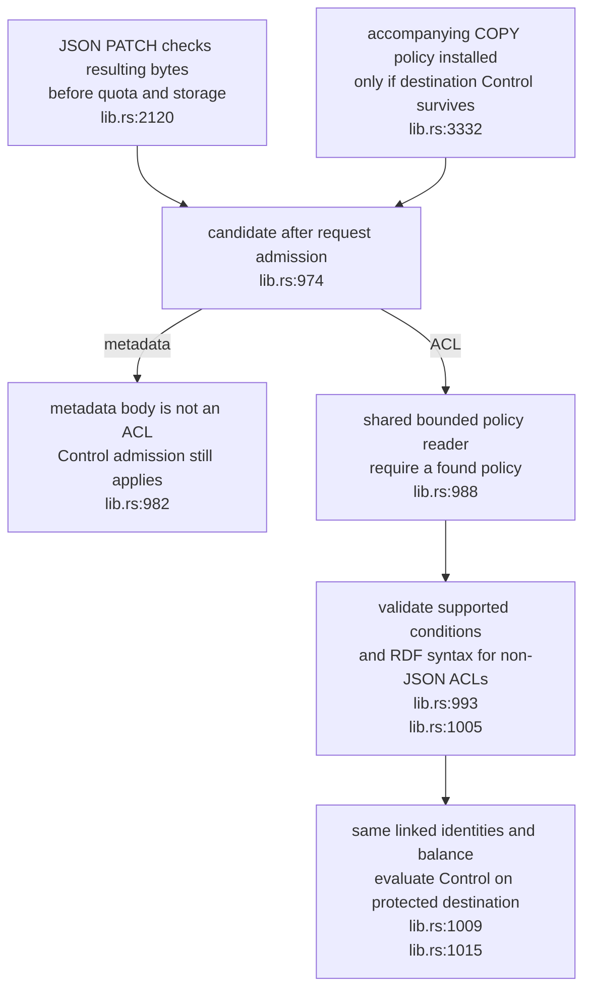
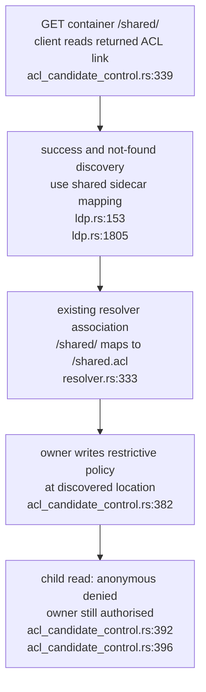

## For developers

Candidate validation composes the shared policy reader and evaluator. Historical SP-04 records the earlier syntactic guard; this topic records the repair. Existing parser information loss, target-IRI limitations and concurrent updates remain outside this change.

## For the business

Malformed or inapplicable permission changes are refused before replacing the policy, and the advertised container ACL is the one enforcement reads. Existing misplaced ACL files still need migration; package publication and deployment are separate steps.

## SP-13.1 Evaluate Control on the candidate destination

An invalid candidate returns false to the caller. Direct writes refuse it; resource COPY skips an unsuitable accompanying ACL. Admission may already have collected a payment, so the guard does not establish transactional charging. The [repair assessment](../../estate-review/2026-11-01-solid-acl-control-repair.md) distinguishes executed route tests from unverified RDF ACL PATCH interoperability.

## SP-13.2 Follow the ACL link through to enforced access

The route test starts with public child access and observes its removal after the advertised-location write. Root discovery remains `/.acl`. The mapping does not relocate old inner policies or choose between conflicting files; the migration guide requires explicit policy selection and access checks.
