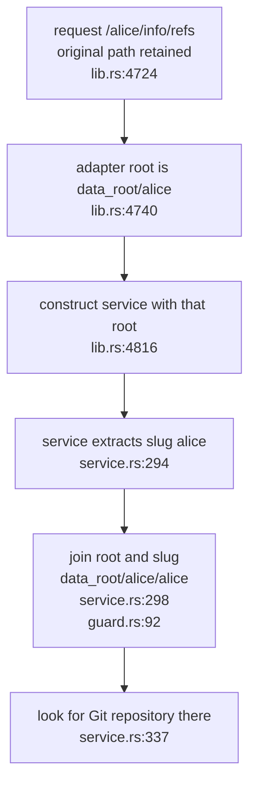
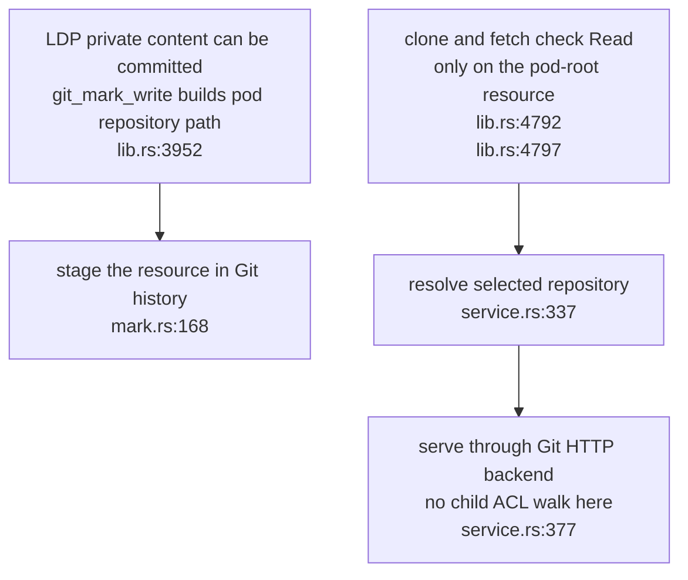

## For developers

The pod adapter and generic Git service both apply the pod path component. This topic separates repository selection from the root-only WAC decision; passing that decision does not prove that the intended repository is served.

## For the business

Usable history export needs both correct routing and explicit authority over the repository's objects. A public container grant does not establish permission to export every private child or previous version. The forge is a separate adapter and is not certified by this assessment.

## SP-14.1 The pod component is applied twice

The normal write hook records files under `data_root/alice`, so this is a different repository selection. A missing nested repository prevents export; an existing nested repository changes which data the route serves. The [assessment](../../estate-review/2026-11-01-solid-git-export-and-baseline.md) distinguishes source analysis, normal routing and a transport positive control.

## SP-14.2 Root permission precedes whole-repository export

The two paths need a common export-authority contract. Correcting selection alone would connect normal stored history to the existing root-only gate. Git's object transport is not a per-resource WAC response; this diagram does not propose root Control or a filtered ref list as a sufficient replacement policy.
