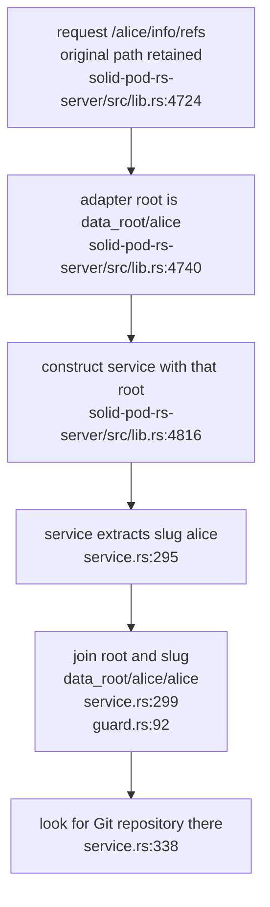
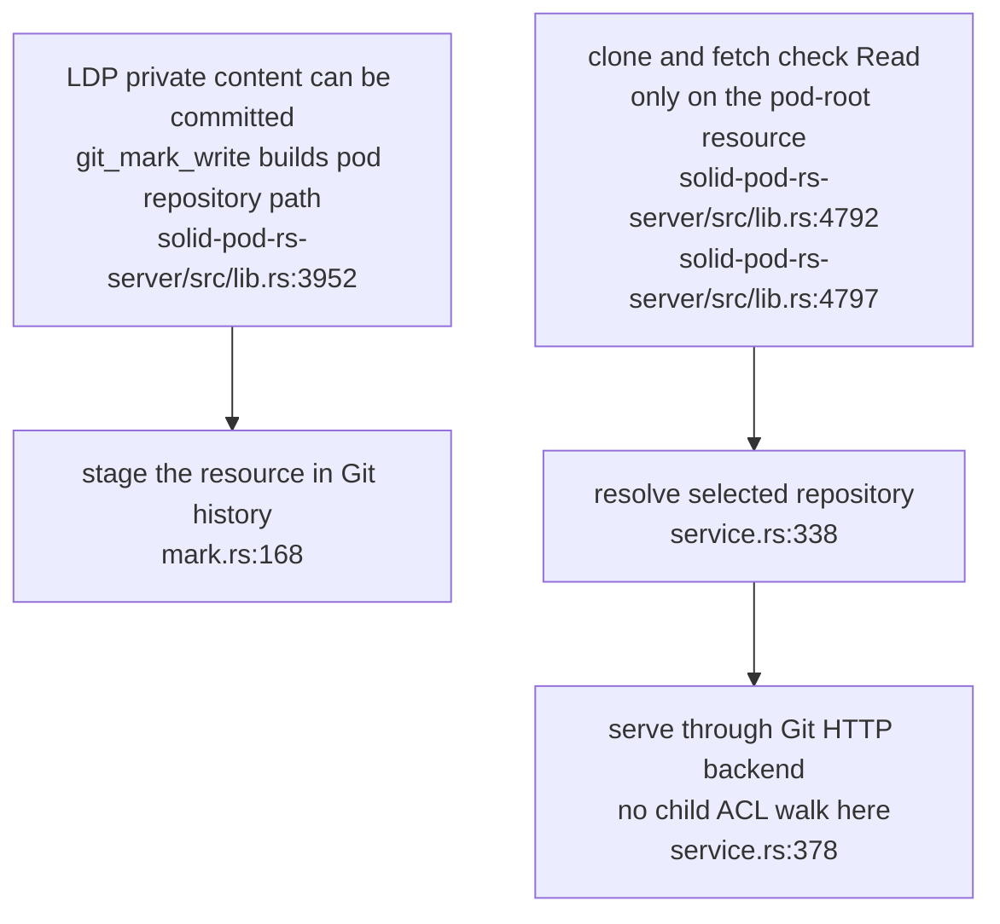
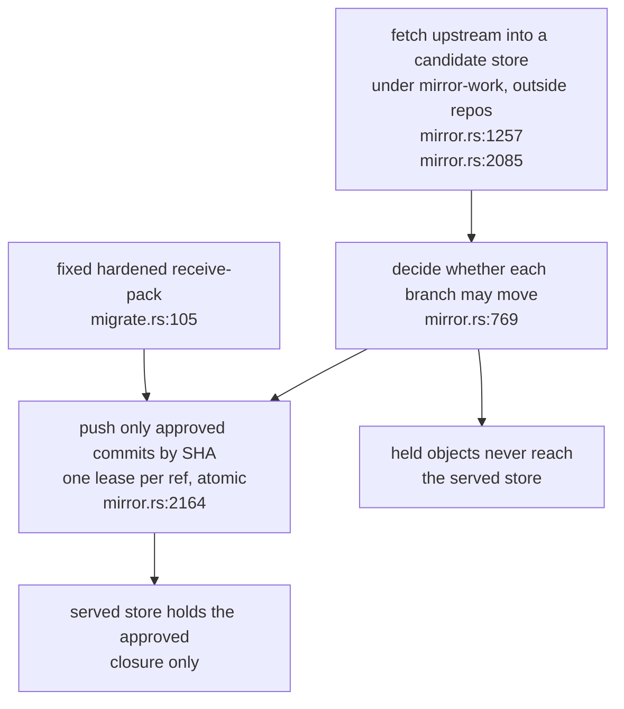
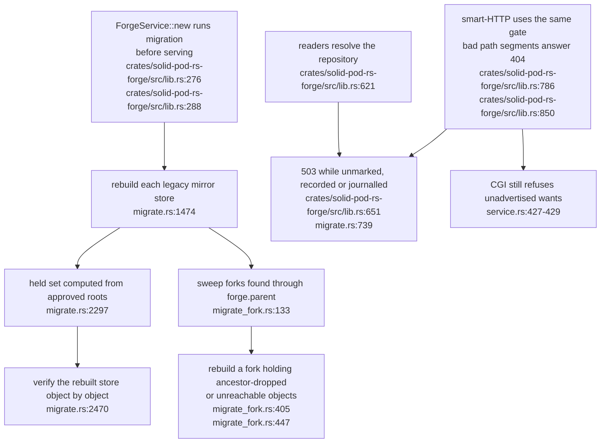

## For developers

The pod adapter and generic Git service both apply the pod path component. This topic separates repository selection from the root-only WAC decision; passing that decision does not prove that the intended repository is served.

## For the business

Usable history export needs both correct routing and explicit authority over the repository's objects. A public container grant does not establish permission to export every private child or previous version. The forge is a separate adapter; its use of the shared export configuration is traced below, without certifying the whole forge.

## SP-14.1 The pod component is applied twice

The normal write hook records files under `data_root/alice`, so this is a different repository selection. A missing nested repository prevents export; an existing nested repository changes which data the route serves. The [assessment](../../estate-review/2026-11-01-solid-git-export-and-baseline.md) distinguishes source analysis, normal routing and a transport positive control.

## SP-14.2 Root permission precedes whole-repository export

The two paths need a common export-authority contract. Correcting selection alone would connect normal stored history to the existing root-only gate. Git's object transport is not a per-resource WAC response; this diagram does not propose root Control or a filtered ref list as a sufficient replacement policy.

## SP-14.3 Mirror fetches stay in a private candidate store

**What it shows:** a mirror fetch now lands in a private candidate store, the verdict is taken there, and only approved commits are pushed into the store that Forge serves. A held commit is never copied across, so no reader can find it by SHA.

**Why it is this way:** hiding `refs/mirror` only changed what smart-HTTP advertised; Forge's raw, HTML, JSON and archive readers call local Git with a caller-supplied revision and never consult that advertisement. Isolation by store was chosen over per-request checks (SP-GIT-02, Commit A `30135fec`). The publish uses an explicit lease per ref and no `+` refspec, because a `+` silently overrides the lease. Evidence is in the [publication assessment](../../estate-review/2026-11-02-solid-mirror-publication.md).

**Invariant:** the served store contains only objects reachable from approved branches and tags; `publish` is the only path that writes mirror content into it (mirror.rs:2164).

## SP-14.4 Every reader is gated, and old stores are migrated at boot

**What it shows:** stores written before the repair, and forks cloned from them, still held fetched objects. At boot each one is rebuilt from approved branches and tags only and verified object by object before it is swapped in. Every reader, smart-HTTP included, goes through one gate that refuses a store until migration has published it.

**Why it is this way:** `clone --local` hardlinks the whole object store, so forks inherit held objects, and deleting refs followed by `gc` is not reliable proof of removal. A failed migration must not leave a store open, so any journal gates readers and an incomplete pass gates every mirror owner (B1 `bcaf9cf6`, B2 `ff8048b`, decisions 21 to 39 in the evidence folder). The earlier CGI setting stays as a second layer.

**Invariant:** a store with a migration journal, or a mirror record without the publication marker, is never served (crates/solid-pod-rs-forge/src/lib.rs:651).

**Open:** no operator recourse yet for a store left gated at the attempt limit, over the size cap, or behind an unreadable owner directory; queued as B3 under SP-GIT-02.
