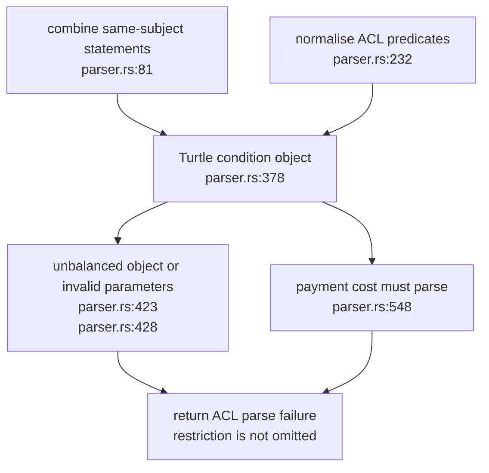
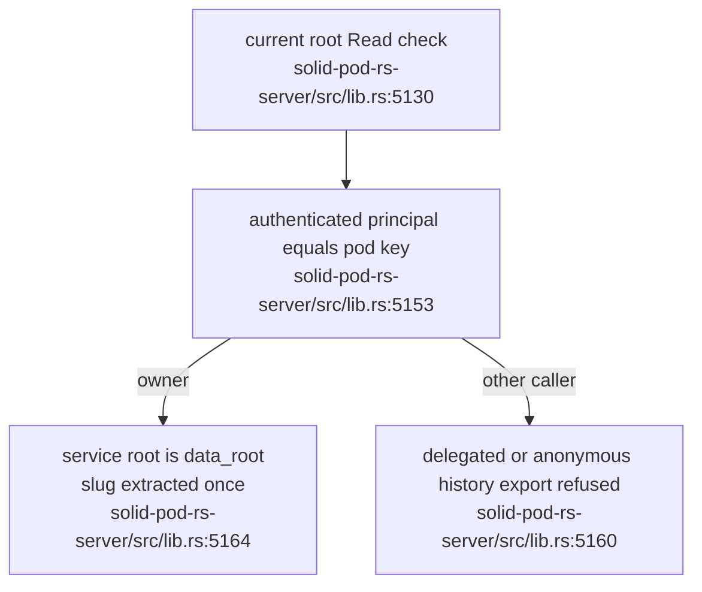
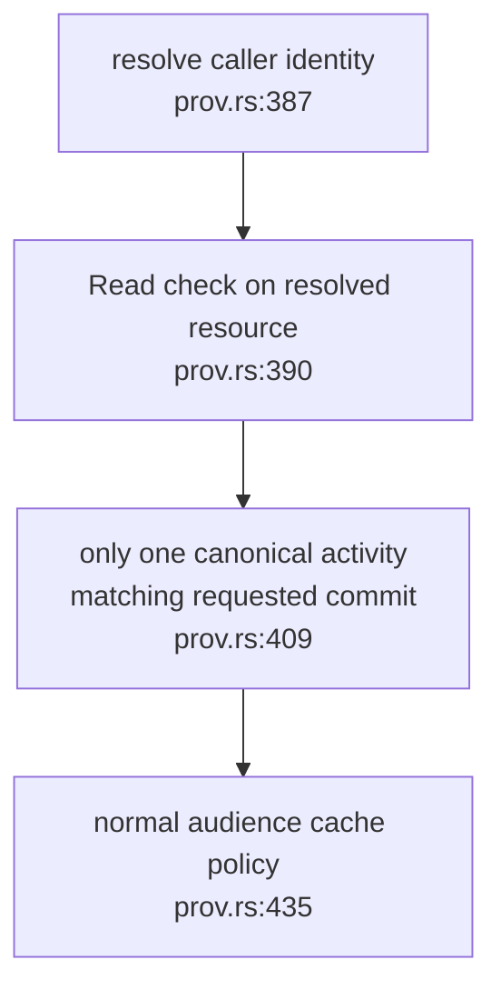
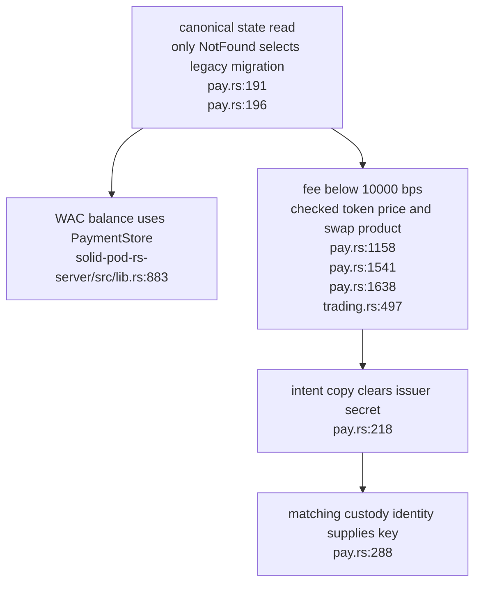
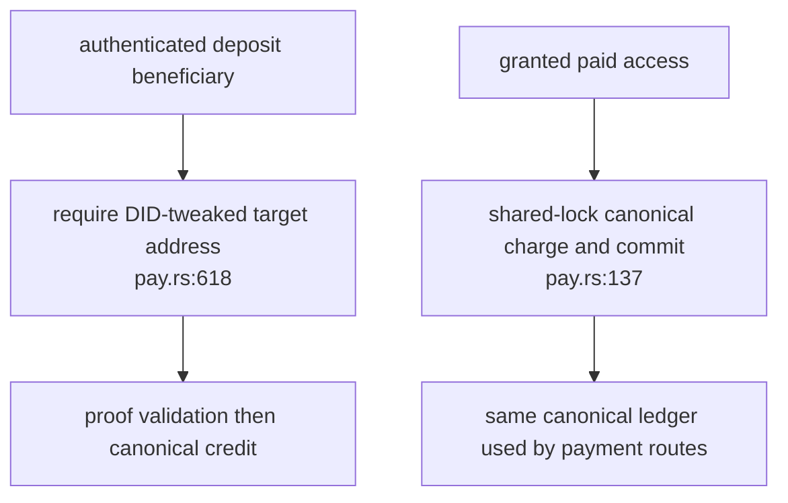

## For developers

This is the scoped successor to SP-04.10, SP-07.6, SP-07.15 and SP-14.1–2. It records the repaired authority and storage contracts, including the additional payment issues found during review. Other panels retain their historical stamps; this topic does not re-verify them.

## For the business

A public folder grant no longer opens an entire pod's private history. Historical provenance obeys the resource's read policy, and a storage failure cannot silently substitute an older balance. These are source and native-test results; consumers and deployed services need their own adoption receipts.

## SP-15.1 A malformed condition cannot disappear

**What it shows:** malformed conditions return errors instead of an empty condition list or a zero-cost replacement. Valid typed conditions remain supported. **Why it is this way:** ADR-2005's fail-closed rule applies before the evaluator, including incomplete Turtle condition objects.

**Invariant:** an absent or invalid payment amount cannot default to a free condition (`parser.rs:548`).

## SP-15.2 Whole-history Git export requires the pod owner

**What it shows:** current resource permission and whole-history custody are separate checks. The service receives the data root rather than an already-prefixed pod directory. **Why it is this way:** root Read alone did not authorise private children or earlier versions. ADR-2010 now defines this route as an owner export/recovery surface; delegated readers use LDP. Alias pods without a cryptographic owner binding gain no export privilege.

**Invariant:** an anonymous public-root Read grant does not satisfy the owner gate (`solid-pod-rs-server/src/lib.rs:5153`).

## SP-15.3 Provenance inherits resource authority and commit identity

**What it shows:** private-resource provenance is gated before the response. A current sidecar for another commit is omitted from a historical result. **Why it is this way:** opt-in provenance under ADR-2004 never implied public disclosure. The sidecar match accepts the server's canonical generated shape; it does not certify arbitrary authored Turtle as a historical mark.

**Invariant:** provenance resolves the same resource Read contract as ordinary reads (`prov.rs:390`).

## SP-15.4 Authoritative payment state, bounds and custody

**What it shows:** failed reads propagate, WAC and payment routes share the canonical ledger, and arithmetic failures are refused. Recovery snapshots carry public state; the issuer key comes from the matching trail store. **Why it is this way:** ADR-2008's canonical state cannot coexist with an authoritative best-effort mirror. The security review also exposed unchecked fee/price arithmetic and unnecessary secret duplication.

**Debt:** old intent copies are scrubbed on a subsequent state commit; this does not erase backups or rotate a previously exported key (`pay.rs:218`).

The shared replay error also has an explicit unavailable-store refusal for durable consumers (`replay_store.rs:80`); this producer declaration does not establish an edge deployment.

## SP-15.5 Payment grants and receipts share one ledger authority

**What it shows:** a public proof cannot credit another principal, and WAC no longer charges a best-effort mirror. **Why it is this way:** the broader review found both receipt ownership and debit authority diverged from the ledger reader. Existing generic-address funds need an explicit migration decision.

**Invariant:** a WAC charge mutates canonical state under the payment lock (`pay.rs:137`).
