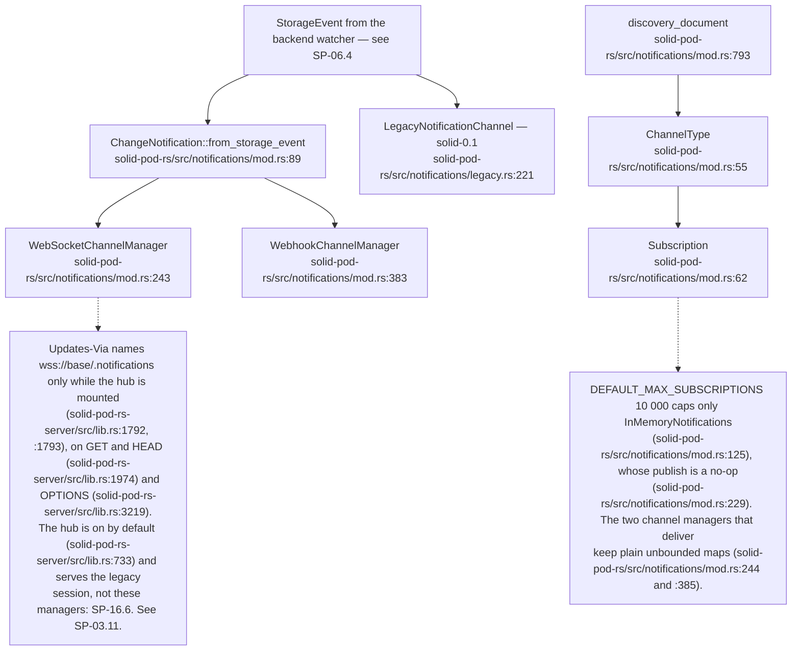
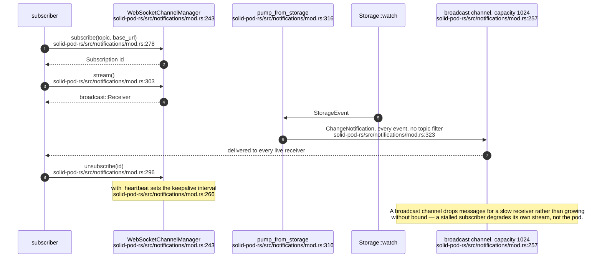
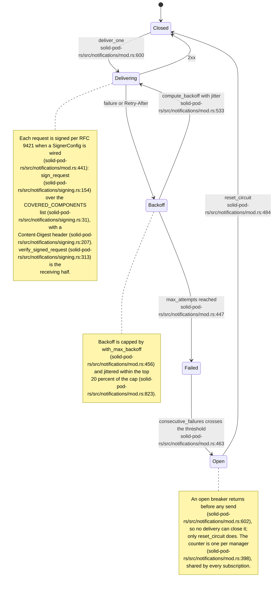
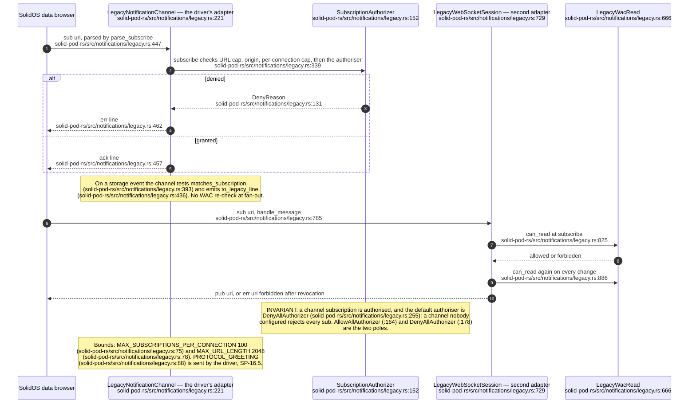
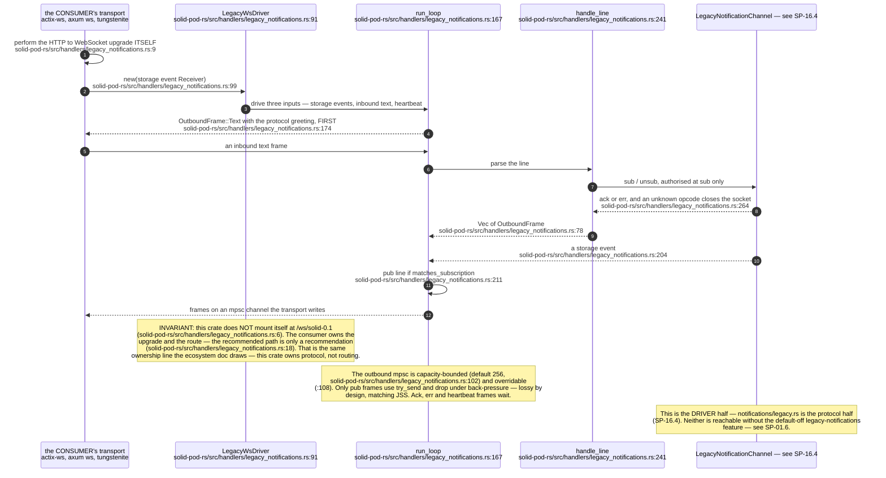
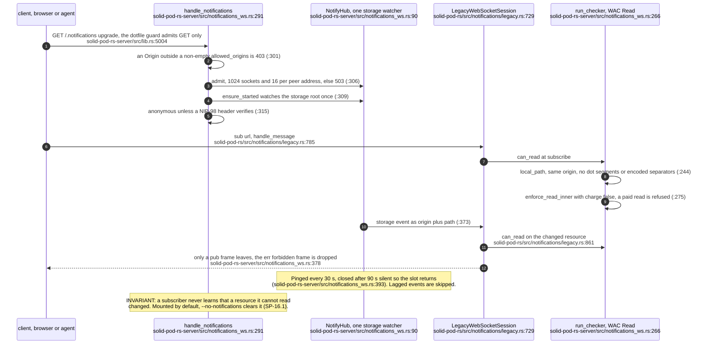

Split from SP-08 on 2026-11-23: the Solid Notifications surface (formerly SP-08.1 to SP-08.4, SP-08.17, SP-08.19 and SP-08.23). ActivityPub and the relay stay in SP-08. Old panel IDs resolve through the `aliases:` map above; the stamp is SP-08's, and the panels were not re-read.

## SP-16.1 Solid Notifications 0.2 — the three channels

**What it shows.** The core crate defines two Notifications 0.2 channel managers, the legacy `solid-0.1` adapter and the discovery document. They are library types: `solid-pod-rs-server` instantiates none of them; its `/.notifications` route runs the legacy session instead (SP-16.6).

**Why it is this way.** The crate owns protocol and leaves routing to the embedder (the same line SP-16.5 draws). Since SP-PAR-279 the reference server advertises only the channel it serves.

**Tension:** RESOLVED at a28a748 (SP-PAR-279). `/.notifications` is now a mounted `solid-0.1` WebSocket (`solid-pod-rs-server/src/lib.rs:6527`), and `Updates-Via` is sent only when it is mounted (`solid-pod-rs-server/src/lib.rs:1793`). No route serves the Notifications 0.2 managers.

**Drift:** the subscription cap note in earlier readings implied the delivering channels were bounded. Only `InMemoryNotifications` is capped, and it delivers nothing.

## SP-16.2 WebSocket notification pump

**Drift:** the doc comment on `pump_from_storage` says each event goes to clients "whose subscription topic covers the event path" (`solid-pod-rs/src/notifications/mod.rs:314`); the body sends every event to the one broadcast channel (`solid-pod-rs/src/notifications/mod.rs:323`). Topic filtering and any WAC check are left to the transport that reads the receiver.

## SP-16.3 Webhook delivery — signing, retry and the circuit breaker

**Tension:** the breaker is one counter per manager, not per target. Any 2xx or 410 from any subscriber's target resets it (`solid-pod-rs/src/notifications/mod.rs:618`, `solid-pod-rs/src/notifications/mod.rs:624`), so one dead endpoint among healthy ones rarely trips it. It opens after ten consecutive exhausted deliveries across the whole manager with no success in between (a correlated outage, or a dead sole subscriber). Once open it is permanent until an operator calls `reset_circuit`, because the open check at `solid-pod-rs/src/notifications/mod.rs:602` runs before any send, and it then blocks every subscriber. A per-URL breaker, or a half-open timer, would bound both effects.

**Drift:** the struct comment says the circuit stays open "until a successful delivery resets the counter" (`solid-pod-rs/src/notifications/mod.rs:380`); while it is open no delivery is attempted, so that cannot happen. `with_max_attempts` says "Default 5" (`solid-pod-rs/src/notifications/mod.rs:446`); the constructor sets `max_retries: 3`, four attempts (`solid-pod-rs/src/notifications/mod.rs:421`).

## SP-16.4 The two legacy `solid-0.1` adapters

**What it shows.** The module holds two independent adapters. `LegacyNotificationChannel` authorises once, at `sub`, through a synchronous `SubscriptionAuthorizer`. `LegacyWebSocketSession` checks an asynchronous `LegacyWacRead` at `sub` and again on every change, and tells a revoked reader `forbidden`.

**Tension:** the library driver (SP-16.5) still wraps the channel, not the session, so a consumer that wires the driver never re-checks access after `ack`. The reference server no longer does: its `/.notifications` route builds `LegacyWebSocketSession` (`solid-pod-rs-server/src/notifications_ws.rs:331`) and re-checks Read on every change (SP-16.6). The driver path remains open.

## SP-16.5 The legacy `solid-0.1` driver — the crate mounts nothing

**Open:** `matches_subscription` compares the stored subscription string with the storage event's path as-is (`solid-pod-rs/src/notifications/legacy.rs:393`, called at `solid-pod-rs/src/handlers/legacy_notifications.rs:211`). A client subscribes with an absolute URL, and the origin check expects one; whether a `pub` line is ever emitted therefore depends on the form of path the consumer's storage events carry. The driver does not normalise either side. Only a running consumer can show which.

## SP-16.6 `/.notifications` in the reference server — Read checked per subscription and per delivery

The route wires the session that re-checks access, not the library driver of SP-16.5. With `allowed_origins` empty any browser origin may connect, which is safe only while NIP-98 is the sole credential (`solid-pod-rs-server/src/notifications_ws.rs:44`).

## SP-16.7 The change-notification envelope

```mermaid
classDiagram
    class StorageEvent {
        Created, Updated or Deleted, each carrying a path  solid-pod-rs/src/notifications/mod.rs:91-93
    }
    class ChangeNotification {
        +context, serialised as @context  solid-pod-rs/src/notifications/mod.rs:78
        +id  solid-pod-rs/src/notifications/mod.rs:80
        +kind, serialised as type  solid-pod-rs/src/notifications/mod.rs:81
        +object  solid-pod-rs/src/notifications/mod.rs:83
        +published  solid-pod-rs/src/notifications/mod.rs:84
        +from_storage_event(event, pod_base)  solid-pod-rs/src/notifications/mod.rs:89
    }
    class as_ns {
        CONTEXT activitystreams  solid-pod-rs/src/notifications/mod.rs:46
        CREATE, UPDATE, DELETE  solid-pod-rs/src/notifications/mod.rs:47
    }
    class WebSocketChannelManager {
        +stream, a broadcast Receiver of ChangeNotification  solid-pod-rs/src/notifications/mod.rs:303
    }
    class WebhookChannelManager {
        -send_once, POST of serde_json bytes  solid-pod-rs/src/notifications/mod.rs:549-554
    }
    StorageEvent ..> ChangeNotification : mapped by from_storage_event
    as_ns ..> ChangeNotification : supplies context and type
    ChangeNotification ..> WebSocketChannelManager : broadcast as the typed value
    ChangeNotification ..> WebhookChannelManager : serialised per delivery
    note for ChangeNotification "Created maps to Create, Updated to Update, Deleted to Delete\n(solid-pod-rs/src/notifications/mod.rs:91).\nobject is pod_base without its trailing slash plus the path (:95),\nid is urn:uuid with a fresh v4 (:98), published is RFC 3339 now (:100).\nOne id per event: the webhook retry loop resends the same note (:611),\nso a receiver can de-duplicate retries by id."
    note for WebhookChannelManager "Content-Type application/ld+json\n(solid-pod-rs/src/notifications/mod.rs:561); the same bytes are what\nwebhook-signing signs when a signer is configured (SP-16.3)."
```

- **What it shows:** the one payload both Notifications 0.2 managers carry, an Activity Streams 2.0 activity built from a storage event. No actor, no target and no state accompany it: a subscriber learns which resource changed and how, then reads it.
- **Why it is this way:** the shape follows the Solid Notifications 0.2 examples (`solid-pod-rs/src/notifications/mod.rs:13`). As SP-16.1 records, the reference server mounts neither manager, so this envelope reaches only an embedder that wires them.
