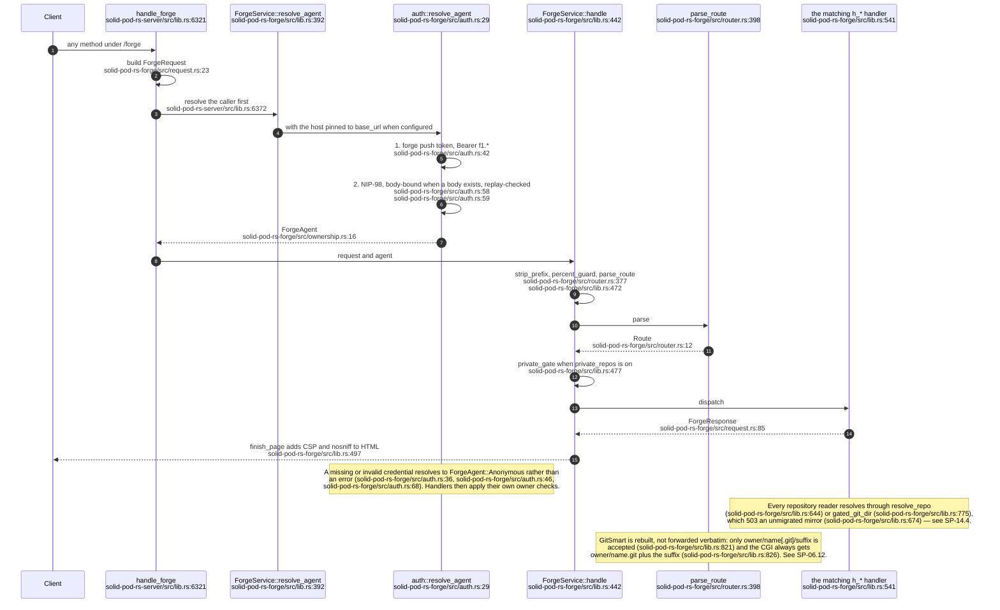
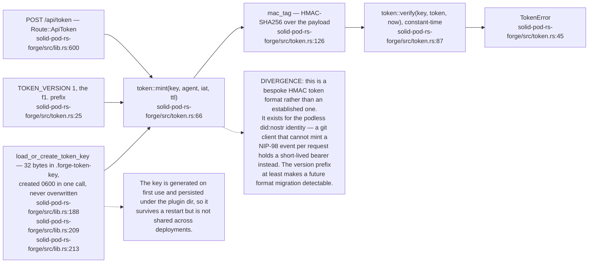
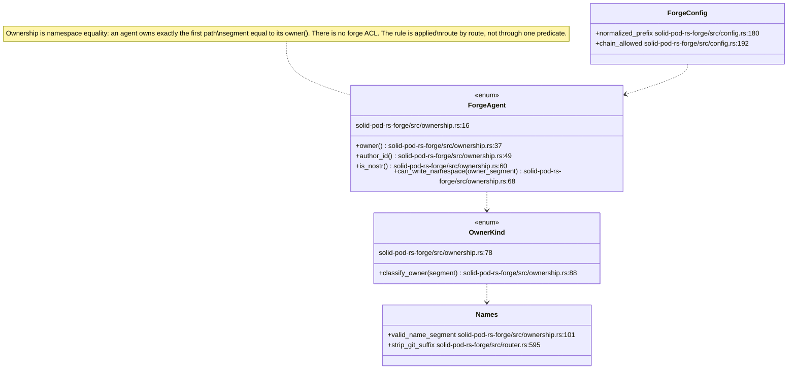
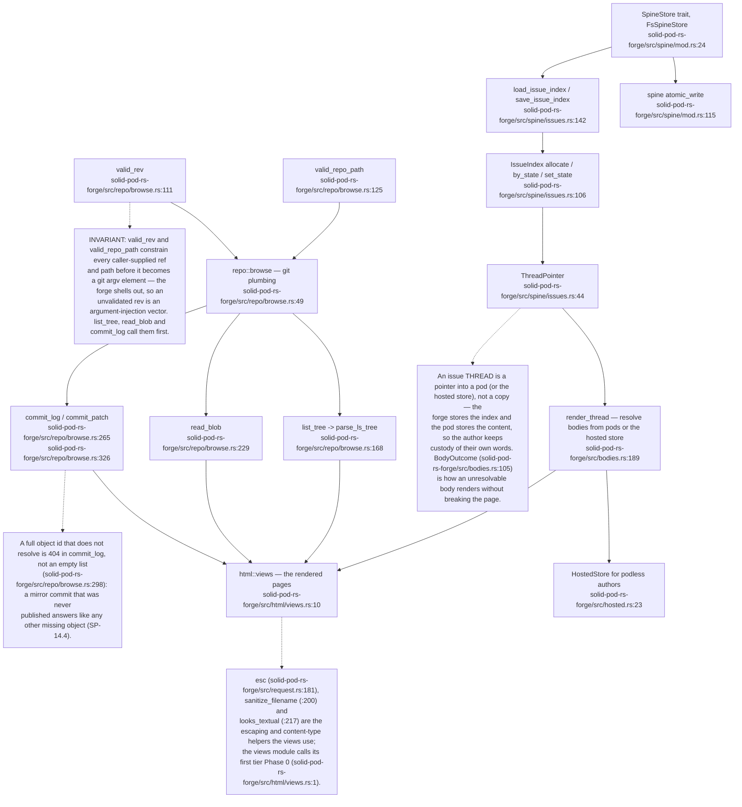
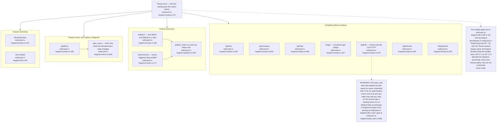
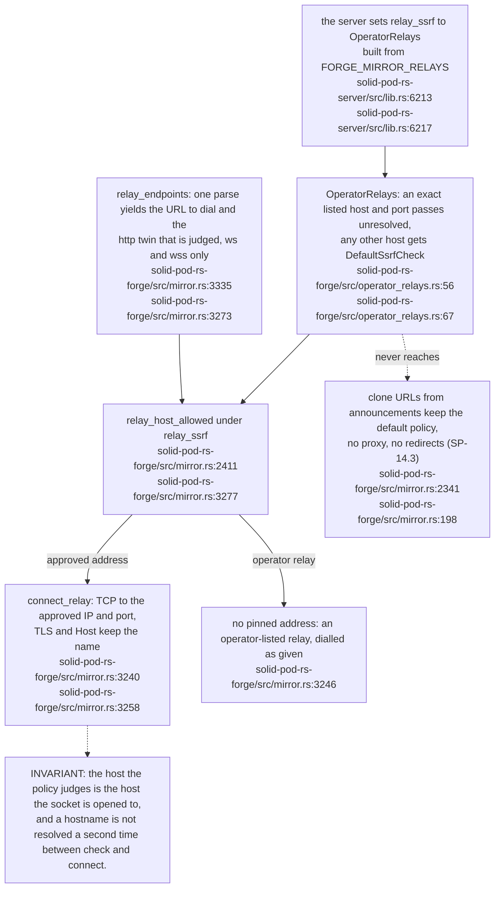
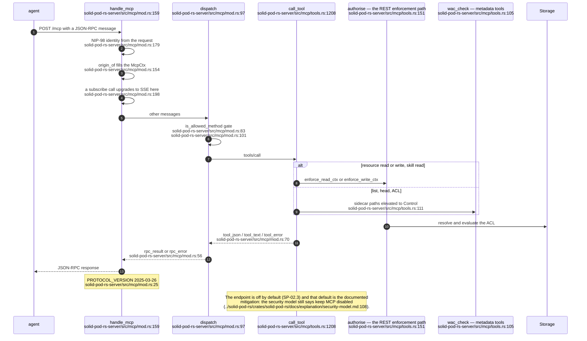
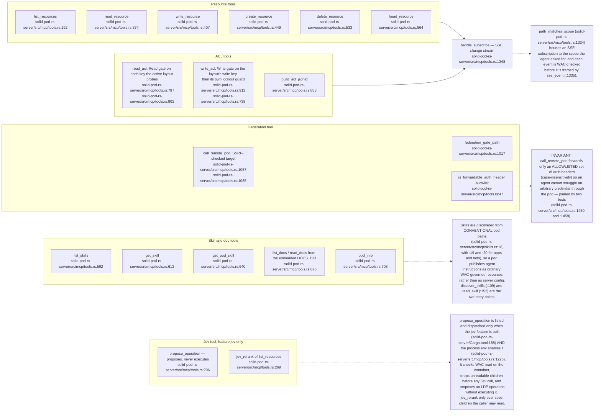

Split from SP-08 on 2026-11-23: the forge and the pod-as-MCP-tool surface (formerly SP-08.10 to SP-08.15, SP-08.18 and SP-08.22). ActivityPub, the relay and estate consumers stay in SP-08. Old panel IDs resolve through the `aliases:` map above; the stamp is SP-08's, and the panels were not re-read.

## SP-17.1 The forge — request dispatch

**Drift:** `auth.rs` numbers NIP-98 as "Scheme 3" and says scheme 2, a pod session, "is injected by the server" (`solid-pod-rs-forge/src/auth.rs:50`). The reference server never injects one: it always calls `resolve_agent`, and its own comment says a pod session "would be" injected (`solid-pod-rs-server/src/lib.rs:6371`). In this server a forge caller is a token holder, a NIP-98 signer or anonymous.

## SP-17.2 The forge push token

**Tension:** a token is "short-lived" only per token. `h_api_token` mints for any non-anonymous agent (`solid-pod-rs-forge/src/lib.rs:1488`), and a valid `f1.` bearer resolves to that agent, so a holder can renew indefinitely. There is no revocation short of replacing the key file. Requiring NIP-98 (not a bearer) to mint would bound a stolen token's life.

**Debt:** the key is two v4 UUIDs (`solid-pod-rs-forge/src/lib.rs:203`), 244 bits from the OS RNG rather than a direct 256-bit fill. RESOLVED at a28a748: it is created with `create_new` and mode `0600` in the same call (`solid-pod-rs-forge/src/lib.rs:209`, `solid-pod-rs-forge/src/lib.rs:213`), so it never exists with the umask's mode. The MAC uses the RustCrypto `hmac` crate.

## SP-17.3 The forge ownership model

**What it shows.** Owner identity is one segment: a pod username or a 64-hex nostr key. Write rights follow from equality with that segment.

**Drift:** `can_write_namespace` is not the single predicate for mutating routes. It guards smart-HTTP push (`solid-pod-rs-forge/src/lib.rs:837`) and trail ownership (`solid-pod-rs-forge/src/trail.rs:921`). Other routes compare `agent.owner()` inline (`solid-pod-rs-forge/src/api.rs:515`, `solid-pod-rs-forge/src/labels.rs:296`) and also let the author of an issue or pull request act on it in someone else's namespace (`solid-pod-rs-forge/src/api_issues.rs:165`, `solid-pod-rs-forge/src/pulls.rs:765`). Two further rules sit beside ownership: `open_edit` bypasses it for edits (SP-17.5), and any write into a mirror's served store is refused with 409 (`solid-pod-rs-forge/src/lib.rs:756`).

## SP-17.4 Forge repository browsing and the issue spine

## SP-17.5 The forge has outgrown the request-dispatch picture

**What it shows.** The forge's route table includes fork, compare, pull-request, search, web-edit and preview routes that compile unconditionally, plus NIP-34 announcement (feature `announce`), relay mirroring (feature `mirror`) and repo-held blocktrails (feature `anchoring`). Since SP-GIT-02 the `migrate` module (`solid-pod-rs-forge/src/lib.rs:69`) and the reader gate are compiled without the `mirror` feature, so a plugin directory that was mirrored once stays gated in any build (SP-14.4).

**Why it is this way.** Each optional tier is a feature gate so a plain forge adds neither relay sockets nor the Bitcoin stack. The README states announcement publication is opt-in: with no `announce_relays` nothing is sent (`../solid-pod-rs/crates/solid-pod-rs-forge/README.md:24-33`).

**Drift (ADR-2009 vs code):** ADR-2009 says the mirror is default off and "nothing in `solid-pod-rs-server` starts it" (`../solid-pod-rs/crates/solid-pod-rs/docs/adr/ADR-2009-forge-plugins-comparator-and-default-off-mirror.md:34`); the server calls `start_forge` at boot when built with `forge` (`../solid-pod-rs/crates/solid-pod-rs-server/src/main.rs:690-692`, now fatal on failure) and reads `FORGE_MIRROR_RELAYS` (`../solid-pod-rs/crates/solid-pod-rs-server/src/lib.rs:6167`). ADR-2010 supersedes the default-off clause and defines "on" as compiled in and started at boot, acting on nothing until relays and follow entries are configured (`../solid-pod-rs/crates/solid-pod-rs/docs/adr/ADR-2010-forge-and-mirror-are-on-in-shipped-builds.md:43`).

**Drift (ADR text vs the SP-GIT-02 repair):** both ADRs gained a review qualification dated 2026-11-01 (`../solid-pod-rs/crates/solid-pod-rs/docs/adr/ADR-2009-forge-plugins-comparator-and-default-off-mirror.md:75`, `../solid-pod-rs/crates/solid-pod-rs/docs/adr/ADR-2010-forge-and-mirror-are-on-in-shipped-builds.md:76`) that still treats hidden refs as the mechanism and complete object withholding as open (`../solid-pod-rs/crates/solid-pod-rs/docs/adr/ADR-2010-forge-and-mirror-are-on-in-shipped-builds.md:83`). At this revision the boundary is store isolation plus the reader gate (SP-14.3, SP-14.4), and neither ADR says so.

**Tension (ADR-2010 vs agentbox):** RESOLVED at agentbox 59b1aca as to the pin. ADR-2010 reads accepted / complete / staged (`../solid-pod-rs/crates/solid-pod-rs/docs/adr/ADR-2010-forge-and-mirror-are-on-in-shipped-builds.md:5-7`), and agentbox's pin enables `forge-full` (`../project/agentbox/lib/solid-pod-rs.nix:18`). At agentbox 59b1aca that pin is `eb22d21` (`../project/agentbox/lib/solid-pod-rs.nix:72`), the v0.5.0-alpha.24 release commit and the parent of the dependency-only a28a748 this topic is stamped at, so a build from it carries SP-16.6 to SP-17.6 as well as the hidden-tip repair and the SP-GIT-02 store isolation. The mirror stays inert while no follow entries are configured. ADR-2009 moved the same way, accepted / complete / staged (`../solid-pod-rs/crates/solid-pod-rs/docs/adr/ADR-2009-forge-plugins-comparator-and-default-off-mirror.md:5-7`).

**Open:** the forge README (`../solid-pod-rs/crates/solid-pod-rs-forge/README.md:33`) records the web-edit tier as "not included" for announce triggering, while `ApiEdit` is routed (`solid-pod-rs-forge/src/router.rs:279`); nothing states whether an edit announces.

## SP-17.6 The forge mirror dials only the relay address its SSRF check approved

The loopback allowance covers the operator's relay sockets alone (SP-MIRROR-WS-REWRITE, AW1-01); the NIP-34 publisher takes the same `OperatorRelays` for its own relay list (`solid-pod-rs-server/src/lib.rs:6238`).
## SP-17.7 The pod as an MCP tool surface

**Drift:** the security model's warning (`../solid-pod-rs/crates/solid-pod-rs/docs/explanation/security-model.md:108`, AUD-009) describes an anonymous read path and sidecar operations without Control. At the pinned revision the source has the fixes that audit asked for: resource and skill reads go through `authorise` (`solid-pod-rs-server/src/mcp/tools.rs:151`), and the metadata gate elevates sidecars to Control (`solid-pod-rs-server/src/mcp/tools.rs:111`). An earlier reading attributed the warning to the README, which no longer mentions MCP.

**Open:** whether AUD-009 is closed needs the audit's own regression tests (anonymous read, Write without Control) run against this revision. This trace shows the gate is wired, not that every tool reaches it.

## SP-17.8 The MCP tool catalogue

