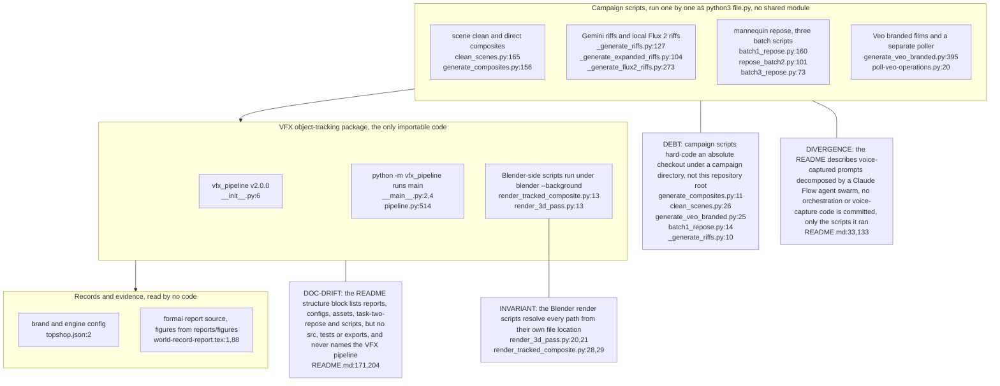
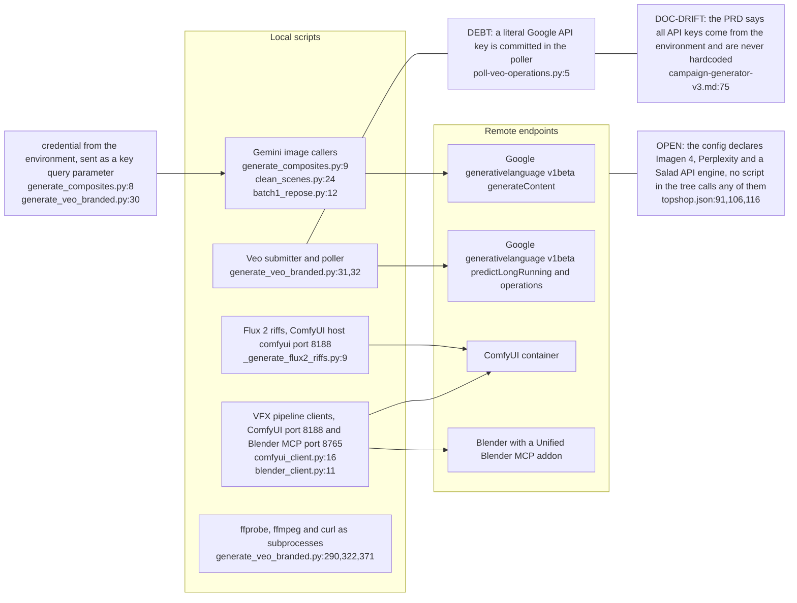
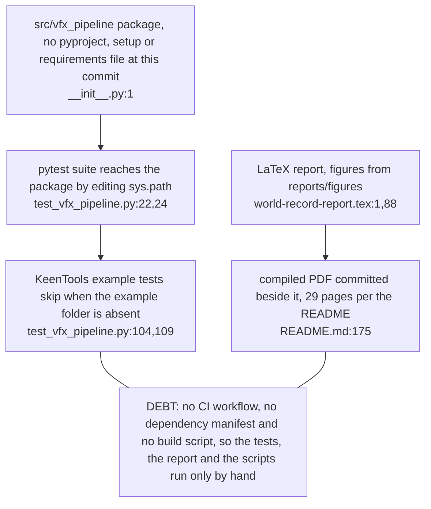

## TH-01.1 What the repository holds, and which files run

**What it shows.** Two unrelated programmes share the tree: the February 2026 campaign scripts and the March 2026 VFX tracking package; everything else is records.

## TH-01.2 External services and how each is reached

**What it shows.** Every remote call is a raw HTTP request from a script; the only credential path is `GOOGLE_API_KEY`, and one script bypasses it with a committed key.

## TH-01.3 Build, test and release path

**What it shows.** Nothing builds, tests or publishes automatically; the committed PDF and media are the release.
