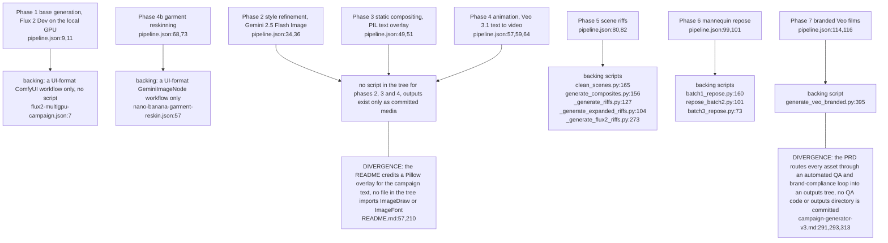
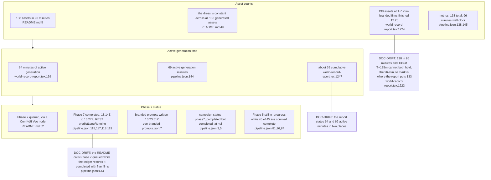
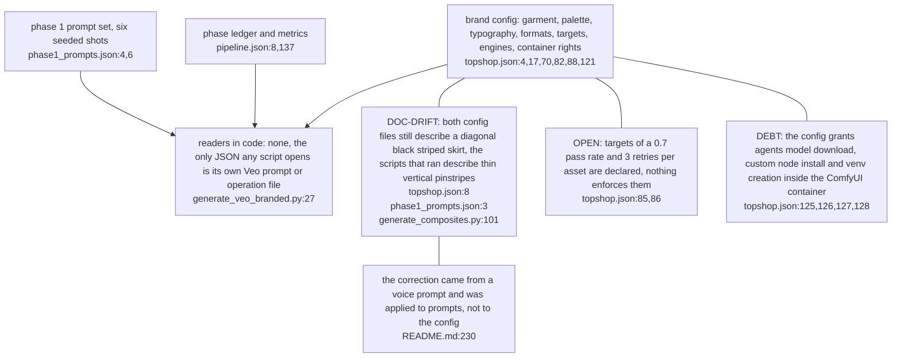

## TH-02.1 Each recorded phase and what in the tree produced it

**What it shows.** Only phases 5 to 7 have runnable code; phases 1 to 4b are a status record, workflow JSON and the media they produced.

## TH-02.2 Counts, timings and statuses that disagree

**What it shows.** The record carries two totals (133 and 138), two active-time figures and two completion times for the same run.

## TH-02.3 The configuration surface and who reads it

**What it shows.** The config files are descriptions written for agents, not inputs to the scripts, so they drifted from what actually ran.
